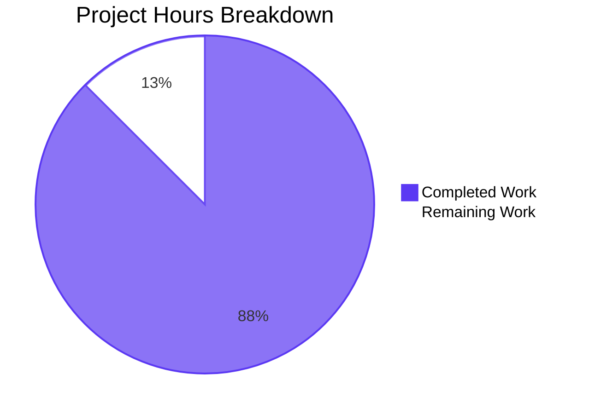

# 1. Executive Summary

## 1.1 Project Overview

This repository is a polyglot "Hello, World!" sample set: six single-file programs — Go, PHP and Ruby at the root, Java, JavaScript and Python inside the `submodule_repo_child_level_1` submodule. This change gave each program one behaviour-summary comment line immediately above the construct that carries its behaviour, and authored `README.md` to state the project name, that no install step exists, and the run command for each sample. The reader is anyone who opens the repository: the README is the entry point, the six samples are the runnable examples. No dependency, manifest, test, build target or service was introduced, and no executable statement changed.

## 1.2 Completion Status

14.0 hours of work are complete of 16.0, with 2.0 hours remaining: **87.5% complete** (14.0 ÷ 16.0). Completed work is dark blue (#5B39F3); remaining work is white (#FFFFFF).



| Metric | Hours |
| --- | --- |
| Total Hours | 16.0 |
| Completed Hours (AI + Manual) | 14.0 (14.0 autonomous, 0 manual) |
| Remaining Hours | 2.0 |

## 1.3 Key Accomplishments

- One behaviour-summary comment line sits immediately above the entry construct in each of the six program files.
- The sentence is identical in all six, written in each language's own comment syntax.
- `README.md` carries the project name, the install answer and the six run commands in ten lines.
- Every documented command runs from the repository root and prints exactly `Hello, World!`.
- Five files changed by exactly one added line; only `hello.php` was re-shaped, its statement untouched.
- Every executable statement is byte-identical to its pre-change revision, so no behaviour moved.
- The submodule edits are committed in the submodule repository and recorded by the superproject gitlink.
- The repository still holds no dependency, manifest, lockfile, test, linter or CI configuration.

## 1.4 Critical Unresolved Issues

Three items remain open against the seven file deliverables this work was scoped to: **3 of 7**.

| Issue | Impact | Owner | ETA |
| --- | --- | --- | --- |
| The run instructions do not state the submodule-initialisation precondition (`README.md:8-10`) | Three of the six documented commands fail in a plain clone until `git submodule update --init --recursive` is run | Repository owner | 1 day |
| Gitlink resolution from the default branch is unverified — `main` still points at the pre-change base | A consumer cloning the default branch before the submodule branch lands gets an empty `submodule_repo_child_level_1`; the delivered branch itself resolves and runs | Release engineer | 1 day |
| `README.md` is mode 0600 in the handover checkout where its siblings are 0644 | A non-root reader of that checkout cannot open the README; clones are unaffected, since git records 100644 | Whoever hands over the checkout | Immediate |

## 1.5 Access Issues

No access issues identified. Every runtime the samples need is on the host `PATH`, no credential or third-party API is involved at run time, and the repository's only external resource — the public submodule remote declared in `.gitmodules` — is reachable.

## 1.6 Recommended Next Steps

1. [High] Land the change, then confirm that a recursive clone of the default branch resolves the gitlink and runs all six commands.
2. [Medium] Decide whether the run instructions should state the submodule-initialisation precondition.
3. [Low] Assert 0644 on the in-scope files in the handover checkout so a non-root reader can open `README.md`.
4. [Medium] Add a pipeline job that runs the six documented commands, so future drift is caught automatically.
5. [Low] Leave `hello.go`'s four-space indentation as it is; a formatting pass would create an unrelated diff.

# 2. Project Hours Breakdown

## 2.1 Completed Work Detail

| Component | Hours | Description |
| --- | --- | --- |
| Root sample behaviour comments | 3.0 | One summary comment line above the entry construct in `hello.go`, `hello.php` and `hello.rb`; the PHP opener moved onto its own line with the statement text, semicolon and indentation unchanged; every other byte preserved (AAP §0.1.2–§0.1.4, §0.3.1, §0.4.2, §0.5.3) |
| Submodule sample behaviour comments | 3.0 | The same comment line above the entry construct in `submodule_repo_child_level_1/hello.java`, `hello.js` and `hello.py`, committed inside the submodule repository (AAP §0.1.5) |
| Repository README | 1.5 | `README.md` authored to its specified ten-line text: the project name, the install answer, and the six run commands in one indented block (AAP §0.4.1, §0.5.1, §0.5.2) |
| Minimal-diff and byte-preservation conformance | 1.5 | Five files changed by exactly one added line and `hello.php` from one line to three; byte preservation proved by diffing each file against its pre-change revision with the inserted line removed, and by running both revisions (AAP §0.1.2, §0.1.3, §0.9) |
| Closed-set and absence verification | 1.0 | No manifest, lockfile, test suite, test file, CI workflow, linter configuration, documentation tree, diagram, badge, handler, error path, environment-variable configuration or hardening exists in either tree (AAP §0.2.1, §0.6, §0.7, §0.8) |
| Submodule carriage | 1.5 | The three submodule edits committed as `58d45eb` and recorded by the superproject gitlink at mode 160000; resolution proved by cloning the delivered branch recursively and running all six commands (AAP §0.1.5, §0.4.2) |
| Whole-package gate and per-language checks | 1.5 | The six documented commands run from the repository root, plus each language's parse or compile check: `go build`, `go vet`, `gofmt`, `php -l`, `ruby -c`, `node --check`, `py_compile` (AAP §0.9) |
| Runtime verification of the documented commands | 1.0 | Byte-level stdout, exit status and stderr for all six; load-time paths; missing-path and wrong-directory failure modes; idempotent repeats; non-root re-runs (AAP §0.2.3, §0.9) |
| README claim verification | 1.0 | The install answer checked by enumeration of both trees, and each printed command matched to the file and entry construct it names in both directions (AAP §0.2.3, §0.4.1) |
| **Total** | **14.0** | |

## 2.2 Remaining Work Detail

| Category | Hours | Priority |
| --- | --- | --- |
| [Path to production] Verify gitlink resolution from the default branch once the change lands upstream — the delivered branch resolves it; `main` still points at the pre-change base | 0.5 | High |
| [Path to production] Decide whether the run instructions state the submodule-initialisation precondition the three submodule commands need in a plain clone, and reopen the text deliberately if so | 1.0 | Medium |
| [Path to production] Assert 0644 on the in-scope files in the handover checkout, where `README.md` is 0600 while git records 100644 | 0.5 | Low |
| **Total** | **2.0** | |

## 2.3 Hours Basis and Cross-Checks

Total project hours are 16.0, the sum of 14.0 completed and 2.0 remaining, and the completion figure is 14.0 ÷ 16.0 = **87.5%**. Only work this change scoped — the six behaviour comments, the authored `README.md`, the constraints the request placed on the diff, and the submodule delivery that carries the three submodule edits — plus the path-to-production steps above are counted. Completed hours cover producing and verifying each artefact, with verification counted at roughly a third of that effort, since every file's content is fixed byte-for-byte and every claim was checked by running the programs. The remaining hours cover no deliverable: all seven files the work was scoped to are present, byte-exact and verified, so the residual work is a post-merge resolution check, one decision about the run instructions, and a file-mode assertion at handover. Recommendations that fall outside this change's closed file set, such as adding an automated gate, carry no hours here and appear in Section 8 instead.

# 3. Test Results

Every case below was executed against the delivered tree, and the six-command gate was re-run on it directly. The counts are the executed cases per area; the repository has no coverage tool, so no coverage figure exists to report.

| Area / Category | Framework | Tests | Passed | Failed | Coverage | What This Proves |
| --- | --- | --- | --- | --- | --- | --- |
| Documented run commands (the repository's whole-project gate) | Bash, from the repository root | 6 | 6 | 0 | n/a — no coverage tool exists | All six commands run verbatim from the README's block and print exactly `Hello, World!`, php without a trailing newline, each exit 0 with empty stderr |
| Go · PHP · Ruby samples — runtime behaviour | Language runtimes + shell harness | 105 | 105 | 0 | n/a | Direct runs, load-time paths, strict diagnostic modes, missing paths, locales, concurrency and repeats all behave, and no run creates an artefact |
| Java · JavaScript · Python samples — runtime behaviour | Language runtimes + shell harness | 63 | 63 | 0 | n/a | The launcher, `require` and import paths run; the documented Java form is the only working one; no `.class` or bytecode is left behind |
| All six samples — pre-change versus delivered differential | Language runtimes | 103 | 103 | 0 | n/a | The pre-change and delivered revisions print byte-identical output, so no executable behaviour moved |
| README claims and the printed command set | Bash + language runtimes | 37 | 37 | 0 | n/a | Each printed command resolves to the entry construct it names with the right interpreter, and the install answer holds in a clean shell |
| Whole-project acceptance — sample behaviour | Language runtimes + shell harness | 223 | 223 | 0 | n/a | Every sample prints the literal, exits 0, writes nothing to stderr and leaves both trees unchanged across every variant tested |
| Whole-project acceptance — documented commands and install answer | Bash + language runtimes | 271 | 271 | 0 | n/a | The command block works as printed across shell dialects, locales, piped input, 24 concurrent processes, a clean shell and a fresh clone |
| Parsing and compilation, six languages | `go build`/`go vet`/`gofmt`, `php -l`, `ruby -c`, `node --check`, `py_compile`, `javac` | 6 | 6 | 0 | n/a | Every file parses in its own language, and the one documented Java compile constraint reproduces exactly |

**Not Covered**

- No automated test framework, CI workflow, linter, formatter or coverage tool exists in either tree, so none of the checks above re-runs on a future change. The six documented commands are the only executable gate, and anyone who edits a sample or the command block has to run them by hand.
- Nothing rendered, served or stored exists in this repository — no screen, page, HTTP endpoint, database, queue or scheduled job — so no UI, API-contract, schema or browser check applies, and none was performed.
- Fresh-clone and submodule-initialisation behaviour was exercised by hand only: a clone made without submodules leaves `submodule_repo_child_level_1` empty and the three submodule commands fail until `git submodule update --init --recursive` is run. Before release, confirm that path once on the branch you actually ship.
- The load-time inclusion paths (`include`, `require`, `load`, and importing `hello.py`) were exercised by hand and are covered by nothing committed, so a future edit that makes a statement run only when its file is executed directly would go unnoticed. Before release, run the three submodule commands and one direct run of each sample.
- The six host runtimes are neither pinned nor checked: a runtime that changed how `echo`, `puts`, `console.log`, `print` or `println` terminate a line would invalidate the documented output silently, and no test would catch it.
- Nothing verifies file modes in the checkout, so a checkout can carry an in-scope file a non-root reader cannot open. Before releasing a workspace copy, confirm the files are readable by every user who needs them.

# 4. Runtime Validation &amp; UI Verification

The project has no server, daemon, database, port or rendered surface: its runtime is six single-file programs invoked from the repository root, and every check below is a command, its exit status and its bytes.

- ✅ **Go sample** — `go run hello.go` prints `Hello, World!` (14 bytes with newline) and exits 0 with empty stderr; the binary built by `go build` prints the same, and `go vet` is clean.
- ✅ **PHP sample** — `php hello.php` prints the literal (13 bytes, no trailing newline) and exits 0; the relocated `<?php` opener emits nothing, and `include`-ing the file prints the same bytes.
- ✅ **Ruby sample** — `ruby hello.rb` prints 14 bytes and exits 0 with no warning under `-w`; the top-level statement also executes when the file is required.
- ✅ **Java sample** — `java submodule_repo_child_level_1/hello.java` runs through the single-file source launcher with 14 bytes and exit 0, leaving no `.class` beside the source.
- ✅ **JavaScript sample** — `node submodule_repo_child_level_1/hello.js` prints 14 bytes and exits 0, and evaluates at load when required.
- ✅ **Python sample** — `python3 submodule_repo_child_level_1/hello.py` prints 14 bytes and exits 0, and executes on import; with the bytecode cache redirected, nothing is written into the checkout.
- ✅ **Install claim** — all six commands run with nothing installed, in a stripped shell and with no network reachable, so the README's install answer holds at runtime.
- ✅ **Published-branch delivery** — a recursive clone of the delivered branch materialises all three submodule files with their comments and runs all six commands with exit 0 and exact output.
- ⚠ **Fresh clone without submodule initialisation** — three of the six documented commands fail visibly (node module-not-found exit 1, `python3` `[Errno 2]` exit 2, java class-not-found exit 1) until `git submodule update --init --recursive` is run; the condition is undocumented by design in the frozen run instructions.
- ⚠ **Non-root reader of the handover checkout** — the six program files are 0644 and readable, while `README.md` is 0600 there; the committed mode is 100644, so clones materialise 0644.

Never exercised at runtime, because no such surface exists anywhere in this repository: any browser or rendered screen, any HTTP endpoint or served asset, any database or stored schema, any authentication, session or token flow, and any container, message queue or scheduled job. Nothing in the change introduced one, and none could be driven.

# 5. Compliance & Quality Review

## 5.1 Compliance Matrix

| Deliverable | Benchmark | Verified Status | Progress |
| --- | --- | --- | --- |
| Behaviour comment immediately above the entry construct, all six program files | AAP requirement fidelity (§0.1.2, §0.3.1) | ✅ PASS | 100% |
| Comment written in each language's own comment syntax | Language correctness (§0.1.3) | ✅ PASS | 100% |
| Single summary line — no tags, no multi-line description, no example | Documentation standard (§0.1.2) | ✅ PASS | 100% |
| Minimal diff and byte preservation of every existing statement | Diff hygiene (§0.1.2, §0.1.3, §0.9) | ✅ PASS | 100% |
| `README.md` authored to its specified ten-line text | Requirement fidelity (§0.4.1) | ✅ PASS | 100% |
| README carries only the three permitted items, under fifteen lines | Scope discipline (§0.1.3, §0.8) | ✅ PASS | 100% |
| Install answer accurate — no manifest or lockfile in either tree | Claim accuracy (§0.2.3, §0.6) | ✅ PASS | 100% |
| Six run commands accurate, root-relative, Java through the source launcher | Claim accuracy and runtime (§0.2.3, §0.9) | ✅ PASS | 100% |
| Closed deliverable set — no extra file, no excluded artefact | Scope discipline (§0.7, §0.8) | ✅ PASS | 100% |
| Submodule edits committed in the submodule and recorded by the gitlink | Delivery integrity (§0.1.5, §0.4.2) | ✅ PASS | 100% |
| No dependency, manifest, lockfile, documentation tooling or test added | Dependency hygiene (§0.6, §0.5.4) | ✅ PASS | 100% |
| No secret, credential, network call, input path or injection surface introduced | Security baseline | ✅ PASS | 100% |

## 5.2 AAP & Rule Divergences and Gaps

| # | What the AAP/Rule Required | What Was Delivered Instead | Why It Diverged | Impact | Remediation |
| --- | --- | --- | --- | --- | --- |
| D1 | One `/** ... */` summary line in every program file (§0.1.2, §0.4.2) | `hello.rb:1` and `submodule_repo_child_level_1/hello.py:1` carry the identical sentence as `#` comments | Sanctioned: the plan itself resolved the syntax conflict (§0.1.3) in favour of the no-logic-change constraint, because the block form is not a comment in Ruby or Python | None — both files parse, run and print the literal | None required |
| D2 | Per-file illustrations show a blank line between the comment and the statement in `hello.rb` and `hello.py` (§0.4.2) | Both files carry the comment directly above the statement, with no blank line | The plan's one-added-line and no-altered-blank-line clauses (§0.1.2, §0.3.1) and the request's "immediately above" wording outrank the illustration | None — behaviour identical | None required |
| D3 | The submodule pointer is quoted as `0664094` (§0.1.5, §0.4.2) | The superproject gitlink records `58d45eb`, the commit carrying the three comment lines | The operative requirement is that the superproject record the gitlink resulting from the submodule commit; mode 160000 and the path are unchanged | None — the gitlink resolves and the three files run | None required |
| D4 | `System.out.println` in `hello.java` is described as four-space indented (§0.1.3) | The statement keeps its pre-existing eight-space indent; the four-space indent belongs to the comment above `main` at `hello.java:2` | Byte preservation and the smallest-diff constraint (§0.1.3, §0.9) govern, and §0.4.2 fixes the comment at the method's own indent | None — the file is byte-identical to its baseline apart from the comment | None required |
| D5 | `README.md` fixed at its ten-line text; the file previously ended without a terminator | Line 1 is the same title text with a line terminator added | The acceptance text has content after line 1, which cannot exist under an unterminated first line | None — line 1's text is unchanged | None required |
| D6 | The run commands are the reader's entire instruction for running the samples (§0.4.1, §0.9) | The three submodule commands need `git submodule update --init --recursive` on a plain clone, and the text does not say so | Accepted with that caveat: the remedy is an added line, and the text is fixed to the project name, the install answer and the run commands (§0.1.2, §0.4.1, §0.8) | Three of six commands fail visibly in a plain clone until initialised | Reopen the text deliberately, or accept the caveat (1.0 h, Section 2.2) |
| D7 | The plan records the environment it measured: Go 1.22.2, PHP 8.3.6, Ruby 3.2.3, Node.js v22.23.3, Python 3.12.3, OpenJDK 17.0.20.1 (§0.2.3) | The change was built and verified on Go 1.24.4, PHP 8.4.11, Ruby 3.3.8, Node.js v22.23.4, Python 3.13.7, OpenJDK 17.0.19 | The record was taken from a different host and was not refreshed; no delivered value carries a version number | None on the delivered files; any future gate must use the installed versions | None required — use the installed versions |

**D1 — Ruby and Python carry `#` comments rather than the requested block form.** The request asked for one `/** ... */` summary line in every file; `hello.rb:1` and `submodule_repo_child_level_1/hello.py:1` instead carry the identical sentence as `# Prints "Hello, World!" to standard output.`. The plan resolved this itself: where a language defines no block comment, the constraint that no line changes semantically governs, and the wording stays byte-identical. The consequence is not theoretical — the block form makes Ruby exit 1 with `SyntaxError: target of repeat operator is not specified`, and Python exit 1 with a `SyntaxError` on line 1. Nothing needs deciding: the delivered files are the only valid rendering of that sentence in those languages.

**D2 — no blank line separates the comment from the statement in `hello.rb` and `hello.py`.** The plan's per-file illustrations render a blank line between comment and statement for these two files; both delivered files, two lines each, carry the comment directly above it. The plan's own constraint that five of the six files change by exactly one added line, and its reservation of any line-structure change to `hello.php`, outrank an illustration, and the request asked for the comment immediately above the handler. A later editor reconciling these files against the illustration would add a blank line and breach that constraint, so the absence is deliberate. No action is needed.

**D3 — the recorded submodule pointer is not the delivered one.** The plan quotes the pre-change state as `0664094`, and the superproject now records gitlink `160000 @ 58d45eb` on `submodule_repo_child_level_1`. That is the required consequence of the plan's operative instruction: the three submodule edits are committed inside the submodule repository first, and the parent then records the resulting gitlink so the comment lines reach the user. `58d45eb` is precisely the commit that carries those three insertions, and the path and mode `160000` are unchanged. Cloning the delivered branch recursively materialises the three annotated files and runs all six commands. Nothing to change.

**D4 — the Java statement is eight-space indented, not four.** The plan's parenthetical describes `System.out.println` in `submodule_repo_child_level_1/hello.java` as four-space indented; the file, before and after the change, indents it by eight spaces, while the four-space indent belongs to `public static void main` — and the plan separately requires the comment to sit at that method's indent, which `hello.java:2` does. Preserving existing text byte-for-byte and keeping the diff to one added line both outrank the parenthetical description, and the file is otherwise byte-identical to its baseline. Re-indenting to match the description would have broken both requirements. No action required.

**D5 — `README.md` line 1 now ends with a newline.** The file previously held a single unterminated title line; after the change, line 1 carries that same text terminated by a newline, and nine further lines follow. This is the only byte-level difference in the file that is not new content, and it is unavoidable: the required ten-line text has content after line 1, which cannot exist while line 1 is unterminated. The line's text is byte-identical to what the file already held, and the commit that authored the file (`bc6ffcd`) is where the terminator appears. A later editor should not "restore" the missing terminator.

**D6 — the run instructions omit the precondition three of the commands need.** `README.md:8-10` gives the three submodule commands, and a plain clone leaves `submodule_repo_child_level_1` empty, so those commands fail until the submodule is initialised: node exits 1 with a module-not-found error, `python3` exits 2 with `[Errno 2] No such file or directory`, and java exits 1 with a class-not-found error, while the three superproject commands pass. This is accepted with that caveat rather than fixed, because the remedy is an added instruction and the text is fixed to three items. The decision is yours: keep the text, or reopen it and add the initialisation step (1.0 h).

**D7 — the plan's environment record does not match the environment used.** The plan records Go 1.22.2, PHP 8.3.6, Ruby 3.2.3, Node.js v22.23.3, Python 3.12.3 and OpenJDK 17.0.20.1; the change was built and verified on Go 1.24.4, PHP 8.4.11, Ruby 3.3.8, Node.js v22.23.4, Python 3.13.7 and OpenJDK 17.0.19. The plan's figures were measured on a different host and were not refreshed, and no delivered file states a version, so nothing in the tree diverges — every sample behaves identically under both sets. The practical consequence is for automation: any future gate must assert against the versions actually installed, not the plan's record. No action is required.

# 6. Risk Assessment

| Risk | Category | Severity | Probability | Mitigation | Status |
| --- | --- | --- | --- | --- | --- |
| A consumer cloning the default branch before the submodule branch lands cannot resolve the gitlink, so the three submodule samples are absent | Integration | High | Medium | Land the submodule branch with this change, then confirm a recursive clone of the default branch resolves `58d45eb` and runs all six commands | Open — 0.5 h |
| The run instructions omit the submodule-initialisation precondition, so a plain clone yields three visible command failures | Operational | Medium | High | Reopen the run instructions deliberately and state the initialisation step, or accept the caveat in writing | Open — 1.0 h |
| No test framework, CI workflow, linter or coverage tool exists, so a future edit to a sample or to the command block is caught only by manual execution | Technical | Medium | Medium | Add a pipeline job that runs the six documented commands and asserts the exact output and exit status | Open — outside this change's closed file set |
| Six host runtimes are neither pinned nor checked, and the README states no versions; a runtime that changes line termination would silently invalidate the documented output | Operational | Medium | Low | Record the required versions if the text is ever reopened, and assert them in the pipeline job | Open |
| `hello.go` is not `gofmt`-conformant by design, so a formatting pass produces an unrelated diff and any `gofmt` gate fails | Technical | Low | High | Keep the byte-preservation intent recorded so a later formatter run is a deliberate decision, not an accident | Accepted |
| Working-tree file modes vary with the process that writes the files — `README.md` is 0600 in the handover checkout while its siblings are 0644 | Operational | Low | Medium | Assert 0644 on the in-scope files after generation, or make the check a step in the release checklist | Open — 0.5 h |
| The Java sample cannot be compiled by file name (`public class Hello` in `hello.java`), so any future tool or IDE that compiles by name fails on it | Technical | Low | Medium | Keep the documented single-file source launcher as the only Java invocation; rename the file in a dedicated change if that constraint ever needs lifting | Accepted — pre-existing |
| The submodule is fetched from a public remote and pinned only by the recorded commit; no lockfile or dependency scanner verifies it | Security | Low | Low | Keep the gitlink pinned to an exact commit on every future submodule update, and treat the remote as untrusted input when it next changes | Accepted |

No other forward-looking exposure was identified. The change introduces no secret, credential, network call, input path, error path or third-party dependency, and the files it touches contain only the fixed literal `Hello, World!`, so the security surface is unchanged from the pre-change state.

# 7. Visual Project Status

**Completed versus remaining work** — 14.0 hours complete of 16.0 total, leaving 2.0 hours outstanding: 87.5%. Completed work is shown in dark blue (#5B39F3) and remaining work in white (#FFFFFF).


**Remaining work by priority**

| Priority | Category | Hours |
| --- | --- | --- |
| High | Verify gitlink resolution from the default branch after the change lands | 0.5 |
| Medium | Decide whether the run instructions state the submodule-initialisation precondition | 1.0 |
| Low | Assert 0644 on the in-scope files in the handover checkout | 0.5 |
| — | **Total** | **2.0** |

# 8. Summary &amp; Recommendations

This project delivered a documentation change and verified it end to end: seven files — six program files, each carrying one behaviour-summary comment line immediately above the construct that holds its behaviour, and an authored `README.md` stating the project name, that no install step is required, and the run command for each sample. Each comment is the same sentence, written in its own language's comment syntax, and every executable statement is byte-identical to its pre-change revision, so no behaviour moved. The repository's whole-project gate passes with the exact expected output: all six documented commands run from the repository root and print precisely `Hello, World!`, php without a trailing newline, each exiting 0 with empty stderr. The three submodule edits travel correctly through the submodule commit and the recorded gitlink, proved by cloning the delivered branch recursively and running all six commands from the clone.

**87.5% of the work is complete** — 14.0 hours of 16.0, with 2.0 hours remaining. Every deliverable the change was scoped to is present, byte-exact and verified; the outstanding hours are path-to-production steps, not unfinished files. Three items remain open. First, a plain clone leaves `submodule_repo_child_level_1` empty, so three of the six documented commands fail visibly until `git submodule update --init --recursive` is run, and the run instructions do not say so — a gap accepted rather than closed, because the file's text is fixed to three items (1.0 h to decide and, if you choose, document). Second, gitlink resolution has been proved from the delivered branch but not yet from the default branch, which still points at the pre-change base (0.5 h). Third, `README.md` is mode 0600 in the handover checkout while its siblings are 0644, so a non-root reader of that copy cannot open it (0.5 h to assert 0644).

The critical path to production is short: merge the change so the submodule branch carrying the three comment lines and the superproject gitlink land together, confirm one recursive clone of the default branch materialises all six samples and runs all six commands, and decide whether the initialisation precondition belongs in the run instructions. Nothing else gates release, and no code path needs to change to ship.

Production readiness for a documentation-only change means the seven deliverables exactly as specified, with no functional behaviour altered — which is the state of the tree. All six programs still hold their single statement writing the fixed literal to standard output; every added line is inert in its own language; the parse and compile gates for all six languages pass; and the documented commands resolve one-to-one to the files present. The one deliberate follow-on is mechanical protection: the repository has no test framework, CI workflow or linter, so the six documented commands are the only executable gate, and a pipeline job that runs them would catch any future drift in a sample or in the command block. Two pre-existing conditions must be left alone: `hello.go`'s four-space indentation, which the byte-preservation requirement protects, and the Java sample's class-name constraint, which is why the documented launcher form is the only working Java invocation.

# 9. Development Guide

### 9.1 System Prerequisites

- A POSIX shell (`bash` or `sh`) and `git` with submodule support.
- One runtime per sample, all six needed only if you intend to run every sample: Go 1.24.4, PHP 8.4.11, Ruby 3.3.8, Node.js v22.23.4, Python 3.13.7 and OpenJDK 17.0.19. Each must be on `PATH`. Versions are those the project was verified against; no sample uses a version-specific language feature.
- No operating-system, hardware, service, database, container or port requirement exists. Nothing is started, and nothing listens.

### 9.2 Environment Setup

There is no install step. Neither the repository root nor `submodule_repo_child_level_1` holds a manifest or lockfile — no `go.mod`, `composer.json`, `Gemfile`, `package.json`, `requirements.txt`, `pyproject.toml`, `pom.xml` or `build.gradle` — so there is no virtual environment to create, no dependency to fetch and no package command to run.

Clone the repository with its submodule so that all six samples are present:

```bash
git clone --recurse-submodules <repository-url> parent_repo_hello_world_ABK_6771
cd parent_repo_hello_world_ABK_6771
```

If you already have a clone made without submodules, initialise it in place:

```bash
git submodule update --init --recursive
```

Two environment settings keep the checkout clean while you work; neither the samples nor the README require them:

```bash
# Keep Python bytecode out of the checkout when you import the Python sample.
export PYTHONPYCACHEPREFIX="$(mktemp -d)"

# Only needed if HOME is unset: `go run` requires a writable build cache.
export GOCACHE="$(mktemp -d)"
```

### 9.3 Application Startup

Nothing has to be started — no daemon, service, database or port. Each sample is a single file run directly by its own runtime. Run these from the repository root, in any order:

```bash
go run hello.go
php hello.php
ruby hello.rb
node submodule_repo_child_level_1/hello.js
python3 submodule_repo_child_level_1/hello.py
java submodule_repo_child_level_1/hello.java
```

Every documented path is relative to the repository root, which is where the README's reader starts; running a command from another directory fails with the interpreter's own not-found message.

### 9.4 Verification Steps

Expected result for the whole set: six lines of `Hello, World!`, every command exiting 0 with empty stderr. `php hello.php` writes the literal without a trailing newline, so a combined script concatenates that output with the next sample's.

```bash
# Whole-project gate: exact output and exit status for each sample.
set -e
test "$(go run hello.go)" = "Hello, World!"
test "$(php hello.php)" = "Hello, World!"
test "$(ruby hello.rb)" = "Hello, World!"
test "$(node submodule_repo_child_level_1/hello.js)" = "Hello, World!"
test "$(python3 submodule_repo_child_level_1/hello.py)" = "Hello, World!"
test "$(java submodule_repo_child_level_1/hello.java)" = "Hello, World!"
echo "all six samples OK"
```

```bash
# Byte-level check, including php's missing trailing newline.
go run hello.go | od -c
php hello.php | od -c
```

```bash
# Parse and compile checks, one per language. Each exits 0 except the Java two-step
# compile, whose failure is expected — see Troubleshooting.
go build -o "$(mktemp -d)/hello_go" hello.go
go vet hello.go
php -l hello.php
ruby -c hello.rb
node --check submodule_repo_child_level_1/hello.js
python3 -m py_compile submodule_repo_child_level_1/hello.py
```

```bash
# The checkout should be unchanged after running any of the above.
git status --porcelain -uall
git -C submodule_repo_child_level_1 status --porcelain -uall
```

### 9.5 Example Usage

```bash
$ go run hello.go
Hello, World!
$ php hello.php
Hello, World!
$ ruby hello.rb
Hello, World!
$ node submodule_repo_child_level_1/hello.js
Hello, World!
$ python3 submodule_repo_child_level_1/hello.py
Hello, World!
$ java submodule_repo_child_level_1/hello.java
Hello, World!
```

Because each file's statement sits at load or top level, the samples also print the literal when they are loaded rather than executed directly:

```bash
php -r 'include "hello.php";'
ruby -e 'require "./hello.rb"'
node -e "require('./submodule_repo_child_level_1/hello.js')"
python3 -c "import sys; sys.path.insert(0,'submodule_repo_child_level_1'); import hello"
```

### 9.6 Troubleshooting

- **`javac submodule_repo_child_level_1/hello.java` fails** with `error: class Hello is public, should be declared in a file named Hello.java`. That is a pre-existing property of the file's name and its public class, not a defect: use the documented single-file source launcher `java submodule_repo_child_level_1/hello.java`, which compiles and runs it in one step and leaves no `.class` file behind.
- **`gofmt -l hello.go` prints `hello.go`.** The file uses a four-space indent that must be preserved byte-for-byte; no gate in this repository enforces `gofmt`, and reformatting it would create an unrelated diff.
- **Three commands fail after a plain `git clone`** — node reports a module-not-found error, `python3` reports `[Errno 2] No such file or directory`, java reports a class-not-found error. The submodule directory is empty; run `git submodule update --init --recursive`.
- **`go run ./...`, `go build ./...` or `go test ./...` fail** with a message about a missing main module. The repository has no `go.mod`; pass file arguments, as the documented command does.
- **`go run hello.go` fails with `build cache is required, but could not be located`.** The Go toolchain needs a writable build cache: set `GOCACHE` or ensure `HOME` (or `XDG_CACHE_HOME`) is defined.
- **A command fails with the interpreter's own not-found message.** Every documented path is relative to the repository root; change into the repository root before running it.
- **Running all six commands as one script merges two lines of output.** `php hello.php` writes no trailing newline; run it separately or add a newline when you compose the output.
- **`__pycache__` appears in the submodule directory.** Importing `hello.py` writes bytecode next to the source, which makes the submodule look dirty. Set `PYTHONPYCACHEPREFIX` to a directory outside the checkout (as in Environment Setup), or run the sample directly instead of importing it.

# 10. Appendices

### A. Command Reference

| Purpose | Command (from the repository root) |
| --- | --- |
| Run the Go sample | `go run hello.go` |
| Run the PHP sample | `php hello.php` |
| Run the Ruby sample | `ruby hello.rb` |
| Run the JavaScript sample | `node submodule_repo_child_level_1/hello.js` |
| Run the Python sample | `python3 submodule_repo_child_level_1/hello.py` |
| Run the Java sample (single-file launcher) | `java submodule_repo_child_level_1/hello.java` |
| Parser and compile checks | `php -l hello.php` · `ruby -c hello.rb` · `node --check submodule_repo_child_level_1/hello.js` · `python3 -m py_compile submodule_repo_child_level_1/hello.py` · `go build -o "$(mktemp -d)/hello_go" hello.go` · `go vet hello.go` |
| Check formatting of the Go sample (informational) | `gofmt -l hello.go` |
| Initialise the submodule in an existing clone | `git submodule update --init --recursive` |
| Confirm nothing was written into the tree | `git status --porcelain -uall` |

### B. Port Reference

| Service | Port | Notes |
| --- | --- | --- |
| — | None | The project binds no port and runs no server, daemon or database. Every sample is a single-file program whose only effect is a write to standard output, so nothing needs a port to develop, test or run it. |

### C. Key File Locations

| Path | Role |
| --- | --- |
| `README.md` | The repository's only documentation file: project name, install answer, six run commands |
| `hello.go` | Go sample — `func main()` with the comment on the line above it |
| `hello.php` | PHP sample — `<?php` on its own line, comment, then the unchanged `echo` statement |
| `hello.rb` | Ruby sample — `#` comment directly above the top-level `puts` |
| `submodule_repo_child_level_1/hello.java` | Java sample — comment inside `public class Hello`, above `public static void main` |
| `submodule_repo_child_level_1/hello.js` | JavaScript sample — comment above the top-level `console.log` |
| `submodule_repo_child_level_1/hello.py` | Python sample — `#` comment above the module-level `print` |
| `.gitmodules` | Declares the submodule path and remote URL; unchanged by this work and carrying no comment |
| `submodule_repo_child_level_1/.git` | Gitdir pointer file (`gitdir: ../.git/modules/submodule_repo_child_level_1`) — submodule metadata, not repository content |

### D. Technology Versions

| Runtime | Version verified |
| --- | --- |
| Go | 1.24.4 |
| PHP | 8.4.11 |
| Ruby | 3.3.8 |
| Node.js | v22.23.4 |
| Python | 3.13.7 |
| OpenJDK (java and javac) | 17.0.19 |

No dependency, manifest or lockfile pins any of these; the repository declares none, and each sample uses only its language's built-ins — `fmt` from the Go standard library, PHP's `echo`, Ruby's `puts`, JavaScript's `console.log`, Python's `print` and Java's `System.out`.

### E. Environment Variable Reference

| Variable | Needed? | Purpose |
| --- | --- | --- |
| `PYTHONPYCACHEPREFIX` | Optional | Redirects Python bytecode outside the checkout so importing `hello.py` leaves the submodule tree clean |
| `GOCACHE` | Optional | Gives the Go toolchain a writable build cache when `HOME` or `XDG_CACHE_HOME` is not set |
| `HOME` / `XDG_CACHE_HOME` | Optional | Alternative to `GOCACHE` for the Go build cache |
| `LANG` / `LC_ALL` | No | Output is locale-independent; every locale tested produced identical bytes |
| `GOPROXY` / `GOSUMDB` | No | Nothing is fetched; the samples run with the network unavailable |

No environment variable, secret or configuration value is required by the project, and none is read by any sample.

### F. Developer Tools Guide

| Tool | Use it for |
| --- | --- |
| `od -c` | Confirm the exact output bytes, including `php hello.php`'s missing trailing newline |
| `cmp` | Compare a sample's output against a reference string byte for byte |
| `php -l`, `ruby -c`, `node --check`, `python3 -m py_compile` | Non-mutating syntax checks for four of the six languages |
| `gofmt -l`, `go build`, `go vet` | Parse, build and vet the Go sample; `gofmt -l` is informational only |
| `java <file>` | Compile and run the Java sample in one step; `javac` cannot compile it under this file name |
| `git submodule update --init --recursive` | Materialise the three submodule samples in an existing clone |
| `git status --porcelain -uall` | Confirm a run left no artefact in either tree |
| `git log --name-status` / `git diff --numstat` | Review the change's shape: five files at one added line, `hello.php` from one line to three, plus the gitlink |

### G. Glossary

| Term | Meaning |
| --- | --- |
| Behaviour comment | The single summary line placed immediately above the construct that carries a file's behaviour, describing what the program does rather than how |
| whole-project gate | The repository's only executable verification: the six documented commands, each required to print exactly `Hello, World!` and exit 0 |
| gitlink | The superproject tree entry (mode `160000`) that records which commit of the submodule belongs in this checkout |
| gitdir pointer | The `submodule_repo_child_level_1/.git` file that redirects to the submodule's real git directory under `../.git/modules/` |
| single-file source launcher | `java <file>.java`, which compiles and runs a source file in one step; required here because `javac` rejects a public class in a differently named file |
| minimal diff | A change limited to the lines the request requires: one added line per program file, and nothing else altered |
| byte preservation | Keeping every pre-existing byte of a file, including indentation and line endings, so only the required insertion differs |
| trailing newline | The final line terminator; `php hello.php` omits it, so its output is 13 bytes where the other five samples write 14 |
