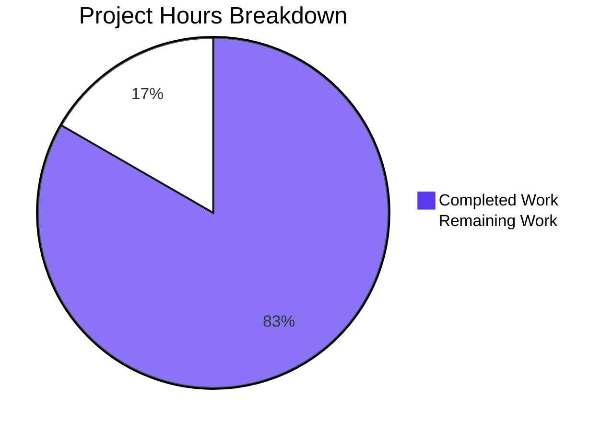
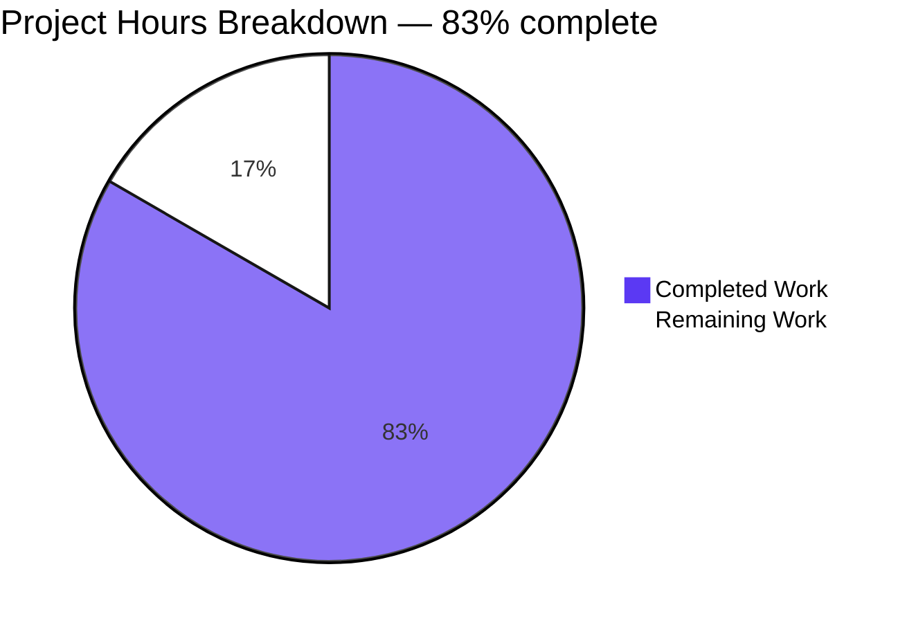
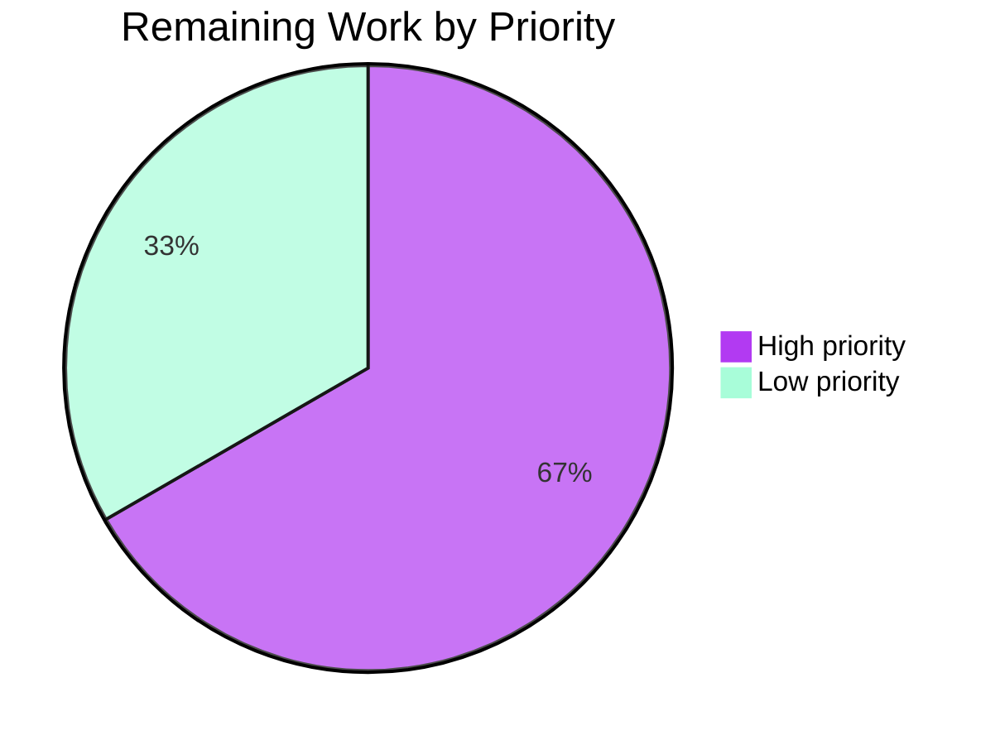

# 1. Executive Summary

## 1.1 Project Overview

A polyglot hello-world sample — a parent repository of five single-file programs plus a submodule holding three more — now exposes one HTTP endpoint. The submodule's only Node member, `submodule_repo_child_level_1/hello.js`, answers the literal path `/status` with the fixed JSON literal `{"status":"ok"}` on Node's built-in `http` module, keeping its original greeting, and the parent `README.md` documents the start and check commands. No framework, dependency or build step is involved.

## 1.2 Completion Status



**83% complete (15 of 18 hours).** Completed = Dark Blue `#5B39F3`; Remaining = White `#FFFFFF`.

| Metric | Hours |
|---|---|
| Total Hours | 18 |
| Completed Hours (AI + Manual) | 15 |
| Remaining Hours | 3 |

Calculation: 15 ÷ (15 + 3) × 100 = 83.3% → **83%**.

## 1.3 Key Accomplishments

- ✅ One HTTP route at the literal path `/status`, built on Node's built-in `http` module with a single `require` and no dependency (`submodule_repo_child_level_1/hello.js:3-8`)
- ✅ Fixed contract — 200, `Content-Type: application/json`, the 15-byte body `{"status":"ok"}`; every other target 404 with an empty body
- ✅ Port binding that honours `process.env.PORT` with a 3000 fallback and reaches every interface
- ✅ Original greeting retained; the five sibling members and `.gitmodules` untouched
- ✅ Two `README.md` lines documenting the start and check commands, consistent with the code's path, port and body (`README.md:1-3`)
- ✅ Cross-repository delivery: child commit `31fa907` published and recorded by the parent gitlink (commits `36070e7`, `ab403e5`)
- ✅ Containment held: no manifest, lockfile, dependency directory, test, config, CI file or generated artefact, and no install
- ✅ 1,377 executed cases with 0 failures

## 1.4 Critical Unresolved Issues

**6 items are open: five of the 18 scoped requirements carry an open caveat, and one production-side obligation — the first run on the deployed host — is outstanding.**

| Issue | Impact | Owner | ETA |
|---|---|---|---|
| Process-manager operation (`pm2 start` / `pm2 logs` / `pm2 delete`) never executed | The managed start path rests on documented commands only | Operator | First deployment |
| The route has not been exercised on the target production host and port | First-run behaviour on the real host is unproven | Operator | First deployment |
| No `PORT` validation: a non-numeric value creates a UNIX socket named after it and leaves no TCP listener | An operator typo yields no reachable service and a stray socket file | Operator | Accepted as-is |
| The "all files" wording: only the child Node member serves `/status` | If a wider reading was intended, that work does not exist | Product owner | Decision needed |
| `package.json`, `ecosystem.config.js` and a start script absent although the request's clauses name them | No `npm start` and no process-manager declaration | Platform / Operator | Decision needed |
| The source specification still describes the member as print-and-exit and the project as exposing no route or port | Where that document is maintained, it disagrees with the code | Documentation owner | Next documentation pass |

## 1.5 Access Issues

| System/Resource | Type of Access | Issue Description | Resolution Status | Owner |
|---|---|---|---|---|
| Child repository `lakshya-blitzy-only-submodules/submodule_repo_child_level_1` (GitHub, separate organisation) | Write (push) | An in-environment push is refused (bare push exit 128; the installation token here covers the parent repository only and returns HTTP 403) | Mitigated — publication goes through the platform push path and the child remote now carries `31fa907`, so the pin is fetchable | Platform |

No other access issues: the project needs no credentials, database, cache, queue or third-party service.

## 1.6 Recommended Next Steps

1. **[High]** Run the documented process-manager sequence on the target host: start the member by name, tail its log, request `/status` through it, remove it. (1.0 h)
2. **[High]** Verify the first run on the deployed host with a numeric `PORT`: the JSON body on the deployed port, and 404 on a miss path. (1.0 h)
3. **[Medium]** Decide whether a managed start should be packaged and whether "all files" meant further endpoints; both are new scope.
4. **[Low]** Add the permitted one-or-two-line note to `blitzy/documentation/Technical Specifications.md` and confirm the surrounding prose still matches the code. (1.0 h)

# 2. Project Hours Breakdown

## 2.1 Completed Work Detail

| Component | Hours | Description |
|---|---|---|
| Route implementation in the child Node member | 3.0 | One `require("http")`, the `createServer` handler answering `/status` with 200, `Content-Type: application/json` and the literal body, the 404 branch for every other path, the `process.env.PORT || 3000` bind with no host argument, and the single design comment (`submodule_repo_child_level_1/hello.js:3-8`) |
| Documentation allowance | 0.5 | The two `README.md` lines naming the start and check commands, kept consistent with the code's path, port and body literals, and refined to a single space before the check line's parenthetical without disturbing the title, the line count or any literal (`README.md:1-3`) |
| Cross-repository delivery | 1.5 | Child commit `31fa907` published to the child repository's remote, the parent gitlink moved from `0664094` to `31fa907`, and the parent commits `36070e7` and `ab403e5` recording the delivery and the documentation |
| Containment and exclusion compliance | 1.0 | Keeping out every excluded artefact class — manifest, lockfile, dependency directory, test, lint/format config, CI file, container, extra documentation — and running no install and no process-manager lifecycle |
| Static verification of the delivered artefacts | 3.0 | Byte-level and structural verification of both files and the gitlink against the agreed literals, element by element |
| Runtime verification campaign | 4.0 | Executed HTTP cases across route dispatch, response contract, process lifecycle, concurrency and statelessness, port precedence and process output |
| Security verification | 2.0 | Input-handling probes (injection, traversal, CRLF, malformed and oversized input) and the access, disclosure and header surface |
| **Total** | **15.0** | |

## 2.2 Remaining Work Detail

| Category | Hours | Priority |
|---|---|---|
| Run the documented process-manager acceptance sequence once on the target host [path-to-production; the only delivered operating path never exercised] | 1.0 | High |
| First-run verification on the deployed host and port — numeric `PORT`, 200 + JSON on the deployed port, 404 on a miss [path-to-production] | 1.0 | High |
| One-or-two-line note in `blitzy/documentation/Technical Specifications.md`, with a check that the surrounding prose still matches the code [the scoped allowance for that document] | 1.0 | Low |
| **Total** | **3.0** | |

Two further items are decisions rather than remaining engineering work and carry no hours in this scope: whether a managed start should be packaged (a manifest with a start script or a process-manager ecosystem declaration), and whether the "all files" wording meant further endpoints beyond the single Node member. Both would be new scope if requested; neither blocks the delivered capability.

# 3. Test Results

This project contains no test suite, framework, runner or coverage tooling, and none may be added. Every figure below is therefore an executed case count: each case was run against a live instance on a dedicated port (HTTP requests through `curl`, raw sockets and a real browser) or, where the subject is a file's content, checked at byte level on disk. Aggregate: **1,377 executed cases, 1,377 passed, 0 failed.**

| Area / Category | Framework | Tests | Passed | Failed | Coverage | What This Proves |
|---|---|---|---|---|---|---|
| Route dispatch and the HTTP contract | Node 22 runtime; curl, raw sockets, browser | 421 | 421 | 0 | n/a — no coverage tooling | Only the literal path `/status` answers, with 200 and the fixed JSON body; every other target — case, query string, trailing slash, encoded, absolute-form, oversized, empty — answers 404 with an empty body, and every ordinary method on the route returns the same JSON |
| Port configuration and precedence | Node 22 runtime; curl and process inspection | 63 | 63 | 0 | n/a — no coverage tooling | The environment port wins and the default is not additionally bound; an empty value falls back to 3000; `PORT=0` binds an OS-chosen port; a non-numeric value yields a UNIX socket instead of a TCP listener; an out-of-range value or an occupied port exits 1 after the greeting |
| Process lifecycle, streams and observability | Node 22 runtime; curl and process inspection | 72 | 72 | 0 | n/a — no coverage tooling | The greeting is written once before the listener and the process keeps serving; neither stream carries anything per request across several hundred requests; the listener binds every interface, and a started instance stops cleanly by the pid it printed |
| State, identity and data reach | Node 22 runtime; curl and process inspection | 17 | 17 | 0 | n/a — no coverage tooling | Responses are byte-identical across requests and connections with no shared state, no identity read, no store touched, no outbound contact and no descriptor growth under load |
| Adversarial, malformed-input and load batteries | Node 22 runtime; curl, raw sockets, browser | 582 | 582 | 0 | n/a — no coverage tooling | Injection, traversal, command, CRLF, NUL-byte, malformed and oversized input, and garbage request lines yield only the two legal responses or a runtime parser rejection with an empty body — never a 5xx, a reflection, a crash or a hang — and concurrency (100 parallel requests, 200 keep-alive requests, abrupt mid-request disconnects) leaves the service serving |
| Exposure, disclosure and the browser client view | Node 22 runtime; curl, raw sockets, headless browser | 60 | 60 | 0 | n/a — no coverage tooling | No authentication challenge, no cookie, no CORS or hardening header, no `Server`/`X-Powered-By`, no stack trace, path or module name in any response, and no difference in the answer for any caller attribute; a real browser renders the same contract as a JSON document, with no console entry beyond its own favicon probe |
| Containment, cross-repository delivery and the project's gates | Node 22 runtime; git, shell and byte-level checks | 162 | 162 | 0 | n/a — no coverage tooling | No manifest, lockfile, dependency directory or other excluded artefact exists in either tree and nothing is installed; the delivered files parse (`node --check`, `GATE-PARSE-OK`); the child revision the gitlink records is the one that serves; and the two documented `README.md` commands reproduce the documented output |

**Not Covered**

- **No automated suite exists.** There is no framework, runner, fixture or coverage tool, and the agreed scope excludes adding any. Coverage is therefore not measurable, and the counts above are executed cases, not code coverage. Any future regression protection must be built from scratch if it is wanted.
- **Process-manager operation is unexercised.** Starting, logging and stopping the app under a process manager (the documented `pm2 start` / `pm2 logs` / `pm2 delete` sequence) has not been executed anywhere, so managed operation, log capture and restart behaviour remain unverified at runtime.
- **The route has not been run on the target production host or port.** All runtime evidence comes from this development host; the binding, port and reachability of the deployed environment are unproven until the first-run verification is performed.
- **The five sibling members are unexercised.** The Go, PHP, Ruby and Java members cannot run here — their toolchains are absent and installing them is out of scope — so the sample set as a whole has no runtime evidence; only the Python member, whose interpreter happens to be present, was executed.
- **The partial-checkout path was not re-tested.** A clone that does not initialise the submodule leaves the route file absent; this behaviour is documented but was not exercised by a fresh clone.
- **Non-numeric `PORT` values were observed but not judged.** The project defines no validation, so these were recorded as observations rather than pass/fail cases.
- **IPv6 reachability could not be exercised** — the container has IPv6 disabled, so the wildcard bind was confirmed on IPv4 only.

# 4. Runtime Validation & UI Verification

The project defines no user interface — no markup, stylesheet, screen or browser context exists — so nothing was validated visually as a UI. A real headless browser was used as an additional HTTP client, which is the only sense in which a browser was exercised.

- ✅ **Start-up** — `node submodule_repo_child_level_1/hello.js` prints `Hello, World!` exactly once, before the listener, then stays in the foreground serving; stderr stays empty for the whole run.
- ✅ **Route** — `GET /status` answers `HTTP/1.1 200 OK`, `Content-Type: application/json` and the 15-byte body `{"status":"ok"}`, byte-identical to the literal, with no trailing newline and no extra field.
- ✅ **Miss path** — every other target (`/`, `/status/`, `/Status`, `/status?x=1`, encoded, absolute-form, oversized, empty) answers `404` with a zero-byte body, no content type and nothing internal disclosed.
- ✅ **Methods** — all eight ordinary methods exercised on `/status` answer the JSON; `HEAD` returns the same headers with no body; all methods on a miss path answer 404.
- ✅ **Interface reach and port handling** — the bind covers every interface (loopback, host address and bridge address all reach the route on IPv4); `PORT` wins over the default, an empty value falls back to 3000, `PORT=0` binds an OS-chosen port, and two instances on different ports served concurrently and independently.
- ✅ **Documented interface as published** — both `README.md` command lines reproduce their documented output when run as written, with the port substituted for the instance in use.
- ✅ **Browser client** — the route renders as a JSON document containing exactly `{"status":"ok"}`, a same-origin `fetch` returns that string, no cookie is set, and the only console entry is the browser's own favicon 404.
- ✅ **Taken-port failure path** — a second start on an occupied port prints the greeting, then an `EADDRINUSE` diagnostic on stderr, and exits 1 while the live instance keeps serving.
- ⚠ **Process-manager operation was never exercised at runtime** — the documented start-under-manager, log-tail, request-through-managed-process and remove steps have not been run by anyone, and the route has not been run on the target production host or port.
- ⚠ **A non-numeric `PORT` value was observed, not corrected** — no validation is in scope, so such a value creates a UNIX socket file named after it in the working directory and leaves no TCP listener, while out-of-range values exit with a range error after the greeting; the five sibling members likewise remain unexercised, their toolchains being absent.

# 5. Compliance & Quality Review

## 5.1 Compliance Matrix

| # | Deliverable / requirement | Status | Verified by |
|---|---|---|---|
| 1 | Exactly one route at the literal path `/status` in the tree's only Node member | ✅ Pass | `submodule_repo_child_level_1/hello.js:5-6`; 32 miss targets all answer 404 |
| 2 | Built on Node's built-in `http` module alone: one `require`, no framework, no dependency | ✅ Pass | `hello.js:3`; zero manifests, packages and lockfiles in either tree |
| 3 | Change kept under ten lines | ✅ Pass | 5 code lines plus 2 blank separators; file 1 line/30 bytes → 8 lines/345 bytes |
| 4 | Response contract: 200, `Content-Type: application/json`, the literal 15-byte body | ✅ Pass | `hello.js:7`; body matches the literal byte for byte, md5 `0f0479874bf6f4a7281099b15df27c27` |
| 5 | Every other target answers 404 with an empty body | ✅ Pass | `hello.js:6`; miss responses measured at 0 bytes with no content type |
| 6 | Port binding `process.env.PORT \|\| 3000` with no host argument, reachable off loopback | ✅ Pass | `hello.js:8`; environment port wins, empty value falls back, wildcard bind confirmed from three addresses on IPv4 |
| 7 | Documentation allowance: exactly two `README.md` lines, no other document, and the refined presentation leaving every literal intact | ✅ Pass | `README.md:1-3`; title byte-identical, file 3 lines/167 bytes with one space before the check line's parenthetical; `README.md` is the only document the change touches |
| 8 | Comment and formatting discipline: at most one comment, no banners, no padding | ✅ Pass | `hello.js:8` holds the only comment; two-space handler indent; no blank-line run over one |
| 9 | No dependency added, removed, renamed or version-bumped; no manifest or ecosystem file | ✅ Pass | No `package.json`, `package-lock.json`, `node_modules/` or `ecosystem.config.js` exists anywhere |
| 10 | Cross-repository delivery: child commit recorded by the parent gitlink and published | ✅ Pass | Child commit `31fa907`; gitlink `0664094` → `31fa907` in HEAD and the index; the child's branch ref returns `31fa907` |
| 11 | Existing content preserved in every member | ✅ Pass | Greeting line byte-identical; five sibling members and `.gitmodules` blobs unchanged from base |
| 12 | Containment: every excluded artefact class absent, and the withheld execution honoured as scoped | ✅ Pass | Zero test, lint/format, CI, container, lockfile or generated artefacts; no install and no lifecycle run performed |

**Overall: 12 of 12 compliance items pass, with no corrective work outstanding in any of them.**

## 5.2 AAP & Rule Divergences and Gaps

No user-specified rules were provided for this work, so every divergence below is measured against the Agent Action Plan or against the requester's own instructions.

| # | What the AAP/Rule Required | What Was Delivered Instead | Why It Diverged | Impact | Remediation |
|---|---|---|---|---|---|
| D1 | The child commit is made on branch `2810_03` | Commit `31fa907` sits on `blitzy-e9698eba-7e8c-49d0-9058-3ffb3876a551`; no `2810_03` ref exists in either repository | The workspace's assigned branch, which must not be changed | Labelling mismatch only; history, delivery and behaviour unaffected | Correct the label where the plan is stored; do not rewrite history |
| D2 | The runtime is recorded as Node `v22.23.3` | The environment supplies `v22.23.4` | The runtime is used as found; installing or downgrading Node is forbidden | None; one patch release on the same Node 22 line | None |
| D3 | The child commit is pushed to the child repository before the parent records it | The parent's gitlink commits were made first; remote publication followed through the platform's publication path | The child repository belongs to another organisation and the in-environment credential is refused there (HTTP 403; bare push exit 128) | None today — the child's branch ref carries `31fa907`, so the pin is fetchable; the child's default branch does not | Route future child changes through the platform publication path |
| D4 | The route is added "to all files" | One route, in the tree's only Node member; no parent-level entry point and no endpoint in the five other members | Only a Node file can host an `http`-module route; a parent-level entry point was recorded as an open question and not built | If a wider reading was intended, those endpoints do not exist | A human decision; a new request if wanted |
| D5 | The request names `package.json` and `ecosystem.config.js` | Neither exists, and no manifest of any kind does | Neither is needed to run the file or start it under a process manager; creating a manifest risks the forbidden lockfile class | No `npm start` script and no process-manager ecosystem declaration | Add on explicit request |
| D6 | One or two lines of note may be added to the source technical specification | No note was added; `blitzy/documentation/Technical Specifications.md` (944,849 bytes) is untouched and its prose still describes the member as print-and-exit and the project as exposing no route or port | The note is permitted rather than required, and the delivered change was confined to the route and its two documentation lines | Where that document is read, its prose contradicts the delivered code | Add the permitted one-or-two-line note (1.0 h, Low) |
| D7 (Sanctioned) | No live install-and-process-lifecycle acceptance is executed; commands are documented for the operator | Exactly that: nothing installed, no application or manager lifecycle run, the sequence documented instead | The requester's explicit instruction, which outranks the default verification posture | The process-manager path is the one delivered operating mode with no runtime evidence | Operator runs the documented sequence once |
| D8 (Sanctioned) | No validation, configuration schema or fail-fast check is added | The port value reaches `listen()` unchecked; a non-numeric value leaves no TCP listener and creates a UNIX socket file in the working directory | The agreed scope excludes validation, and the decision was recorded as settled | An operator typo yields an unreachable service and a stray socket file | Set `PORT` numerically in the runbook and any process manager |
| D9 (Sanctioned) | `README.md` line 3 reads `Check it: curl -s localhost:3000/status  (returns {"status":"ok"})`, with two spaces before the parenthetical | The delivered line carries one space, leaving the file 3 lines / 167 bytes | The requester's refinement instruction directed an improvement of exactly that file without expanding scope, and the doubled space was its only presentational blemish; their instruction outranks the plan | None — presentation only; the title, the two appended lines and every literal (`submodule_repo_child_level_1/hello.js`, `/status`, `3000`, `{"status":"ok"}`) are unchanged | None; the delivered text is the directed state, and only a return of the doubled space would be a divergence |

**D1 and D2.** Both are records rather than defects. The plan named a branch for the child commit that no ref in either repository carries; `31fa907` sits on the branch the workspace was assigned, which is the branch both repositories were checked out on and which the work is not free to change, so the mismatch is a label to correct where the plan is stored rather than history to rewrite. The plan's runtime note says Node `v22.23.3` while the host supplies `v22.23.4`. Nothing in either repository pins a version — no `.nvmrc`, `.node-version`, `engines` field, manifest or CI file exists — and the delivered code uses `createServer`, `writeHead`, `end` and `listen`, all long-stable across the Node 22 line. Neither item calls for action.

**D3.** The agreed order was for the child commit to reach the child repository before the parent recorded it; in the delivered history the parent's commits came first and publication followed through the platform's own publication path. The cause is environmental: the child repository belongs to a different GitHub organisation, and no credential available inside the environment is accepted there (HTTP 403; a bare push exits 128). Nothing is outstanding — `31fa907` is present on the child repository's branch ref, which is the ref the gitlink names (`git ls-tree HEAD submodule_repo_child_level_1` → `160000 commit 31fa907…`), so a clone resolves the pin. The child's default branch still points at the pre-route revision, so child-side changes should continue to go through the platform publication path.

**D4.** The request asked for the route "to all files". One route exists, in the tree's only Node member (`submodule_repo_child_level_1/hello.js:5-7`), which is the only file in either repository that can host a route built on Node's `http` module; each of the five sibling members would need its own language's server facility, which the same request excludes. A parent-level Node entry point was raised as an open question and deliberately not built. Nothing delivered is wrong — what is unresolved is what was meant. If endpoints beyond the single member were intended, they are a new request, not a gap in this delivery.

**D5.** The request's clauses name `package.json` and `ecosystem.config.js`; neither exists, and no manifest of any kind does. Neither is needed: `node submodule_repo_child_level_1/hello.js` runs the route, and a process manager can start that file directly with no ecosystem declaration. Creating a manifest in a tree that has none is also the one way to produce the artefact class the request forbids, since `npm install` with no manifest writes an empty `package-lock.json`. The practical effect is that there is no `npm start` script and no process-manager declaration. If either is wanted, it is a small, separate request; the delivered code does not depend on it.

**D6.** The source specification may carry a one-or-two-line note; none was written, and `blitzy/documentation/Technical Specifications.md` is untouched. Its prose still describes the JavaScript member as printing once and exiting — "Each of the six programs prints exactly `Hello, World!` and exits 0", with the member rated at 30 bytes and one line — and the project as exposing no port, route or environment input; it also quotes Node v22.23.3 and Python 3.12.3 where this host has v22.23.4 and 3.13.18. None of that affects the running service. A documentation owner should add the permitted note and confirm the surrounding prose matches the code: one hour, tracked in Section 2.2 as the Low-priority item.

**D7 (Sanctioned).** By the requester's own instruction, no live install-and-process-lifecycle acceptance was executed: nothing was installed against a live registry, no application or process-manager instance was started, polled or torn down as part of delivery, and the install, start, curl and manager commands were supplied as documented steps for the operator. This is a deliberate narrowing of verification that the instruction requires, not an omission, and it is carried in the remaining work rather than in the code. Its consequence is concrete: the managed-start path is the one delivered operating mode with no runtime evidence behind it, which is why running the documented sequence is the first High-priority task in Section 1.6.

**D8 (Sanctioned).** The agreed scope excludes validation, configuration schemas and fail-fast checks, so the port value reaches `listen()` unchecked: `PORT=abc` leaves the process alive with no TCP listener and creates a UNIX socket file named `abc` in the working directory, `PORT=-1` behaves the same way, and `PORT=65536` exits with a range error after the greeting. The delivered code is exactly what the agreed scope specifies, and the behaviour was recorded as a settled decision rather than corrected. The exposure is an operator typo that produces an unreachable service; the mitigation is operational — set the port numerically in the runbook and in any process-manager environment, as Section 9 does.

**D9 (Sanctioned).** The plan froze the check line as `Check it: curl -s localhost:3000/status  (returns {"status":"ok"})`, with two spaces before the parenthetical. The delivered line carries one space, leaving the file 167 bytes rather than 168. The requester's refinement instruction directed an improvement of exactly that file without expanding scope, and the doubled space was its only presentational blemish, so their instruction governs this text. Nothing else about the line or the file moved: the title is byte-identical, exactly two lines remain appended, the file ends with a single newline, and the literals `submodule_repo_child_level_1/hello.js`, `/status`, `3000` and `{"status":"ok"}` survive character for character. No action is required; only a return of the doubled space would be a divergence.

# 6. Risk Assessment

| Risk | Category | Severity | Probability | Mitigation | Status |
|---|---|---|---|---|---|
| No automated regression protection: the project's only gate is the syntax check, so any future edit to the route file has no behavioural safety net | Technical | Medium | High | Build a test suite or an external contract check if regression protection is wanted; until then re-run the documented checks of Section 9.5 after any change | Open |
| A non-numeric `PORT` value produces no TCP listener and leaves a UNIX socket file in the working directory | Operational | Medium | Medium | Set `PORT` numerically in the runbook and in any process-manager environment; add validation only if the scope widens | Open — accepted by scope |
| A taken port ends the process with an unhandled error and nothing supervises it | Operational | Medium | Medium | Run it under a process manager (documented) or guarantee the port is free and monitored | Open |
| The process-manager operating path has never been executed | Operational | Medium | Medium | Run the documented start, log-tail, request and remove sequence on the target host and record the outputs | Open |
| Exact string path matching: a query string, trailing slash or case variant answers 404 | Integration | Medium | Medium | Callers must use the bare path `/status`; introduce a normalising router only if the scope widens | Accepted by design |
| Future changes to the child repository depend on the platform publication path, and the child's default branch does not carry the route | Integration | Medium | Medium | Route child-repository changes through the platform push mechanism; an in-environment push is refused | Open |
| Responses carry no `Content-Length` and are sent chunked | Technical | Low | Medium | Verified on the wire, through a raw socket and in a browser; move to an explicit header-then-body form only if an intermediary or strict client mis-handles it | Accepted by design |
| The route is unauthenticated and reachable on every interface | Security | Low | Low | It serves one static public literal and reads no input; place it behind a network policy or reverse proxy if the host is internet-facing | Accepted by design |

# 7. Visual Project Status



Completed = Dark Blue `#5B39F3`; Remaining = White `#FFFFFF`. Completed 15 hours + Remaining 3 hours = 18 total hours.



Priority accents: High = Violet-Black `#B23AF2`; Low = Mint `#A8FDD9`. High priority covers the two path-to-production verification tasks (2 hours); Low covers the specification note and its consistency check (1 hour). No medium-priority work carries hours: the two open decisions would be new scope if taken up.

# 8. Summary & Recommendations

This release delivers one HTTP endpoint to the sample: the child repository's Node member serves the literal path `/status` with a fixed JSON response on Node's built-in `http` module, keeps its original greeting line, and is published to the parent through a gitlink move plus two `README.md` lines naming the start and check commands. All 18 scoped requirements are delivered and verified, at **83% complete** (15 of 18 hours), with the residual 3 hours being production-side verification and documentation hygiene rather than unfinished code.

The delivered behaviour was verified statically and at runtime. The response contract holds byte for byte: 200, `Content-Type: application/json` and the 15-byte body `{"status":"ok"}` on the literal path, and 404 with an empty body everywhere else, including case, query-string, encoded, absolute-form and oversized targets. The process prints its greeting once before the listener, stays silent per request on both streams, keeps no state under sequential and concurrent load, honours the environment port while falling back to 3000, and binds every interface. A real browser client rendered the same contract as a JSON document, with no console entry beyond its own favicon probe. In total 1,377 cases were executed with 0 failures, and the delivered files, the gitlink, the publication of the child revision and the two documented commands were each verified directly.

Six items remain open before this is production-ready, none of them code defects. The process-manager sequence — start under a manager, tail its log, request the route through it, remove it — has never been run, and the route has not yet been exercised on the target host or port; those are the first two tasks, at an hour each. The port value is not validated, so a non-numeric `PORT` leaves no TCP listener and a stray socket file, and a taken port ends the process immediately: both are accepted caveats to carry into the runbook rather than code to change. Three further items are decisions or documentation rather than engineering: whether a managed start should be packaged, whether the "all files" wording meant endpoints beyond the single Node member, and the permitted one-or-two-line note the source specification has not received. Separately, nothing re-verifies the route automatically, since the project's only gate is a syntax check.

Production readiness: the endpoint itself is ready to serve — it is dependency-free, contained, and its behaviour under load, malformed input, hostile input and browser clients is verified with no residual defect and no security finding. The remaining exposure is operational rather than functional: an unsupervised process, an unvalidated port value, a managed-start path that has been documented but not demonstrated, and no automated regression protection. Completing the two High-priority tasks closes the operational ones.

Success metrics: 18 of 18 scoped requirements delivered; 12 of 12 compliance items passing; 1,377 executed cases with 0 failures; 0 excluded artefacts present and 0 installs performed; the child revision recorded by the parent gitlink and published to its remote. Recommended sequencing is the managed-start acceptance run, then the deployed-host first-run verification, then the packaging and wording decisions, and last the specification note.

# 9. Development Guide

## 9.1 System Prerequisites

- **Node.js 22** — the only runtime the deliverable needs (`node -v` → `v22.23.4` on the reference host). The repository pins no version: there is no `.nvmrc`, `.node-version`, `engines` field or manifest.
- **Git** with submodule support, because the route lives in a submodule.
- **curl** for the verification commands. `lsof` and `ss` are handy for confirming the listener and are present on the reference host; `netstat` and `nc` are not, and nothing here needs them.
- Optionally a process manager (`pm2` 7.x) for the managed start in 9.7. It is not present by default and nothing in the project declares it.

## 9.2 Environment Setup

No virtual environment, no `.env`, no configuration file and no secrets are involved — the only configuration input is the optional `PORT` environment variable.

```bash
# from the repository root
git submodule status --recursive
git submodule update --init        # only needed if the submodule directory is empty
```

Expected: `git submodule status --recursive` prints the child at `31fa907` with no leading `-` or `+` marker:

```text
 31fa907f6bb09c3879d4efc8d1736a651cc75dd1 submodule_repo_child_level_1 (heads/blitzy-e9698eba-7e8c-49d0-9058-3ffb3876a551)
```

A clone made without `--recurse-submodules` leaves `submodule_repo_child_level_1/` empty, and the route is then absent until `git submodule update --init` is run.

## 9.3 Dependency Installation

**There is nothing to install.** The project has no `package.json`, no lockfile, no `node_modules/` and no dependencies; the route uses only Node's built-in `http` module.

> Do **not** run `npm install`, `npm ci`, `yarn` or `pnpm` in this checkout. With no manifest, npm writes an empty `package-lock.json`, which is an artefact this project deliberately excludes.

## 9.4 Application Startup

Run from the repository root. Pick a free port (3000 is the default when `PORT` is unset); on a shared host give each instance its own port.

```bash
PORT=3077 node submodule_repo_child_level_1/hello.js
```

Expected: the greeting is printed once, then the process stays in the foreground serving until interrupted.

```text
Hello, World!
```

To leave it running in the background, capture the pid so you can stop it precisely, and redirect its output to a log file you choose:

```bash
PORT=3077 nohup node submodule_repo_child_level_1/hello.js > hello-status.log 2>&1 &
echo $!
```

Stop it by that pid — never by name, because other instances of this script may be running:

```bash
kill <printed pid>
```

The log file is untracked scratch output; delete it when you are done with it, or point the redirect at wherever your host keeps service logs.

## 9.5 Verification Steps

With the server listening on the port you started:

```bash
curl -s localhost:3077/status
# {"status":"ok"}

curl -s -o /dev/null -w '%{http_code}\n' localhost:3077/status
# 200

curl -s -o /dev/null -w '%{http_code} %{size_download}\n' localhost:3077/nope
# 404 0
```

Inspect the full response, including that the body is exactly 15 bytes and framed chunked:

```bash
curl -si localhost:3077/status | head -8
# HTTP/1.1 200 OK
# Content-Type: application/json
# Date: ...
# Connection: keep-alive
# Keep-Alive: timeout=5
# Transfer-Encoding: chunked

curl -s localhost:3077/status | wc -c
# 15
```

Static checks that need no running process:

```bash
node --check submodule_repo_child_level_1/hello.js && echo SYNTAX-OK

find . -name .git -prune -o -name '*.js' -print | xargs -r -n1 node --check && echo GATE-PARSE-OK
```

## 9.6 Example Usage

The route is the member's whole interface: one path, one method-agnostic answer.

```bash
# the documented default port, when PORT is unset
node submodule_repo_child_level_1/hello.js &
curl -s localhost:3000/status
# {"status":"ok"}

# environment-supplied port
PORT=8080 node submodule_repo_child_level_1/hello.js &
curl -s localhost:8080/status
# {"status":"ok"}

# any HTTP method reaches the same route
curl -s -X POST localhost:3077/status
# {"status":"ok"}

# anything that is not the literal path is a miss
curl -s -o /dev/null -w '%{http_code}\n' 'localhost:3077/status?x=1'
# 404
```

## 9.7 Documented Process-Manager Sequence

These steps are provided for the operator and follow the pattern the request named. They have not been executed in this environment, so treat the first run as its own verification:

```bash
npm install -g pm2                                                  # outside the checkout
pm2 start submodule_repo_child_level_1/hello.js --name hello-status  # run from the repository root
pm2 logs hello-status                                                # expect the greeting line
curl -s localhost:3000/status                                        # {"status":"ok"}
pm2 delete hello-status
```

No `ecosystem.config.js` and no `package.json` are needed: the manager infers the interpreter from the `.js` extension. If several instances share a host, isolate the manager's home directory per instance so the daemon sockets do not collide.

## 9.8 Troubleshooting

| Symptom | Cause | Resolution |
|---|---|---|
| `Error: listen EADDRINUSE: address already in use` and the process exits 1 | The port is already taken (the greeting prints first, then the error) | Set `PORT` to a free port and start again, or stop the process holding the port with `kill $(lsof -ti tcp:<port> -sTCP:LISTEN)` |
| The process starts but nothing answers on any TCP port | `PORT` holds a non-numeric value; `listen()` then treats it as a UNIX socket path and creates a file of that name in the working directory | Set `PORT` to a number, for example `PORT=3077` |
| `RangeError [ERR_SOCKET_BAD_PORT]` right after the greeting | `PORT` is out of range (for example `65536`) or malformed | Use a value between 0 and 65535 |
| `Cannot find module '.../hello.js'` or the submodule directory is empty | The clone did not initialise submodules | Run `git submodule update --init` from the repository root |
| `/status` works but `/status?x=1` or `/status/` returns 404 | Path matching is an exact string comparison by design | Call the bare path `/status` |
| The same route file no longer behaves as documented after an edit | The project has no test suite or CI job and none may be added, so nothing re-verifies the contract automatically | Re-run the checks in 9.5 after any change to the file |
| A client complains about a missing `Content-Length` | The response headers are committed before the body, so responses are chunked with no length | Expected for this implementation; consume the body to its end (curl and browsers do this automatically) |
| `pkill`/`killall` on the script name stops unrelated processes | Other instances of the same script may be running on a shared host | Stop the instance by the pid it printed, or by the pid owning its port |
| Logs are empty apart from `Hello, World!` | The project logs nothing per request by design | Expected; there is no logging surface to configure |

# 10. Appendices

## Appendix A — Command Reference

| Purpose | Command | Run from | Observed result |
|---|---|---|---|
| Confirm the submodule | `git submodule status --recursive` | repository root | prints `31fa907… submodule_repo_child_level_1 (heads/…)`, no `-` or `+` marker |
| Initialise an empty submodule | `git submodule update --init` | repository root | no output, exit 0 |
| Syntax-check the route file | `node --check submodule_repo_child_level_1/hello.js` | repository root | no output, exit 0 |
| Whole-package parse gate | `find . -name .git -prune -o -name '*.js' -print \| xargs -r -n1 node --check && echo GATE-PARSE-OK` | repository root | `GATE-PARSE-OK` |
| Start on a chosen port | `PORT=3077 node submodule_repo_child_level_1/hello.js` | repository root | prints `Hello, World!`, then serves |
| Start detached, capturing the pid | `PORT=3077 nohup node submodule_repo_child_level_1/hello.js > hello-status.log 2>&1 & echo $!` | repository root | prints the pid; the log holds the greeting |
| Body check | `curl -s localhost:3077/status` | anywhere | `{"status":"ok"}` |
| Status code check | `curl -s -o /dev/null -w '%{http_code}\n' localhost:3077/status` | anywhere | `200` |
| Miss-path check | `curl -s -o /dev/null -w '%{http_code} %{size_download}\n' localhost:3077/nope` | anywhere | `404 0` |
| Confirm the listener | `lsof -i :3077` or `ss -ltn \| grep 3077` | anywhere | the `node` process bound to the port, or nothing when it has stopped |
| Stop a started instance | `kill <printed pid>`, or `kill $(lsof -ti tcp:3077 -sTCP:LISTEN)` for the pid that owns the port | anywhere | the port stops answering |

Every command above was run from the repository root as written; `hello-status.log` is untracked scratch output you can delete.

## Appendix B — Port Reference

| Port | Meaning |
|---|---|
| 3000 | The default the route binds when `PORT` is unset, and the port the `README.md` check line names |
| `process.env.PORT` | The override; when set to a numeric value it wins over 3000 and the default is not additionally bound |
| 0 | Binds an ephemeral port chosen by the operating system |
| anything non-numeric | Not treated as a port: the runtime creates a UNIX socket file of that name and no TCP listener exists |
| any free port | Use a distinct one per instance when several share a host; the recorded verification runs used 3001–3012, 3064, 3107, 3131–3133, 31806 and 8080, and `PORT=0` produced an OS-chosen port |

## Appendix C — Key File Locations

| Path | Role |
|---|---|
| `submodule_repo_child_level_1/hello.js` | The deliverable: 8 lines; greeting, the `/status` route, the 404 branch and the port bind |
| `README.md` | The project's only document: title line plus the start and check commands (3 lines, 167 bytes) |
| `.gitmodules` | Submodule declaration (path and URL only); unchanged by this work |
| `submodule_repo_child_level_1` (tree entry, mode 160000) | The gitlink recording the child revision `31fa907` |
| `blitzy/documentation/Technical Specifications.md` | The source specification; untouched, and still describing the pre-route system |
| `hello.go`, `hello.php`, `hello.rb`, `submodule_repo_child_level_1/hello.java`, `submodule_repo_child_level_1/hello.py` | The five sibling members; unchanged, no route added |

## Appendix D — Technology Versions

| Component | Version | Notes |
|---|---|---|
| Node.js | `v22.23.4` (Node 22 LTS line) | The only runtime required; supplies the built-in `http` module |
| npm | `11.21.0` | Present but unused: there is no manifest and nothing to install |
| Git | `2.56.0` with submodule support | Needed for the submodule checkout |
| curl | `8.18.0` | The verification client |
| Process manager (optional) | `pm2` 7.x (7.1.1 current at this assessment), requires Node ≥ 18 | Installable globally outside the checkout; never declared in the project |
| Python (present, unused) | `3.13.18` | The sibling Python member's interpreter; the route does not use it |
| Project runtime pins | none | No `.nvmrc`, `.node-version`, `engines` field, manifest or CI file exists |

## Appendix E — Environment Variable Reference

| Variable | Required | Type | Default | Behaviour |
|---|---|---|---|---|
| `PORT` | No | Numeric string | `3000` | Read once at start as `process.env.PORT \|\| 3000`. A numeric value wins and the default is not additionally bound; an empty value falls back to 3000; a non-numeric value is not validated and produces a UNIX socket instead of a TCP listener; an out-of-range value exits with a range error |

No other environment variable, secret or configuration file is read anywhere in either repository.

## Appendix F — Developer Tools Guide

- **Node's own syntax check** is the project's only static gate: `node --check <file>` exits 0 or prints the parse error, starts nothing and binds no port.
- **curl** is the primary client: `-i` for the full response, `-o /dev/null -w '%{http_code} %{size_download}'` for status and body size, `--path-as-is` to send a target unnormalised.
- **Git** is the delivery surface: what the parent records is the submodule's revision, so verify with `git submodule status` and `git ls-tree HEAD submodule_repo_child_level_1`.
- **A browser** is a useful second client: it renders the JSON body and shows the framing in its network panel. The project has no UI, so there is nothing to validate visually.
- **Listener inspection**: `lsof -i :PORT` and `ss -ltn` are present on the reference host; stop an instance by the pid it printed or by the pid owning its port, never by process name.
- **Not needed here, and absent on the reference host**: `netstat`, `nc`, and the Go, PHP, Ruby and Java toolchains.

## Appendix G — Glossary

| Term | Meaning |
|---|---|
| Route | The single path the server answers: the literal `/status`, compared with `!==` against the request URL |
| Literal body | The fixed 15-byte string `{"status":"ok"}` written from a compile-time constant, with no serialisation step |
| Gitlink | The parent's tree entry (mode 160000) that records which revision of the submodule is part of a commit |
| Submodule | A separate Git repository mounted at `submodule_repo_child_level_1/`; the route lives inside it |
| Wildcard bind | Listening with no host argument, which binds every interface (`::`, or `0.0.0.0`) rather than loopback only |
| Chunked framing | The response is sent with `Transfer-Encoding: chunked` and no `Content-Length`, because the headers are committed before the body is written |
| `EADDRINUSE` | The runtime error raised when the chosen port is already taken; the process prints its greeting first and then exits 1 |
| Parse gate | The whole-package check that every JavaScript file in the tree parses: `… | xargs -r -n1 node --check && echo GATE-PARSE-OK` |
| Scoped requirement | One of the 18 discrete obligations the work was measured against |
