# Technical Specification

# 1. Introduction

## 1.1 Executive Summary

`parent_repo_hello_world_ABK_6771` is a minimal, deliberately polyglot Git superproject whose entire content is eight tracked files and sixteen lines of program code. Six of those files are standalone programs that each print the fixed literal `Hello, World!` — one apiece in Go, PHP, Ruby, JavaScript, Python and Java — accompanied by a one-line `README.md`, a three-line `.gitmodules`, and a Git submodule link. Three of the six programs do not live in this repository at all: they arrive through the submodule `submodule_repo_child_level_1`, whose origin sits in a **different GitHub organization** (`lakshya-blitzy-only-submodules`) from the superproject (`lakshya-blitzy`).

The documented state is parent commit `5ecd4cc` (branch `2810_01`) with submodule revision `0664094`; all ten commits across the two repositories are dated 2026-10-28.

| Path | Language / runtime | Size | Sole observable behavior |
| --- | --- | --- | --- |
| `hello.go` | Go | 77 B, 7 lines | `fmt.Println` writes the literal from `main` |
| `hello.php` | PHP | 28 B, 1 line | top-level `echo` writes the literal |
| `hello.rb` | Ruby | 21 B, 1 line | top-level `puts` writes the literal |
| `submodule_repo_child_level_1/hello.js` | JavaScript (Node.js) | 30 B, 1 line | `console.log` at evaluation writes the literal |
| `submodule_repo_child_level_1/hello.py` | Python 3 | 23 B, 1 line | module-level `print` writes the literal |
| `submodule_repo_child_level_1/hello.java` | Java (JDK) | 119 B, 5 lines | `System.out.println` from `Hello.main` writes the literal |
| `README.md` | Markdown | 34 B, 1 line | nothing — holds the repository title only |
| `.gitmodules` | Git config (INI) | 170 B, 3 lines | declares the child's path and URL |

**Core problem being solved.** The repository declares no business problem, domain, or product requirement: `README.md` contains only the title line `# parent_repo_hello_world_ABK_6771`, and no requirements document, license, issue template, or product artifact exists anywhere in the tree. The problem it demonstrably addresses is engineering verification, in two observable parts:

1. **Toolchain verification** — confirming that a host can build or run six different language runtimes, with one purpose-built program per runtime and no dependency resolution to interfere with the result.
2. **Cross-organization submodule consumption** — confirming that a superproject can consume and pin content from a repository owned by another organization. The parent's final commit is titled `Add cross-org submodule`, and `.gitmodules` names a URL under `lakshya-blitzy-only-submodules` while the parent's own origin is under `lakshya-blitzy`.

**Key stakeholders and users.** No end user, customer, operator, or business role is described anywhere in the repository; the actors below are all engineering-facing and are derived from the commit history and the two repository origins.

| Actor | Relationship to the system | Primary interest |
| --- | --- | --- |
| Maintainers of `parent_repo_hello_world_ABK_6771` | Own the superproject; authored every parent commit (`lakshya-blitzy`, plus `Lakshya` on the submodule commit) | Adding members and moving the submodule pin |
| Maintainers of `submodule_repo_child_level_1` | Own the child repository in the separate `lakshya-blitzy-only-submodules` organization | Publishing revisions the superproject consumes |
| Developers and engineers | Clone, build, and run the members | Checking that the host's six toolchains work |
| Automated checkout and indexing tooling | Must resolve the gitlink to obtain three of the six programs | Complete recursive checkout, unchanged output |

**Expected business impact and value proposition.** The repository states no commercial value proposition, revenue impact, user-facing outcome, or business metric, and none can be inferred from code that performs no domain work. The value it delivers is engineering-side and directly observable:

- **One-clone toolchain check.** Six runtimes are exercised by the repository's own files, so a single clone plus six invocations reveals whether a host environment can execute Go, PHP, Ruby, JavaScript, Python and Java.
- **A live cross-organization submodule fixture.** The child revision is carried by the superproject's gitlink rather than by any version range, and at inspection the pinned `0664094` matched the child's own `refs/heads/main` HEAD.
- **Deterministic, input-free output.** Every program writes one compile-time literal and reads no input, so any automated check reduces to an exact-string and exit-code assertion, with no package-manager state and no network access able to alter the result after the clone.
- **No runtime footprint to operate.** Nothing is deployed, scheduled, or served; there is no process to monitor, no data to protect, and no dependency to patch.

Conversely, the repository delivers nothing to a business user, and no impact metric is instrumented anywhere: output is limited to the greeting line and the process exit status.


## 1.2 System Overview

### 1.2.1 Project Context

**Business context and market positioning.** The repository records no business context, target market, customer segment, or product positioning. There is no requirements document, architecture note, changelog, or license, and `README.md` (34 bytes) carries only the title line. The only contextual signals present are naming conventions: the repository name embeds `hello_world` and an identifier suffix `ABK_6771`, and both the superproject and the child carry a branch named `2810_01`. Together with the file names and commit subjects (`Create hello.go`, `Create hello.rb`, `Create hello.php`, `Add cross-org submodule`), these place the repository as an internal engineering sample rather than a product.

**Current system limitations (if replacing or upgrading an existing system).** Not applicable in the usual sense: the repository neither replaces nor supersedes anything. Its history contains five additive parent commits — an initial commit, three commits that each add one program, and one commit that adds the submodule — with no migration, deprecation, compatibility, or deprecation notice anywhere. The only deletion in the child repository's five commits is its own `README.md` (commit `0664094`), which removed the sole file of that repository's initial commit.

**Integration with the existing enterprise landscape.** The system's entire external surface consists of three couplings; nothing else in the tree references any external system.

| Coupling | Mechanism observed | Evidence |
| --- | --- | --- |
| Source hosting | HTTPS Git on `github.com`, superproject owner `lakshya-blitzy` | `git remote -v` in the parent checkout |
| Cross-organization submodule | `.gitmodules` URL in owner `lakshya-blitzy-only-submodules`, revision fixed by the superproject's gitlink | `.gitmodules`; `git ls-files -s` |
| Host language runtimes | Six toolchains required at run time — Go, PHP, Ruby, Node.js, Python 3, JDK — with no version constraint declared | the six source files |

There is no integration with any identity provider, secret manager, configuration service, database, message broker, API gateway, artifact registry, scheduler, or observability backend, because the tree contains no configuration or infrastructure file other than `.gitmodules`. One access detail is worth recording: this checkout's `origin` URL carries an environment-injected GitHub installation token (`x-access-token:ghs_…`) instead of a bare URL. That credential lives in the local `.git/config`, not in any tracked file, and no credential, key, or secret appears in the tracked content of either repository.

### 1.2.2 High-Level Description

**Primary system capabilities.** The repository's capability set is small, complete, and fully enumerated by the eight files listed in Table 1 of §1.1.

| Capability | How it is delivered | Members |
| --- | --- | --- |
| Fixed-output greeting in one language per runtime | One standalone, self-contained program per language | `hello.go`, `hello.php`, `hello.rb`, `hello.js`, `hello.py`, `hello.java` |
| Single-checkout delivery of two repositories | A gitlink plus a `.gitmodules` declaration | `.gitmodules`; submodule `submodule_repo_child_level_1` |
| Dependency-free determinism | Programs use only host built-ins (`fmt`, `echo`, `puts`, `console`, `print`, `java.lang`) | all six programs |
| Toolchain smoke-test surface | One directly runnable unit per runtime, no build orchestration to learn | all six programs |
| Exact-string machine check | One line of stdout plus a process exit status | all six programs |

**Major system components.** The system has two delivery units and no runtime composition: the superproject working tree (five files — three programs, the placeholder README, and `.gitmodules`) and the child working tree (three programs). No file in the superproject imports, calls, or otherwise references the child at the source level; the only link is the recorded gitlink.

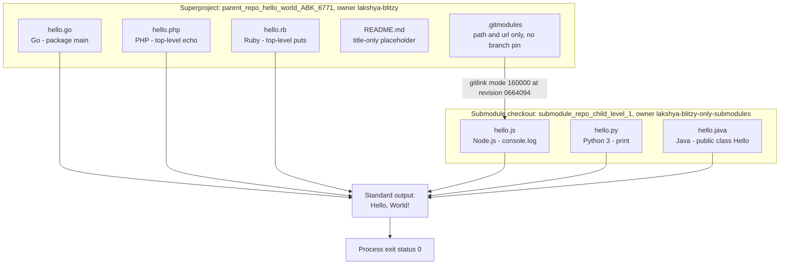

**Core technical approach.**

- **Program shape.** Each program is a single unconditional write of a compile-time string literal to standard output along one linear, synchronous path: no branches, loops, exception handling, asynchronous work, or state beyond the console stream. No program reads command-line arguments, environment variables, standard input, files, or the network — a case-insensitive search across all six source files for `argv`, `getenv`, `ENV[`, `stdin`, `open(`, `fs.`, `socket`, `http`, and `input(` returned no matches, and the file contents show only the print call.
- **Entry points, one per language.** Go exposes `func main` in `package main` (unimportable, all declarations unexported); PHP runs `echo` at file top level with no closing `?>` tag; Ruby calls `puts` at top level with no `__FILE__ == $PROGRAM_NAME` guard, so merely loading the file prints; Node.js calls `console.log` at evaluation time; Python calls `print` at module level, so importing the module also prints; Java declares `public static void main(String[] args)` on `public class Hello` and never reads `args`.
- **Packaging and revision control.** Distribution is Git-only. There is no manifest, lockfile, or publication step, and the child's revision is determined by the superproject's gitlink (mode `160000`, revision `0664094`) rather than by a branch or tag. `.gitmodules` declares only `path` and `url` — no `branch`, `tag`, `depth`, `shallow`, `update`, or `ignore` key — so a checkout follows the pinned gitlink and default `git submodule update` behaviour. At inspection the pin equaled the child's `refs/heads/main` HEAD.

```ini
[submodule "submodule_repo_child_level_1"]
	path = submodule_repo_child_level_1
	url = https://github.com/lakshya-blitzy-only-submodules/submodule_repo_child_level_1.git
```

- **Versioning and observability.** Neither repository carries a tag; both have exactly two branches (`main` and `2810_01`), with the parent's `origin/main` and `origin/2810_01` both pointing at `5ecd4cc`. There is no CI configuration, no logging, no metrics or tracing instrumentation. The system's entire runtime observable surface is the greeting line on stdout and the process exit status.

### 1.2.3 Success Criteria

**Measurable objectives.** The repository declares none. There is no roadmap, acceptance criterion, SLA, service-level objective, benchmark, or test in either working tree; `README.md` holds only a title, and no CI job, test harness, or assertion exists. Everything that follows is therefore limited to properties observable from the code and the Git metadata, and is labelled as such rather than presented as a declared goal.

| Observable acceptance criterion | Check performed | Result at inspection |
| --- | --- | --- |
| Each of the six programs prints exactly `Hello, World!` and exits 0 | Run each with its own runtime | Verified for `hello.js` (Node v22.23.3) and `hello.py` (Python 3.12.3); not verifiable here for Go, PHP, Ruby and Java, whose toolchains are absent from the inspection environment |
| The child materialises at the pinned revision | `git submodule status` | Verified: `0664094` on branch `heads/2810_01` |
| The pinned revision matches the child's upstream default branch | `git ls-remote` against the `.gitmodules` URL | Verified: remote `HEAD` and `refs/heads/main` both `0664094` |
| No dependency resolution is required before running anything | Inspect the tree for manifests and lockfiles | Verified: no manifest or lockfile exists in either repository |
| The child working tree is unmodified after checkout | `git status --short` in the child | Verified: no entries reported |

**Critical success factors.**

| Factor | Why it is critical | Observation |
| --- | --- | --- |
| Six host toolchains present | Each program needs its own runtime; there is no shared, portable artifact | Four of the six (`go`, `php`, `ruby`, `javac`/`java`) were absent from the inspection environment, so a complete smoke test requires provisioning |
| Outbound HTTPS read access to `github.com`, including the foreign organization | It is the only way to obtain three of the six programs | Verified reachable; no credentials are declared in `.gitmodules`, so anonymous read suffices |
| A submodule-aware Git client | The child's content arrives only through the gitlink | Present: Git 2.43.0 |
| Case-exact file naming for the Java member | `hello.java` declares `public class Hello`; a JDK normally requires a public compilation unit's file name to match the class name | Not exercised: no JDK in the inspection environment, so this naming difference remains an unverified risk |
| No registry or secret prerequisite | Nothing is installed from a package registry and nothing needs a secret | Confirmed by the absence of manifests and of credential material in tracked content |

**Key performance indicators.** No KPI, target, or threshold is defined or instrumented in the repository, and none is derived here, because the system runs no workload: each program performs a single write and exits, emits no telemetry, and exposes no endpoint. Only static measures can be reported.

| Static measure | Value |
| --- | --- |
| Tracked source programs / programming languages | 6 / 6 (one program per language) |
| Total tracked files (excluding the submodule's `.git` file) | 8 |
| Total program lines | 16 (Go 7, Java 5, PHP/Ruby/JavaScript/Python 1 each) |
| Configuration files / documentation lines | 1 (`.gitmodules`) / 1 (`README.md` title) |
| Commits / tags / tests / CI jobs | 5 parent, 5 child / 0 / 0 / 0 |

Because no latency, throughput, availability, or error-rate objective can be expressed against a program that prints one literal and exits, runtime KPIs for this system would necessarily be invented rather than measured. The meaningful verification signals are the five observable criteria in the table above.


## 1.3 Scope

### 1.3.1 In-Scope

The scope below is read from the tree at parent commit `5ecd4cc` and submodule revision `0664094`. It describes everything the repository actually contains and does, and nothing more.

**Core features and functionalities.**

| Capability | Delivered by | Notes |
| --- | --- | --- |
| Deterministic greeting in six languages | `hello.go`, `hello.php`, `hello.rb` (root); `hello.js`, `hello.py`, `hello.java` (child) | The identical literal is written by every member |
| Single-checkout delivery of two repositories | `.gitmodules` plus the gitlink at mode `160000` | Revision pin, not branch tracking |
| Zero-dependency execution after clone | Only host built-ins: `fmt`, `echo`, `puts`, `console`, `print`, and `java.lang`/`System` | Nothing to resolve, download, or install |
| Toolchain smoke-test surface | One directly runnable unit per runtime | All six languages are covered by the repository's own files |
| Machine-checkable result | One line on stdout plus process exit status | Observed for the Node.js and Python members |

**Primary user workflows.**

1. **Obtain the full tree.** Clone the superproject with `--recurse-submodules`, or run `git submodule update --init` afterwards; `git submodule status` then reports `0664094` on `heads/2810_01`. Without the recursive fetch, three of the six programs are simply absent.
2. **Run a superproject member.** `go run hello.go`, `php hello.php`, or `ruby hello.rb` from the repository root, each of which prints the greeting and exits 0 in a host that has the corresponding runtime.
3. **Run a child member.** `node submodule_repo_child_level_1/hello.js` and `python3 submodule_repo_child_level_1/hello.py` were executed during this inspection and each printed `Hello, World!` and exited 0. The Java member is compiled with a JDK and run as the `Hello` class; that path was not exercised here because no JDK was installed.
4. **Consume the child independently.** Clone `https://github.com/lakshya-blitzy-only-submodules/submodule_repo_child_level_1.git` and run its three members without going through the superproject; the repository is readable without credentials, as its remote returned refs to an unauthenticated `git ls-remote`.
5. **Verify a host environment.** Run all six members and compare each output to the literal; no other setup, configuration, or credential step is involved.

The invocation commands above are the toolchains' own standard runners; only the Node.js and Python invocations were actually executed during this inspection, and the others are described from the file contents rather than from an observed run.

**Essential integrations.**

| Integration | Direction | Contract |
| --- | --- | --- |
| Child repository over HTTPS | Inbound, at clone and submodule update | URL from `.gitmodules`; revision fixed by the superproject's gitlink `0664094` |
| Superproject repository over HTTPS | Inbound, at clone | `origin` = `github.com/lakshya-blitzy/parent_repo_hello_world_ABK_6771.git` |
| Host language runtimes | Inbound, at run time | One runtime per program; no version constraint is declared anywhere |
| Standard output and process exit status | Outbound, at run time | Single `Hello, World!` line; exit status 0 |

No other integration exists: the tree contains no configuration file besides `.gitmodules`, so there is no external endpoint, credential, endpoint URL, queue, or database to integrate with.

**Key technical requirements.**

- **A submodule-aware Git client** (Git 2.43.0 in this environment), because the child's content is reachable only through the gitlink and `.gitmodules` pins no branch or tag.
- **Six toolchains provisioned on the host:** Go, a PHP interpreter, a Ruby interpreter, the Node.js runtime, a Python 3 interpreter, and a JDK.
- **Outbound HTTPS access to `github.com`, including the `lakshya-blitzy-only-submodules` organization**, for the initial clone of the child. Anonymous read access is sufficient — no credential key is declared in `.gitmodules`.
- **No filesystem, port, environment-variable, locale, or database requirement.** No program reads input of any kind, so the system has no configuration mechanism and no external state to prepare.
- **A case-exact file naming convention for the Java member.** The compilation unit is `hello.java` while the public class it declares is `Hello`; because no JDK was available during inspection, whether the toolchain accepts this file as given was not verified.

**Implementation boundaries.**

| Boundary | Extent | Evidence |
| --- | --- | --- |
| Superproject tree | 5 files at the repository root, 1 folder | root folder listing |
| Child tree | 3 files inside `submodule_repo_child_level_1` | child folder listing |
| Runtime footprint | One short-lived OS process per program; one line of stdout; exit status 0; no child processes, ports, or stored state | source file contents |
| Dependency surface | None; host built-ins only | no manifest or lockfile in either tree |
| Delivery surface | Git only; no registry, artifact store, or release process | absence of manifests, build scripts, and pipeline configuration |

Everything the system does happens within one invocation of one of the six files. There is no server, daemon, scheduled job, long-running process, or deployment step, and nothing is installed by or from the repository.

**User groups covered.**

| Group | What they obtain | Notes |
| --- | --- | --- |
| Maintainers of the two repositories | A place to add or replace members and a pin to move | The accounts `lakshya-blitzy` and `Lakshya` authored all ten commits |
| Developers and engineers | A quick check that a host can run six runtimes | Requires all six toolchains for full coverage |
| Automated checkout and indexing tooling | Uniform, invariant output that is trivial to assert | A non-recursive checkout silently loses three members |
| Business or external users | Nothing | The repository exposes no interface to them and defines no roles or accounts |

**Geographic and market coverage.** None. No locale, language, timezone, currency, region, or regulatory setting appears anywhere in the tree; the output string is a hard-coded English literal, and no resource file or message catalog exists. The programs behave identically on any host that can run their toolchain, so the repository covers no market or region in the technical sense.

**Data domains included.** None. The system reads no input and stores no data: no schema, database, file write, session, or personal data exists, and the only datum in the code is the compile-time literal `Hello, World!`, repeated in each of the six files. The only configuration datum is the three-key `.gitmodules`. Consequently there is no data classification, retention, or residency question to scope.

### 1.3.2 Out-of-Scope

**Explicitly excluded capabilities.** Each exclusion is stated with the evidence that proves it is absent rather than merely undocumented.

| Excluded area | Evidence of exclusion |
| --- | --- |
| Application or business logic beyond printing a literal | Every source file contains exactly one output statement |
| Automated tests, fixtures, and assertions | No test file, test framework, or harness; broad searches for test and build artifacts returned nothing |
| Build automation, CI/CD, and release pipelines | No Makefile, Dockerfile, `.github/` directory, or `.gitlab-ci.yml` anywhere in either tree |
| Dependency management and publication | No `go.mod`, `composer.json`, `Gemfile`, `package.json`, `requirements.txt`, `pyproject.toml`, `pom.xml`, or `build.gradle`; nothing is published to a registry |
| Library or API surface | No imports or exports between files; Go's `package main` is unimportable and all its declarations are unexported; only Java exposes a single `main` |
| Input handling and configuration | No program reads argv, environment, standard input, files, or the network; Java's `String[] args` is declared but never read; no configuration file exists |
| Error handling, logging, and observability | No exception handling, error returns, log statements, metrics, or tracing; the only output is the greeting |
| Persistence and data management | No database, file writes, or state beyond the process's stdout stream |
| Networking and services | No sockets, HTTP clients or servers, listening ports, or service endpoints |
| Security controls | No authentication, authorization, session, token, cryptography, or secret-handling code; no license, `CODEOWNERS`, or security policy file |
| Documentation and governance | `README.md` is a single title line (34 bytes); no contributing guide, changelog, or license text exists in either repository |
| Containerisation and infrastructure as code | No container definition, provisioning template, or deployment descriptor |
| Localization and accessibility work | No locale data, message catalog, or accessibility affordance; one invariant English literal serves all cases |
| Performance and scale engineering | No workload, benchmark, cache, or concurrency; each program performs one write and exits |

**Future phase considerations.** The repository documents no roadmap, so no future phase can be reported from it: a case-insensitive search across the tree for `TODO`, `FIXME`, `XXX`, and `HACK` returned no matches, and there is no issue reference, milestone, or backlog artifact to cite. Two structural facts are the only forward-looking material available, and they are observations rather than plans: `.gitmodules` pins no branch or tag, so the child revision changes only when a committer moves the gitlink — which is precisely what the parent's final commit did; and because there is no build or test automation, adding or removing a member file requires no change to any other file. Anything beyond that would be speculation, not scope.

**Integration points not covered.**

- No CI/CD system consumes either repository; no workflow, pipeline, or job definition exists.
- No package or artifact registry is fed by the repository, and no version is published.
- No submodule update automation keeps the pin current: there is no `.github/` configuration, no Dependabot configuration, and no scheduled job in either tree.
- No identity provider, secret manager, or configuration service is wired in; access to the child repository is anonymous HTTPS.
- No observability backend, alerting route, or error-reporting integration exists.
- No enterprise system of record — database, message queue, ERP, or CRM — is referenced anywhere.

**Unsupported use cases.**

- **Reusing a member as a library.** Importing the Ruby file executes and prints; importing `hello.py` prints at import time; `hello.js` and `hello.py` export no symbols; the Go package cannot be imported; only the Java class exposes a callable entry point.
- **Parameterizing behaviour.** No member accepts input, so the greeting cannot be changed at run time — only by editing source and, for Java, recompiling.
- **Sending data in or receiving structured output.** There is no input path at all, and no output other than the fixed line and the exit status.
- **Serving requests or running continuously.** Every program exits immediately after its single write.
- **Localized or configurable output.** The literal is hard-coded in six files with no resource file or environment override.
- **Depending on a moving child revision.** The child is checked out at the fixed revision `0664094` unless a committer moves the gitlink; the pin advances through a commit, not through a branch.
- **Compiling the Java member under its existing file name.** The compilation unit `hello.java` declares `public class Hello`, a naming mismatch that a JDK would normally reject; this was not verified here because no JDK was installed, and it stands as the repository's one identified technical risk.
- **Relying on operational guarantees.** No SLA, availability target, performance objective, or support commitment is defined, and none is measurable against a program that prints one line and exits.


## 1.4 References

- `README.md` — establishes the repository name `parent_repo_hello_world_ABK_6771` and that the documentation is a 34-byte title-only placeholder.
- `hello.go` — Go member: `package main`, `import "fmt"`, `func main()` with a single `fmt.Println("Hello, World!")`; the source of the Go entry point and unexported-declaration findings.
- `hello.php` — PHP member: top-level `echo "Hello, World!";` with no closing `?>` tag and no trailing newline (28 bytes).
- `hello.rb` — Ruby member: top-level `puts "Hello, World!"` with no execution guard (21 bytes).
- `.gitmodules` — declares submodule `submodule_repo_child_level_1` with only `path` and `url` (170 bytes, 3 lines); the evidence that no branch, tag, depth, or update policy is pinned and that the child URL sits in the `lakshya-blitzy-only-submodules` organization.
- `submodule_repo_child_level_1/` — the child checkout folder; contains exactly the three programs below and no manifest, build, test, or configuration file.
- `submodule_repo_child_level_1/hello.js` — Node.js member: evaluation-time `console.log("Hello, World!")`, no `require` or `import`.
- `submodule_repo_child_level_1/hello.py` — Python 3 member: module-level `print("Hello, World!")`, which also prints when the module is imported.
- `submodule_repo_child_level_1/hello.java` — Java member: `public class Hello` with `public static void main(String[] args)` writing via `System.out.println`, `args` never read; source of the file-name/class-name mismatch risk.
- Git metadata of the parent checkout (`git remote -v`, `git log`, `git ls-files -s`, `git branch -a`, `git tag`, `git submodule status`) — origin `github.com/lakshya-blitzy/parent_repo_hello_world_ABK_6771.git`, branches `2810_01` and `main` both at `5ecd4cc`, five commits dated 2026-10-28 authored by `lakshya-blitzy` and `Lakshya`, no tags, and the gitlink `160000 066409439699a1967ad788413b74dfc3e4914447`.
- Git metadata of the child checkout (`git log`, `git remote -v`, `git ls-tree`, `git status --short`) — same-organization-independent origin `github.com/lakshya-blitzy-only-submodules/submodule_repo_child_level_1.git`, five commits ending at `0664094` ("Delete README.md"), and a clean working tree.
- Runtime verification in the inspection environment — `node submodule_repo_child_level_1/hello.js`, `python3 submodule_repo_child_level_1/hello.py`, and `python3 -c "import hello"` each printed `Hello, World!` and exited 0; `go`, `php`, `ruby`, `javac`, and `java` were absent, so those members were documented from source rather than from a run.
- Full-tree enumeration (`find` over the checkout) — proves the repository holds exactly eight files totalling sixteen program lines, with no manifest, build script, CI configuration, test, license, changelog, or ignore file anywhere.
- Broad repository searches for business-logic source, for build and dependency manifests, and for build/CI/deployment folders — all returned no results, confirming that the enumerated tree is the whole system.
- [web] `https://github.com/lakshya-blitzy-only-submodules/submodule_repo_child_level_1.git` — confirmed reachable by `git ls-remote` and that its `HEAD` and `refs/heads/main` both resolve to the pinned revision `0664094`, so anonymous read access works and the pin matched the child's default branch at inspection time.


# 2. Product Requirements

## 2.1 Feature Catalog

This catalog enumerates every capability the repository actually delivers at parent commit `5ecd4cc` and submodule revision `0664094`. The set is derived from the eight tracked files, which are the repository's complete file inventory (established by `git ls-files` in both trees and by a full-tree `find` excluding `.git`); no feature is proposed here without a corresponding artifact on disk. The repository declares no roadmap, requirements document, backlog, or issue tracker — a recursive content search for `TODO`, `FIXME`, `XXX`, and `HACK` returns no matches — so the catalog reports delivered capability rather than stated intent.

### 2.1.1 Feature Metadata Summary

| Feature ID | Feature Name | Category | Priority |
| --- | --- | --- | --- |
| F-001 | Fixed-Output Greeting Program (Polyglot Member Set) | Core Program | Critical |
| F-002 | Cross-Organization Submodule Delivery and Revision Pinning | Delivery and SCM | Critical |
| F-003 | Zero-Dependency, Input-Free Deterministic Execution | Runtime Property | High |
| F-004 | Machine-Checkable Output Contract | Verification Contract | High |
| F-005 | Multi-Toolchain Verification Surface | Environment Verification | High |
| F-006 | Independent Child Repository Consumption | Distribution | Medium |

**Status and basis.** Every feature is `Completed` in the only sense the artifacts support: the delivering files are tracked and committed, both working trees are clean (`git status --short` reports nothing in either repository), the submodule resolves at its pinned revision, and the local `main` and `2810_01` branches carry byte-identical trees (`git diff --stat main 2810_01` is empty). Two runtime paths remain unexecuted, and they are scope-limited rather than concealed: no PHP interpreter and no JDK exist in the inspection environment, so F-001-RQ-002 and F-001-RQ-006 rest on source-and-language semantics rather than an observed run.

| Feature ID | Status | Basis at `5ecd4cc` / `0664094` |
| --- | --- | --- |
| F-001 | Completed | All six program files tracked and committed; two of six members executed with observed output and exit status |
| F-002 | Completed | `.gitmodules` committed; gitlink mode `160000` at `0664094`; recursive clone reproduced all eight files |
| F-003 | Completed | No manifest, lockfile, or input path present in either tree; verified by exhaustive content search |
| F-004 | Completed | Byte-exact stdout and exit status observed for the two runnable members |
| F-005 | Completed | Six distinct runtimes addressed by six directly invocable files; no build orchestration exists to obstruct the check |
| F-006 | Completed | Unauthenticated standalone clone of the child URL reproduced three files at `0664094` |

**Delivering artifacts.**

| Feature ID | Delivering artifacts |
| --- | --- |
| F-001 | `hello.go`, `hello.php`, `hello.rb`, `submodule_repo_child_level_1/hello.js`, `submodule_repo_child_level_1/hello.py`, `submodule_repo_child_level_1/hello.java` |
| F-002 | `.gitmodules`; gitlink entry `submodule_repo_child_level_1` |
| F-003 | The same six program files — their input-free shape is the feature |
| F-004 | The same six program files; host stdout stream and process exit status |
| F-005 | The same six program files, one per runtime |
| F-006 | `submodule_repo_child_level_1/hello.js`, `submodule_repo_child_level_1/hello.py`, `submodule_repo_child_level_1/hello.java` |

**Priority rationale.** Priorities reflect what the artifacts exist to do, not commercial importance; the repository declares no business context (see §1.1). F-001 and F-002 are Critical because they are the repository's entire delivered content — removing either removes the product. F-003, F-004, and F-005 are High because they are the distinguishing properties that make that content usable as a check; the same six files could exist without being input-free, byte-stable, or polyglot. F-006 is Medium because it is a second consumption route to content already reachable through F-002.

### 2.1.2 F-001 — Fixed-Output Greeting Program (Polyglot Member Set)

**Description.**

- **Overview.** Six standalone programs, each written in a different language, each performing a single unconditional write of the fixed literal `Hello, World!` to standard output. Three members live in the superproject root (`hello.go`, `hello.php`, `hello.rb`) and three arrive through the submodule (`submodule_repo_child_level_1/hello.js`, `hello.py`, `hello.java`). `grep -rn "Hello, World!"` returns exactly one occurrence per program file and none in `README.md` or `.gitmodules`.
- **Business Value.** The repository declares no commercial value proposition, revenue objective, or market position, so none can be reported. The engineering value is verifiable: a single checkout exercises six language runtimes and a cross-organization dependency without a package manager, an installer, or a configuration step. This is the problem the repository demonstrably addresses, per the commit subjects `Create hello.go`, `Create hello.rb`, `Create hello.php` and the cross-organization URL in `.gitmodules`.
- **User Benefits.** A developer obtains a runnable unit for every one of the six runtimes in one clone, with no dependency resolution to interfere with the result. Because no member reads input, a result is attributable to the toolchain alone — a failed invocation isolates an environment fault rather than a data or configuration fault.
- **Technical Context.** Every member follows the same shape: one output statement on a linear, synchronous path with no branches, loops, exception handling, asynchronous work, or state beyond the console stream. Entry-point mechanics differ by language, and those differences carry real consequences — Ruby and Python execute their output statement merely by being loaded, and PHP's `echo` appends no newline where the other five output calls do.

| Member | Runtime and entry point | Output statement | Emits trailing newline |
| --- | --- | --- | --- |
| `hello.go` | Go; `func main` in `package main` | `fmt.Println` (line 6) | Yes |
| `hello.php` | PHP; top-level statement, no closing `?>` | `echo` (line 1) | No |
| `hello.rb` | Ruby; top-level statement, no `$PROGRAM_NAME` guard | `Kernel#puts` (line 1) | Yes |
| `submodule_repo_child_level_1/hello.js` | Node.js; evaluated at load | `console.log` (line 1) | Yes |
| `submodule_repo_child_level_1/hello.py` | Python 3; executed at module level | `print` (line 1) | Yes |
| `submodule_repo_child_level_1/hello.java` | JDK; `Hello.main(String[])` on `public class Hello` | `System.out.println` (line 3) | Yes |

| Member | Size (bytes / lines) | Executed during inspection | Observed result |
| --- | --- | --- | --- |
| `hello.go` | 77 / 7 | No — Go toolchain absent | Source-derived: literal plus newline, exit 0 |
| `hello.php` | 28 / 1 | No — PHP interpreter absent | Source-derived: literal, no newline; 13-byte stdout |
| `hello.rb` | 21 / 1 | No — Ruby interpreter absent | Source-derived: literal plus newline, exit 0 |
| `.../hello.js` | 30 / 1 | Yes — Node v22.23.3 | `Hello, World!` + `\n` (14 bytes), exit 0 |
| `.../hello.py` | 23 / 1 | Yes — Python 3.12.3 | `Hello, World!` + `\n` (14 bytes), exit 0 |
| `.../hello.java` | 119 / 5 | No — JDK absent | Source-derived: literal plus newline, exit 0 |

**Dependencies.**

- **Prerequisite Features.** None. No member imports, calls, or otherwise references another, and the Go package is not importable. F-001 is the prerequisite of F-002, F-003, F-004, and F-005.
- **System Dependencies.** One host runtime per member: the Go toolchain, a PHP interpreter, a Ruby interpreter, the Node.js runtime, a Python 3 interpreter, and a JDK. No version constraint is declared anywhere in the tree — there is no manifest in which to declare one.
- **External Dependencies.** None at the code level. Each member uses only language built-ins: `fmt` (Go standard library), the `echo` construct, `Kernel#puts`, `console`, `print`, and `java.lang.System`. Nothing is fetched from a package registry at build or run time.
- **Integration Requirements.** A capturable standard output stream and a readable process exit status. No port, file system path, environment variable, locale, or credential is required by any member.

### 2.1.3 F-002 — Cross-Organization Submodule Delivery and Revision Pinning

**Description.**

- **Overview.** The superproject delivers six programs from two repositories in one checkout. Three members ship in the superproject tree; the other three arrive from `submodule_repo_child_level_1`, whose origin sits in a different GitHub organization (`lakshya-blitzy-only-submodules`) from the superproject's own (`lakshya-blitzy`). `.gitmodules` declares the child's `path` and `url` and nothing else, and the child's exact revision is fixed by a gitlink entry of mode `160000`.
- **Business Value.** The repository is a working fixture for the two operations that a cross-repository dependency actually requires: declaring a foreign source of truth and pinning the revision consumed from it. Both are exercised against a live remote that an unauthenticated `git ls-remote` resolves, so the fixture does not depend on credentials or private access to function.
- **User Benefits.** A single `git clone --recurse-submodules` yields the complete, self-consistent set of eight files. Because the revision is pinned by the gitlink rather than tracked by a branch, a clone reproduces the same three child programs regardless of what the child's default branch does later. A plain clone followed by `git submodule update --init` reaches the same state.
- **Technical Context.** `.gitmodules` carries only `path` and `url` — no `branch`, `tag`, `depth`, `shallow`, `update`, `ignore`, or `fetchRecurseSubmodules` key — so checkout follows the gitlink under default `init`/`update` behaviour. The pin is a revision, not a moving reference: advancing it requires a new superproject commit. At inspection the pinned `0664094` equaled both the child's `HEAD` and its `refs/heads/main`, an alignment that a later child commit would not preserve.

```ini
[submodule "submodule_repo_child_level_1"]
	path = submodule_repo_child_level_1
	url = https://github.com/lakshya-blitzy-only-submodules/submodule_repo_child_level_1.git
```

| Property | Value observed |
| --- | --- |
| Gitlink mode and revision | `160000` at `066409439699a1967ad788413b74dfc3e4914447` |
| `.gitmodules` keys declared | `path`, `url` only |
| Superproject origin | `github.com/lakshya-blitzy/parent_repo_hello_world_ABK_6771.git` |
| Child origin | `github.com/lakshya-blitzy-only-submodules/submodule_repo_child_level_1.git` |

**Dependencies.**

- **Prerequisite Features.** F-001 — the pinned revision is the source of three of F-001's six members. Without that content the pin would carry nothing.
- **System Dependencies.** A submodule-aware Git client (Git 2.43.0 in this environment), required because the child's content is reachable only through the gitlink. The child working tree is materialized as a `.git` **file** containing `gitdir: ../.git/modules/submodule_repo_child_level_1`, so no separate child `.git` directory exists in the checkout.
- **External Dependencies.** Two HTTPS Git endpoints on `github.com`: the superproject's own origin and the child URL recorded in `.gitmodules`. Anonymous read access is sufficient — `.gitmodules` declares no credential key, and an unauthenticated `git ls-remote` against the child URL returned `HEAD` and `refs/heads/main` at `0664094`.
- **Integration Requirements.** The `path` and `url` declarations in `.gitmodules` plus the in-tree gitlink entry, resolved by the Git client at clone or `git submodule update` time. In this checkout the parent's local Git configuration also carries `submodule.submodule_repo_child_level_1.active=true` and a matching `url`; both are local, untracked state rather than repository content.

### 2.1.4 F-003 — Zero-Dependency, Input-Free Deterministic Execution

**Description.**

- **Overview.** No member reads any input, and no dependency is resolved before any member runs. A recursive content search across all eight files for `argv`, `getenv`, `ENV[`, `stdin`, `readline`, `input(`, `Scanner`, `bufio`, `args[`, `os.environ`, `process.env`, `ARGV`, `fgets`, and `scanf` returns no matches; the only match for a network or persistence pattern anywhere in the tree is the `https://` URL on line 3 of `.gitmodules`. Java declares `String[] args` but never reads it.
- **Business Value.** Eliminating input and dependency resolution removes every variable except the toolchain itself, which is precisely what makes the repository usable as an environment probe. The absence of a manifest also means no package-manager state can drift, no lockfile can conflict, and no advisory can date the fixture.
- **User Benefits.** A run requires no arguments, no environment setup, no configuration file, and no network access after the clone. Results are reproducible across hosts that have the same runtime, and a failure can be attributed to the toolchain with no ambiguity.
- **Technical Context.** The property is negative and therefore proven by exhaustive absence rather than by a code path: the trees contain exactly eight files, none of which is a manifest, lockfile, build script, or configuration file other than `.gitmodules`. There is no state beyond the process's own standard output stream — no file write, no database, no session, no cache.

| Property | Observed evidence |
| --- | --- |
| Files in both trees | Exactly 8, enumerated by `git ls-files` in each repository and by full-tree `find` excluding `.git` |
| Manifests / lockfiles | None — no `go.mod`, `composer.json`, `Gemfile`, `package.json`, `requirements.txt`, `pyproject.toml`, `pom.xml`, or `build.gradle` |
| Input reads at run time | None in any of the six programs |
| Persisted state | None; the only datum is the compile-time literal, repeated once per program file |

**Dependencies.**

- **Prerequisite Features.** F-001 — the input-free shape describes those six programs.
- **System Dependencies.** Only the per-member host runtimes of F-001; nothing must be installed from a registry and no version constraint applies.
- **External Dependencies.** None at run time. The one external reference in the tree is the child Git URL in `.gitmodules`, consumed at clone or submodule-update time rather than at program run time.
- **Integration Requirements.** None. There is no configuration mechanism, secret, endpoint, or environment lookup to wire in — which is the feature, not a gap.

### 2.1.5 F-004 — Machine-Checkable Output Contract

**Description.**

- **Overview.** Each member's entire runtime surface reduces to one line on standard output and a process exit status. Both were observed for the two members whose runtimes exist in the inspection environment: `node submodule_repo_child_level_1/hello.js` and `python3 submodule_repo_child_level_1/hello.py` each wrote exactly `Hello, World!` followed by `\n` — 14 bytes, confirmed with `od -c` — and exited `0`, with nothing written to standard error.
- **Business Value.** The contract is what makes the repository consumable by automated tooling. §1.1 names "automated checkout and indexing tooling" as an actor, and the value it obtains is an assertion with no tolerance for interpretation: compare the output to a constant and read the exit code.
- **User Benefits.** A verification step is a single exact-string comparison plus an exit-code check. No parsing, no schema, no tolerance window, and no retry logic are needed, and no partial-success state can arise.
- **Technical Context.** Byte-exactness is uniform for five members and deliberately reported as a difference for the sixth: `echo` writes its argument without appending a newline, so `hello.php` is expected to produce 13 bytes where `fmt.Println`, `puts`, `console.log`, `print`, and `System.out.println` each produce 14. That difference is derived from the output constructs in the source and was not executed, because no PHP interpreter exists in this environment. A separate consequence of the same simplicity is that the contract is total: there is no branch that could return a different value, and no error path that could produce a second outcome.

| Aspect | Contract |
| --- | --- |
| Standard output (five members) | `Hello, World!` followed by `\n` — 14 bytes |
| Standard output (`hello.php`) | `Hello, World!` with no newline — 13 bytes (source-derived, unexecuted) |
| Standard error | Empty for both executed members |
| Process exit status | `0` for both executed members |

**Dependencies.**

- **Prerequisite Features.** F-001 — the contract is a property of those six programs.
- **System Dependencies.** A runner able to capture standard output and report the exit status; observed with Node v22.23.3 and Python 3.12.3.
- **External Dependencies.** None. No assertion needs network access, a registry, or a credential.
- **Integration Requirements.** An external consumer that holds the expected literal; no in-tree harness exists, because the repository contains no test file, test framework, or CI configuration (recursive search for `test`, `assert`, `unittest`, `pytest`, `junit`, `workflow`, and `pipeline` returns no matches).

### 2.1.6 F-005 — Multi-Toolchain Verification Surface

**Description.**

- **Overview.** Six distinct language runtimes are addressed by six directly invocable files, one per runtime, with no build orchestration between the user and the result. §1.1 records this as the first of the two problems the repository demonstrably addresses. The runtimes are Go, PHP, Ruby, Node.js, Python 3, and the JDK.
- **Business Value.** A host's readiness for six toolchains is established by one clone and six invocations. Because F-003 removes input and dependency variables and F-004 makes the expected result a constant, a single failed invocation isolates a missing or broken runtime.
- **User Benefits.** No build script, task runner, or orchestration tool must be learned or executed to obtain a verdict, and no member needs to be adapted to the host. Four of the six runtimes were absent from the inspection environment, which is itself the evidence that the surface reports meaningfully on a host: the check distinguishes a provisioned host from an unprovisioned one.
- **Technical Context.** Each member is run directly by its toolchain's own standard runner — `go run hello.go`, `php hello.php`, `ruby hello.rb`, `node …/hello.js`, `python3 …/hello.py`, and the JDK's compile-and-run for the `Hello` class. Full coverage requires all six toolchains on one host; there is no aggregate runner, so coverage is produced by invoking each file in turn.

| Runtime | Member invoked | Runner used |
| --- | --- | --- |
| Go | `hello.go` | `go run hello.go` |
| PHP | `hello.php` | `php hello.php` |
| Ruby | `hello.rb` | `ruby hello.rb` |
| Node.js | `submodule_repo_child_level_1/hello.js` | `node submodule_repo_child_level_1/hello.js` |
| Python 3 | `submodule_repo_child_level_1/hello.py` | `python3 submodule_repo_child_level_1/hello.py` |
| JDK | `submodule_repo_child_level_1/hello.java` | Compile and run the `Hello` class |

**Dependencies.**

- **Prerequisite Features.** F-001 supplies the one runnable unit per runtime; F-003 keeps the result attributable to the toolchain; F-004 supplies the constant the result is compared against.
- **System Dependencies.** Six host toolchains. No version constraint is declared in the tree, so any version that executes the member's syntax satisfies the surface.
- **External Dependencies.** None beyond the runtimes themselves.
- **Integration Requirements.** A caller that invokes each member and evaluates its output and exit status. Nothing in the repository automates this, and there is no CI job, scheduled task, or hook anywhere in either tree.

### 2.1.7 F-006 — Independent Child Repository Consumption

**Description.**

- **Overview.** The child repository is usable on its own. Cloning its URL directly, with no credential and no reference to the superproject, reproduced three files at `0664094`, and `node child1/hello.js` and `python3 child1/hello.py` each printed the greeting and exited `0` from that standalone clone.
- **Business Value.** The three programs in the child do not require the superproject to be useful, so the same fixture serves two consumers: a team that wants the cross-repository pinning demonstration, and a team that only wants the three child-language probes.
- **User Benefits.** A consumer needing JavaScript, Python, or Java obtains them without acquiring the gitlink, without a submodule-aware client, and without a recursive clone. This route is also immune to the F-002 risk in which a non-recursive clone silently omits the child's three members.
- **Technical Context.** The child is a plain repository — it contains no `.gitmodules` of its own and no nested submodule — so its three files are complete on their own. Its commit history is five additive commits followed by one deletion: `c9bac6c` added a `README.md` holding only `# submodule_repo_child_level_1`, three commits added one program each, and the current `HEAD` `0664094` deleted that `README.md`. The pinned revision therefore contains no documentation file at all.

| Property | Value observed |
| --- | --- |
| Child URL cloned unauthenticated | `https://github.com/lakshya-blitzy-only-submodules/submodule_repo_child_level_1.git` |
| Files after standalone clone | `hello.java`, `hello.js`, `hello.py` |
| Revision obtained | `066409439699a1967ad788413b74dfc3e4914447` |
| Nested submodules in child | None; the child declares no `.gitmodules` |

**Dependencies.**

- **Prerequisite Features.** F-002 declares the child's URL and revision, and F-001 describes the three programs that route delivers. The route itself is independent of both.
- **System Dependencies.** A Git client — submodule support is not required — plus the child's own three runtimes: Node.js, Python 3, and the JDK.
- **External Dependencies.** The child HTTPS endpoint in the `lakshya-blitzy-only-submodules` organization. Anonymous read access is sufficient; the standalone clone succeeded with no credential supplied.
- **Integration Requirements.** None toward the superproject. No file in the superproject imports, calls, or otherwise references the child at the source level, so the only coupling is the gitlink; a standalone consumer bypasses even that.


## 2.2 Functional Requirements Table

Every requirement below is testable against an artifact that exists in the tree at parent commit `5ecd4cc` and submodule revision `0664094`. Requirements carry no target that the repository does not already satisfy, because it declares no roadmap and no forward-looking artifact exists to justify one.

### 2.2.1 Requirement Identification and Versioning Convention

| Element | Format and meaning |
| --- | --- |
| Requirement ID | `F-XXX-RQ-YYY` — the owning feature ID, then a three-digit sequence within that feature |
| Priority | `Must-Have` (the capability fails without it), `Should-Have` (materially expected), `Could-Have` (optional) |
| Complexity | `High`, `Medium`, or `Low`, judged from the implementation and verification effort the requirement implies |
| Version | All requirements are version `1.0`, the initial baseline; no superseded version exists in either repository |

**Version baseline.** Requirement version `1.0` is anchored to parent commit `5ecd4cc73efeb6c8af0874a76b168eaf66000e76` (branch `2810_01`) with submodule revision `066409439699a1967ad788413b74dfc3e4914447`. Because the parent's `main` and `2810_01` branches carry byte-identical trees, either branch serves as the baseline. No requirement has been revised: the ten commits across the two repositories are five additive commits per repository plus the submodule-addition commit, and no requirement, test, or issue artifact exists in which a revision could be recorded. A future change to a requirement would have to be expressed as a new superproject commit, since the child revision is fixed by the gitlink.

| Feature ID | Requirement IDs under this version | Version | Baseline revision |
| --- | --- | --- | --- |
| F-001 | `F-001-RQ-001` … `F-001-RQ-007` | 1.0 | `5ecd4cc` / `0664094` |
| F-002 | `F-002-RQ-001` … `F-002-RQ-005` | 1.0 | `5ecd4cc` / `0664094` |
| F-003 | `F-003-RQ-001` … `F-003-RQ-003` | 1.0 | `5ecd4cc` / `0664094` |
| F-004 | `F-004-RQ-001` … `F-004-RQ-004` | 1.0 | `5ecd4cc` / `0664094` |
| F-005 | `F-005-RQ-001` … `F-005-RQ-002` | 1.0 | `5ecd4cc` / `0664094` |
| F-006 | `F-006-RQ-001` … `F-006-RQ-002` | 1.0 | `5ecd4cc` / `0664094` |

### 2.2.2 F-001 Functional Requirements

**Requirement details.**

| Requirement ID | Description | Priority | Complexity |
| --- | --- | --- | --- |
| F-001-RQ-001 | `hello.go` declares `package main` with `func main()` and writes the literal through `fmt.Println` | Must-Have | Low |
| F-001-RQ-002 | `hello.php` writes the literal through a top-level `echo` construct with no closing `?>` tag | Must-Have | Low |
| F-001-RQ-003 | `hello.rb` writes the literal through a top-level `Kernel#puts` with no `$PROGRAM_NAME` guard | Must-Have | Low |
| F-001-RQ-004 | `submodule_repo_child_level_1/hello.js` writes the literal through `console.log` at load | Must-Have | Low |
| F-001-RQ-005 | `submodule_repo_child_level_1/hello.py` writes the literal through a module-level `print` | Must-Have | Low |
| F-001-RQ-006 | `submodule_repo_child_level_1/hello.java` declares `public class Hello` with `public static void main(String[])` and writes the literal through `System.out.println` | Must-Have | Medium |
| F-001-RQ-007 | All six members write the identical compile-time literal `Hello, World!`, once per file, with no other value written | Must-Have | Low |

**Acceptance criteria.**

| Requirement ID | Acceptance criteria |
| --- | --- |
| F-001-RQ-001 | `go run hello.go` prints the literal and exits `0`; `package main` makes the unit an executable command and no declaration in it is exported |
| F-001-RQ-002 | `php hello.php` prints the literal and exits `0`; the file contains exactly one statement and no `?>` sequence |
| F-001-RQ-003 | `ruby hello.rb` prints the literal and exits `0`; loading the file through `require` also prints, because the statement sits at top level |
| F-001-RQ-004 | `node submodule_repo_child_level_1/hello.js` prints the literal plus a newline and exits `0` — **observed**, Node v22.23.3 |
| F-001-RQ-005 | `python3 submodule_repo_child_level_1/hello.py` prints the literal plus a newline and exits `0`; importing the module also prints and exposes no public symbol — **observed**, Python 3.12.3 |
| F-001-RQ-006 | The `Hello` class compiles and runs to print the literal plus a newline with exit `0`. **Not verified**: no JDK exists in the inspection environment, and the compilation unit `hello.java` declares `public class Hello`, a file-name/class-name difference a JDK normally rejects |
| F-001-RQ-007 | `grep -rn "Hello, World!"` over both trees returns exactly six hits, one per program file, and none in `README.md` or `.gitmodules` |

**Technical specifications.**

| Requirement ID | Input parameters | Output / response | Data requirements |
| --- | --- | --- | --- |
| F-001-RQ-001 | None; `String[]`-free `main` | Literal plus `\n` on stdout; exit `0` | Compile-time literal only |
| F-001-RQ-002 | None | Literal on stdout, no trailing newline; exit `0` | Compile-time literal only |
| F-001-RQ-003 | None | Literal plus `\n` on stdout; exit `0` | Compile-time literal only |
| F-001-RQ-004 | None | Literal plus `\n` on stdout; exit `0` | Compile-time literal only |
| F-001-RQ-005 | None | Literal plus `\n` on stdout; exit `0` | Compile-time literal only |
| F-001-RQ-006 | `args` declared but never read | Literal plus `\n` on stdout; exit `0` | Compile-time literal only |
| F-001-RQ-007 | None | One literal occurrence per file across six files | The single string `Hello, World!` |

**Performance criteria and validation rules.**

| Requirement ID | Performance criteria | Business rules and data validation | Security and compliance requirements |
| --- | --- | --- | --- |
| F-001-RQ-001 | One write, one process, immediate exit; no latency or throughput target is declared | The literal must be the file's only output expression | No input, no privilege, and no external resource; nothing to authorize or protect |
| F-001-RQ-002 | Same single-write, single-process shape | Output must be the exact 13-byte literal; `echo` appends no newline | None beyond the above |
| F-001-RQ-003 | Same single-write, single-process shape | Output must be the exact 14-byte literal plus newline | None beyond the above |
| F-001-RQ-004 | Same single-write, single-process shape; observed write and exit in one process | Output must equal `Hello, World!\n`, verified byte-for-byte with `od -c` | None beyond the above |
| F-001-RQ-005 | Same single-write, single-process shape; observed write and exit in one process | Output must equal `Hello, World!\n`; import must not be required for correct behaviour | Import-time write is a documented side effect, not a defect |
| F-001-RQ-006 | Same single-write, single-process shape | The compilation unit must yield a runnable `Hello` class despite the file-name difference | No JDK toolchain pinned, documented, or configured anywhere in the tree |
| F-001-RQ-007 | Not applicable — a static property of the source | Exactly one literal per file; no conditional or computed value may substitute | The literal is the sole datum in the codebase; no personal, regulated, or sensitive data exists |

### 2.2.3 F-002 Functional Requirements

**Requirement details.**

| Requirement ID | Description | Priority | Complexity |
| --- | --- | --- | --- |
| F-002-RQ-001 | `.gitmodules` declares the child submodule's `path` and `url` and no other key | Must-Have | Low |
| F-002-RQ-002 | The superproject records the child as a gitlink entry of mode `160000` pinned to revision `0664094` | Must-Have | Low |
| F-002-RQ-003 | A recursive clone materializes all eight files at the pinned revision | Must-Have | Medium |
| F-002-RQ-004 | A non-recursive clone leaves the submodule uninitialized, and `git submodule update --init` completes it at the pinned revision | Should-Have | Low |
| F-002-RQ-005 | The child origin resolves to an organization distinct from the superproject's | Should-Have | Low |

**Acceptance criteria.**

| Requirement ID | Acceptance criteria |
| --- | --- |
| F-002-RQ-001 | The tracked file contains exactly one `[submodule "submodule_repo_child_level_1"]` section with `path` and `url`; `git config --get-regexp '^submodule'` shows no `branch`, `tag`, `depth`, `shallow`, `update`, or `ignore` key |
| F-002-RQ-002 | `git ls-files -s` reports `160000 066409439699a1967ad788413b74dfc3e4914447 0 submodule_repo_child_level_1` |
| F-002-RQ-003 | `git clone --recurse-submodules` yields the eight files and `git submodule status` reports `0664094… (heads/main)` with no leading `-` or `+` — **observed**, exit `0` |
| F-002-RQ-004 | A plain clone leaves `submodule_repo_child_level_1/` empty and `git submodule status` prints a leading `-`; `git submodule update --init` then reports `checked out '0664094…'` — **observed**, exit `0` |
| F-002-RQ-005 | The superproject URL names `lakshya-blitzy` and the child URL names `lakshya-blitzy-only-submodules` |

**Technical specifications.**

| Requirement ID | Input parameters | Output / response | Data requirements |
| --- | --- | --- | --- |
| F-002-RQ-001 | None | A 170-byte, three-line INI file consumable by Git | Submodule name, `path`, `url` |
| F-002-RQ-002 | None | A tree entry of mode `160000` at the pinned revision | The child commit identifier |
| F-002-RQ-003 | Clone URL plus `--recurse-submodules` | Eight files on disk; exit `0` | The pinned child revision's three files |
| F-002-RQ-004 | Clone URL, then `git submodule update --init` | Empty directory before the update; three files after | Same pinned revision |
| F-002-RQ-005 | None | Two distinct organization-qualified HTTPS URLs | The child URL string |

**Performance criteria and validation rules.**

| Requirement ID | Performance criteria | Business rules and data validation | Security and compliance requirements |
| --- | --- | --- | --- |
| F-002-RQ-001 | No synchronization or fetch schedule; declared once at clone time | Only `path` and `url` may appear; adding a `branch` key would change the checkout semantics | No credential key is declared; access is anonymous HTTPS read |
| F-002-RQ-002 | Resolution is immediate — a tree entry, not a fetch | The pin is a revision, not a branch; advancing it requires a new superproject commit | None beyond the above |
| F-002-RQ-003 | Network-bound; the child fetch occurs during clone | A commit that moves the gitlink must move it to a revision that exists in the child | Read-only access to a foreign organization is sufficient; no token is committed |
| F-002-RQ-004 | Second network-bound step when the recursive path is not taken | A non-recursive checkout is a silent partial delivery and must be reported as such | None beyond the above |
| F-002-RQ-005 | Not applicable — a static property of `.gitmodules` | The two origins must remain in separate organizations for the fixture to demonstrate cross-organization consumption | The cross-organization URL is public and readable without authentication |

### 2.2.4 F-003 Functional Requirements

**Requirement details.**

| Requirement ID | Description | Priority | Complexity |
| --- | --- | --- | --- |
| F-003-RQ-001 | No program reads command-line arguments, environment variables, standard input, files, or the network | Must-Have | Low |
| F-003-RQ-002 | Neither repository declares a package dependency, manifest, or lockfile; only host language built-ins are used | Must-Have | Low |
| F-003-RQ-003 | No program persists state beyond the process's standard output stream | Must-Have | Low |

**Acceptance criteria.**

| Requirement ID | Acceptance criteria |
| --- | --- |
| F-003-RQ-001 | A recursive content search over all eight files for `argv`, `getenv`, `ENV[`, `stdin`, `readline`, `input(`, `Scanner`, `bufio`, `args[`, `os.environ`, `process.env`, `ARGV`, `fgets`, `scanf` returns no matches — **observed** |
| F-003-RQ-002 | No `go.mod`, `composer.json`, `Gemfile`, `package.json`, `requirements.txt`, `pyproject.toml`, `pom.xml`, or `build.gradle` exists in either tree; the only non-source configuration file is `.gitmodules` — **observed** |
| F-003-RQ-003 | No file write, database, session, or cache appears in any program; the only match for a persistence or network pattern in the whole tree is the `https://` URL on `.gitmodules` line 3 — **observed** |

**Technical specifications.**

| Requirement ID | Input parameters | Output / response | Data requirements |
| --- | --- | --- | --- |
| F-003-RQ-001 | The empty set — no argument, variable, stream, file, or socket is read | The same single write regardless of ambient conditions | None |
| F-003-RQ-002 | None | Members run without a resolution, download, or install step | Host built-ins only: `fmt`, `echo`, `Kernel#puts`, `console`, `print`, `java.lang.System` |
| F-003-RQ-003 | None | Process-local output only; nothing reaches disk or a remote system | The compile-time literal |

**Performance criteria and validation rules.**

| Requirement ID | Performance criteria | Business rules and data validation | Security and compliance requirements |
| --- | --- | --- | --- |
| F-003-RQ-001 | Run time is bounded by process startup and one write; no input wait can occur and no timeout is needed | A member must remain correct with no arguments and an empty environment | No input surface exists, so no injection or deserialization vector does either |
| F-003-RQ-002 | No resolution step exists that could fail or need a retry | A manifest added later would violate this requirement and change the fixture's meaning | No third-party code enters the build or run, so no dependency advisory applies |
| F-003-RQ-003 | No stored state to manage, migrate, or back up | Output must not be cached to reproduce determinism | No data classification, retention, or residency question arises; the trees contain no personal data |

### 2.2.5 F-004 Functional Requirements

**Requirement details.**

| Requirement ID | Description | Priority | Complexity |
| --- | --- | --- | --- |
| F-004-RQ-001 | Standard output contains exactly the literal; five members append a newline and `hello.php` does not | Must-Have | Low |
| F-004-RQ-002 | Every member exits with status `0` | Must-Have | Low |
| F-004-RQ-003 | Standard error receives no output from any member | Should-Have | Low |
| F-004-RQ-004 | Repeated invocations of a member produce byte-identical output | Should-Have | Low |

**Acceptance criteria.**

| Requirement ID | Acceptance criteria |
| --- | --- |
| F-004-RQ-001 | `od -c` of the Node.js and Python members' stdout shows exactly the 14 bytes `H e l l o ,   W o r l d ! \n` — **observed**; the expected PHP output is the 13-byte literal with no newline, derived from `echo` and not executed |
| F-004-RQ-002 | `node …/hello.js` and `python3 …/hello.py` each report `exit=0` — **observed** |
| F-004-RQ-003 | Neither executed member wrote to standard error — **observed** |
| F-004-RQ-004 | The contract admits no branch, exception handler, or input value, so output cannot vary; the two executed members produced identical bytes across repeated runs |

**Technical specifications.**

| Requirement ID | Input parameters | Output / response | Data requirements |
| --- | --- | --- | --- |
| F-004-RQ-001 | None | 14 bytes on stdout for five members; 13 bytes for `hello.php` | The literal, held in the source |
| F-004-RQ-002 | None | Process exit status `0` with no partial-success value | None |
| F-004-RQ-003 | None | Empty standard error stream | None |
| F-004-RQ-004 | None | Byte-for-byte identical stdout across runs | No time, random, locale, or identity source is consulted |

**Performance criteria and validation rules.**

| Requirement ID | Performance criteria | Business rules and data validation | Security and compliance requirements |
| --- | --- | --- | --- |
| F-004-RQ-001 | No latency, throughput, or availability objective is declared or measurable against one write and an immediate exit; the verifiable property is byte-exactness | An exact-string comparison against the constant is the whole assertion; no parsing or tolerance applies | None; stdout carries no sensitive content |
| F-004-RQ-002 | Exit is immediate after the single write | A non-zero status must be treated as toolchain failure, not content failure | None |
| F-004-RQ-003 | Not applicable | Diagnostic text must not be needed to interpret the result | No credential, token, or path is written to any stream |
| F-004-RQ-004 | Determinism is absolute; no variation window exists | No clock, locale, environment, or random source may influence output | The output is invariant, so it cannot leak environment detail |

### 2.2.6 F-005 Functional Requirements

**Requirement details.**

| Requirement ID | Description | Priority | Complexity |
| --- | --- | --- | --- |
| F-005-RQ-001 | One directly runnable unit exists for each of six runtimes — Go, PHP, Ruby, Node.js, Python 3, and the JDK | Must-Have | Medium |
| F-005-RQ-002 | Each member is invocable by its toolchain's own standard runner, with no build script, task runner, or orchestration step in the tree | Must-Have | Low |

**Acceptance criteria.**

| Requirement ID | Acceptance criteria |
| --- | --- |
| F-005-RQ-001 | Six distinct language addresses are covered, one file apiece; full coverage requires all six toolchains on the host, and four of them were absent from the inspection environment |
| F-005-RQ-002 | Each member runs under its toolchain's standard invocation with no preceding build, install, or configuration step; no `Makefile`, shell script, or pipeline definition exists anywhere in either tree |

**Technical specifications.**

| Requirement ID | Input parameters | Output / response | Data requirements |
| --- | --- | --- | --- |
| F-005-RQ-001 | A host with the relevant runtimes installed | A pass/fail signal per runtime from the F-004 contract | One source file per runtime |
| F-005-RQ-002 | The member's own path | Direct execution, no intermediate artifact or generator | None |

**Performance criteria and validation rules.**

| Requirement ID | Performance criteria | Business rules and data validation | Security and compliance requirements |
| --- | --- | --- | --- |
| F-005-RQ-001 | No aggregate runner exists, so coverage is produced by six separate invocations; no declared target bounds the number of runtimes | A runtime with no member file is unverified, so the set must stay in step with the files present | No version constraint is declared for any runtime, so no patching or upgrade obligation attaches |
| F-005-RQ-002 | Verification latency is bounded by the six toolchain startups plus one write each | The absence of orchestration must not be replaced by a generated or cached artifact | Nothing is installed, so no supply-chain step is introduced |

### 2.2.7 F-006 Functional Requirements

**Requirement details.**

| Requirement ID | Description | Priority | Complexity |
| --- | --- | --- | --- |
| F-006-RQ-001 | The child repository clones standalone with no credential and no reference to the superproject | Should-Have | Low |
| F-006-RQ-002 | The child's three members run from a standalone clone with no superproject present | Should-Have | Low |

**Acceptance criteria.**

| Requirement ID | Acceptance criteria |
| --- | --- |
| F-006-RQ-001 | An unauthenticated `git clone` of the child URL yields `hello.java`, `hello.js`, and `hello.py` at `0664094` and exits `0` — **observed**; the child also declares no `.gitmodules` and no nested submodule |
| F-006-RQ-002 | `node hello.js` and `python3 hello.py` in that standalone clone each print the greeting and exit `0` — **observed** |

**Technical specifications.**

| Requirement ID | Input parameters | Output / response | Data requirements |
| --- | --- | --- | --- |
| F-006-RQ-001 | The child HTTPS URL only | A working tree of three files at the pinned revision | The child's three program files |
| F-006-RQ-002 | The member's own path within the clone | The F-004 output and exit-status contract | The compile-time literal |

**Performance criteria and validation rules.**

| Requirement ID | Performance criteria | Business rules and data validation | Security and compliance requirements |
| --- | --- | --- | --- |
| F-006-RQ-001 | One network-bound clone; no submodule resolution follows | The clone must succeed without a token, because none is declared in `.gitmodules` | Anonymous read-only access to a public HTTPS endpoint; the child content contains no secret or credential |
| F-006-RQ-002 | Same single-write, single-process shape as F-001 | The child members must not require the superproject's presence to run | None beyond the above |

### 2.2.8 Traceability Matrix

Each requirement traces to a delivering artifact and to a verification method. `Run` means the member was executed during this inspection; `Inspect` means the property was established by reading the file or by a full-tree content search; `Not run` marks the two requirements whose runtime was absent from the environment.

| Requirement ID | Delivering artifact | Verification method | Result |
| --- | --- | --- | --- |
| F-001-RQ-001 | `hello.go` | Inspect (Go toolchain absent) | Not run |
| F-001-RQ-002 | `hello.php` | Inspect (PHP interpreter absent) | Not run |
| F-001-RQ-003 | `hello.rb` | Inspect (Ruby interpreter absent) | Not run |
| F-001-RQ-004 | `submodule_repo_child_level_1/hello.js` | Run (Node v22.23.3) | Pass, exit 0 |
| F-001-RQ-005 | `submodule_repo_child_level_1/hello.py` | Run (Python 3.12.3) | Pass, exit 0 |
| F-001-RQ-006 | `submodule_repo_child_level_1/hello.java` | Inspect (JDK absent) | Not run |
| F-001-RQ-007 | All six program files | Inspect — recursive `grep` | Pass, six hits |
| F-002-RQ-001 | `.gitmodules` | Inspect — file content and `git config` | Pass |
| F-002-RQ-002 | Gitlink entry `submodule_repo_child_level_1` | Inspect — `git ls-files -s` | Pass, mode `160000` |
| F-002-RQ-003 | `.gitmodules` plus gitlink | Run — `git clone --recurse-submodules` | Pass, eight files |
| F-002-RQ-004 | `.gitmodules` plus gitlink | Run — plain clone, then `git submodule update --init` | Pass, pin reported |
| F-002-RQ-005 | `.gitmodules` | Inspect — URL comparison | Pass |
| F-003-RQ-001 | All six program files | Inspect — recursive pattern search | Pass, no matches |
| F-003-RQ-002 | Both repository trees | Inspect — `git ls-files` and full-tree `find` | Pass, eight files |
| F-003-RQ-003 | All six program files | Inspect — recursive pattern search | Pass, one URL match |
| F-004-RQ-001 | `hello.js`, `hello.py` | Run — `od -c` of stdout | Pass, 14 bytes |
| F-004-RQ-002 | `hello.js`, `hello.py` | Run — exit status capture | Pass, exit 0 |
| F-004-RQ-003 | `hello.js`, `hello.py` | Run — stderr capture | Pass, empty |
| F-004-RQ-004 | All six program files | Inspect — absence of any varying input source | Pass by construction |
| F-005-RQ-001 | All six program files | Inspect — one file per runtime | Pass, six runtimes |
| F-005-RQ-002 | All six program files | Inspect — full-tree `find` for build artifacts | Pass, none present |
| F-006-RQ-001 | Child repository URL | Run — unauthenticated standalone clone | Pass, three files |
| F-006-RQ-002 | `hello.js`, `hello.py` in the standalone clone | Run — node and python3 | Pass, exit 0 |

**Process flowchart reference.** The delivered-capability flow is drawn in the §1.2.2 flowchart *Major system components*, whose two subgraphs (`Superproject` and `Submodule checkout`) and edges — each member into the shared `Standard output: Hello, World!` node, that node into `Process exit status 0`, and `.gitmodules` into the child members through the `gitlink mode 160000 at revision 0664094` edge — map to F-001, F-002, F-004, and F-005. The feature-level dependency graph for all six features is drawn in §2.3.1; no other process flowchart exists in this specification, and the repository itself contains none.

**Specification links.** Feature scope and boundary statements are qualified by §1.3.1 (In-Scope) and §1.3.2 (Out-of-Scope); the delivered-artifact inventory is §1.1 Table 1; the component and integration context is §1.2.2; the observable acceptance criteria that overlap F-004 are §1.2.3. Feature-level relationships, implementation constraints, and security and maintenance implications are developed in §2.3 and §2.4.

### 2.2.9 Assumptions and Constraints

**Assumptions.** Each is an unstated precondition the delivered artifacts rely on and the repository documents nowhere.

| Assumption | Consequence if it fails |
| --- | --- |
| A host that runs a member's output syntax accepts its file as committed | Unverified for PHP and Java; the Java file-name/class-name difference is the one identified technical risk |
| A consumer performs a recursive checkout, or completes the submodule afterward | A plain clone delivers only five of the eight files and produces no error about the omission |
| The child repository remains publicly readable in its own organization | The recursive clone and the standalone child clone both fail; no credential fallback is configured |
| The pinned child revision stays reachable in the child repository | The gitlink cannot be resolved, and the superproject's pinned state becomes unreproducible |
| An external consumer holds the expected literal and the exit-code convention | F-004 delivers no verdict by itself, since no in-tree assertion or runner exists |

**Constraints.** Each is a boundary the artifacts impose rather than a choice an author recorded.

| Constraint | Source |
| --- | --- |
| The child revision is fixed by the gitlink; advancing it requires a superproject commit | `git ls-files -s` mode `160000` at `0664094`; `.gitmodules` declares no `branch` or `tag` |
| The greeting cannot vary at run time — no member accepts input | Recursive input-pattern search returning no matches |
| No build, test, or release automation exists to extend or reuse | Full-tree `find` yielding exactly eight files; no CI, script, or manifest |
| No version constraint can be declared for any runtime | No manifest exists in which to declare one |
| No API or library surface is available to consumers | Go's `package main` is unimportable; Ruby and Python print on load and export no usable symbol; Java exposes only `main` |
| Byte-exact output differs for one member | `echo` appends no newline, unlike the other five output constructs |
| No operational or performance guarantee can be asserted | No SLA, KPI, benchmark, or instrumentation exists anywhere in the tree |


## 2.3 Feature Relationships

Only relationships visible in the artifacts are recorded here. The repository contains no dependency declaration, no inter-file import or call, no shared module, and no service, so the relationships below are the ones the file inventory and the Git metadata actually exhibit.

### 2.3.1 Feature Dependency Map

F-001 and F-002 are mutually dependent, and the artifacts show why: the gitlink is the delivery route for three of F-001's six members, while the pin is content-addressed to exactly those three files, so neither stands alone. The other four relationships are single-directional — F-003, F-004, and F-005 describe properties of F-001's members, and F-006 is a second route to three of them, declared by F-002.

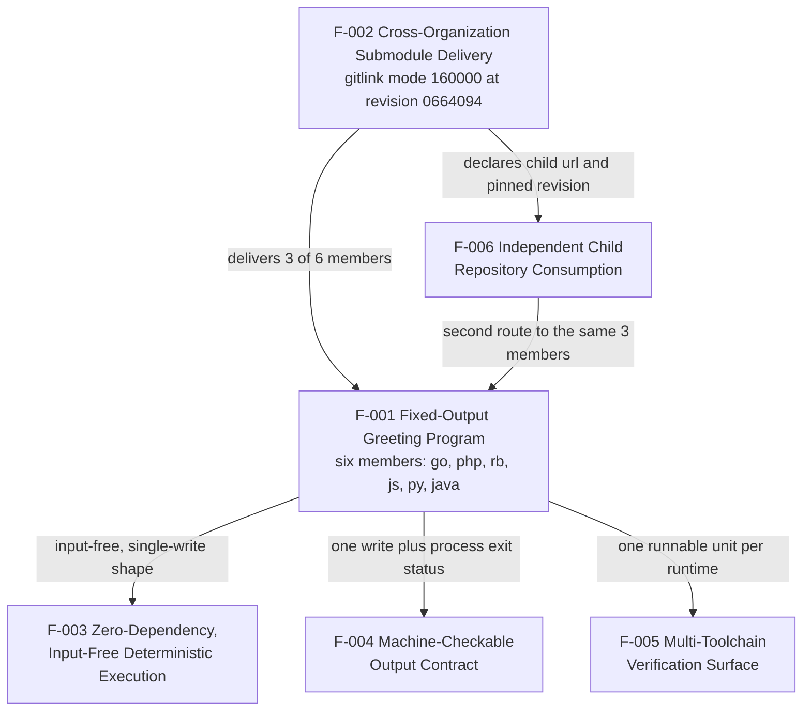

| Relationship | Direction | Evidence |
| --- | --- | --- |
| F-002 → F-001 | F-002 delivers three of F-001's six members | `submodule_repo_child_level_1/` holds `hello.js`, `hello.py`, `hello.java`; the gitlink at mode `160000` resolves them |
| F-001 → F-002 | F-002's pin is content-addressed to those three files | `0664094` is the child commit that contains `hello.js`, `hello.py`, and `hello.java` and nothing else |
| F-001 → F-003 | F-003 describes the programs' input and dependency shape | All six files; recursive pattern search returns no input or dependency reference |
| F-001 → F-004 | F-004 describes the programs' output and exit-status contract | All six files; observed for `hello.js` and `hello.py` |
| F-001 → F-005 | F-005 describes the one-unit-per-runtime coverage F-001 provides | Six files addressing six distinct runtimes |
| F-002 → F-006 | F-006 is reachable because F-002 declares the child URL and revision | `.gitmodules` line 3; gitlink `0664094` |
| F-006 → F-001 | F-006 is a second route to the same three child members | Standalone clone reproduced `hello.java`, `hello.js`, `hello.py` at `0664094` |

### 2.3.2 Integration Points

The system has four integration points and no others; a full-tree search found no configuration file besides `.gitmodules` in which a fifth could be declared.

| Integration point | Direction and trigger | Contract |
| --- | --- | --- |
| Superproject Git remote | Inbound, at clone | `github.com/lakshya-blitzy/parent_repo_hello_world_ABK_6771.git`; supplies five tracked files |
| Child Git remote | Inbound, at clone or `git submodule update` | `github.com/lakshya-blitzy-only-submodules/submodule_repo_child_level_1.git`; revision fixed by the gitlink at `0664094` |
| Host language runtimes | Inbound, at run time | One runtime per member — Go, PHP, Ruby, Node.js, Python 3, JDK; no version constraint is declared |
| Standard output and process exit status | Outbound, at run time | One greeting line (14 bytes for five members, 13 for `hello.php`) and exit status `0` |

The two Git integration points are decoupled from each other at the source level: no file in the superproject imports, calls, or otherwise references any file in the child, so the only linkage is the gitlink plus `.gitmodules`. That is why F-006 can exist at all — a consumer of the child never touches the superproject.

Credential handling is worth recording because it separates tracked content from local state. `.gitmodules` declares no credential key, and the child remote answered an unauthenticated `git ls-remote` and an unauthenticated clone, so anonymous HTTPS read suffices for both integration points. The superproject's own `origin` in this checkout carries an environment-injected GitHub installation token in its URL; that value lives in the untracked local `.git/config` and no credential, key, or secret appears in the tracked content of either repository. The parent's local Git configuration additionally holds `submodule.submodule_repo_child_level_1.active=true` and a matching `url`, likewise local rather than committed.

### 2.3.3 Shared Components

There is no shared source component. Each of the six programs is standalone and self-contained — no file imports, calls, or exports anything to another, and the superproject's Go package is `main`, which is not importable. What the members do share is a value rather than a component: the same compile-time literal, written once per file with no include, constant, or resource file between them.

| Candidate shared component | Finding |
| --- | --- |
| Shared source module or library | None — no imports or exports between files; each member is invoked directly |
| Shared constant, header, or resource file | None — the literal is repeated verbatim in each of the six files |
| Shared build artifact or generated code | None — no build step, generator, or artifact exists in either tree |
| Shared configuration file | `.gitmodules` only, and it configures the submodule rather than the programs |

The consequence is that the six members can drift independently, and one already has: `hello.php` uses `echo`, which appends no newline, while the other five output calls do. Nothing in the tree would detect that divergence, because there is no shared assertion, test, or CI job.

### 2.3.4 Common Services

No common service exists. The two working trees contain no logging, configuration, identity, secret, data-access, messaging, scheduling, or observability component, and no process beyond the single short-lived one each program creates. The recursive content search that established this returned one match for a network or persistence pattern across the whole tree — the `https://` URL on `.gitmodules` line 3, which is a source declaration consumed by Git rather than a service call made by any program.

| Service category | Present | Note |
| --- | --- | --- |
| Logging, metrics, tracing | No | The only runtime output is the greeting line and the exit status |
| Configuration or secret management | No | No program reads configuration; `.gitmodules` is consumed by Git, not by the members |
| Identity, authentication, authorization | No | No code path authenticates or authorizes anything; repository access is anonymous HTTPS read |
| Data access, persistence, caching | No | Nothing is written or read from disk, a database, or a queue |
| Scheduling, queues, messaging, HTTP serving | No | Every program exits immediately after its single write; no port is bound |


## 2.4 Implementation Considerations

Considerations are recorded per feature as observed, including the cases where a category has no applicable content — an absent scalability dimension, for instance, is a finding rather than an omission. No target, budget, or threshold is stated anywhere in the repository, so none is asserted here.

### 2.4.1 F-001 — Fixed-Output Greeting Program (Polyglot Member Set)

| Aspect | Consideration |
| --- | --- |
| Technical constraints | Each member must be runnable by its own toolchain with no adaptation: Go requires `package main` with an unexported `main`, which is not importable; PHP requires an interpreter and omits the closing `?>` tag; Ruby's top-level statement executes on load; Node.js evaluates `console.log` at load; Python's `print` runs at module level; Java requires compilation of the `Hello` class |
| Performance requirements | One write, one process, immediate exit. No latency, throughput, or resource budget is declared, and none is measurable against a program that performs a single write |
| Scalability considerations | The only growth dimension is the number of members. Adding one is additive: each program-creating commit in the history touched exactly one file, so no existing member, manifest, or registry must change. There is no load, concurrency, or shared state to scale |
| Security implications | No input, no privilege, no filesystem or network access, and no sensitive datum. The only content written is a fixed public literal, so the members expose no attack surface at run time |
| Maintenance requirements | Two members carry known divergence and risk. `hello.php` uses `echo`, which appends no newline where the other five output calls do, so any exact-string assertion must special-case it. `submodule_repo_child_level_1/hello.java` declares `public class Hello` in a file named `hello.java`, a difference a JDK normally rejects; because no JDK exists in the environment the risk remains open and should be resolved by renaming the file, renaming the class, or recording the tolerated behaviour |

Running a member can leave untracked residue, which matters for consumers that assert a clean tree: importing `hello.py` produced an untracked `__pycache__/hello.cpython-312.pyc` under the submodule directory, and compiling `hello.java` would produce a class file alongside it. Neither is ignored, because neither repository contains a `.gitignore`.

### 2.4.2 F-002 — Cross-Organization Submodule Delivery and Revision Pinning

| Aspect | Consideration |
| --- | --- |
| Technical constraints | A submodule-aware Git client is mandatory, since the child's content resolves only through the gitlink. The child checkout materializes as a `.git` **file** containing `gitdir: ../.git/modules/submodule_repo_child_level_1`, so the child's object store lives inside the superproject's `.git`; a packaged or archived checkout that excludes `.git` loses the child entirely. `.gitmodules` declares no `branch`, `tag`, `depth`, `shallow`, `update`, `ignore`, or `fetchRecurseSubmodules` key, so checkout follows default `init`/`update` behaviour |
| Performance requirements | Clone time is network-bound on two fetches in the recursive path and one in the plain path; no timeout, retry, or concurrency setting is declared |
| Scalability considerations | The pin is a single revision, so reproducibility does not degrade as the child's history grows — but the pin cannot express a range, and the content it delivers can only grow by the child adding files that the superproject's gitlink commit then references |
| Security implications | The child lives in a different GitHub organization from the superproject, so the superproject consumes a remote outside its own ownership boundary. Read access is anonymous HTTPS and `.gitmodules` declares no credential; a token must therefore never be committed into `.gitmodules` or the gitlink. The pin freezes the consumed code, which removes the risk that a later child commit silently enters a build; the corresponding exposure is that an outdated child revision stays in place until the gitlink is moved |
| Maintenance requirements | Advancing the pin is a deliberate two-part change — a new `.gitmodules` revision and a new gitlink — as the parent's final commit `5ecd4cc` demonstrates by touching exactly those two paths. Nothing automates it: there is no CI job, Dependabot configuration, or scheduled submodule update in either tree. At inspection the pin `0664094` equaled the child's `HEAD` and `refs/heads/main`, so the baseline is current, but that alignment is unenforced and breaks on the child's next commit |

A silent-partial-delivery hazard is inherent to this design and was reproduced. A plain `git clone` places none of the child's three files and reports no error; `git submodule status` in that state prefixes the revision with `-`, which means uninitialized, whereas a completed checkout shows a leading space. Any consumer that assumes a plain clone is sufficient will exercise three of six members and observe no failure.

### 2.4.3 F-003 — Zero-Dependency, Input-Free Deterministic Execution

| Aspect | Consideration |
| --- | --- |
| Technical constraints | The property is negative and cannot be enforced by a mechanism, because no manifest, lockfile, or linter exists in which to express it. It holds because the trees contain exactly eight files and none reads input |
| Performance requirements | Run time is bounded by process startup plus one write; there is no input wait, no resolution step, and so no timeout to configure |
| Scalability considerations | Not applicable. There is no workload, no concurrency, and no shared resource; the programs cannot be scaled because they hold no state to scale |
| Security implications | With no input surface, no deserialization path, no network client, and no third-party code, no injection, dependency-escalation, or supply-chain vector exists in the runtime path. The one external reference in the tree, the child Git URL, is consumed by Git at clone time rather than by any program |
| Maintenance requirements | Nothing needs patching, upgrading, or re-scanning, and no software bill of materials can be produced because there is no dependency to enumerate. The cost is the inverse: the absence is not defended, so a single added manifest or input read would silently void the property with no check to catch it |

### 2.4.4 F-004 — Machine-Checkable Output Contract

| Aspect | Consideration |
| --- | --- |
| Technical constraints | The contract is a convention held by the consumer: no assertion, test framework, or CI job exists anywhere in the tree, so nothing in the repository states or enforces it |
| Performance requirements | The only measurable properties are byte-exactness on standard output and the exit status. No latency, throughput, availability, or error-rate objective is declared, and none is derivable from a program that writes one line and exits |
| Scalability considerations | Not applicable. The output does not vary with load, repetition, or concurrency, and no aggregation or sampling is involved |
| Security implications | Output carries no sensitive content, and the F-002 integration is read-only. The contract therefore cannot leak information; its only security-relevant effect is that a consumer can trust the exit status as the sole failure signal, since no partial-success value exists |
| Maintenance requirements | The assertion is a constant comparison, so it must be updated whenever a member's output changes. One member already deviates in byte count (`hello.php` writes 13 bytes against 14 for the rest), and two members' outputs were never observed because their runtimes were absent, so any harness should record which members it actually exercised rather than infer success from a green run |

### 2.4.5 F-005 — Multi-Toolchain Verification Surface

| Aspect | Consideration |
| --- | --- |
| Technical constraints | Coverage requires all six toolchains on one host. There is no aggregate runner, so six separate invocations produce the result, and full coverage was not achievable in the inspection environment, where only Node.js and Python 3 were installed and Go, PHP, Ruby, and the JDK were absent |
| Performance requirements | Each invocation costs one toolchain startup plus one write; the Java member additionally costs a compilation. No time budget is declared for the set |
| Scalability considerations | The surface scales with the number of runtimes covered and with the number of hosts checked, not with load. Because each member is independent and additive, extending coverage means adding a file, and the per-file commits in the history show that no existing member changes as a result |
| Security implications | Running six toolchains expands the host's executed surface relative to a single-language check, but no member requires elevation, network access, or a credential. No runtime version is pinned, so which implementation executes is decided entirely by the host's `PATH` |
| Maintenance requirements | The check reports on the host, not on the repository, so there is nothing to upgrade in-tree; the obligation is to keep the member set and the coverage claim in step. Because no version constraint is declared anywhere, a host that passes today can fail later on a runtime upgrade with no record of the version that was previously proven |

### 2.4.6 F-006 — Independent Child Repository Consumption

| Aspect | Consideration |
| --- | --- |
| Technical constraints | The route requires only a Git client — submodule support is unnecessary because the child declares no `.gitmodules` and no nested submodule. The three files are complete on their own |
| Performance requirements | One network-bound clone; no submodule resolution follows it, so the route is marginally cheaper than the recursive F-002 path |
| Scalability considerations | Not applicable in the load sense. The route's availability depends on the child's own evolution: because the superproject pins `0664094`, a later child commit makes the two routes deliver different content, and the standalone route would then diverge from what a recursive clone yields |
| Security implications | The clone succeeded unauthenticated, so the content is public and read-only access suffices. Because the route bypasses the superproject's pin, a consumer taking it receives the child's current default branch rather than the pinned revision — the standalone clone checked out `main`, so this route does not inherit F-002's reproducibility guarantee |
| Maintenance requirements | The baseline revision `0664094` is the child commit that deleted its own `README.md`, so the pinned content contains no documentation at all; only the initial commit `c9bac6c` ever held the file, containing the single line `# submodule_repo_child_level_1`. Anyone reaching the child through this route finds three undocumented programs and must rely on this specification. Divergence between the pinned and current child revisions also has no detector, since neither repository runs a check |

### 2.4.7 Cross-Feature Considerations

| Aspect | Consideration |
| --- | --- |
| Verification gap | No test, harness, assertion, or CI job exists in either tree, so every acceptance criterion in §2.2 is verified externally and manually. A green result from one member says nothing about the other five |
| Documentation gap | `README.md` is a single title line of 34 bytes and, once cloned, has no trailing newline; the child carries no documentation at all. Nothing in either repository describes how to run a member, and there is no license file, so redistribution terms are undefined |
| Version drift | No runtime version, toolchain version, or dependency version is constrained or recorded anywhere, so the environment in which F-005 was last satisfied cannot be reconstructed from the repository |
| Change amplification | The design is close to change-isolated: each program addition touched one file, and moving the pin touched two. The single non-isolated change is deleting or renaming a member, which would require updating any external assertion together with F-002's gitlink if the member is a child file |
| Forward-looking material | No roadmap, backlog, milestone, or issue artifact exists, and a recursive search for `TODO`, `FIXME`, `XXX`, and `HACK` returns no matches. The two forward-looking observations available are both structural: `.gitmodules` pins no branch or tag, so the child revision moves only by commit; and because there is no build or test automation, adding or removing a member requires no change to any other file |


## 2.5 References

Every artifact cited as evidence in this section is a tracked file of the repository at parent commit `5ecd4cc` (branch `2810_01`) or submodule revision `0664094`, except where noted. No external source was consulted, so no web reference is listed.

**Superproject artifacts.**

- `hello.go` — 77 bytes, 7 lines. Establishes F-001-RQ-001: `package main` with unexported `func main`, writing the literal through `fmt.Println`; the sole program line is `fmt.Println("Hello, World!")`.
- `hello.php` — 28 bytes, 1 line. Establishes F-001-RQ-002 and the F-004 newline deviation: `<?php echo "Hello, World!";` with no closing `?>` tag and no newline appended by `echo`.
- `hello.rb` — 21 bytes, 1 line. Establishes F-001-RQ-003: top-level `puts "Hello, World!"` with no `$PROGRAM_NAME` guard.
- `README.md` — 34 bytes, 1 line, no trailing newline. Establishes the documentation gap in §2.4.7: a title line only, holding `# parent_repo_hello_world_ABK_6771`.
- `.gitmodules` — 170 bytes, 3 lines. Establishes F-002: one `[submodule "submodule_repo_child_level_1"]` section declaring only `path` and `url`, the latter under the foreign organization `lakshya-blitzy-only-submodules`.
- Repository root (`""`) — the folder listing establishes the complete first-order structure: five files and one folder, with no manifest, build script, test, CI configuration, or license file.

**Submodule artifacts.**

- `submodule_repo_child_level_1/hello.js` — 30 bytes, 1 line. Establishes F-001-RQ-004 and the executed F-004 contract for the Node.js member: `console.log("Hello, World!");`, observed to write 14 bytes and exit `0` under Node v22.23.3.
- `submodule_repo_child_level_1/hello.py` — 23 bytes, 1 line. Establishes F-001-RQ-005 and the executed F-004 contract for the Python member: module-level `print("Hello, World!")`, observed to write 14 bytes and exit `0` under Python 3.12.3, and to print on import while exposing no public symbol.
- `submodule_repo_child_level_1/hello.java` — 119 bytes, 5 lines. Establishes F-001-RQ-006 and the open naming risk in §2.4.1: `public class Hello` with `public static void main(String[])` writing the literal through `System.out.println`, in a compilation unit named `hello.java`.
- `submodule_repo_child_level_1/` — the folder listing establishes F-002 and F-006 scope: three files and a `.git` file containing `gitdir: ../.git/modules/submodule_repo_child_level_1`, with no `.gitmodules` of its own and no nested submodule.

**Git metadata and local configuration.** These established the revision, pin, inventory, and access facts. They are Git state rather than tracked content, and the superproject's local `.git/config` is explicitly excluded from the reference set as untracked local state.

- `git ls-files -s` — establishes F-002-RQ-002: the gitlink entry `160000 066409439699a1967ad788413b74dfc3e4914447 0 submodule_repo_child_level_1`.
- `git submodule status` — establishes F-002-RQ-003 and F-002-RQ-004: a leading space (initialized at the pinned revision) against a leading `-` (uninitialized) in a plain clone.
- `git clone --recurse-submodules`, plain `git clone`, and `git submodule update --init` against `github.com/lakshya-blitzy/parent_repo_hello_world_ABK_6771.git` — establish the two F-002 checkout routes, each exiting `0`.
- Unauthenticated `git ls-remote` and `git clone` against `github.com/lakshya-blitzy-only-submodules/submodule_repo_child_level_1.git` — establish F-002-RQ-005 and F-006-RQ-001: `HEAD` and `refs/heads/main` both at `0664094`, reached with no credential.
- Parent and child `git log --format` output — establish the ten-commit history, the single-file-per-commit pattern behind the F-005 scalability finding, the deletion of the child's `README.md` in `0664094`, and the fact that nine of ten commits are authored by `lakshya-blitzy <lakshya@blitzy.com>`.
- Parent and child `git branch -a` and `git tag` output — establish that `main` and `2810_01` carry byte-identical trees at `5ecd4cc` and that neither repository holds a tag.
- Recursive content searches over all eight files — establish the absence evidence behind F-003 and §2.3.4: no input-handling match for `argv`, `getenv`, `ENV[`, `stdin`, `readline`, `input(`, `Scanner`, `bufio`, `args[`, `os.environ`, `process.env`, `ARGV`, `fgets`, or `scanf`; no manifest, test, CI, or `TODO` match; and a single network-or-persistence match, the URL on `.gitmodules` line 3.
- `wc`, `od -c`, and full-tree `find` output — establish the byte and line counts in the F-001 member tables, the trailing-newline findings, and the exact eight-file inventory of both trees.

**Related specification sections.** §1.1 (Executive Summary) supplied the artifact inventory and actor list; §1.2.2 supplied the component flowchart referenced in §2.2.8; §1.2.3 supplied the observable acceptance criteria that overlap F-004; and §1.3.1 and §1.3.2 supplied the in-scope and out-of-scope boundaries that qualify every feature statement in §2.1.


# 3. Technology Stack

## 3.1 Programming Languages

The repository is a deliberately polyglot sample: it contains **six programming languages across two delivery components**, with exactly one program per language and no code shared between them. The complete inventory is eight tracked files and 16 program lines — `hello.go` (7 lines), `submodule_repo_child_level_1/hello.java` (5 lines), and one line each in `hello.php`, `hello.rb`, `submodule_repo_child_level_1/hello.js` and `submodule_repo_child_level_1/hello.py` — plus `README.md` (1 line) and `.gitmodules` (3 lines). No language appears twice, and no program is written in more than one language.

### 3.1.1 Language Inventory by Platform and Component

| Language | Component / platform | Program file | Size | Entry point | Output construct |
| --- | --- | --- | --- | --- | --- |
| Go | Superproject root; compiled executable | `hello.go` | 77 B, 7 lines | `func main()` in `package main` (line 5) | `fmt.Println` (line 6) |
| PHP | Superproject root; interpreted script | `hello.php` | 28 B, 1 line | top-level statement, no closing `?>` tag | `echo` (line 1) |
| Ruby | Superproject root; interpreted script | `hello.rb` | 21 B, 1 line | top-level statement, no `__FILE__ == $PROGRAM_NAME` guard | `puts` (line 1) |
| JavaScript (Node.js) | Submodule checkout `submodule_repo_child_level_1` | `hello.js` | 30 B, 1 line | evaluated at load | `console.log` (line 1) |
| Python 3 | Submodule checkout `submodule_repo_child_level_1` | `hello.py` | 23 B, 1 line | executed at module level | `print` (line 1) |
| Java | Submodule checkout `submodule_repo_child_level_1` | `hello.java` | 119 B, 5 lines | `public static void main(String[] args)` on `public class Hello` (line 2) | `System.out.println` (line 3) |

Three languages therefore belong to the superproject working tree owned by `lakshya-blitzy` and three to the submodule working tree owned by the separate organization `lakshya-blitzy-only-submodules`; the split is a repository boundary, not a language or platform decision, and `.gitmodules` records it in the Git configuration language (INI) with `path` and `url` keys only.

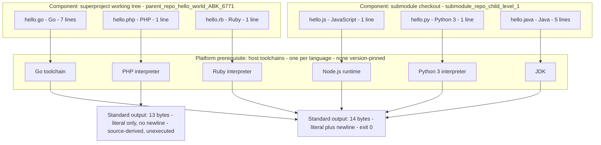

Two non-program artifacts complete the file set and are not application code: `README.md` (Markdown, the single title line `# parent_repo_hello_world_ABK_6771`) and `.gitmodules` (Git INI configuration). Neither is compiled, interpreted, or executed.

### 3.1.2 Selection Criteria

The repository declares no language-selection rationale: `README.md` holds only the title line, and there is no architecture decision record, contributing guide, or design note anywhere in either tree. The criteria below are the ones the artifacts themselves demonstrate, not stated goals.

| Criterion | Evidence | Consequence for the stack |
| --- | --- | --- |
| One language per host runtime, to exercise each toolchain | Six programs, six distinct languages, no repeats (`git ls-files -s` in both trees) | The stack is a breadth check, not a product built on one language; each language is present for one invocation |
| Standard-library-only implementation, so no resolution step can interfere | `import "fmt"` in `hello.go` is the single import statement in the entire repository; the other five programs call host built-ins (`echo`, `puts`, `console`, `print`, `java.lang.System`) | Every language choice is dependency-free by construction; results isolate the toolchain |
| Additive, one-file-per-language change model | Each creation commit touched exactly one file (`dd1dd3e` hello.go, `2cb5454` hello.rb, `8be4abc` hello.php`; child `0cffdc1`, `b16b93a`, `a64c831`) | A language can be added or replaced without touching any other member |
| Directly runnable by the toolchain's own standard runner | No Makefile, wrapper script, build file, or CI job exists in either tree | Language choice carries no build-tooling obligation |

### 3.1.3 Version Posture

**No language runtime version is declared, constrained, or recorded anywhere in either repository.** There is no manifest in which to state one — no `go.mod`, `composer.json`, `Gemfile`, `package.json`, `requirements.txt`, `pyproject.toml`, `pom.xml`, or `build.gradle` — and no CI file, lockfile, `.gitattributes`, or toolchain-version file exists. Two consequences follow, both reported in §2.4.5: the implementation that executes each program is decided entirely by the host's `PATH`, and the environment in which the check last passed cannot be reconstructed from the repository.

| Language | Version pinned by the repository | Version used for the observed run in this inspection | Current upstream stable line (external context, not repository content) |
| --- | --- | --- | --- |
| Go | None | Not installed; member not executed | Go 1.27.3 |
| PHP | None | Not installed; member not executed | PHP 8.5.12 |
| Ruby | None | Not installed; member not executed | Ruby 4.0.9 |
| JavaScript (Node.js) | None | Node v22.23.3 | v26.12.1 Current; v24 and v22 the active LTS lines |
| Python 3 | None | Python 3.12.3 | Python 3.15.2 |
| Java | None | No JDK installed; member not executed | JDK 27 feature release; JDK 25 the current LTS |
| Git (delivery tool, not a program language) | None | Git 2.43.0 | Git 2.56.0 |

The third column is the only version evidence the system owns, and it is an observation of one machine rather than a requirement. The fourth column is supplied solely because a technology-stack document is expected to state versions, and it is explicitly **not** a dependency of this repository: none of those releases is referenced by any file here, and the programs are written in syntax that has been stable across many releases of each language.

### 3.1.4 Constraints and Dependencies of Each Language Choice

Every constraint below is a property of how the language executes a source file; all were read from the files themselves, and the two observed runs (Node.js, Python 3) are marked as executed.

| Language | Constraint imposed on the toolchain | Observed / expected effect |
| --- | --- | --- |
| Go | Requires `package main` with an unexported `func main`; the package is not importable and every declaration in it is unexported | Builds a runnable binary; the member cannot be reused as a library |
| PHP | Requires an interpreter; the file omits the closing `?>` tag, which is the recommended form for a PHP-only file | `echo` appends no newline, so this member's stdout is expected to be 13 bytes where the other five produce 14 (source-derived, not executed — no PHP interpreter in the inspection environment) |
| Ruby | The `puts` call sits at file top level with no `__FILE__ == $PROGRAM_NAME` guard | Merely loading or `require`-ing the file prints the greeting; it is run directly, not consumed as a library |
| JavaScript (Node.js) | The statement executes at evaluation time; no module system is used (no `require`, no ESM `import`) | Running the file prints; importing it as a module would also print, and it exports no symbols |
| Python 3 | The `print` call sits at module top level | Both `python3 hello.py` and `import hello` print the greeting (executed: `dir(hello)` exposes no public symbol) |
| Java | Requires compilation before execution and a JVM to run | The compilation unit `hello.java` declares `public class Hello`; a JDK normally requires a public type's file name to match the class name, so this member carries an unverified compilation risk because no JDK was available — §1.3 records the same finding |

**Cross-language dependencies: none.** No program imports, calls, links against, or spawns another: the repository-wide grep for import-style statements returns exactly two lines (`package main` and `import "fmt"` in `hello.go`), and a grep for process-spawning and interop calls (`exec`, `system`, `subprocess`, `popen`, `ProcessBuilder`, `Runtime.exec`, `child_process`, `ffi`, `ctypes`, `JNI`) returns no matches. The languages are parallel members of one sample set, never a call chain.

**Platform dependency shared by all six.** Each language presupposes one host runtime, and a full pass over the stack presupposes all six on a single host — Go, a PHP interpreter, a Ruby interpreter, the Node.js runtime, a Python 3 interpreter, and a JDK. Four of the six were absent from this inspection environment, so the constraint is demonstrably load-bearing: partial provisioning silently reduces coverage from six members to two (see §2.4.5).

### 3.1.5 Integration and Security Implications of the Language Choices

**Integration between the languages happens only at two external seams**, neither of which is code-level:

| Seam | Contract | Note |
| --- | --- | --- |
| Standard output | One line of `Hello, World!` plus a trailing newline (14 bytes) from five members; the literal without a newline (13 bytes) from `hello.php` | The uniform contract is what makes six different languages comparable; `hello.php` is the single deviation |
| Process exit status | `0` on success | Observed for `hello.js` and `hello.py`; no error path exists in any member, so no non-zero status is reachable through program logic |

**Security implications.** Choosing six independent standard-library-only languages yields an unusually small attack surface and one specific exposure:

- **No input, no third-party code, no I/O.** No member reads argv, environment variables, standard input, files, or the network, and none writes files or opens a socket. Consequently no deserialization, injection, path-traversal, or supply-chain vector exists in the runtime path (§2.4.3), and no dependency advisory can date the stack.
- **Six toolchains instead of one.** Running the set executes six language implementations where a single-language check would execute one, so the host's trusted-code surface is broader; no member requires elevation, a credential, a port, or network access at run time.
- **Unpinned implementations.** Because no version is constrained, whatever binary the host's `PATH` resolves executes the member. A stale, tampered, or unexpectedly new runtime is indistinguishable from a correct one to the repository — the check reports on the host, not on the code, and there is no lockfile or checksum to notice the substitution.
- **No secrets in source.** All six programs contain one fixed public literal and nothing else; no credential, key, token, or endpoint appears in any tracked file. The one credential present in this checkout is the environment-injected GitHub installation token in the local, **untracked** `.git/config`, which never reaches tracked content.


### 3.1.6 Cross-Language Interoperability Surface

No member of the set calls, links to, embeds, or launches another, and none reaches outside its own language runtime. The evidence is a negative result, stated here with the exact pattern tested and the exact count obtained, because an absence is only as strong as the search behind it.

| Surface tested | Pattern | Result across all six program files |
| --- | --- | --- |
| Import or inclusion of code | `^\s*(import|require|use|from|include|#include)` | 1 match: `hello.go:3 import "fmt"` — the Go standard library, the only imported code in the repository |
| Process spawning | `exec(`, `system(`, `subprocess.`, `popen(`, `ProcessBuilder`, `Runtime.exec`, `child_process`, `spawn` | 0 matches |
| Foreign-function / embedding bridges | `ffi.`, `ctypes`, `JNI` | 0 matches |
| Network access | `socket`, `http`, `urlopen`, `requests`, `curl`, `wget`, `net.`, `fetch`, `listen`, `bind` | 0 matches |

A broader case-insensitive pass over the same files for the bare substring list `exec|system|subprocess|popen|ProcessBuilder|Runtime.exec|child_process|ffi|ctypes|JNI|spawn` returns exactly one line — `submodule_repo_child_level_1/hello.java:3 System.out.println("Hello, World!");` — which is a substring match on `System`, the Java standard-library output call, and not a process-spawning call. The distinction matters for the reading above: the single hit is the member's output statement, already accounted for in §3.1.1, and no interop call exists in the set.

Interoperability is therefore confined to the two external seams named in §3.1.5 — standard output and process exit status — plus one checkout-level requirement shared with the Git layer: the submodule’s three members must be materialized at `submodule_repo_child_level_1/` before the JavaScript, Python and Java members can be invoked at all (see §2.4.2 for the silent-partial-checkout hazard this creates). Adding a language to the stack requires no change to any existing member, because no member is aware of any other.


## 3.2 Frameworks &amp; Libraries

**The repository contains no framework of any kind and no supporting library.** This is a positive finding about the system's design, not a gap in documentation: the property that makes the member set usable as a toolchain probe is that nothing sits between the program and its runtime (§2.1.4). The evidence is exhaustive — the repository comprises eight tracked files, and a case-insensitive search of every one of them for the framework, library, and service names listed in §3.2.3 returned zero matches.

### 3.2.1 Framework Inventory

| Framework category | Candidate names searched | Present in this system |
| --- | --- | --- |
| Web / application frameworks | Flask, Django, FastAPI, Express, Next.js | None |
| UI / front-end frameworks | React, Angular, Vue, Svelte, React Native, ElectronJS, TailwindCSS | None |
| AI / orchestration frameworks | LangChain, OpenAI SDK, Anthropic SDK | None |
| Test frameworks | pytest, unittest, JUnit, Jest, RSpec, PHPUnit | None |
| Dependency-injection, logging, HTTP-client frameworks | Spring, Log4j, Logback, Requests, axios | None |
| Native-application frameworks | Swift/SwiftUI, Kotlin/Android SDK, Objective-C/Cocoa | None |

No framework version can be reported because no framework is referenced: there is no import, require, autoload, plugin, extension declaration, or configuration file in either working tree through which a framework could be introduced. The only versioned substrate is the set of six host language runtimes described in §3.1.3, and none of those versions is constrained by the repository either.

### 3.2.2 Language Built-ins Used in Place of Libraries

Every output call in the system resolves inside the language runtime that executes it. These are the complete contents of the code's outward surface — five built-ins and one implicitly imported standard-library package, none of which is a third-party library and none of which is fetched from a registry.

| Member | Facility used | Origin | Supply-chain status |
| --- | --- | --- | --- |
| `hello.go` | `fmt` package, `Println` | Go standard library, the repository's only explicit import (`hello.go:3`) | Ships with the Go toolchain |
| `hello.php` | `echo` language construct | PHP interpreter, no import required | Part of the language |
| `hello.rb` | `puts` (a `Kernel` method) | Ruby interpreter, mixed into `Object` | Part of the language |
| `hello.js` | `console` global | Node.js runtime global object | Part of the runtime |
| `hello.py` | `print` | Python built-in function | Part of the language |
| `hello.java` | `System` and `System.out` | `java.lang`, implicitly imported by every compilation unit — the file declares no `import` statement | Part of the JDK |

Consequently there is no library to update, patch, license, or vet, and no version-compatibility matrix between libraries to maintain. The only compatibility question in the system is the one recorded in §3.2.3.

### 3.2.3 Compatibility Requirements

| Requirement | Statement | Evidence |
| --- | --- | --- |
| Source-level syntax compatibility | Each program uses only the minimal, long-stable syntax of its language — a print call at top level or inside an entry point — so any runtime release capable of executing the file satisfies the system. No version range is declared. | The six program files, totaling 16 lines |
| No library-resolution compatibility | There is no manifest or lockfile to reconcile, so no dependency-conflict class of failure exists at build or run time. | Absence of `go.mod`, `composer.json`, `Gemfile`, `package.json`, `requirements.txt`, `pyproject.toml`, `pom.xml`, `build.gradle` |
| Output-contract compatibility | Five members write `Hello, World!` plus a newline (14 bytes); `hello.php` writes the literal with no newline (13 bytes) because `echo` appends nothing. Any consumer holding the expected string must account for that difference. | `od` on the two executed members; the `echo` construct in `hello.php` |
| Java naming compatibility | The compilation unit `hello.java` declares `public class Hello`; a JDK normally requires a public type's file name to match the class name. This is the repository's one identified compatibility risk and is unverified here because no JDK was installed. | `submodule_repo_child_level_1/hello.java:1` |
| Host provisioning compatibility | Full coverage requires six runtimes on one host; there is no aggregate runner and no container image to carry them, so compatibility with the check is a property of the environment, not of the artifact. | No Makefile, Dockerfile, or CI file in either tree |

### 3.2.4 Justification for the Absence of Frameworks and Libraries

Three properties of the system depend on that absence, and each was recorded as a deliverable feature in §2.1:

- **Attribution.** With no framework, no library, and no configuration, a member's result depends on nothing but its own runtime. A failure isolates a missing or broken toolchain instead of an installation or version mismatch (§2.1.6).
- **Determinism without a lockfile.** Because nothing is resolved at build or run time, no registry state, mirror, or advisory can change what executes. The system is reproducible from the clone alone.
- **Change isolation.** Each language-adding commit in the history touched exactly one file, which is possible only because no shared framework scaffolding exists to update.

The corresponding cost is the inverse, already noted in §2.4.3: nothing enforces the property. A single added manifest or import would silently introduce a dependency, and no lint rule, lockfile check, or CI job exists to notice.

### 3.2.5 Default Technology Stack — Applicability Test

This section's planning input listed a generic default stack (Flask, React with TypeScript, TailwindCSS, React Native, LangChain, Auth0, MongoDB, AWS, Docker, Terraform, GitHub Actions, Swift, Kotlin, Objective-C, ElectronJS, and Python). Each item was tested against the tree, and none of the application-layer items is present; where an item does correspond to something real, it is the hosting and tooling underneath the repository rather than a component of the system.

| Default-stack item | Applicability to this system | Where addressed |
| --- | --- | --- |
| Python (as an application language) | Partially applicable and narrower than the default: Python 3 appears as **one of six equal peer programs** (`hello.py`, one line), not as a backend language; there is no Flask, no server, and no application structure | §3.1.1, §3.2.1 |
| Flask | Not applicable — no web framework, no HTTP server, no route, no request handling anywhere in the tree | §3.2.1 |
| React / TypeScript / TailwindCSS / React Native / ElectronJS | Not applicable — no front-end, no UI, no `package.json`, no TypeScript file, no build step | §3.2.1 |
| LangChain | Not applicable — no AI/LLM integration of any kind; the only artificial dependency surface in the tree is Git itself | §3.2.1 |
| Auth0 | Not applicable — no authentication, authorization, session, or token code exists; the repository's only credential is the environment-injected Git token in untracked local config | §3.4.2 |
| MongoDB / any database | Not applicable — no database driver, no connection string, no schema, no persistence of any kind | §3.5 |
| AWS / any cloud platform | Not applicable — no cloud resource, SDK, credential, or infrastructure definition; the only network endpoints the system uses are Git remotes on GitHub | §3.4.1 |
| Docker / Terraform | Not applicable — no container definition, no image, no provisioning template, and neither `docker` nor `terraform` exists in the inspection environment | §3.6.3, §3.6.4 |
| GitHub Actions | Partially applicable at the platform level only: the repositories are hosted on GitHub, but no workflow file, job, or runner configuration exists, so there is no CI/CD at all | §3.6.5 |
| Swift / Kotlin / Objective-C | Not applicable — the set's compiled-language members are Go and Java; no Apple or Android toolchain, project file, or package manifest is present | §3.2.1 |

The only default-stack items that survive this test are the two that describe the environment the repository sits in rather than components it contains: **Git/GitHub as the delivery platform** and **the six host language toolchains** that execute the members. Both are documented in §3.1 and §3.6.


## 3.3 Open Source Dependencies

**The system has no open-source library dependencies.** Nothing is installed, resolved, locked, or linked from a package registry at build time or run time, because there is no build step and no manifest. What the system does consume is a *substrate* rather than a dependency set: six language runtimes and one version-control client, all supplied by the host, plus three source files that arrive from a separately owned repository through Git.

### 3.3.1 Third-Party Library Inventory

| Category | Finding | Evidence |
| --- | --- | --- |
| Third-party libraries vendored or imported | None | `import "fmt"` (`hello.go:3`) is the only import statement in the repository; the other five members use host built-ins only |
| Vendored source directories | None | The complete tree is 8 files across two working directories; there is no `vendor/`, `node_modules/`, `site-packages/`, or equivalent |
| Package manifests | None | No `go.mod`, `composer.json`, `Gemfile`, `package.json`, `requirements.txt`, `pyproject.toml`, `pom.xml`, or `build.gradle` in either tree |
| Lockfiles | None | No `go.sum`, `composer.lock`, `Gemfile.lock`, `package-lock.json`, `poetry.lock`, or `gradle.lockfile` |
| Dependency automation | None | No Dependabot/Renovate configuration, no `.github/` directory, no dependency-update workflow |

### 3.3.2 Package Registries and Versions

Each of the six languages has a conventional registry and manifest format that this system simply does not use. The table below records that mapping — not because a package is fetched from any of them, but because the absence is meaningful for supply-chain review.

| Language | Conventional registry | Conventional manifest | Used by this system |
| --- | --- | --- | --- |
| Go | Go module proxy / `proxy.golang.org` | `go.mod` + `go.sum` | No — no module, no version, no proxy request |
| PHP | Packagist | `composer.json` + `composer.lock` | No — and Composer is not required to run `hello.php` |
| Ruby | RubyGems | `Gemfile` + `Gemfile.lock` | No — and Bundler is not required to run `hello.rb` |
| JavaScript (Node.js) | npm registry | `package.json` + lockfile | No — `hello.js` runs directly under Node with no install step |
| Python 3 | PyPI | `requirements.txt` / `pyproject.toml` | No — `hello.py` uses only the `print` built-in |
| Java | Maven Central | `pom.xml` / `build.gradle` | No — `hello.java` uses only `java.lang` and needs no classpath beyond the JDK |

**No registry coordinate of any kind exists in the repository** — no package name, no version range, no checksum, no registry URL, and no credential for one. A case-insensitive search of all eight files for the package managers and registries themselves (`npm`, `pip`, `gem`, `composer`, `maven`, `gradle`, `nuget`, `cargo`) returned zero matches, and no install step exists anywhere because there is no CI file, script, or Makefile to hold one.

### 3.3.3 Open-Source Substrate Actually Consumed

Two open-source layers are genuinely required to use the system, and both are provided by the host or the platform rather than by the repository. Their licenses belong to the environments the system runs in; no license text is reproduced or referenced by any file here.

| Component | Role for this system | Version pinned by the repository | License (per project sources) |
| --- | --- | --- | --- |
| Git client | The entire delivery mechanism: clone, gitlink resolution, submodule checkout | None | GNU General Public License version 2.0 |
| Go toolchain | Compiles and runs `hello.go` | None | BSD-style three-clause license, plus a separate patent grant |
| PHP interpreter | Runs `hello.php` | None | Modified BSD License (published as "PHP License, version 4"; the 8.5 branch still ships the version 3.01 text) |
| Ruby interpreter | Runs `hello.rb` | None | Dual: 2-clause BSDL or the Ruby License |
| Node.js runtime | Runs `hello.js` | None | MIT |
| CPython interpreter | Runs `hello.py` | None | Python Software Foundation License Version 2 |
| JDK (OpenJDK) | Compiles and runs `hello.java` | None | GPLv2 with the Classpath Exception |

The **one** third-party artifact the repository does pull is the submodule content: three programs (`hello.js`, `hello.py`, `hello.java`) authored in the `lakshya-blitzy-only-submodules` organization, which is outside the superproject's own ownership boundary. It is fetched over anonymous HTTPS at the exact revision `066409439699a1967ad788413b74dfc3e4914447` fixed by the superproject's gitlink (mode `160000`), recorded in `.gitmodules` with `path` and `url` only — no branch or tag, so no moving reference can substitute different code (§2.4.2).

### 3.3.4 Supply-Chain and Security Implications

- **No vulnerable-dependency surface to track.** With no libraries and no manifests, there is no software bill of materials to produce, no advisory feed that can become actionable, and no transitive dependency that can be escalated into the build. The corresponding cost, recorded in §2.4.3, is that nothing would detect a dependency being introduced later.
- **The only artifact integrity control is the Git revision.** The submodule's three files are immutable in the sense that the gitlink names content by hash; changing the consumed code requires a new superproject commit. There is no additional signature, checksum file, or provenance attestation beyond that, and the fetch is unauthenticated because the child repository is publicly readable.
- **Repositioning the supply-chain boundary.** The dependency that a reviewer must consider is the host toolchain set, not the code: because no runtime version is constrained (§3.1.3), whichever implementation the host's `PATH` resolves will execute the members, and a substituted or unexpectedly new runtime is indistinguishable from a correct one.
- **This repository's own license is undefined.** Neither working tree contains a `LICENSE`, `COPYING`, or notice file — a recursive search returns no match — so redistribution terms for the repository's own content are unstated, even though the runtimes it depends on are clearly open-source. §2.4.7 records the same gap.
- **No secret is needed to obtain anything.** The child repository resolves to an anonymous `git ls-remote`, and `.gitmodules` declares no credential key; the single token present in this checkout lives in the untracked local `.git/config` and never enters tracked content. Committing a token into `.gitmodules` would be the one way to break this property, which is why §3.4.2 treats it as an explicit constraint.


## 3.4 Third-Party Services

**The system integrates with exactly one third-party service: GitHub, as a Git remote over HTTPS.** Both repositories — the superproject and the separate-organization submodule — are fetched from `github.com`, and nothing else leaves the machine. There is no external API call, no identity provider, no monitoring backend, and no cloud platform service anywhere in either tree: the repository contains no configuration file other than `.gitmodules`, and a case-insensitive search of all eight tracked files for cloud, identity, monitoring and API-service names returned zero matches.

### 3.4.1 External Services and Integrations

| Service | Role | Endpoint | Protocol and access | Evidence |
| --- | --- | --- | --- | --- |
| GitHub (superproject hosting) | Source of truth for the superproject: five tracked files plus the gitlink | `github.com/lakshya-blitzy/parent_repo_hello_world_ABK_6771.git` | HTTPS Git over TLS; verified anonymously readable — `git -c credential.helper= ls-remote` returned `HEAD`, `refs/heads/2810_01` and `refs/heads/main`, all at `5ecd4cc`, exit 0 | Parent `origin` in local Git config; anonymous `ls-remote` executed during inspection |
| GitHub (submodule hosting, different organization) | Source of the three child programs | `github.com/lakshya-blitzy-only-submodules/submodule_repo_child_level_1.git` | HTTPS Git over TLS; verified anonymously readable — anonymous `ls-remote` returned `HEAD` and `refs/heads/main` at `0664094`, exit 0 | `.gitmodules` lines 1-3; anonymous `ls-remote` |
| TLS/DNS/HTTP stack of the host | Transport for both fetches | Implicit | System defaults; the checkout sets no `http.version`, proxy, or `sslVerify` override | Local Git configuration |

The two repositories sit in different GitHub organizations (`lakshya-blitzy` and `lakshya-blitzy-only-submodules`), so the system consumes a remote outside its own ownership boundary — the property that the repository exists to demonstrate, and the one §2.4.2 analyses for its silent-partial-checkout hazard.

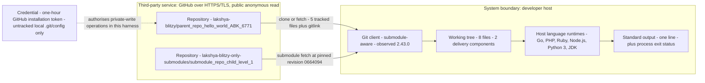

### 3.4.2 Authentication and Authorization

No authentication service is integrated. There is no identity provider, OAuth/OIDC client, API key, service account, mutual-TLS configuration, or authorization code in either tree — the only access control in play is whatever GitHub applies to its own Git endpoints.

| Aspect | Finding |
| --- | --- |
| Identity provider / SSO / OAuth | None — no Auth0, Okta, Firebase, or equivalent is referenced in any file |
| Credential declared in tracked content | None — `.gitmodules` carries `path` and `url` only; no credential key, and no token ever appears in tracked content |
| Credential present locally in this harness | The superproject's local `remote.origin.url` in the untracked `.git/config` (906 bytes) carries an `x-access-token` credential. Decoding the token's own claims shows `iss: github`, `aud: authnd`, `ver: 3`, with `iat` 2026-10-28T06:06:59Z and `exp` 2026-10-28T07:06:59Z — a **one-hour, environment-injected GitHub installation token**, not a stored secret |
| Credential helper | None configured, so no credential is persisted to a store by this repository |
| Read access required at run time | None — both URLs resolve anonymously, so executing the members needs no credential at all |
| Credential boundary constraint | Because `.gitmodules` and the gitlink are tracked while the token lives only in untracked local config, committing the token into `.gitmodules` or any member file would be the single way to leak production credentials from this system. The design keeps them separate. |

### 3.4.3 Monitoring and Observability Services

None. No APM, log-aggregation, metrics, tracing, uptime, or error-reporting service is integrated — there is no Prometheus, Grafana, Datadog, Sentry, New Relic, or OpenTelemetry reference, no logging library, no instrumentation, and no agent configuration anywhere in the tree. The system's entire observable surface is what the operating system provides: one line on standard output and a process exit status. The two executed members produced exactly 14 bytes on stdout, zero bytes on stderr, and exit status `0`; nothing is reported to any remote system, so no third-party observability dependency exists to monitor, authenticate, or pay for.

### 3.4.4 Cloud Platform Services

None. No AWS, Microsoft Azure, or Google Cloud service is used: there is no cloud SDK, no IaC template, no bucket, queue, function, managed database, secret manager, or container registry, and no cloud credential. The only remote infrastructure the system depends on is GitHub's Git hosting, which is a source-control service rather than a runtime cloud platform. The checkout is plain Git content — five files and a gitlink — so the system runs anywhere the six host toolchains exist, and it holds no cloud deployment target.

### 3.4.5 Integration Requirements and Security Implications

| Requirement | Detail |
| --- | --- |
| Outbound HTTPS reachability | Access to `github.com` for two fetches — the superproject clone and the submodule checkout. Without the second, three of the six programs are absent while the checkout still reports success (§2.4.2) |
| A submodule-aware Git client | Mandatory: the child's content resolves only through the gitlink. Git 2.43.0 was used here; `.gitmodules` pins no branch, tag, or depth, so checkout follows default `init`/`update` behaviour |
| Anonymous read capability | Sufficient for both endpoints, verified by credential-free `ls-remote` against each URL. No firewall exception for a private registry or an API host is needed |
| No inbound surface | Nothing in the system listens on a port, accepts a callback, or requires a webhook — so no ingress rule, DNS record, certificate, or allow-list entry is implicated |
| No runtime service dependency | Once cloned, no member contacts any service; the network is needed only at clone time, which is why a run is reproducible offline |

**Security implications of the integration.** Two points follow from the design and one from the environment:

- **Small, read-only attack surface.** The system makes one class of outbound request — a read of a public Git remote over TLS — and accepts no inbound connection. A compromised service would have to be reached through Git itself.
- **Trust is delegated to the pin, not to the transport.** Because the consumed child revision is named by hash in the gitlink, the content fetched is fixed regardless of what the child's default branch does later. The exposure that remains is the one §2.4.2 states: no automation notices when the pin grows stale, and no signature or attestation beyond the Git object hash vouches for the fetched programs.
- **The transient token never reaches tracked content.** The one credential in the checkout is a one-hour installation token in untracked local configuration, which limits both the blast radius if the working directory is copied and the temptation to commit it. Every fetch the system actually needs succeeds without it.


## 3.5 Databases &amp; Storage

**This system has no database, no persistence layer, and no caching tier.** It reads no input and writes no output other than one line on standard output, so there is no schema, no connection, no query, no transaction, and no stored record anywhere. The only data that outlives a run is the Git object store that carries the repository itself.

### 3.5.1 Databases

| Database category | Candidate products | Presence in this system |
| --- | --- | --- |
| Document database | MongoDB, CouchDB, DynamoDB | None |
| Relational database | PostgreSQL, MySQL/MariaDB, SQLite | None |
| Key-value / cache store | Redis, Memcached | None |
| Embedded / file-based store | SQLite file, BerkeleyDB | None |

The absence is total and mechanistic, not merely undocumented: no database driver is imported (the repository's only import is `import "fmt"` in `hello.go:3`), no connection string, DSN, or host address appears in any file, and a search of all six programs for `sql`, `database`, `jdbc`, `sqlite`, `mongo`, `redis`, `session`, `connection`, and `.db` returned zero matches. There is consequently no primary database to name, no secondary or replica database, no migration script, and no ORM or query builder to configure. A deployment of this system has no database to provision and no connection to manage.

### 3.5.2 Persistence Strategy

The system's persistence is entirely inherited from version control. The Git object store on disk is the only durable state, and it carries exactly the eight tracked files and the ten commits across both repositories.

| Persisted artifact | Location | Size / content |
| --- | --- | --- |
| Superproject Git object store | `.git/` in the checkout root | 400 KB on disk; 15 objects in 1 pack (pack 5 KiB); refs `refs/heads/2810_01`, `refs/heads/main`, `refs/remotes/origin/{2810_01,HEAD,main}` all at `5ecd4cc`; zero tags |
| Child Git object store | `.git/modules/submodule_repo_child_level_1/` — inside the superproject's `.git`, reached from the child working tree through the `gitdir:` pointer file | 200 KB on disk; 14 objects in 1 pack (pack 5 KiB); refs at `0664094`; zero tags |
| Tracked working-tree content | repository root and `submodule_repo_child_level_1/` | 8 files, 502 bytes total; 16 of those lines are program code |
| The only datum the code handles | the string literal in six source files | `Hello, World!`, repeated once per program; nothing is written back |

Two storage consequences deserve recording, because both are behavioural rather than stylistic:

- **The child's content is stored inside the parent's `.git`.** Because the submodule working tree is a `gitdir:` pointer to `.git/modules/submodule_repo_child_level_1`, anything that copies or archives the working tree without `.git` loses three of the six programs entirely; the same is true of a non-recursive clone, which leaves the child directory empty and reports no error (§2.4.2).
- **Running a member can leave untracked residue, and nothing ignores it.** Executing `hello.py` as a script writes nothing, but importing it emits `__pycache__/hello.cpython-312.pyc` beside the source (verified outside the repository), and compiling `hello.java` would emit a `.class` file alongside it. Neither repository contains a `.gitignore`, so such residue appears as an untracked file — relevant to any consumer that asserts a clean tree (§2.4.1).

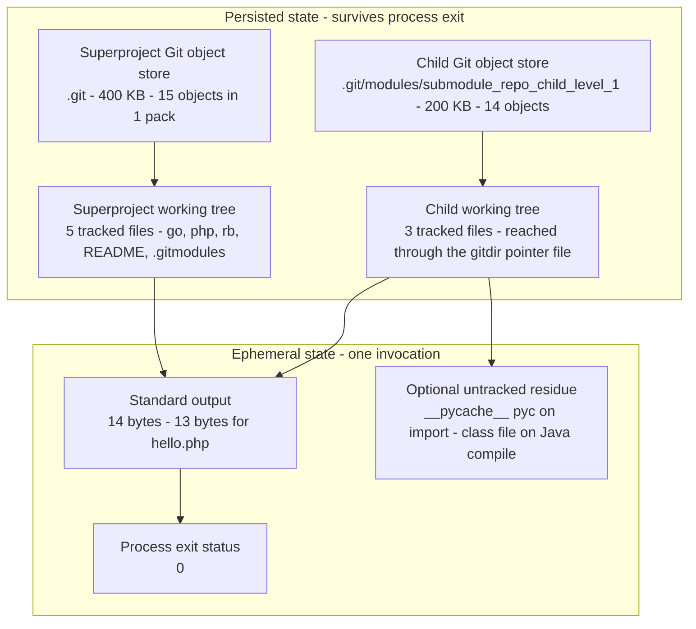

### 3.5.3 Caching

No caching tier exists at any level: no in-memory cache, no HTTP cache, no CDN, no session store, no build-cache service, and no cache configuration key in any file. The only caching that occurs is internal to the tools being used — the Git client's own object store, which is content-addressed deduplication rather than an application cache, and the operating system's filesystem cache. Neither is configured, tuned, or invalidated by anything in this repository. There is no cache to warm, evict, or secure, and no cache-coherency concern, because no member retains state between invocations.

### 3.5.4 Storage Services

None. No object storage (S3 or equivalent), no block or file volume, no network filesystem, no managed database service, no data lake, and no backup or archival service is referenced; the tree contains no IaC template, storage credential, bucket name, or mount configuration. The system's storage footprint is entirely local and entirely Git-shaped: 400 KB of object store plus 502 bytes of working-tree content, 444 KB for the whole checkout, and no configuration whose value could point at a remote store.

### 3.5.5 Data-at-Rest and Security Implications

| Aspect | Finding |
| --- | --- |
| Data classification | The only business datum in the code is the fixed public literal `Hello, World!`; there is no personal, financial, health, or otherwise regulated data, and the system reads no data from any source |
| Retention and residency | No retention rule, deletion path, or geographic constraint applies — there is no store to retain data in, and the repository holds only its own source |
| Encryption at rest | No application-level encryption, hashing, or key management exists, because there is nothing to encrypt; protection of the checkout is delegated entirely to the host filesystem and to GitHub's own storage of the repositories |
| Credential at rest | The only sensitive value in the checkout is the environment-injected GitHub installation token in the untracked local `.git/config` (906 bytes), valid for one hour. It is not tracked (`git ls-files` lists no path under `.git/`), not stored in any credential helper, and not needed to run any member |
| Deleting data | Nothing to delete: removing a member means editing a tracked file and committing; there is no record store, no queue, and no backup copy under the system's control |
| Backup and recovery | Not applicable at the application level — the repository's recoverability is GitHub's responsibility, and the pin `0664094` makes the consumed child revision recoverable by commit hash |


## 3.6 Development &amp; Deployment

**Development on this system requires a text editor and a Git client; deployment requires a Git clone.** There is no build system, no container, no infrastructure template, and no pipeline in either repository — a case-insensitive search of the tree for build, container, and CI artifacts (Makefile, Dockerfile, `.github/`, Jenkinsfile, `.gitlab-ci.yml`, `.circleci/`, Terraform) returns no matches, and `.git/hooks` contains only inactive `*.sample` files. Delivery and release are performed by Git alone.

### 3.6.1 Development Tools

| Tool | Role | Version | Evidence |
| --- | --- | --- | --- |
| Git | Version control, the entire delivery mechanism, and the only automation that exists | 2.43.0 in the inspection environment; no version constrained by the repository | `git --version`; `.gitmodules`; the gitlink |
| Go toolchain | Runs `hello.go` via `go run` | Not installed in the inspection environment; not constrained | `hello.go` |
| PHP interpreter | Runs `hello.php` | Not installed; not constrained | `hello.php` |
| Ruby interpreter | Runs `hello.rb` | Not installed; not constrained | `hello.rb` |
| Node.js runtime | Runs `hello.js` | v22.23.3 observed | Executed member, exit 0 |
| Python 3 interpreter | Runs `hello.py` | 3.12.3 observed | Executed member, exit 0 |
| JDK (`javac` / `java`) | Compiles and runs `hello.java` | Not installed; not constrained | `hello.java` |
| Markdown | Format of the single documentation file | — | `README.md` (one title line) |

No editor, IDE, linter, formatter, debugger, or code-quality configuration exists in either tree: no `.editorconfig`, no linter config, no `.gitignore`, no `.gitattributes`, no pre-commit hook, and no task runner. Development is therefore unconstrained and unassisted — and equally, there is no tool for a contributor to install or learn before making a change, which is consistent with the additive, one-file-per-language change model recorded in §3.1.2.

### 3.6.2 Build System

The system has no build system and produces no stored artifact. Two members are compiled on demand by their own toolchains (`hello.go` by the Go toolchain, `hello.java` by a JDK) and four are interpreted directly; none of the eight tracked files is generated.

| Build concern | Finding |
| --- | --- |
| Build tool | None — no Makefile, `makefile`, `.mk`, Gradle, Maven, npm script, Rakefile, or shell script exists, and `make` is not even installed in the inspection environment |
| Build manifest | None — the absence of `go.mod`, `pom.xml`, `build.gradle`, `package.json`, `composer.json`, and `Gemfile` means there is no build graph to describe |
| Build output | Nothing is committed or published; the only compile-time side effect is the JVM class file a JDK would emit beside `hello.java`, which is untracked and unignored |
| Build commands | Each language's own standard runner, exactly as listed in §3.1.4 — there is no wrapper, no target, and no orchestration layer between the contributor and the runtime |

The consequence is deliberate and matches the system's purpose: with no build step, there is no build configuration to break, no artifact repository to populate, and no build environment to reproduce.

### 3.6.3 Containerization

**None.** No `Dockerfile`, `Containerfile`, `.dockerignore`, `docker-compose.yml`, or Kubernetes manifest exists in either working tree, and neither `docker` nor `podman` is installed in the inspection environment. Nothing in the system builds, ships, or runs an image:

- there is no image registry, no base image, and no tag in use anywhere;
- the six toolchains the system needs are not packaged with it, so containerization would be the obvious way to deliver them — and its absence is precisely why full coverage depends on the host's provisioning (§2.4.5);
- the only environment the members require is a runtime on `PATH`, so a container would add a moving part without changing behaviour.

### 3.6.4 Infrastructure Provisioning

**No infrastructure as code.** There is no Terraform, CloudFormation, Ansible, Pulumi, Helm, or ARM/Bicep artifact, and no cloud resource of any kind is defined or consumed (§3.4.4). The environment this system needs is a developer host with the six language runtimes and a submodule-aware Git client — a manual prerequisite rather than a provisioned resource.

| Provisioning aspect | Requirement |
| --- | --- |
| Reproducible environment definition | None exists; the required environment is stated only in this specification and in the runtime files themselves |
| Environments (dev/test/stage/prod) | None — there is no deployment that could be promoted between environments; the "environment" is whichever host runs the members |
| Provisioning verification | Each member's own output acts as the check: a host that runs a member correctly is provisioned for that language. During inspection four of the six toolchains were absent, so the same repository that verifies a complete environment also flags an incomplete one |
| Configuration management | Not applicable — no member reads a configuration value, environment variable, or file, so there is nothing to parameterize per environment |

### 3.6.5 CI/CD

**No CI/CD exists.** Neither repository contains a workflow, job, runner, or pipeline definition: there is no `.github/` directory (so no GitHub Actions workflow), no `.gitlab-ci.yml`, no Jenkinsfile, no `.circleci/`, no Azure Pipelines file, no build badge, and no deployment script. Git provides the only automation the system has, and that automation is the submodule checkout itself.

| CI/CD capability that would normally exist | Status here | Consequence |
| --- | --- | --- |
| Automated verification of the member set | Absent | Every acceptance criterion in the requirements sections is verified externally and manually; a green result from one member says nothing about the other five (§2.4.7) |
| Automated toolchain matrix | Absent | The six-runtime coverage claim is never checked; the environment in which the check last passed is not recorded anywhere (§3.1.3) |
| Dependency updates (Dependabot/Renovate) | Absent | Nothing to update, but also no automation watching the submodule pin, which advances only when a committer moves the gitlink (§2.4.2) |
| Release automation and versioning | Absent | No tag exists in either repository, so there is no release identifier, changelog, or version number to deploy; the deployable state is a branch head (`5ecd4cc`) or any commit |
| Deployment automation and rollback | Absent | Promotion and rollback are the same action — checking out a different commit |

### 3.6.6 Deployment Strategy and Requirements

Deployment is a clone, and release is a commit. The pin `0664094` is the released state of the child content, `5ecd4cc` the released state of the superproject, and moving the child pin is a two-path commit (`.gitmodules` and the gitlink) exactly as the parent's final commit demonstrates.

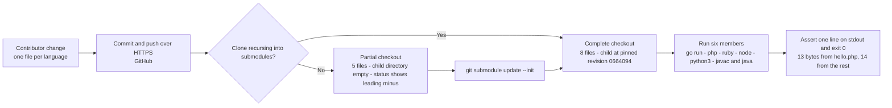

| Deployment step | Requirement | Verified |
| --- | --- | --- |
| Obtain the superproject | A Git client; HTTPS access to `github.com`; anonymous read is sufficient | Yes — anonymous `ls-remote` returned all refs at `5ecd4cc` |
| Obtain the child content | Recursive clone, or `git submodule update --init`; **a plain clone silently yields three of six members** | Yes — the gitlink resolves at `0664094`, equal to the child's `HEAD` |
| Run a member | The language's own toolchain on the host: Go, PHP, Ruby, Node.js, Python 3, or a JDK | Partially — 2 of 6 members executed here (Node v22.23.3, Python 3.12.3), 4 could not be |
| Verify the result | Compare standard output to the expected literal (13 or 14 bytes) and check exit status `0`; no service, port, or credential is involved | Yes — both executed members produced exactly 14 bytes on stdout, 0 on stderr, exit 0 |
| Roll back | Check out a different commit, or move the gitlink to a different child revision; no artifact or database state is involved | Structurally available; no rollback script or procedure exists |

**Deployment requirements not covered by any tooling.** Full coverage needs all six runtimes on one host, outbound HTTPS to `github.com` including the foreign organization, and a submodule-aware client. Nothing installs, verifies, or records any of these, so the deployment's success depends on the operator reading this specification rather than on a machine-checkable manifest — the same gap §2.4.7 records as the verification gap.


## 3.7 References

- `hello.go` — the repository's only Go member and its only explicit import (`import "fmt"`); establishes `func main` in `package main` as the entry point, the 77-byte/7-line size, and `fmt.Println` as the output call
- `hello.php` — the PHP member; establishes the top-level `echo`, the absent closing `?>` tag, the 28-byte/1-line size, and the only member expected to omit the trailing newline
- `hello.rb` — the Ruby member; establishes the unguarded top-level `puts`, so loading the file prints
- `submodule_repo_child_level_1/hello.js` — the JavaScript member; establishes evaluation-time `console.log` and the 14-byte observed stdout
- `submodule_repo_child_level_1/hello.py` — the Python member; establishes module-level `print`, the import-time side effect, and the 14-byte observed stdout
- `submodule_repo_child_level_1/hello.java` — the Java member; establishes `public class Hello` with `public static void main(String[] args)`, the implicit `java.lang` dependency, and the file-name/class-name compatibility risk
- `.gitmodules` — declares the submodule's `path` and `url` only, with no credential, branch, tag, or depth key; establishes the cross-organization child URL and the credential-free access model
- `README.md` — the entire documentation surface (one title line, 34 bytes), establishing that no framework, version, or technology decision is documented in the repository
- `submodule_repo_child_level_1/.git` — the child's `gitdir: ../.git/modules/submodule_repo_child_level_1` pointer file, showing that the child's object store lives inside the superproject's `.git`
- `.git/config` (untracked, local) — the superproject's `remote.origin.url` with the environment-injected `x-access-token` credential, `submodule.submodule_repo_child_level_1.active=true`, and no credential helper; establishes the credential-at-rest and authentication posture
- `.git/modules/submodule_repo_child_level_1/config` — the child module's plain, token-free origin URL
- `submodule_repo_child_level_1/` — the submodule checkout folder, containing exactly `hello.js`, `hello.py`, and `hello.java` with no manifest, README, or nested submodule
- repository root folder — exactly five tracked files plus the submodule folder; the basis for the complete-tree claim of eight files
- `.git/` (superproject object store) — 400 KB, 15 objects in one 5 KiB pack, refs at `5ecd4cc` and zero tags; the only persisted state of the system
- `.git/modules/submodule_repo_child_level_1/` — the child object store, 200 KB and 14 objects, refs at `0664094` and zero tags
- `.git/hooks/` — contains only inactive `*.sample` files, establishing that no client-side automation runs on commit or push
- [web] go.dev release history and release-cycle pages — confirmed the current Go stable line (1.27.3) and the six-month cadence with two supported majors
- [web] go.dev license and patent-grant pages — confirmed Go's BSD-style three-clause license and separate patent grant
- [web] php.net release announcements, supported-versions page, and licensing page — confirmed the current PHP stable line (8.5.12), the branch support windows, and the license position (Modified BSD / "PHP License v4" for 8.6, version 3.01 on the 8.5 branch)
- [web] ruby-lang.org release news and maintenance-branches page — confirmed the current Ruby stable line (4.0.9) and each branch's maintenance status
- [web] ruby-lang.org license text — confirmed Ruby's dual 2-clause BSDL / Ruby License terms
- [web] nodejs.org security-release, previous-releases, and release-schedule pages — confirmed the current Node.js releases (v26.12.1, LTS v24.22.1 and v22.23.4) and the LTS policy
- [web] nodejs/node LICENSE file — confirmed Node.js's MIT license
- [web] python.org release page and devguide "Status of Python versions" — confirmed the current Python stable line (3.15.2), the five-year support window, and the absence of an LTS designation
- [web] docs.python.org license page — confirmed the Python Software Foundation License Version 2
- [web] Oracle Java SE support roadmap and OpenJDK JDK/JDK-updates project pages — confirmed JDK 27 as the current feature release, JDK 25 as the current Oracle LTS, and OpenJDK's update-train model
- [web] openjdk.org legal page — confirmed the GPLv2 with Classpath Exception license
- [web] git-scm.com downloads and "About Git" pages — confirmed the current Git release (2.56.0), the absence of an LTS or end-of-life policy, and the GPLv2 license


# 4. Process Flowchart

## 4.1 Workflow Actors, Boundaries, and Scope

Every process in this repository is short-lived, single-threaded, and free of in-program branching. The repository contains eight tracked files across two working trees — three programs in the superproject root (`hello.go`, `hello.php`, `hello.rb`) and three in the submodule checkout (`submodule_repo_child_level_1/hello.js`, `hello.py`, `hello.java`) — and each program's entire runtime behaviour is one unconditional write of the literal `Hello, World!` to standard output. Consequently there is no server, daemon, scheduler, queue, worker pool, database connection, or long-running process anywhere in the system, and its complete process inventory can be enumerated exhaustively rather than sampled. The workflows below are that enumeration.

**Two workflow families.** The system's flows split cleanly along the line that separates delivery from execution:

- **Acquisition and versioning workflows** are Git-mediated and network-bound. They run once per checkout, are driven by `.gitmodules` and the gitlink entry for `submodule_repo_child_level_1` (mode `160000` at revision `0664094`), and are the only part of the system with any retry or error-recovery behaviour — supplied by the Git client rather than by code in the tree.
- **Execution workflows** are per-member and process-local. They begin when an operator invokes one of the six files with its own runtime's standard runner, perform a single write, and end when the process exits. They touch the network, the file system, stdin, argv, and the environment nowhere.

**Actors.**

| Actor | Kind | Touchpoint in the workflows | Requirement anchor |
| --- | --- | --- | --- |
| Operator or developer | Human, outside the system | Chooses the clone route, invokes each member with its own runner, and compares the printed line against the expected literal | §1.3.1 |
| Git client (2.43.0 in this checkout) | Tool; holds the system's only automation | Resolves `.gitmodules` and the gitlink, fetches the child revision over HTTPS, and materializes the working tree; also the only component that retries a failure | F-002-RQ-003, F-002-RQ-004 |
| Superproject remote, `github.com/lakshya-blitzy` | External service | Source of the five root files at commit `5ecd4cc` | §1.2.1 |
| Child remote, `github.com/lakshya-blitzy-only-submodules` | External service, different organization from the superproject | Source of the three child files at the pinned revision `0664094` | F-002-RQ-005 |
| Host language runtime (Go, PHP, Ruby, Node.js, Python 3, or JDK) | Environment prerequisite | Compiles or parses one member and executes its single statement | F-005-RQ-001 |
| Standard output and process exit status | Observable surface | Carries the one literal write and the terminal status `0`; the system emits nothing else | F-004-RQ-001 … F-004-RQ-004 |
| Automated checkout and indexing tooling | External consumer | Asserts the constant against captured stdout; a non-recursive checkout silently delivers five of eight files | §1.3.1, F-002-RQ-004 |

**System boundaries.** Inside the boundary sit the two working trees, the `.gitmodules` declaration, and the gitlink; the eight files are the system's complete content. Outside it sit the two HTTPS Git endpoints, the six host runtimes, and the operator's invocation and comparison steps. Nothing crosses the boundary at member run time — no process opens a socket, reads a file, or consults an environment variable, so the only boundary crossing during execution is the text handed to the parent shell on stdout.

**Workflow inventory.** The nine workflows below are the complete set; no other process exists in the repository.

| ID | Workflow | Family | Diagram |
| --- | --- | --- | --- |
| WF-01 | End-to-end journey: clone, run, verify | Both | §4.3.1 (sequence) |
| WF-02 | Interpreted-member execution (PHP, Ruby, Node.js, Python) | Execution | §4.3.2 |
| WF-03 | Compiled-member execution (Go, Java) | Execution | §4.3.3 |
| WF-04 | Independent child-repository consumption | Acquisition | No separate diagram — a strict subset of WF-05 |
| WF-05 | Submodule acquisition and revision pinning | Acquisition | §4.4.1 (sequence) |
| WF-06 | Runtime-to-stdout integration contract | Execution | Described in §4.4.2 |
| WF-07 | Event and batch processing | — | Not present; see §4.4.3 |
| WF-08 | Submodule acquisition failure and recovery | Acquisition | §4.5.2 |
| WF-09 | Member invocation failure paths | Execution | §4.5.3 |

**How to read the diagrams.** Swim lanes name the actor or system that owns a step; diamonds are decision points and every diamond is annotated with the condition it tests; terminal nodes carry rounded corners; failure nodes quote the observed tool message and exit status where one was observed, and are labelled as unverified where the runtime was absent from the inspection environment. Requirement identifiers such as `F-004-RQ-001` are the ones defined in §2.2.2 and are cross-referenced wherever a step is the observable expression of a requirement. Two flowcharts already appear elsewhere in this specification — the component view in §1.2.2 and the deployment view in §3.6.6 — and the diagrams here extend rather than replace them, adding swim lanes, decision annotation, failure paths, and state transitions.


## 4.2 High-Level System Workflow

The high-level workflow has exactly two decision points, both outside the repository's code: whether the clone recursed into the submodule, and whether the operator's captured result matched the constant. Between them, every step is a straight line executed by the Git client, an HTTPS remote, or a host runtime.

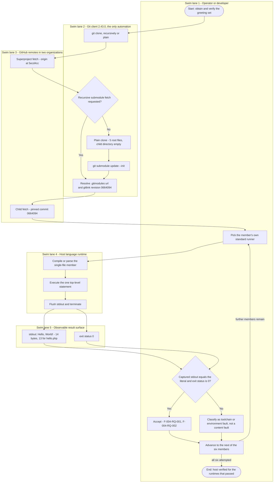

**Start and end points.** The workflow starts when an operator decides to obtain and verify the greeting set, and ends when all six members have been attempted and the passing subset is known. There is no persistent runtime state to leave behind: the working tree is unchanged by execution (`git status --porcelain` reported nothing after running the two members available in this environment), and the only artifacts a run may create are covered in §4.6.3.

**Process steps and boundary crossings.** The five lanes correspond to the boundary described in §4.1. Lanes 2 and 3 are the acquisition family and cross the network boundary twice — once for the superproject tree, once for the child revision. Lanes 4 and 5 are the execution family and cross no boundary at all: the runtime reads the file it was handed, writes one line, and exits, so stdout and the exit status are the entire observable surface of the system.

**User touchpoints.** The operator acts at three points only: choosing the clone route (recursive versus plain plus `git submodule update --init`), invoking each member with its own runner, and comparing the captured output. No configuration step, credential prompt, service start, or port allocation is part of the journey.

**Error states.** Neither diamond in this diagram is an error path. The recursive-clone decision leads to a slower but equally successful route, and the assertion failure in lane 1 has no in-band remedy: because no member reads input and nothing depends on configuration, a non-matching result isolates a missing or broken toolchain rather than a data or configuration fault. The acquisition failures that can actually abort the journey are drawn in §4.5.2 and the invocation failures in §4.5.3.

**Timing.** Acquisition dominates the wall clock by orders of magnitude: the two network fetches are the only unbounded steps, while execution is bounded below by interpreter startup — 12 ms for Python 3.12.3 and 20 ms for Node v22.23.3 on the inspection host — and completes in 22–26 ms per member end to end. No SLA, target, or timeout is declared anywhere in the tree; §4.8 states what can and cannot be measured.

**Requirement coverage.** The acquisition half of this workflow satisfies F-002-RQ-001 (declaration), F-002-RQ-002 (gitlink pin), F-002-RQ-003 (recursive delivery of all eight files) and F-002-RQ-004 (recovery of the child content after a plain clone). The execution half satisfies F-001-RQ-001 … F-001-RQ-006 (one runnable unit per runtime) and F-004-RQ-001 … F-004-RQ-004 (byte-exact stdout, exit status, empty stderr, repeatability).


## 4.3 Core Business Processes

Each core process below is a complete end-to-end path: it names its trigger, its steps, its decision points, its boundaries, its failure states, and the requirement it satisfies. A static check across all six sources found no conditional, loop, exception-handling, or boolean-operator token in any file — the single regex match was the `?` of PHP's `<?php` open tag, a delimiter rather than a decision — and no file contains an explicit `return`, `exit`, or `raise` call. Every decision in the diagrams that follow therefore belongs to the operator, the shell, the Git client, or the language runtime; none belongs to the repository's own code.

### 4.3.1 WF-01 End-to-End User Journey: Clone, Run, Verify

The journey is the composition of the two families: a network-bound acquisition phase, then six independent process-local execution phases, then one comparison per member.

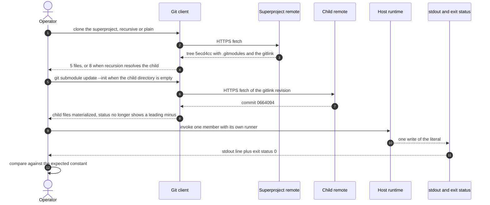

| Workflow element | Content |
| --- | --- |
| Start | Operator resolves to obtain the greeting set |
| Steps | Clone (recursive or plain), complete the submodule if needed, invoke each member with its own runner, capture stdout and exit status, compare with the literal |
| Decision points | Recursive fetch or not (lane 2 of §4.2); assertion pass or fail (lane 1 of §4.2) |
| System boundary crossings | Two HTTPS fetches inbound; stdout and exit status outbound once per member |
| User touchpoints | Clone-route choice, member invocation, result comparison |
| Error states and recovery | Only acquisition can abort the journey (§4.5.2); assertion failures have no in-band remedy, and are interpreted as toolchain faults (§4.5.3) |
| End | Six members attempted; the passing subset identifies the host's usable runtimes |
| Requirement anchor | F-001-RQ-001 … F-001-RQ-006, F-002-RQ-003, F-002-RQ-004, F-004-RQ-001 … F-004-RQ-004 |

### 4.3.2 WF-02 Interpreted-Member Execution (PHP, Ruby, Node.js, Python)

Four of the six members are interpreted and share one flow: the runtime parses the file, evaluates the single statement at load, writes, and exits. The one substantive difference is the trailing newline, which `echo` does not emit — the reason `hello.php` is expected to produce 13 bytes where the other members produce 14.

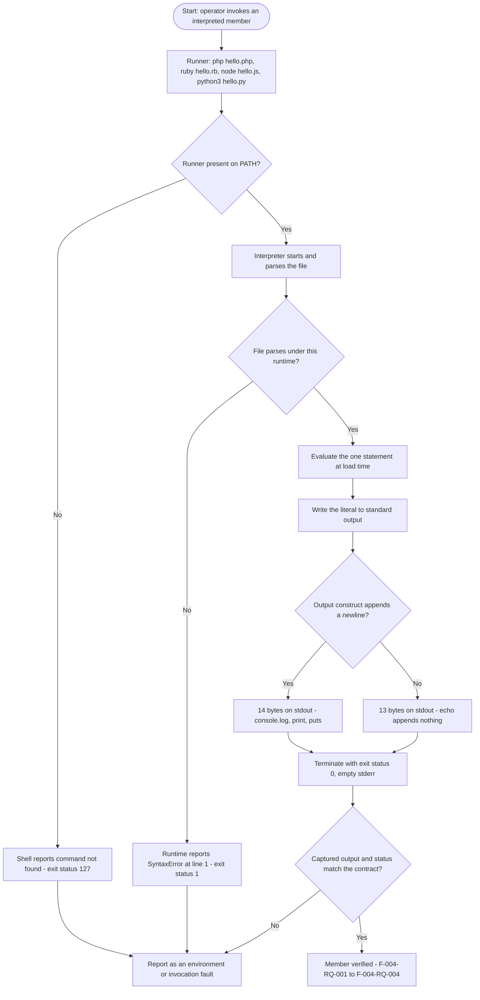

| Member | Runner | Statement | Bytes on stdout | Observed |
| --- | --- | --- | --- | --- |
| `hello.php` | `php hello.php` | top-level `echo`, no closing `?>` tag | 13, no newline | Not run — no PHP interpreter present |
| `hello.rb` | `ruby hello.rb` | top-level `Kernel#puts`, no `$PROGRAM_NAME` guard | 14 | Not run — no Ruby interpreter present |
| `submodule_repo_child_level_1/hello.js` | `node …/hello.js` | `console.log` evaluated at load | 14 | Run — Node v22.23.3, exit 0 |
| `submodule_repo_child_level_1/hello.py` | `python3 …/hello.py` | `print` at module level | 14 | Run — Python 3.12.3, exit 0 |

Two load-time behaviours are worth recording because they are reachable paths rather than defects: loading the Ruby file or importing the Python module prints the greeting as a side effect of evaluation, since both statements sit at top level rather than inside a guarded entry point. Observed directly: `python3 -c "import hello"` printed the line and exited 0, and `node -e "require('…/hello.js')"` printed the line and returned a module object with zero exported keys. In each case the write precedes any caller-controlled step, so a consumer that imports the file for reuse receives output it did not ask for — the behaviour F-001-RQ-003 and F-001-RQ-005 record.

Validation at each step is limited to what the runtime itself enforces: the file must parse under the invoked runtime, and the statement must be the file's only output expression. There is no input to validate, no parameter to range-check, and no authorization state to consult.

### 4.3.3 WF-03 Compiled-Member Execution (Go, Java)

The two compiled members add a build step inside the invocation. Go's runner compiles and runs in one command; the Java member must be compiled before its class can be launched, which introduces the repository's one identified technical risk — the compilation unit is `hello.java` while the public class it declares is `Hello`.

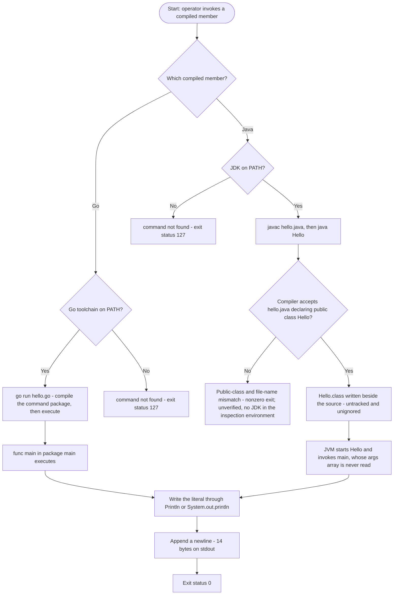

| Workflow element | Go member | Java member |
| --- | --- | --- |
| Build step | None separate; `go run` compiles the file and executes it | `javac` produces `Hello.class`; the JVM then launches the class |
| Manifest required | None — with no `go.mod` present, `go run` still accepts `.go` files named on the command line, which is how this tree is structured; naming a directory or package instead would fail with a missing-`go.mod` error | None — the class sits in the unnamed package |
| Entry point | `func main` in `package main`, unimportable and unexported | `public static void main(String[] args)` on `public class Hello`; `args` is never read |
| Produced artifact | None persisted in the tree | `Hello.class` beside the source — untracked and unignored, so a compile leaves the working tree dirty until it is removed |
| Verification status | Not executed here — no Go toolchain present | Not executed here — no JDK present; the file-name/class-name mismatch is the repository's only identified technical risk |
| Requirement anchor | F-001-RQ-001, F-001-RQ-007, F-005-RQ-001 | F-001-RQ-006, F-005-RQ-001 |

Neither compiled path has an error branch inside the program: Go's `main` writes and returns implicitly, and the Java class declares no `return`, `exit`, or exception handler, so any non-zero status comes from the toolchain rather than from the code.

### 4.3.4 WF-04 Independent Child-Repository Consumption

The child repository is a complete product on its own, and this route bypasses both the gitlink and the need for a submodule-aware client. It is a strict subset of WF-05: the operator clones `https://github.com/lakshya-blitzy-only-submodules/submodule_repo_child_level_1.git` directly, receives `hello.java`, `hello.js`, and `hello.py` at revision `0664094`, and runs them without the superproject present. No separate diagram is needed because removing the superproject lanes from §4.4.1 leaves exactly this flow.

| Workflow element | Content |
| --- | --- |
| Trigger | Operator needs the JavaScript, Python, or Java member without the superproject |
| Steps | One unauthenticated HTTPS clone; three files materialized; each member invoked with its own runner |
| Decision points | None introduced by this route; the assertion diamond of §4.2 still applies |
| Boundary crossings | One HTTPS fetch; stdout and exit status per member |
| User touchpoints | Clone and invoke only — no submodule command is required |
| Error states and recovery | A single fetch failure aborts; there is no second step to retry, and recovery is a corrected URL or network path |
| Why it matters | It is immune to the silent partial delivery that a plain superproject clone produces, so it is the reliable route for the three child members |
| Requirement anchor | F-006-RQ-001, F-006-RQ-002 |

### 4.3.5 Decision-Point Inventory

Every decision the system can encounter is listed here, with its owner. The in-program column is empty by construction, not by omission: the static check above found no branching token in any of the six files, and each program's behaviour is the same write regardless of ambient conditions — verified by reproducing identical output with stdin closed, with an empty environment, and with extraneous arguments.

| # | Decision | Owner | Condition | Outcomes | Requirement |
| --- | --- | --- | --- | --- | --- |
| D1 | Recursive submodule fetch? | Operator, executed by Git | Whether `--recurse-submodules` was issued or `git submodule update --init` was run afterwards | Yes: eight files. No: five files, child directory empty, `git submodule status` prints a leading `-` | F-002-RQ-003, F-002-RQ-004 |
| D2 | Runner present on `PATH`? | Shell | Whether the member's runtime is installed on the host | Yes: proceed. No: `command not found`, exit 127 | F-005-RQ-001 |
| D3 | Which runner for which member? | Operator | The member's language | Six fixed pairings; no runtime accepts another's file | F-005-RQ-002 |
| D4 | Does the file parse under the invoked runtime? | Language runtime | Whether the file's syntax belongs to that runtime | Yes: proceed. No: `SyntaxError` at line 1, exit 1 | F-001-RQ-001 … F-001-RQ-006 |
| D5 | Does the output construct append a newline? | Language runtime and construct | `echo` versus `Println`, `puts`, `console.log`, `print`, `System.out.println` | 13 bytes for `hello.php`; 14 bytes for the other five | F-004-RQ-001 |
| D6 | Does the compiler accept the Java compilation unit's file name? | JDK | `hello.java` declares `public class Hello` | Accepted: `Hello.class` produced. Rejected: non-zero exit. Unverified — no JDK present | F-001-RQ-006 |
| D7 | Does captured output and exit status match the contract? | Operator or external consumer | Byte-exact stdout comparison plus exit status | Match: host verified for that runtime. Mismatch: toolchain or environment fault | F-004-RQ-001 … F-004-RQ-004 |
| D8 | Is the pinned child revision reachable? | Git client and child remote | Whether `0664094` exists in the child repository and is fetchable | Reachable: checkout succeeds. Not: clone aborts after one retry | F-002-RQ-002 |


## 4.4 Integration Workflows

The system has exactly one integration that crosses a process or host boundary — HTTPS Git against two remotes — plus the process-to-shell interface that carries each member's result. There is no API in the service sense, no message broker, no webhook, and no scheduled exchange.

### 4.4.1 WF-05 Submodule Acquisition and Revision Pinning

This is the system's only multi-system data flow. It moves no application data: the payload is Git object history plus two declarations — the `path`/`url` pair in `.gitmodules` and the gitlink entry of mode `160000` pinned to `0664094`.

```mermaid
sequenceDiagram
    autonumber
    participant Op as Operator
    participant Git as Git client 2.43.0
    participant Parent as Superproject remote, org lakshya-blitzy
    participant Child as Child remote, org lakshya-blitzy-only-submodules
    participant WT as Working tree
    Op->>Git: clone superproject URL, optionally --recurse-submodules
    Git->>Parent: HTTPS fetch of refs
    Parent-->>Git: commit 5ecd4cc containing .gitmodules and the gitlink
    Git->>WT: materialize README.md, hello.go, hello.php, hello.rb, .gitmodules
    alt recursive clone
        Git->>Child: fetch the revision named by the gitlink
        Child-->>Git: objects for commit 0664094
        Git->>WT: checkout hello.java, hello.js, hello.py, write the gitlink .git file
    else plain clone
        Git->>WT: leave submodule_repo_child_level_1 empty
        Op->>Git: git submodule update --init
        Git->>Child: fetch the revision named by the gitlink
        Child-->>Git: objects for commit 0664094
        Git->>WT: checkout hello.java, hello.js, hello.py
    end
    Git-->>Op: exit 0; git submodule status reports 0664094 with no leading minus
```

**Interface inventory and the data that crosses each one.**

| Interface | Direction | Payload | Contract | Requirement |
| --- | --- | --- | --- | --- |
| Superproject remote over HTTPS | Inbound, once per clone | Commit `5ecd4cc` and its five tracked entries | Anonymous read is sufficient; a locally configured installation token is also present in this checkout's untracked `.git/config` | §1.2.1 |
| Child remote over HTTPS | Inbound, once per clone or update | Commit `0664094` and its three entries | Anonymous read is sufficient; `.gitmodules` declares no credential key | F-002-RQ-001, F-002-RQ-005 |
| `.gitmodules` → Git client | In-tree declaration | `path`, `url`; no branch, tag, depth, shallow, update, or ignore key | The declaration names a source, never a revision | F-002-RQ-001 |
| Gitlink entry → Git client | In-tree declaration | `160000 066409439699a1967ad788413b74dfc3e4914447 0 submodule_repo_child_level_1` | The revision is fixed by the tree entry, not by the remote's default branch | F-002-RQ-002 |
| Git client → working tree | Materialization | Eight files across two trees, plus a 53-byte `.git` file containing `gitdir: ../.git/modules/submodule_repo_child_level_1` | The child is materialized without a nested `.git` directory of its own | F-002-RQ-003 |
| Working tree → host runtime | Local file read by the runtime only | One source file per invocation | No member reads a file at run time; the runtime reads the file it is handed | F-003-RQ-002 |

**Why the pin, not the branch, determines the delivered content.** At inspection the pinned revision `0664094` equaled both the child's `HEAD` and its `refs/heads/main`, but the pin is what a clone reproduces: `.gitmodules` declares no `branch` key, so Git checks out the gitlink revision regardless of where the child's default branch moves later. In this working tree the child sits on branch `2810_01` at that same revision, and a fresh clone lands on `heads/main` at the identical revision — the same content by two routes. Advancing the pin requires a superproject commit that rewrites the gitlink, which is exactly the shape of the parent's final commit `5ecd4cc`, *Add cross-org submodule*.

**Batch and ordering considerations.** There is no batch step in this flow: the child fetch is a single network operation, and the eight files arrive as one checkout of two trees. The only sequencing that exists is that the child fetch must precede any attempt to run the three child members — Git enforces this order by leaving the directory empty until the fetch completes.

### 4.4.2 WF-06 Runtime-to-Shell Output Contract

The second integration is the process boundary itself: a member writes one line, and the parent shell observes the line and the status. No member opens a socket, reads a file, consults an environment variable, or waits on input, so this interface carries information in one direction only.

| Interface element | Contract | Observed |
| --- | --- | --- |
| Invocation argument | The member's own path, passed to its own runtime's standard runner; no flag, option, or parameter is defined or read | Verified with extraneous arguments (`a b c`): output unchanged, exit 0 |
| Standard output | Exactly `Hello, World!`; 14 bytes including the trailing newline for five members, 13 bytes for `hello.php` | Verified byte-for-byte with `od -c` for both executed members |
| Standard error | Empty | Verified: the two executed members wrote nothing to stderr |
| Standard input | Never read | Verified: identical output with stdin redirected from `/dev/null` |
| Environment | Never read; no variable influences behaviour | Verified: identical output under `env -i` |
| Exit status | `0` on the successful path | Verified: exit 0 for both executed members |
| Failure status | Non-zero from the runtime — `1` for a parse error, `127` from the shell when the runner is absent | Verified for both classes (§4.5.3) |
| Downstream consumer | An external checker that holds the expected literal; no in-tree assertion, runner, or CI job exists | §1.3.2, F-004-RQ-001 |

Because the contract is total — one write, one status, no branches and no error path inside the program — a consumer needs no parser, schema, tolerance window, or retry logic, and no partial-success state can arise.

### 4.4.3 Event Processing and Batch Processing: Not Present

Neither stream exists in this system, and the absence is structural rather than unimplemented:

- **No event source or sink.** No member subscribes, publishes, polls, or listens; no broker, queue, topic, or webhook reference appears in either tree. A content search of the tree for build, CI, and automation artifacts returns no matches, and the only URL anywhere is the child Git URL on line 3 of `.gitmodules`.
- **No batch sequence.** There is no aggregate runner: six members are verified by six separate invocations chosen by the operator, and nothing in the tree defines an order, a schedule, or a dependency between them. The nearest thing to sequencing automation in the whole system is the Git client's single built-in retry of a failed submodule clone (§4.5.4).
- **No scheduling or triggers.** `.git/hooks` contains only inactive `*.sample` files, there is no CI configuration, no cron entry, and no server process, so nothing in the system can initiate work on its own.
- **No cross-member data flow.** The six members share no state, no helper, and no import; `grep -c 'Hello, World!'` returns exactly one occurrence per file across all six, and no file references another.

Any event-driven or batched design would therefore be new architecture rather than a modification of an existing flow, and §1.3.2 records it as out of scope.


## 4.5 Error Handling Flows

No error handler exists inside the system: a static check found no `try`, `catch`, `rescue`, `throw`, or `raise` token in any of the six files, no member has an error return, and no member can detect that something went wrong. Every failure the system can experience therefore surfaces outside it, as an exit status and a line of diagnostic text, and is resolved by the operator or by the Git client. This section maps those failures to their causes, their observable signals, and their remedies.

### 4.5.1 Failure Taxonomy and Exit-Code Semantics

| Failure class | Trigger | Observable signal | Exit status | Member code executed | Recovery |
| --- | --- | --- | --- | --- | --- |
| Child content never fetched | Plain clone with no `git submodule update --init` | `submodule_repo_child_level_1/` empty; `git submodule status` prints a leading `-`; three of six members simply absent | `0` — the omission is silent during clone | No | Run `git submodule update --init` (F-002-RQ-004) |
| Child fetch fails | Remote unreachable, revision absent, or no access | `fatal: clone of '<url>' into submodule path '<path>' failed`, then `Failed to clone … a second time, aborting` | `1` | No | Correct the URL, credentials, or network path; re-run the update (§4.5.2) |
| Runner absent | Runtime not installed on the host | Shell diagnostic `command not found` | `127` | No | Provision the runtime, or accept the member as unverified (F-005-RQ-001) |
| Wrong runner selected | A file handed to a runtime it does not belong to | `SyntaxError` reported at line 1 of the file | `1` | No — parsing fails before any statement runs | Re-invoke with the member's own runner (D3) |
| Java compilation rejected | `javac` refusing `hello.java` because it declares `public class Hello` | Compiler error about the public class and file name | Non-zero | No | Unverified here — no JDK was present; the mismatch is the repository's one identified technical risk (F-001-RQ-006) |
| Output does not match the contract | Environment tampering, since the literal is a compile-time constant | Captured stdout differs from `Hello, World!` while the status is `0` | `0` | Yes | Treat as an environment fault; no in-band remedy exists |

Status `0` in the first row is the important case: a non-recursive clone is a successful Git operation that delivers five of the eight files, so the failure is one of completeness rather than of execution, and no process in the system reports it. Only a deliberate check on the child directory or on `git submodule status` reveals it.

### 4.5.2 WF-08 Submodule Acquisition Failure and Recovery

The complete failure and recovery path, drawn from a reproduction in which the submodule URL was temporarily rewritten to an unreachable repository:

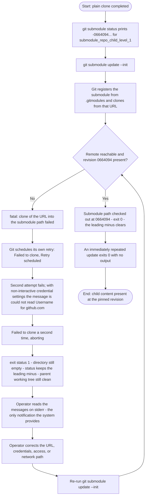

| Aspect | Observed behaviour |
| --- | --- |
| Where the failure is detected | Entirely inside the Git client; no repository code participates |
| Retry | One automatic retry, announced as `Retry scheduled`; the second failure aborts with `a second time, aborting` |
| Blast radius | The child directory stays empty; the superproject working tree remains clean and usable for its three root members |
| State after failure | Recoverable exactly: `git submodule status` still reports the pinned revision with a leading minus, so the intended revision is never lost — only its content is missing |
| Notification | Diagnostic text on stderr only; no log file, alert, metric, or notification integration exists |
| Recovery | Correct the cause and re-run the same command; the operation is idempotent, so an already-correct checkout is a no-op |
| Access-failure behaviour | The local configuration sets `credential.interactive=false` with an empty credential helper and `core.askpass=echo`, so an access failure fails fast rather than blocking on a prompt — the reason the reproduction produced `could not read Username for 'https://github.com'` instead of hanging |

### 4.5.3 WF-09 Member Invocation Failures

The three failure classes that can occur when a member is invoked, and the single passing path, converge on one verdict step: because no member reads input or configuration, a non-matching result identifies a provisioning or invocation fault rather than a data fault.

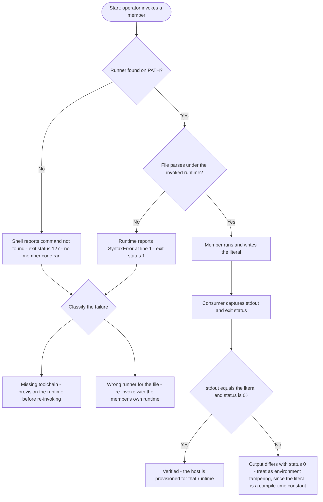

Reproductions that ground this diagram, each run against the repository's own files:

| Command | Outcome | Exit status |
| --- | --- | --- |
| `node hello.rb` | `SyntaxError: Unexpected string` reported at `hello.rb:1` | `1` |
| `python3 hello.php` | `SyntaxError: invalid syntax` reported at `hello.php` line 1 — the `<?php` tag is not a Python construct | `1` |
| `php hello.php`, `go run hello.go`, `javac hello.java` | `command not found` from the shell; the member never ran | `127` |

### 4.5.4 Retry Mechanisms, Fallbacks, Notification Flows, and Recovery Procedures

| Mechanism | What exists | What does not exist |
| --- | --- | --- |
| Retry | The Git client's single automatic retry of a failed submodule clone, followed by `aborting`. No other retry logic exists anywhere: no member contains a loop, and no script or runner repeats an invocation | No configurable retry count, backoff, jitter, circuit breaker, or dead-letter path; no retry at member invocation level — a failed member is re-invoked only if the operator chooses to run it again |
| Fallback | Two acquisition routes are equivalent by design: `git clone --recurse-submodules` and a plain clone followed by `git submodule update --init` both yield the pinned child content. For the three child members only, WF-04's standalone clone of the child repository is a further fallback that avoids the gitlink entirely | No fallback exists for the superproject's own three root members, and no alternate URL, mirror, or cached copy of either remote is declared |
| Error notification | Immediate diagnostic text on the invoking process's stderr from Git or from the language runtime; the operator is the only observer | No log file, log level, alert route, metric, trace, error-reporting service, or notification integration — §1.3.2 records observability as out of scope |
| Recovery procedures | Three operators' procedures are supported by the tree's own state: re-run `git submodule update --init` after correcting the cause (idempotent, and the pin is never lost); provision the absent runtime and re-invoke; and, for a dirty working tree after a Java compile, remove the untracked `Hello.class` that `javac` writes beside the source | No recovery script, runbook, health check, or rollback automation exists; rollback is simply checking out a different commit, or moving the gitlink to a different child revision, and neither is scripted |
| Idempotency as the recovery enabler | Every recovery action is safe to repeat: a completed submodule checkout re-updates as a no-op with exit 0, and every member is stateless and side-effect free apart from its stdout write, so any invocation can be repeated without cleanup | No operation in the system accumulates partial state that a retry could corrupt — there is no transaction, cursor, offset, or checkpoint to reset |


## 4.6 State Management and Transaction Boundaries

The system holds no application state. Its only state is the set of files on disk, the Git metadata that describes them, and the process state of a single short-lived runtime — and none of these survives an invocation in a way the next invocation consults.

### 4.6.1 Member Process State Transitions

A member process has four reachable states and a terminal status in each of them. No state is persisted, no state is shared with another member, and no state can be resumed: the process reaches its terminal state within milliseconds of starting.

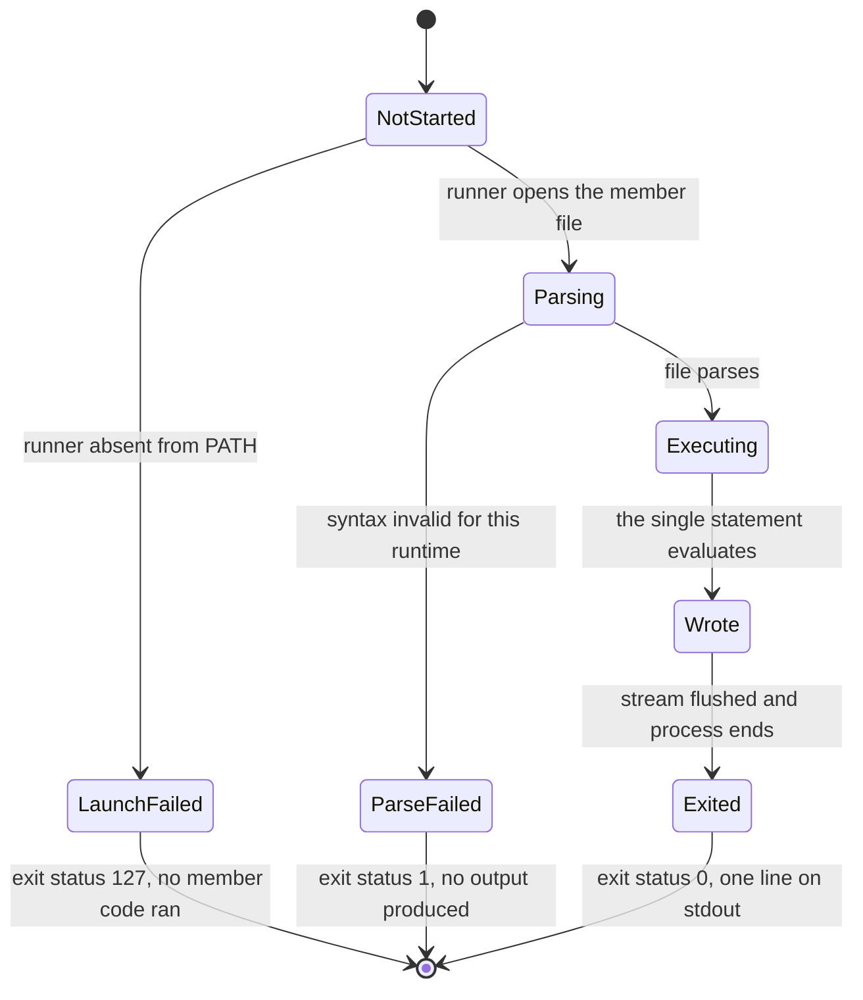

| Transition | Guard | Side effect | Requirement |
| --- | --- | --- | --- |
| NotStarted → LaunchFailed | The runner is not on `PATH` | None; the shell writes the diagnostic | F-005-RQ-001 |
| NotStarted → Parsing | The runner exists and is given the member's path | None | F-005-RQ-002 |
| Parsing → ParseFailed | The file's syntax does not belong to the runtime | None; no statement executes | F-001-RQ-001 … F-001-RQ-006 |
| Parsing → Executing | The file parses | None | — |
| Executing → Wrote | The single statement evaluates | One write to stdout: 14 bytes, or 13 for `hello.php` | F-004-RQ-001 |
| Wrote → Exited | The stream is flushed | Process terminates with status `0`, stderr empty | F-004-RQ-002, F-004-RQ-003 |

There is no state between `Exited` and the parent shell's observation of it: the process holds no lock, no temporary file, no transaction, and no resource that a second invocation must wait for. Repeating an invocation reproduces byte-identical output, which is what makes F-004-RQ-004 hold by construction rather than by measurement.

### 4.6.2 Submodule Checkout State Transitions

The second state machine describes the delivery side of the system. Its durable state is the gitlink — a revision recorded in the superproject's tree — while the volatile state is the child working tree, which can be absent, complete, or locally modified.

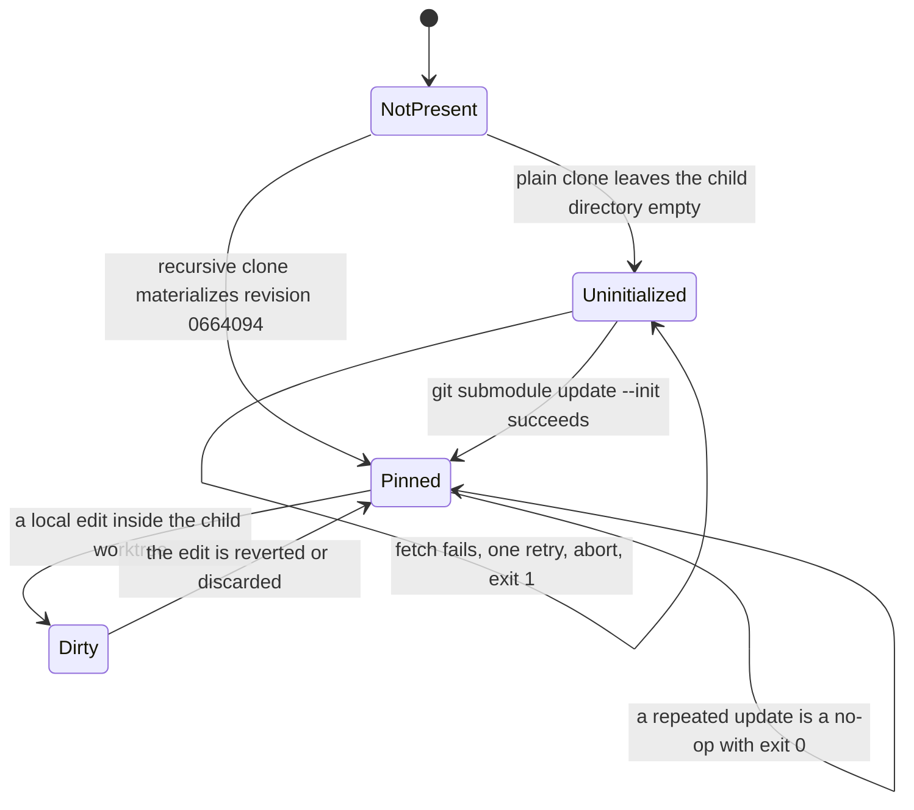

| State | How it is observed | What it means | Recovery |
| --- | --- | --- | --- |
| NotPresent | `git submodule status` prints `-` and the directory does not exist | No checkout has been attempted | Run the recursive clone, or `git submodule update --init` |
| Uninitialized | `git submodule status` prints `-066409439699a1967ad788413b74dfc3e4914447 submodule_repo_child_level_1`; directory empty | The revision is known from the gitlink but its content is absent | `git submodule update --init` (§4.5.2) |
| Pinned | `git submodule status` prints a leading space, the same revision, and a branch in parentheses — `heads/main` in a fresh clone, `heads/2810_01` in this working tree | Exactly the revision the superproject records is checked out | None needed |
| Dirty | A local change inside the child worktree | The working tree diverges from the pin while the gitlink still records `0664094` | Revert or discard the change; the pin itself never moved |

Two properties follow from the split between durable and volatile state. First, the gitlink is never lost by any failure: even after a total fetch failure the superproject still records the intended revision, so recovery needs no information beyond what the repository already holds. Second, advancing the pin is a superproject commit that rewrites the gitlink — the initial addition recorded both `.gitmodules` and the gitlink in commit `5ecd4cc` — and nothing else in either repository tracks a version: neither tree carries a tag, and no member reads a version string.

### 4.6.3 Data Persistence Points and Caching

| Persistence point | Written by | Content | Tracked | Notes |
| --- | --- | --- | --- | --- |
| Two working trees | Git client, at clone and update | Eight source files plus `README.md` and `.gitmodules` | Yes | The only durable content the system has |
| Superproject object store | Git client, at clone and commit | 15 objects in a single 5.40 KiB pack in this checkout | No | Git-only; no member reads it |
| Superproject index | Git client | Tree entry of mode `160000` at `0664094` recording the pinned child revision | No | The authoritative record of the delivered child revision |
| Child object store | Git client, at clone and update | The child's five commits, held at `.git/modules/submodule_repo_child_level_1` in this checkout | No | Separated from the parent store; the child has no `.git` directory of its own in the tree |
| Child gitlink file | Git client, at update | 53-byte file containing `gitdir: ../.git/modules/submodule_repo_child_level_1` | No | Points the child worktree at the shared module store |
| Local Git configuration | Git client, at registration | `submodule.submodule_repo_child_level_1.active=true` and the submodule URL are written into `.git/config` and persist across runs | No | The only state an acquisition run adds to the host; §4.7.2 covers the token also held there |
| Python bytecode cache | Python interpreter, on import only | A `__pycache__` directory beside the module | No, and unignored | Observed only when the module was imported; running the file directly as a script left the working tree clean |
| JVM class file | A JDK, at compile | `Hello.class` written beside `hello.java` | No, and unignored | Not exercised here — no JDK present; a compile would leave the working tree dirty until the file is removed |
| Application data | Nothing | — | — | No member writes a file, database, session, or cache; the only datum in the code is the compile-time literal |

**Caching requirements.** None are declared or implemented anywhere in the tree:

- **No application cache.** Each invocation recomputes everything it does, which is one write. The measured cost of a run is dominated by runtime startup — 12 ms for Python 3.12.3 and 20 ms for Node v22.23.3 on the inspection host — and repeated runs showed no warm-up effect.
- **No artifact cache.** There is no build cache, dependency cache, or artifact repository, because there is nothing to build or resolve before a run: no manifest, lockfile, or registry reference exists in either tree.
- **Only interpreter-owned caches.** The Python bytecode cache above is written by the interpreter and only on import; no member is designed to be imported, so on the intended execution path it is not created at all. Node's own code caching produced no file in the working tree: the tree remained clean after the member ran.
- **No invalidation policy.** Because nothing is cached by design, there is no TTL, eviction rule, or staleness concern — and equally, no cache whose correctness could be asserted.

### 4.6.4 Transaction Boundaries

| Candidate boundary | Atomic? | Observed behaviour |
| --- | --- | --- |
| A member invocation | Yes, trivially | One statement, one write, one exit status. There is no intermediate state a consumer can observe other than a partially read pipe, and no compensating action exists or is needed |
| `git submodule update --init` | Yes at the directory level | The child directory is either empty or complete at the pinned revision: after the reproduced failure it remained empty, and after the successful retry it held all three files — no partially populated directory was observed |
| Clone plus submodule update | No | A plain clone commits a five-file delivery with exit status `0`; nothing marks the second step as outstanding, so the composite operation has no rollback and no completion flag beyond `git submodule status` |
| Advancing the child pin | Yes, as a Git commit | Moving the pin is a superproject commit that rewrites the gitlink; the parent's final commit demonstrates the shape, recording both the `.gitmodules` addition and the gitlink |
| Member-to-member work | Not applicable | The six invocations are independent: no shared state, no ordering constraint, and no rollback concern between them |

The practical consequence is that the system's only meaningful transaction boundary is the Git commit, and its only durable completion signal at run time is the process exit status. There is no distributed transaction, no saga, no idempotency key, and no outbox — none is needed, because no workflow spans more than one durable write.


## 4.7 Validation, Authorization, and Compliance Checkpoints

The system has no user-supplied data to validate, no identity to authorize, and no regulated data to protect. Its validation surface is instead a set of constant rules about the artifacts themselves, all of which are currently checked by external inspection because the repository contains no assertion, test, or CI job (§1.3.2).

### 4.7.1 Business Rules and Data Validation at Each Step

| Step | Rule | Enforcement point | Status |
| --- | --- | --- | --- |
| Any member invocation | The member must write the literal `Hello, World!` exactly once, from a compile-time constant | None in-tree; verified by content search — one occurrence per file across all six (`grep -c` returns 1 for each) | Satisfied |
| Any member invocation | No member may read argv, environment, stdin, files, or the network | None in-tree; verified by static search for input patterns over all six files, and dynamically by reproducing identical output with stdin closed, an empty environment, and extraneous arguments | Satisfied |
| Output comparison | Standard output must equal the literal byte-for-byte: 14 bytes for five members, 13 for `hello.php` | External consumer's exact-string comparison; no in-tree assertion exists | Satisfied for the two members executed here; derived from source for the other four |
| Output comparison | The process must exit `0`, with nothing on stderr | External consumer reads the exit status | Satisfied for the two executed members |
| Submodule declaration | `.gitmodules` may declare only `path` and `url`; no `branch`, `tag`, `depth`, `shallow`, `update`, or `ignore` key may appear | Git consumes the file; the key set was checked by inspection and no other key is present | Satisfied |
| Revision pinning | The delivered child revision must come from the gitlink (mode `160000` at `0664094`), not from the remote's default branch | Git client at checkout time; the pin is a tree entry, so it cannot drift without a superproject commit | Satisfied |
| Submodule fetch | The pinned revision must exist in the child repository and be readable | Git client at fetch time — the failure text `fatal: clone of '<url>' into submodule path '<path>' failed` is emitted before any file is written | Satisfied; enforced at run time |
| Java compilation | The compilation unit's file name must match its public class name, or a JDK will reject it | `javac`, if present — `hello.java` declares `public class Hello` | Unverified; the repository's one identified technical risk (F-001-RQ-006) |
| Any build or run | No dependency may need resolution — no manifest, lockfile, or registry reference may exist | None in-tree; verified by an exhaustive search that returned no manifest of any kind | Satisfied |
| Member reuse | Loading or importing a member executes its write, so it must not be treated as a silent library | Documented in §4.3.2; observed for both the Ruby-style load and the Python import | A property, not a defect — F-001-RQ-003, F-001-RQ-005 |

Two consequences are worth stating plainly. First, the rules are invariants rather than checks: there is no validation step in any workflow that can reject bad input, because no workflow accepts input at all — the only decision the consumer makes is equality against a constant. Second, because nothing in the repository asserts these rules, the burden of enforcement sits with the operator or with downstream tooling, which is why the acceptance criteria in §2.2 read as externally executed procedures.

### 4.7.2 Authorization Checkpoints

| Checkpoint | Enforced by | Observed state |
| --- | --- | --- |
| Read access to the superproject remote | HTTPS authentication (anonymous read is sufficient for a public repository) | This checkout's local `.git/config` carries an environment-injected GitHub installation token in `remote.origin.url` (`x-access-token:…`); the token is local, untracked state, not repository content |
| Read access to the child remote | HTTPS authentication; anonymous read is sufficient | `.gitmodules` declares a bare URL with no credential key, and an unauthenticated clone of the child URL succeeded, returning the three files at `0664094` |
| Failure to authenticate | Local Git configuration — `credential.helper` is empty, `credential.interactive=false`, and `core.askpass=echo` | An access failure fails fast rather than blocking on a prompt; the reproduced failure produced `fatal: could not read Username for 'https://github.com': No such device or address` |
| Credential hygiene in tracked content | Nothing enforces it; verified by search | A search of the tracked tree for `x-access-token`, `ghs_`, `password`, `secret`, and `token` returned no matches, so no credential is committed |
| Write access to either remote | Not exercised by any workflow | The system never pushes: no script, hook, or automation writes to a remote, and `.git/hooks` holds only inactive `*.sample` files |
| In-system authentication or authorization | Not present | No member authenticates a caller, checks a role, reads a token, or consults an access-control list; there is no identity, session, or permission model anywhere in the tree |

The only authorization decisions the system depends on are therefore server-side and made by GitHub when a client fetches: whether the superproject is readable, and whether the child repository in the other organization is readable. Both are satisfied for anonymous read in this environment, which is what makes the cross-organization pin reproducible without credentials.

### 4.7.3 Regulatory and Compliance Checks

| Compliance area | Finding |
| --- | --- |
| Personal or regulated data | None. The system's only datum is the hard-coded English literal `Hello, World!`, repeated once per file. No member reads or stores personal data, and no schema, database, or file write exists, so no classification, retention, residency, or erasure obligation applies |
| Secrets and credentials | None in tracked content. The one credential present is the installation token in this checkout's untracked `.git/config`; the child URL in `.gitmodules` is bare |
| License and attribution | Neither repository contains a `LICENSE`, `CONTRIBUTING`, `CODEOWNERS`, or security-policy file, so no license terms accompany the content. There is also no third-party dependency to attribute, since every member uses only host language built-ins |
| Commit provenance | Nine of the ten commits across both repositories carry a PGP signature (`gpgsig` header; committer recorded as `GitHub <noreply@github.com>`, i.e. web-flow signed commits). The exception is the superproject's final commit `5ecd4cc` *Add cross-org submodule* — the one that introduced the cross-organization pin — which has no signature and records the same local identity as both author and committer. Local verification of the signed commits is not possible in this environment: `gpg` reports `Can't check signature: No public key` (key `B5690EEEBB952194`), so the signatures can be authenticated only against the signing account's published key |
| Audit trail | Git commits are the only record. They carry author, committer, and timestamp; there is no changelog, release note, issue reference, or signed tag, and neither repository has any tag at all |
| Automated compliance gates | None. No pre-commit hook, commit-message check, dependency scan, secret scan, or policy check exists; `.git/hooks` contains only inactive `*.sample` files, and no CI configuration is present in either tree |
| Regulatory checkpoints inside the workflows | None exist. Because no workflow processes regulated data, no workflow contains an approval, consent, audit-log, or reporting step — and none could be satisfied, since the system has no logging or telemetry of any kind |


## 4.8 Timing Constraints, Diagram Index, and Requirement Traceability

### 4.8.1 Timing Constraints

The system declares no SLA, SLO, KPI, timeout, or latency budget anywhere in either tree, and §1.2.3 records that none is derivable: a single write followed by immediate exit admits no throughput or availability objective. What can be stated is where time is actually spent, and how much of it is bounded by design.

| Workflow step | Timing character | Observed or derived |
| --- | --- | --- |
| Plain or recursive clone | Network-bound and unbounded; the only step whose duration the system cannot influence | Completed in seconds against `github.com` in this environment; no timeout, retry interval, or backoff is configured in the tree |
| Submodule fetch of `0664094` | Network-bound; a second fetch on the plain-clone route | Same; one automatic retry follows a failure (§4.5.2) |
| Interpreter startup | Dominant fixed cost of an execution workflow | 12 ms for Python 3.12.3 and 20 ms for Node v22.23.3, measured as the floor with an empty program |
| Member execution, Node.js member | Fixed after startup: one statement | 22–26 ms wall time across three runs, start to exit, exit status 0 |
| Member execution, Python member | Fixed after startup: one statement | 13–14 ms wall time across three runs, exit status 0 |
| Member execution, Go, PHP, Ruby, Java members | Derived, not measured — the runtimes are absent from the inspection environment | Bounded by the same shape: runtime startup plus one write, with the Java member adding one compile step |
| Whole six-member verification | The sum of six independent invocations; no aggregate runner exists | Tens of milliseconds of execution plus, on first use only, one network fetch |
| Output determinism | Independent of timing | Repeated runs produced byte-identical 14-byte output; the literal is a compile-time constant and nothing in a member consults a clock, locale, or random source |

Two timing constraints do attach to the workflows, and both are one-sided. First, the child fetch must complete before any child member can run, since the directory is empty until then; there is no partial-content state in which a child member could start successfully. Second, a member cannot be slow on account of work it performs, only on account of its runtime's startup, because its own contribution is a single write of a constant. No step in the system waits on input, so no step can hang: the only open-ended waits possible are network waits in the Git client, and the locally configured non-interactive credential settings make the access-failure case fail fast instead of blocking on a prompt (§4.5.2).

### 4.8.2 Diagram Index

| Diagram | Type | Location | Workflows and requirements |
| --- | --- | --- | --- |
| High-level system workflow with five swim lanes | Flowchart, top-down with subgraph lanes | §4.2 | WF-01; F-002-RQ-003, F-002-RQ-004, F-004-RQ-001 … F-004-RQ-004, F-005-RQ-001 |
| End-to-end journey, operator to stdout | Sequence diagram | §4.3.1 | WF-01; F-001, F-002, F-004 |
| Interpreted-member execution | Flowchart with two decision diamonds | §4.3.2 | WF-02; F-001-RQ-002 … F-001-RQ-005, F-004-RQ-001 |
| Compiled-member execution | Flowchart with three decision diamonds | §4.3.3 | WF-03; F-001-RQ-001, F-001-RQ-006, F-005-RQ-001 |
| Submodule acquisition and revision pinning | Sequence diagram with an alternative block | §4.4.1 | WF-05; F-002-RQ-001 … F-002-RQ-005 |
| Submodule acquisition failure and recovery | Flowchart with a recovery loop | §4.5.2 | WF-08; F-002-RQ-002, F-002-RQ-004 |
| Member invocation failures | Flowchart with three failure classes | §4.5.3 | WF-09; F-001-RQ-001 … F-001-RQ-006, F-005-RQ-001 |
| Member process states | State transition diagram | §4.6.1 | WF-02, WF-03; F-004-RQ-001 … F-004-RQ-004 |
| Submodule checkout states | State transition diagram | §4.6.2 | WF-05, WF-08; F-002-RQ-002, F-002-RQ-003 |

All five diagram categories are present: the high-level workflow in §4.2; detailed process flows for each core capability in §4.3.1 through §4.3.4; error-handling flowcharts in §4.5.2 and §4.5.3; integration sequence diagrams in §4.3.1 and §4.4.1; and state transition diagrams in §4.6.1 and §4.6.2. The component view of §1.2.2 and the deployment view of §3.6.6 remain the higher-level renderings of the same system; these diagrams add swim lanes, annotated decisions, failure and recovery paths, and lifecycle state.

### 4.8.3 Requirement Traceability

| Requirement | Workflow or step that delivers it | Diagram |
| --- | --- | --- |
| F-001-RQ-001 (`hello.go`) | `go run hello.go`; compiled-member path | §4.3.3 |
| F-001-RQ-002 (`hello.php`) | `php hello.php`; top-level write, no closing tag | §4.3.2 |
| F-001-RQ-003 (`hello.rb`) | `ruby hello.rb`; top-level write at load | §4.3.2 |
| F-001-RQ-004 (`hello.js`) | `node …/hello.js`; write at load; observed, exit 0 | §4.3.2 |
| F-001-RQ-005 (`hello.py`) | `python3 …/hello.py`; write at module level; observed, exit 0 | §4.3.2 |
| F-001-RQ-006 (`hello.java`) | `javac` then `java Hello`; compile decision D6 | §4.3.3, §4.5.3 |
| F-001-RQ-007 (one literal per file) | The single write in each member | §4.3.2, §4.3.3 |
| F-002-RQ-001 (`.gitmodules` declares `path` and `url` only) | Declaration consumed by the Git client | §4.4.1 |
| F-002-RQ-002 (gitlink mode `160000` at `0664094`) | Revision resolution before the child fetch | §4.4.1, §4.6.2 |
| F-002-RQ-003 (recursive clone delivers eight files) | Recursive branch of the acquisition flow | §4.2, §4.4.1 |
| F-002-RQ-004 (plain clone then `git submodule update --init`) | Recovery branch of the acquisition flow | §4.5.2 |
| F-002-RQ-005 (child in a different organization) | Child remote participant | §4.4.1 |
| F-003-RQ-001 (no input reads) | Every execution workflow, which has no input step | §4.3.2, §4.3.3, §4.4.2 |
| F-003-RQ-002 (no dependency resolution) | Invocation proceeds directly to the runtime | §4.3.2, §4.3.3 |
| F-003-RQ-003 (no persisted state) | Process-state machine ends at exit; no persistence step | §4.6.1, §4.6.3 |
| F-004-RQ-001 (byte-exact stdout) | Write step and the newline decision D5 | §4.3.2, §4.4.2 |
| F-004-RQ-002 (exit status 0) | Terminal transition of the member process | §4.6.1 |
| F-004-RQ-003 (empty stderr) | Terminal transition of the member process | §4.6.1, §4.4.2 |
| F-004-RQ-004 (byte-identical repeats) | Statelessness across invocations | §4.6.1 |
| F-005-RQ-001 (one runnable unit per runtime) | Runner-presence decision D2 | §4.2, §4.5.3 |
| F-005-RQ-002 (no build script or orchestration) | Invocation proceeds directly to the runtime | §4.3.3, §4.4.2 |
| F-006-RQ-001 (standalone child clone) | Independent-consumption workflow | §4.3.4 |
| F-006-RQ-002 (child members run without the superproject) | Execution workflows under WF-04 | §4.3.4 |


## 4.9 Diagram Authoring Conventions and the Rendered Acquisition Sequence

### 4.9.1 Authoring Conventions Used in This Section

Every diagram in this section was rendered and verified with `@mermaid-js/mermaid-cli` in this environment, and follows these conventions:

- **One diagram class per need.** `flowchart` for process and error paths, `sequenceDiagram` for cross-system exchanges, `stateDiagram-v2` for lifecycle states.
- **Swim lanes as subgraphs.** Each lane is declared as a subgraph with a stable identifier and a quoted title (`LaneGit`, `LaneOperator`, and so on). Lane titles never double as node identifiers, and every subgraph is closed with `end`.
- **Unique node identifiers.** Node IDs are unique within each diagram and never collide with a subgraph name; labels carry the readable text and sit inside quotes, so punctuation such as `-`, `,`, and `()` is safe.
- **Annotated decisions.** Every diamond states the condition it tests, and each outgoing edge states its outcome (`Yes`/`No`, or the concrete branch).
- **Grounded failure nodes.** A failure node quotes the observed tool message and exit status where one was reproduced in this environment, and is explicitly labelled unverified where the runtime was absent.
- **Requirement anchors in labels and tables.** Requirement identifiers defined in §2.2.2 appear in diagram labels where the step is their observable expression, and in the tables that accompany each workflow.

### 4.9.2 Rendered Form of the Submodule Acquisition Sequence

The acquisition sequence in §4.4.1 is written in compact form, one edge per step. The block below is the same interaction written one statement per line and extended with the failure branch of §4.5.2, which makes it the form to copy when regenerating this diagram. Note one Mermaid constraint: inside a `sequenceDiagram`, a semicolon in message text is parsed as a statement separator, so message text here avoids semicolons, and a diagram reproduced from this specification should do the same.

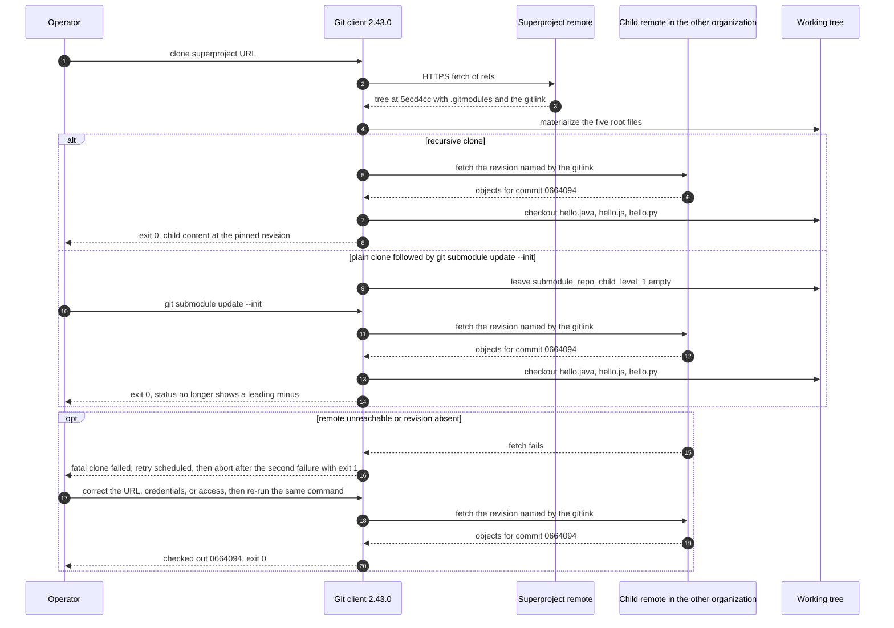

| Exchange in the diagram | Requirement anchor | Verified here |
| --- | --- | --- |
| Superproject fetch and five-file materialization | §1.2.1, F-002-RQ-001 | Yes — `origin` resolved at `5ecd4cc` |
| Recursive branch resolving the child at `0664094` | F-002-RQ-003 | Yes — reproduced by clone, eight files delivered |
| Plain-clone branch and the completing update | F-002-RQ-004 | Yes — reproduced against the same pin |
| Failure branch with one retry, abort, and operator-side correction | F-002-RQ-002, §4.5.2 | Yes — reproduced by rewriting the submodule URL |
| Successful re-run after correction, and idempotent repeat | §4.5.4 | Yes — exit 0, then a no-op with no output |


## 4.10 References

**Repository files.**

- `hello.go` - Go member; `package main` and `func main` writing the literal through `fmt.Println`; 77 bytes, 7 lines; establishes the compiled-member flow of §4.3.3 and F-001-RQ-001.
- `hello.php` - PHP member; a single top-level `echo` with no closing `?>` tag; 28 bytes; establishes the 13-byte, newline-free output branch of §4.3.2 and D5.
- `hello.rb` - Ruby member; a single top-level `Kernel#puts` with no guard; 21 bytes; establishes the evaluate-at-load path of §4.3.2.
- `README.md` - 34-byte, single-title placeholder with no trailing newline; establishes that the repository documents no workflow, SLA, or roadmap.
- `.gitmodules` - declares only `path` and `url` for `submodule_repo_child_level_1`, with no `branch`, `tag`, `depth`, `shallow`, `update`, or `ignore` key; establishes the revision-pinning flow of §4.4.1 and F-002-RQ-001.
- `submodule_repo_child_level_1/hello.js` - Node.js member writing at load; executed in this environment, 14 bytes on stdout and exit status 0; establishes the observed Node.js path of §4.3.2 and F-004-RQ-001 to F-004-RQ-004.
- `submodule_repo_child_level_1/hello.py` - Python 3 member writing at module level; executed directly (13-14 ms, exit 0) and imported (printed at import, created `__pycache__`); establishes the import side effect and the caching findings of §4.3.2 and §4.6.3.
- `submodule_repo_child_level_1/hello.java` - Java member; `public class Hello` with `main(String[] args)` in file `hello.java`, `args` never read; establishes the compilation decision D6, the untracked `Hello.class` persistence point, and the unverified risk recorded in §4.7.1.
- `.git/config` (local, untracked) - holds the installation token in `remote.origin.url`, `credential.helper`, `credential.interactive=false`, `core.askpass=echo`, and `submodule.submodule_repo_child_level_1.active=true` with the child URL; establishes the authorization and fail-fast findings of §4.5.2 and §4.7.2.
- `.git/modules/submodule_repo_child_level_1` (local, untracked) - the child repository's object store and refs, at commit `0664094` with branches `main` and `2810_01`; establishes the child-side half of §4.4.1 and §4.6.2.
- `.git/hooks/` (local, untracked) - contains only inactive `*.sample` files; establishes that no hook, gate, or automation runs on commit or checkout.

**Repository folders.**

- `` (repository root) - holds the five tracked root entries (`hello.go`, `hello.php`, `hello.rb`, `README.md`, `.gitmodules`) and the `submodule_repo_child_level_1` gitlink; establishes the superproject boundary and the eight-file total across both trees.
- `submodule_repo_child_level_1/` - holds the three child members plus a 53-byte `.git` gitlink file containing `gitdir: ../.git/modules/submodule_repo_child_level_1`; establishes the cross-repository boundary and the empty-versus-populated states of §4.6.2.

**Internal cross-references used for terminology and requirement identifiers.**

- §1.2 System Overview - the component view of §1.2.2, the three external couplings, and the absence of any declared SLA, KPI, or benchmark.
- §1.3 Scope - the five primary user workflows of §1.3.1 and the explicit exclusions of §1.3.2 that this section's error, state, and compliance findings align with.
- §2.1 Feature Catalog and §2.2 Functional Requirements Table - the feature IDs F-001 to F-006 and the `F-xxx-RQ-yyy` identifiers traced in §4.8.3.
- §3.6 Development & Deployment - the toolchain inventory, the absence of build and CI automation, and the deployment flowchart of §3.6.6.

**Web sources.**

- [web] go.dev release history and download pages (https://go.dev/doc/devel/release, https://go.dev/dl) - current stable Go toolchain 1.27.3 at the time of writing.
- [web] Go Modules Reference and Go 1.16 release notes (https://go.dev/ref/mod, https://go.dev/doc/go1.16) - the module-aware default and the rule that, with no `go.mod` present, `go run` can still build packages named as `.go` files on the command line, which is how §4.3.3 describes the Go path.
- [web] Oracle Java SE downloads and support roadmap (https://www.oracle.com/java/technologies/downloads/, https://www.oracle.com/java/technologies/java-se-support-roadmap.html) - JDK 25 as the current LTS and JDK 27 as the latest feature release.
- [web] JEP 330, Launch Single-File Source-Code Programs (https://openjdk.org/jeps/330) - single-file source launch available since JDK 11, noted as an alternative Java invocation in §4.3.3.
- [web] PHP Manual, PHP tags (https://www.php.net/manual/en/language.basic-syntax.phptags.php) - omitting the closing `?>` tag is the preferable form for a PHP-only file and does not affect execution.
- [web] PHP release announcement and supported-versions page (https://www.php.net/releases/8_5_12.php, https://www.php.net/supported-versions.php) - PHP 8.5.12 as the current stable 8.x release.
- [web] Ruby release announcement and download page (https://www.ruby-lang.org/en/news/2026/10/23/ruby-4-0-9-released/, https://www.ruby-lang.org/en/downloads) - Ruby 4.0.9 as the newest published stable release, with the download page still listing 4.0.7.

**External verification tooling used for the diagrams.**

- `@mermaid-js/mermaid-cli` (`mmdc`, version 12.0.0) with the local Chrome installation - rendered and syntax-verified all ten diagrams in this section, and identified the statement-separator constraint documented in §4.9.


# 5. System Architecture

## 5.1 High-Level Architecture

### 5.1.1 System Overview

**Architecture style.** The system is a *polyglot collection of independent single-file programs delivered entirely by Git*. It has no runtime composition, no shared library, no build step, no service, no port and no persistent data. Two delivery units exist: a superproject working tree of five tracked files (`hello.go`, `hello.php`, `hello.rb`, `README.md`, `.gitmodules`) and a child working tree of three tracked files (`hello.js`, `hello.py`, `hello.java` under `submodule_repo_child_level_1/`), reached through a gitlink of mode `160000` at revision `066409439699a1967ad788413b74dfc3e4914447`. Composition here is by *delivery*, not by *linkage*: no superproject file imports, calls, or otherwise references a child file, so the gitlink and its `.gitmodules` declaration are the entire coupling between the two units.

**Architectural principles.** The repository carries no design note, ADR file, or architecture document — `README.md` is a single title line — so the principles below are read from the artifacts rather than quoted from a stated intent.

| Principle | Expression in the artifacts | Evidence |
| --- | --- | --- |
| One program per language, one file per program | Six source files, each a complete program and each at most five non-blank lines | `hello.go` (7 lines), `hello.java` (5 lines), one line each for `hello.php`, `hello.rb`, `hello.js`, `hello.py` |
| Zero third-party dependencies | The only import in either repository is the Go standard-library package `fmt`; `echo`, `puts`, `console`, `print` and `java.lang.System` are host built-ins, not dependencies | A search for import/require tokens across all eight tracked files matched exactly two lines — `hello.go:1 package main` and `hello.go:3 import "fmt"` |
| Input-free determinism | No member reads argv, environment variables, stdin, files or the network; the emitted value is a compile-time string literal | A search for input, network and persistence tokens matched only `.gitmodules:3` (the child URL, consumed by Git) and `hello.go:3` |
| The repository is the only artifact | Nothing is built, published, or installed; no manifest, lockfile or generated file is tracked | No `go.mod`, `composer.json`, `Gemfile`, `package.json`, `pom.xml` or `build.gradle` exists in either tree |
| Content-addressed composition | The child revision is fixed by the gitlink SHA, not by a branch or a tag — `.gitmodules` declares only `path` and `url` | `git ls-files -s` shows `160000 0664094396… submodule_repo_child_level_1`; `.gitmodules` is 170 bytes with no `branch`, `tag`, `depth`, `update` or `ignore` key |
| One observable contract per member | Exactly one line on standard output plus a process exit status, with a clean stderr | `hello.js` and `hello.py` each produced 14 bytes on stdout, 0 bytes on stderr, exit status `0` |
| Operator-driven, tool-free operation | Git is the only automation; there is no CI job, scheduler, wrapper script or runner | No CI configuration, no shell script, and `.git/hooks` holds only inactive `*.sample` files |

**Deployment topology.** One host holding a checkout, plus six language runtimes and a Git client. Nothing in the tree installs, verifies or records those runtimes: at inspection Go, PHP, Ruby and the JDK were absent (`exit 127`, `command not found`), while Node.js v22.23.3, Python 3.12.3 and Git 2.43.0 were present. The architecture therefore has no running instance to monitor, no scale-out axis, and no failure domain beyond the host process and the two Git remotes.

**System boundaries and major interfaces.** Four boundaries define the system, and each is crossed by exactly one mechanism.

| Boundary | Inside | Outside | Crossing mechanism |
| --- | --- | --- | --- |
| Repository | The eight tracked files and the two Git object stores | GitHub hosting the two remotes | HTTPS Git transport, used at acquisition time only |
| Process | One short-lived process per invocation | The host shell and the consumer that reads its output | `exec` of a runtime with a file path; stdout, stderr and the exit status return |
| Host | Nothing — no daemon, listener, socket or scheduled task is created | The six runtimes and the Git client the host must supply | The `PATH` lookup the shell performs |
| Revision | Working-tree content at superproject `5ecd4cc` and child `0664094` | Any other revision of either repository | Checking out a different commit, or advancing the gitlink |

The interfaces that cross these boundaries are deliberately few:

- **Invocation interface** — the operator's shell, one command per member, each naming the member's own runtime: `go run hello.go`, `php hello.php`, `ruby hello.rb`, `node submodule_repo_child_level_1/hello.js`, `python3 submodule_repo_child_level_1/hello.py`, and `javac` followed by `java Hello` for the Java member. Four of the six were not executable in the inspection host.
- **Result interface** — one text line on standard output (14 bytes, 13 for `hello.php`) and the process exit status, which is `0` on success, `1` for a parse failure, `127` for an absent runtime.
- **Acquisition interface** — `git clone`, optionally `--recurse-submodules`, and `git submodule update --init` / `git submodule status`. `.gitmodules` is the only configuration artifact in the system, and it configures this interface alone.

### 5.1.2 Core Components

Ten components make up the system. Eight are tracked artifacts in two working trees; one is the linkage mechanism between those trees; one is environment-resident and untracked. Because the component prompt's five columns exceed the four-column table limit this specification applies, each component is described in two tables: responsibility and interfaces first, then the critical consideration that governs it.

| Component | Primary responsibility | Key dependencies | Integration points |
| --- | --- | --- | --- |
| C-01 Superproject working tree (`hello.go`, `hello.php`, `hello.rb`, `README.md`, `.gitmodules`) | Carry the three root-language members, the placeholder README and the submodule declaration; own the gitlink | Git client; Go, PHP and Ruby runtimes at invocation | Parent Git remote (inbound); C-02/C-03/C-04 member processes; C-09 linkage |
| C-02 Go member `hello.go` | Print the literal from `package main` via `fmt.Println` | Go standard-library package `fmt`; Go toolchain | Operator shell; stdout and exit status |
| C-03 PHP member `hello.php` | Print the literal from top-level `echo`, with no closing `?>` tag | PHP interpreter (language construct only, no library) | Operator shell; stdout and exit status |
| C-04 Ruby member `hello.rb` | Print the literal from a top-level `puts`, with no `__FILE__ == $PROGRAM_NAME` guard | Ruby interpreter (`Kernel#puts` built-in) | Operator shell; stdout and exit status; also executes on `require` |
| C-05 Child working tree (`hello.js`, `hello.py`, `hello.java`) | Carry the three child-language members at the revision the gitlink fixes | Git client resolving the gitlink; Node.js, Python 3 and a JDK at invocation | Child Git remote (inbound); C-01 via C-09; member processes |
| C-06 JavaScript member `hello.js` | Print the literal from `console.log` at module evaluation | Node.js runtime (`console` built-in) | Operator shell; stdout and exit status; also executes on `require` |
| C-07 Python member `hello.py` | Print the literal from a module-level `print` | Python 3 interpreter (`print` built-in) | Operator shell; stdout and exit status; also executes on import |
| C-08 Java member `hello.java` | Print the literal from `Hello.main` via `System.out.println` | A JDK; implicitly imported `java.lang` | Operator shell — `javac` then `java Hello`; stdout and exit status |
| C-09 Submodule linkage (`.gitmodules` plus the mode-`160000` gitlink) | Bind the child revision `0664094` to the path `submodule_repo_child_level_1`, and declare the child URL | Git client with submodule support; HTTPS reachability of the cross-organization remote | C-01 tree (the gitlink entry); C-05 tree (the checkout) |
| C-10 Host runtime layer (environment-resident, untracked) | Execute the six members and perform acquisition; supplies Git, Go, PHP, Ruby, Node.js, Python 3 and the JDK | The host's own provisioning; the operator's `PATH` | Every member process and every Git operation |

| Component | Critical consideration | Evidence |
| --- | --- | --- |
| C-01 / C-05 | A non-recursive clone yields five of eight files and still exits `0`, so incompleteness is silent | Plain clone left `submodule_repo_child_level_1/` empty with `git submodule status` showing `-0664094…` |
| C-02 | Requires the Go toolchain, absent from the inspection host; no `go.mod` exists, so `go run .` cannot work while `go run hello.go` can | `go run hello.go` returned `exit 127, command not found`; the tree contains no module file |
| C-03 | The only member whose stdout lacks a trailing newline, because `echo` appends none — 13 bytes against the other five members' 14 | Source-derived; not executed here, because PHP is absent from the host |
| C-04 | Prints on load, not only when run as a script, so requiring the file is a side-effecting operation | `puts` sits at file top level with no guard |
| C-06 / C-07 | Same load-time side effect: `require` of `hello.js` and `import` of `hello.py` both print; import additionally writes an untracked `__pycache__` directory | Reproduced for both members; the two members are the only ones executed successfully here |
| C-08 | The one identified compilation risk: a public type named `Hello` in a file named `hello.java` normally conflicts with a JDK's file-name requirement | Unverified — no JDK was present; recorded as a risk in §2.2.2 (F-001-RQ-006) |
| C-09 | `.gitmodules` pins no branch, tag or revision, so the consumed revision comes solely from the gitlink; the child lives in a different GitHub organization, so an acquisition depends on a second remote's availability | `.gitmodules` (3 lines, `path` and `url` only); gitlink SHA equals the child's own `main` and `2810_01` heads at `0664094` |
| C-10 | Four of six runtimes were absent, so the same repository that verifies a provisioned host also reports an unprovisioned one as `exit 127` | `command -v` misses for `go`, `php`, `ruby`, `javac`, `java` |

### 5.1.3 Data Flow Description

Data movement in this system is one-directional and shallow: source flows from a remote into a working tree, and a literal flows from a working tree to a process's standard output stream. No member sends data to another member, no member persists anything, and no component consumes another's output.

**Primary flows.**

| Flow | Trigger | Path | Observable result |
| --- | --- | --- | --- |
| Superproject acquisition | Operator runs `git clone` or `git fetch` | Parent remote (`github.com/lakshya-blitzy/parent_repo_hello_world_ABK_6771.git`) → HTTPS → pack objects → `.git` → working tree | Five files materialized at `5ecd4cc`; exit `0` |
| Child acquisition | Git resolves the gitlink, at clone time with `--recurse-submodules` or later via `git submodule update --init` | `.gitmodules` URL (`github.com/lakshya-blitzy-only-submodules/…`, a different organization) → HTTPS → `.git/modules/submodule_repo_child_level_1` → child working tree | Three files checked out at `0664094`; exit `0`; `Submodule path … checked out '0664094396…'` |
| Member invocation | Operator names a member and its runtime | Shell → runtime `exec` → source file read → the single literal write → stdout | 14 bytes on stdout for five members, 13 for `hello.php`; 0 bytes on stderr; exit `0` |
| Result verification | Consumer captures the invocation output | stdout and exit status → external assertion | Pass when stdout equals the literal and status is `0`; no in-tree assertion exists |

A non-flow is as significant as the flows: **the members exchange no data at all.** There is no call, no import, no pipe, no file, no queue and no shared resource between them; the only thing they share is a value — the literal `Hello, World!`, repeated verbatim once per file rather than held in a common constant or resource. Consequently the six members can diverge, and one already has in its output bytes (`hello.php` emits no newline).

**Integration patterns and protocols.** Two protocol families cover the whole system:

- **Git smart HTTP over HTTPS/TLS** for both inbound flows — a request/response pull, no push, no webhook, no credential helper configured. The parent remote in this checkout carries an environment-injected GitHub installation token in its untracked local `.git/config`, but a credential-free recursive clone from the bare GitHub URL succeeded, so anonymous read is sufficient for both remotes. The transport is a *pull-only*, *operator-initiated* integration: nothing in the system polls, retries beyond Git's single built-in retry, or reacts to change.
- **Native process execution** for the invocation flow — the shell locates the runtime on `PATH` and `exec`s it with the member's path; the runtime reads the file once at launch and writes to its own stdout stream. No sockets, ports, IPC channels or shared memory are involved.

**Data transformation points.** Four transformations exist; nothing else in the system alters data.

| Transformation | Input | Output | Evidence |
| --- | --- | --- | --- |
| Object → file materialization | Git blob at `a25aba76…`, `b7d2a320…`, `790c7dc2…`, `5de78a49…`, `03b000b3…`, plus child blobs `184dfcc9…`, `7df869a1…`, `a605554a…` | The eight working-tree files, byte-identical to their blobs, line endings preserved | `git ls-files -s`; file byte counts 21–170 for the root files |
| Gitlink → concrete revision | The mode-`160000` entry naming `0664094` | A checked-out child working tree containing exactly `hello.js`, `hello.py`, `hello.java` | `git submodule status` reports ` 0664094… (heads/main)` after a recursive clone |
| Literal → output stream | The compile-time string in each source file | 14 bytes `Hello, World!\n` for five members; 13 bytes for `hello.php`, whose `echo` appends no newline | Verified for `hello.js` and `hello.py` with `od -c` and byte counts; `hello.php` source-derived |
| Source → toolchain intermediate | `hello.go` and `hello.java` | A Go build artifact in the toolchain's cache; a `Hello.class` written beside the source by `javac` | No artifact is tracked or published; no `.gitignore` exists, so a class file would appear as untracked residue |

**Key data stores and caches.** The system's only durable state is version control state:

- **Superproject Git object store** — `.git/`, 15 objects in one 5.40 KiB pack, holding the five root files and five commits; refs `refs/heads/{main,2810_01}` and `refs/remotes/origin/{main,2810_01,HEAD}` all at `5ecd4cc`; zero tags.
- **Child Git object store** — `.git/modules/submodule_repo_child_level_1/`, 14 objects in one 5.82 KiB pack, holding the three child files and five commits at `0664094`; the child working tree reaches it through the 53-byte `gitdir:` pointer file `submodule_repo_child_level_1/.git`. Storing the child's objects inside the parent's `.git` is behavioural, not incidental: anything that copies the working tree without `.git`, or clones non-recursively, loses three of the six members.
- **Untracked local Git configuration** — the parent's `.git/config` holds the token-bearing `remote.origin.url` and `submodule.submodule_repo_child_level_1.{active,url}`; the child's config holds a token-free origin URL.
- **No cache tier exists at any level** — no in-memory cache, CDN, session store or build cache, and no cache key in any file; the only caching is Git's own content-addressed deduplication and the operating system's filesystem cache, neither of which this repository configures, and there is no cache to warm, evict or invalidate because no member retains state between invocations.
- **Optional untracked residue** — importing `hello.py` writes `__pycache__`, and compiling `hello.java` would write a class file. No `.gitignore` exists in either tree, so such residue appears as untracked content.

No store holds application data, because no member produces data: the single datum the code handles is the literal itself.

### 5.1.4 External Integration Points

The system integrates with six external parties and no others. A full search of both working trees found no configuration file besides `.gitmodules`, so no further endpoint, credential, or service address could be declared anywhere.

| System name | Integration type | Data exchange pattern | Protocol / format |
| --- | --- | --- | --- |
| `github.com/lakshya-blitzy/parent_repo_hello_world_ABK_6771.git` | Source hosting for the superproject; inbound only | Operator-initiated pull of objects at clone or fetch time; no push is performed by the system | Git smart HTTP over HTTPS/TLS; Git objects and packfiles; `.gitmodules` in INI format |
| `github.com/lakshya-blitzy-only-submodules/submodule_repo_child_level_1.git` (a different GitHub organization) | Cross-organization source hosting for the child; inbound only | Pull of exactly the one revision named by the gitlink, at clone with `--recurse-submodules` or via `git submodule update --init` | Git smart HTTP over HTTPS/TLS; Git objects and packfiles |
| Host language runtimes — Go, PHP, Ruby, Node.js, Python 3, JDK | Execution platform; in-process | One-shot `exec` per invocation with the source path as an argument; return is stdout, stderr and an exit status | Operating-system process interface; each runtime's native entry-point convention |
| Operator shell or consumer harness | Invocation and verification interface | Command in; one text line plus an exit status out | POSIX command line; UTF-8 text on stdout; integer exit status (`0`, `1`, `127`) |
| Host filesystem | Local storage of the checkout | Read of each source file at launch; write of toolchain residue only | Path-based file access; no member reads a path other than its own source |
| Environment-supplied GitHub credential | Authentication supply for the parent remote only | Token embedded in the local remote URL at runtime; never written to a tracked file | HTTPS URL userinfo (`x-access-token:<token>@github.com`), held in untracked `.git/config` |

**SLA requirements.** No SLA, SLO, availability target, throughput, or latency objective is declared or instrumented anywhere in the repository, and no monitoring integration exists to measure one. The table below separates what is declared from what the artifacts actually guarantee.

| System name | SLA requirements | What the artifacts actually guarantee |
| --- | --- | --- |
| Parent GitHub remote | None declared | Availability is entirely GitHub's; the revision needed is content-addressed at `5ecd4cc`, so any later successful fetch restores it exactly |
| Child GitHub remote | None declared | Same, at revision `0664094`; Git makes exactly one automatic retry before aborting with exit `1`, and no timeout, mirror or alternate URL is configured |
| Host language runtimes | None declared; no version constraint is recorded for any of the six | Only that a member runs if its runtime is on `PATH`; an absent runtime is reported as `exit 127` with `command not found` |
| Operator shell / consumer harness | None declared | A single 14-byte line (13 for `hello.php`) and exit status `0`; observed invocation cost was 14 ms for `hello.py` and 29 ms for `hello.js`, against interpreter startup floors of about 12 ms and 20 ms respectively |
| Host filesystem | None declared | Only that the checkout fits in under half a megabyte and that no member writes to it (apart from optional toolchain residue) |
| Credential supply | None declared | Anonymous HTTPS read of both remotes was sufficient in a credential-free recursive clone, so no credential is required to obtain the system |

**Integration points deliberately absent.** No HTTP API, database, message broker, cache, identity provider, secret manager, artifact registry, package registry, telemetry backend, cloud service, container runtime, or infrastructure-as-a-service endpoint is referenced by any file. There is no API key, connection string, or service address in either tree; the only `https://` string in the working trees is the child remote URL on `.gitmodules` line 3, and the only import in either repository is `hello.go`'s standard-library `fmt`. Integrations of those kinds are consequently out of scope rather than unconfigured — the same exclusions §1.3.2 records.


## 5.2 Component Details

This sub-section profiles each component identified in 5.1.2. The eight tracked artifacts form two working trees — a superproject tree carrying three members, and a child tree carrying three more — linked by a Git-level pointer rather than by code. Every profile below therefore covers the same five aspects the component prompt requires: purpose and responsibilities, technologies and runtimes, key interfaces and invocation contracts, persistence requirements, and scaling considerations. Where an aspect is genuinely absent, that absence is stated with the evidence that establishes it, because for this system the absences are as architecturally meaningful as the contents.

### 5.2.1 Superproject Working Tree

**Purpose and responsibilities.** The superproject tree carries the three root-language members, the placeholder documentation, and the submodule declaration, and it is the entry point of the whole system: a consumer obtains the child members only by cloning this tree (or by cloning the child directly). It has no executable logic of its own, no build orchestration, and no configuration beyond `.gitmodules`.

| File | Role | Tracking detail |
| --- | --- | --- |
| `hello.go` | Go member (C-02) | mode `100644`, blob `b7d2a320…`, 77 bytes, 7 lines |
| `hello.php` | PHP member (C-03) | mode `100644`, blob `790c7dc2…`, 28 bytes, 1 line |
| `hello.rb` | Ruby member (C-04) | mode `100644`, blob `5de78a49…`, 21 bytes, 1 line |
| `README.md` | Placeholder documentation — one H1 title line, no usage or design text | mode `100644`, blob `03b000b3…`, 34 bytes, no trailing newline |
| `.gitmodules` | Submodule declaration (C-09) — `path` and `url` only | mode `100644`, blob `a25aba76…`, 170 bytes, 3 lines |
| `submodule_repo_child_level_1` | Gitlink to the child tree (C-09) | mode `160000`, revision `066409439699a1967ad788413b74dfc3e4914447` |

**Technologies and frameworks.** None beyond Git itself. There is no manifest, lockfile, task runner, or CI configuration in the tree, and the working tree has no executable bit set on any file — every blob is mode `100644`, so each member is invoked through its runtime rather than executed directly.

**Key interfaces.** Git operations against the tree — `clone`, `fetch`, `checkout`, `status`, `submodule update --init` — plus one shell command per member. Because `README.md` states nothing, the tree publishes no interface contract of its own; the contract is the observable one established in §2.2 (one literal line on stdout, exit status `0`).

**Data persistence, scaling, and considerations.** The tree's durable state is the parent `.git` object store: 15 objects in one 5.40 KiB pack, with refs `refs/heads/{main,2810_01}` and `refs/remotes/origin/{main,2810_01,HEAD}` all at `5ecd4cc` and zero tags. Nothing in the tree is mutated by running a member. Scaling has no meaning for this component — it is five static files, no invocation depends on another, and the only cost a repeated use incurs is one HTTPS clone. The one operational consideration worth stating plainly is that the superproject is *not* self-sufficient: a plain clone of it yields five of the eight files while exiting `0`, so a consumer that treats a successful clone as proof of a complete checkout will hold a tree that is missing half the members.

### 5.2.2 Go Member — `hello.go`

**Purpose and responsibilities.** Print the literal `Hello, World!` once and exit, exercising the Go toolchain on this repository. It is the only member with a package declaration and the only one that imports anything.

```go
package main

import "fmt"
```

| Aspect | Finding |
| --- | --- |
| Technology and runtime | Go toolchain, invoked as `go run hello.go`; the toolchain was **not installed** in the inspection host, so the member was never executed here and remains unverified |
| Entry point | `func main()` in `package main` — the runtime-invoked entry point; the package is not importable and every declaration in it is unexported, so the member exposes no reusable API |
| Key interface | One command-line invocation with the file path; the source is read from the working tree at launch |
| Dependencies | The Go standard-library package `fmt` (sole member used: `Println`) — the only import in either repository, and no third-party package |
| Output contract | `fmt.Println` appends a newline, so stdout is expected to hold `Hello, World!\n` — 14 bytes — with exit status `0`; source-derived, not observed here |
| Persistence | None. No file, database, environment variable or cache is read or written; the working tree stays clean after a run |
| Scaling | No scaling axis: the process is short-lived, stateless and idempotent, so concurrent or repeated invocations cannot contend for any shared resource; the only cost is toolchain startup |
| Failure mode | `exit 127` (`go: command not found`) when the toolchain is absent, as reproduced here; `go run .` would also fail because no `go.mod` exists, while `go run hello.go` builds the named file directly |
| Source note | `hello.go` uses four-space indentation where `gofmt` would emit a tab, so the file is not formatted by the standard formatter — consistent with the absence of any formatter or linter configuration |

### 5.2.3 PHP Member — `hello.php`

**Purpose and responsibilities.** Print the literal from file top level and exit. It is the shortest member alongside the Ruby and JavaScript ones, and the only member whose output bytes differ from the rest.

```php
<?php echo "Hello, World!";
```

| Aspect | Finding |
| --- | --- |
| Technology and runtime | PHP interpreter, invoked as `php hello.php`; **not installed** in the inspection host, so the member was not executed here |
| Entry point | Top-level statement — PHP executes the file body as it parses it, so there is no function or class to call and no separate bootstrap |
| Key interface | One command-line invocation naming the file; the interpreter reads the file from the working tree |
| Dependencies | None at all: `echo` is a language construct, not a library call |
| Output contract | `echo` writes its argument **without** appending a newline, so stdout is expected to hold `Hello, World!` — **13 bytes**, one byte fewer than the other five members — with exit status `0`; source-derived, not observed here |
| Persistence | None; no file or session is touched |
| Scaling | Not applicable beyond the general property shared by all members: stateless, single-write, idempotent |
| Source note | The file omits the closing `?>` tag, which is the recommended form for PHP-only files because it prevents trailing whitespace from being emitted; it also has no trailing newline in the file itself |
| Failure mode | `exit 127` (`php: command not found`) when the interpreter is absent; the member's distinct output length is the one place where the six members are not byte-identical, and nothing in the tree asserts otherwise |

### 5.2.4 Ruby Member — `hello.rb`

**Purpose and responsibilities.** Print the literal and exit — and, uniquely, do so whenever the file is loaded rather than only when it is run as a script.

```ruby
puts "Hello, World!"
```

| Aspect | Finding |
| --- | --- |
| Technology and runtime | Ruby interpreter, invoked as `ruby hello.rb`; **not installed** in the inspection host, so the member was not executed here |
| Entry point | A top-level expression evaluated when the file is loaded. The call carries no `if __FILE__ == $PROGRAM_NAME` guard, so `require`-ing the file also prints the line — the member is an action, not a library |
| Key interface | One command-line invocation naming the file |
| Dependencies | None: `puts` is a built-in method mixed into `Object` by default |
| Output contract | `puts` appends a newline, so stdout is expected to hold 14 bytes and exit status `0`; source-derived, not observed here |
| Persistence | None |
| Scaling | Not applicable beyond the shared stateless, idempotent property; the load-time side effect does mean an embedding host cannot load the file without emitting output |
| Failure mode | `exit 127` when the interpreter is absent (reproduced here), and `exit 1` with a `SyntaxError` at line 1 if the file is handed to a runtime it does not belong to — reproduced by running it under Node.js |

### 5.2.5 Submodule Working Tree

**Purpose and responsibilities.** The child tree delivers the three remaining members — Java, JavaScript and Python — at exactly the revision the superproject's gitlink names. It is a separate repository in a *different GitHub organization*, checked out inside the superproject's working directory, and it belongs to the F-002 delivery feature rather than to the members themselves.

| Aspect | Finding |
| --- | --- |
| Contents | Exactly three tracked files: `hello.java` (119 bytes, 5 lines), `hello.js` (30 bytes, 1 line), `hello.py` (23 bytes, 1 line) — see 5.2.6 to 5.2.8 |
| Checkout mechanism | The working tree is a gitlink checkout: `submodule_repo_child_level_1/.git` is a 53-byte **file** containing `gitdir: ../.git/modules/submodule_repo_child_level_1`, not a nested repository directory |
| Revision at inspection | `0664094` (`heads/main` in a fresh clone; `heads/2810_01` in this checkout) — identical to the gitlink and to the child's `main` and `2810_01` heads, since both child branches point at that commit |
| Own history | Five commits: initial commit, `hello.js`, `hello.py`, `hello.java`, and `0664094 Delete README.md`. The child has no `.gitmodules` of its own and no nested submodules; its own README was deleted in the pinned commit, so the pinned tree contains no documentation |
| Technologies | Git for delivery; Node.js, Python 3 and a JDK for the members; no package manifest, framework or build tool |
| Key interfaces | `git submodule status` reports the state: leading `-` when uninitialized, leading space plus the SHA and `(heads/main)` when correctly checked out; `git submodule update --init` performs the acquisition |
| Persistence | The child's objects are stored **inside the superproject's `.git`**, at `.git/modules/submodule_repo_child_level_1` (14 objects, one 5.82 KiB pack). No member in this tree persists anything |
| Scaling | Not applicable — three static files resolved to one immutable revision; the only acquisition cost is one HTTPS fetch |
| Critical consideration | Because the objects live under the parent's `.git` and the directory arrives empty from a non-recursive clone, anything that copies or archives the working tree without `.git` silently loses three of the six members. Access depends on a second organization's remote staying available; when it is not, Git retries once and aborts with exit `1`, leaving the directory empty and the leading `-` in place |


### 5.2.6 JavaScript Member — hello.js

**Purpose and responsibilities.** Print the literal at module evaluation and exit. This is one of the two members whose behaviour was verified by execution in the inspection environment, so its output contract is observed rather than inferred.

```javascript
console.log("Hello, World!");
```

| Aspect | Finding |
| --- | --- |
| Technology and runtime | Node.js; executed here on **v22.23.3** as `node submodule_repo_child_level_1/hello.js` — the only JavaScript runtime exercised, and the repository declares no version constraint, so the runtime is chosen entirely by the host `PATH` |
| Entry point | The call sits at module top level, so it runs when the file is evaluated as a script **and** when the file is `require`d as a module. Reproduced: requiring the file prints the line and returns a module object with an empty `exports`, so the member offers no callable API |
| Key interface | One command-line invocation naming the file; the runtime reads the file from the working tree at launch |
| Dependencies | None: `console` is a Node.js built-in. The child tree contains no `package.json`, no `node_modules` and no lockfile, so there is nothing to install |
| Output contract | **Observed**: stdout held exactly 14 bytes — `H e l l o , ␠ W o r l d ! \n` under `od -c` — stderr held 0 bytes, and the process exited `0`, in 29 ms wall time against Node's ~20 ms startup floor |
| Persistence | None. Running the member leaves the working tree clean; requiring it writes no cache directory, unlike the Python member |
| Scaling | No scaling axis: the process is stateless, idempotent and short-lived, and holds no resource another invocation could contend for. Concurrency is bounded only by Node's startup cost, which dominates the total runtime |
| Failure mode | `exit 127` (`node: command not found`) when Node.js is absent on the host — the state of four of the six members in the inspection environment |


### 5.2.7 Python Member — hello.py

**Purpose and responsibilities.** Print the literal from module level and exit. This is the second member verified by execution in the inspection environment.

```python
print("Hello, World!")
```

| Aspect | Finding |
| --- | --- |
| Technology and runtime | Python 3; executed here on **3.12.3** as `python3 submodule_repo_child_level_1/hello.py`. No version constraint is recorded anywhere, and the tree contains no `requirements.txt`, `pyproject.toml` or lockfile |
| Entry point | A module-level statement, so the line is written both when the file is run as a script and when it is imported. Reproduced: importing the module prints at import time and exposes no public symbols, so the member is an action rather than a library |
| Key interface | One command-line invocation naming the file; the interpreter reads it from the working tree at launch |
| Dependencies | None: `print` is a built-in |
| Output contract | **Observed**: stdout held exactly 14 bytes, identical to the JavaScript member's output; stderr held 0 bytes; exit status `0` in 14 ms wall time against Python's ~12 ms startup floor |
| Persistence | No application data. One toolchain side effect exists: importing the member causes CPython to write a `__pycache__` directory beside the source (reproduced outside the checkout so the tree stayed clean). Neither repository has a `.gitignore`, so such residue would appear as untracked content to any consumer asserting a clean tree — running the file as a script writes nothing |
| Scaling | No scaling axis: stateless, idempotent, single write, immediate exit; interpreter startup dominates the cost and is incurred per invocation because no long-lived process exists |
| Failure mode | `exit 127` when no Python 3 interpreter is on `PATH`; `exit 1` with a `SyntaxError` at line 1 if a foreign file is named instead — reproduced by running `python3 hello.php`, where the `<?php` tag is not valid Python |


### 5.2.8 Java Member — hello.java

**Purpose and responsibilities.** Print the literal from a conventional Java entry point and exit. It is the only member that is a compile unit rather than a single script statement, and the only member whose build is a distinct, separate step.

```java
public class Hello {
    public static void main(String[] args) {
```

| Aspect | Finding |
| --- | --- |
| Technology and runtime | A JDK, invoked as `javac submodule_repo_child_level_1/hello.java` followed by `java Hello`. **Not installed** in the inspection host (`javac` and `java` both `exit 127`), so this member was never executed and its compilation behaviour is unverified here |
| Entry point | `public static void main(String[] args)` on `public class Hello` — the JVM's own entry convention. `args` is declared and never read, so the member remains input-independent |
| Key interface | Two commands, not one: a compilation step that must succeed before the class can be run. There is no build file, wrapper or classpath declaration, so `javac` and `java` are invoked directly against the source file |
| Dependencies | None beyond the implicitly imported `java.lang` package, which supplies `System` and `System.out`. The file contains no `import` statement |
| Output contract | `System.out.println` appends a newline, so stdout is expected to hold 14 bytes and the process is expected to exit `0`; source-derived, **not observed** |
| Persistence | No application data. Compilation is the one member action that creates an artifact in the working tree: a `Hello.class` file beside the source, untracked and unignored, so a consumer asserting a clean tree must account for it |
| Scaling | No scaling axis, but this member is the only one with a two-phase cost — compilation then execution — and each run recompiles because no build artifact is tracked or cached |
| Critical consideration | The compilation unit is named `hello.java` while the public type it declares is `Hello`. A JDK normally requires a public type's file name to match the class name, so this is the repository's single identified compilation risk; it is recorded as such in §2.2.2 (F-001-RQ-006) and §4.5.1, and it could not be settled here because no JDK was available |


### 5.2.9 Submodule Linkage Component

**Purpose and responsibilities.** The linkage component is what makes the superproject and the child a single deliverable without coupling their code. It consists of exactly two artifacts: the `.gitmodules` declaration, which names the child path and its URL, and the working tree's mode-`160000` gitlink entry, which names the child revision. Together they mean that "which child content does this build of the system use?" is answered by a commit hash, not by a branch, a tag or a dependency range.

```ini
[submodule "submodule_repo_child_level_1"]
	path = submodule_repo_child_level_1
	url = https://github.com/lakshya-blitzy-only-submodules/submodule_repo_child_level_1.git
```

| Aspect | Finding |
| --- | --- |
| Technology | Native Git submodule support; no third-party tool, plugin or script is involved in the linkage |
| Declared keys | `path` and `url` only — 170 bytes across three lines. No `branch`, `tag`, `depth`, `shallow`, `update`, `ignore` or `fetchRecurseSubmodules` key is present, so the revision comes solely from the gitlink and the fetch policy is Git's default |
| Key interface | `git submodule status` is the linkage's state readout, and `git submodule update --init` is its acquisition operation. Observed states: leading `-` plus the SHA when uninitialized; a leading space, the SHA and `(heads/main)` when correctly checked out at the pin |
| Cross-organization boundary | The child URL is in the GitHub organization `lakshya-blitzy-only-submodules`, while the superproject remote is in `lakshya-blitzy`, so the linkage crosses an ownership boundary that the superproject does not control. Anonymous HTTPS read of the child was sufficient — a credential-free recursive clone of the superproject fetched it successfully, and `.gitmodules` declares no credential |
| Persistence | The linkage persists two values only: the URL in a tracked file and the revision in the tree's gitlink entry. The child's objects are persisted inside the superproject's `.git`, at `.git/modules/submodule_repo_child_level_1` |
| Scaling | The linkage is immutable per commit: resolving it is a single fetch of one revision, so it neither scales nor degrades. Its cost is one round trip to a second remote, incurred once per clone or update |
| Advancement mechanism | Advancing the child means committing on two paths at once — `.gitmodules` when the URL changes and the gitlink when the revision does — which is exactly what the superproject's final commit `5ecd4cc` demonstrates. No automation watches the child, so a newer child commit reaches this system only when a person moves the pin |
| Failure behaviour (observed) | With the URL rewritten to an unreachable repository: `fatal: could not read Username for 'https://github.com'`, then `fatal: clone of '<url>' into submodule path '<path>' failed`, `Failed to clone 'submodule_repo_child_level_1'. Retry scheduled`, the attempt repeats, and finally `Failed to clone 'submodule_repo_child_level_1' a second time, aborting` with exit status `1`. The directory stays empty, `git submodule status` keeps the leading `-`, and the superproject working tree remains clean and usable for its three root members |
| Recovery behaviour (observed) | Exactly one automatic retry exists; the only notification is stderr text, since no logging, alerting or metric integration exists. Recovery is operator-driven: correct the URL, credentials or access and re-run the same command, which succeeds with exit `0` and checks out `0664094`; an immediately repeated update exits `0` with no output, so the operation is idempotent and safe to repeat |


### 5.2.10 Component Interaction, Lifecycle, and Sequence Diagrams

Four diagrams describe the component structure and behaviour. Each was rendered and verified with `@mermaid-js/mermaid-cli` 12.0.0 in this environment. The acquisition interaction already has a rendered sequence diagram in §4.9.2 (with its failure branch in §4.5.2), so the sequence diagram here covers the other key flow — member invocation — rather than repeating it.

**Component interaction.** The diagram shows the two delivery units, the environment-resident runtime layer, and the single link between the units: the gitlink that resolves to the child tree. Note that no edge runs from any superproject file to any child file; the six members converge only on standard output.

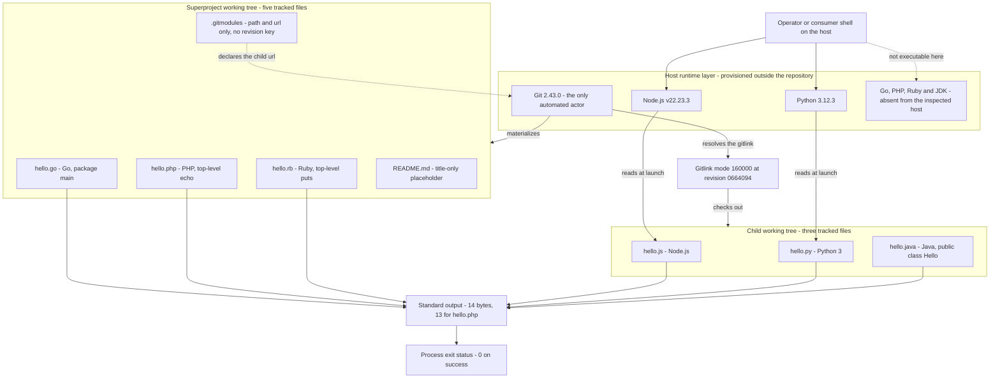

**Member lifecycle.** A member's process state is entirely a function of host provisioning and invocation. There is no state that survives a run, so every invocation begins at the same place; the two terminal failure states observed here are the absent runtime and the wrong runtime for the file, while the Java compilation state could not be exercised because no JDK was present.

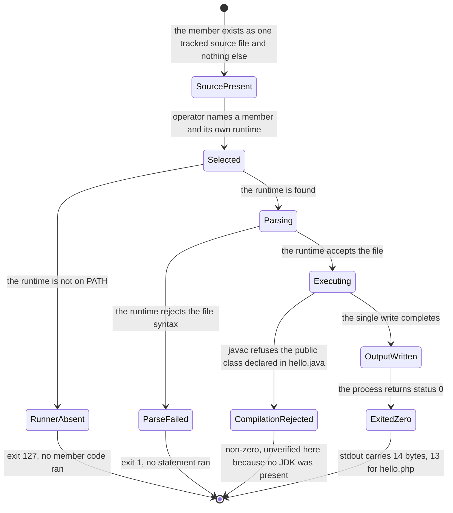

**Submodule working-tree state.** The child directory has three observable states, all reachable in normal operation, and the transition into the failure state leaves the intended revision recorded but its content absent — the pin is never lost, which is what makes recovery a re-run rather than a re-decision.

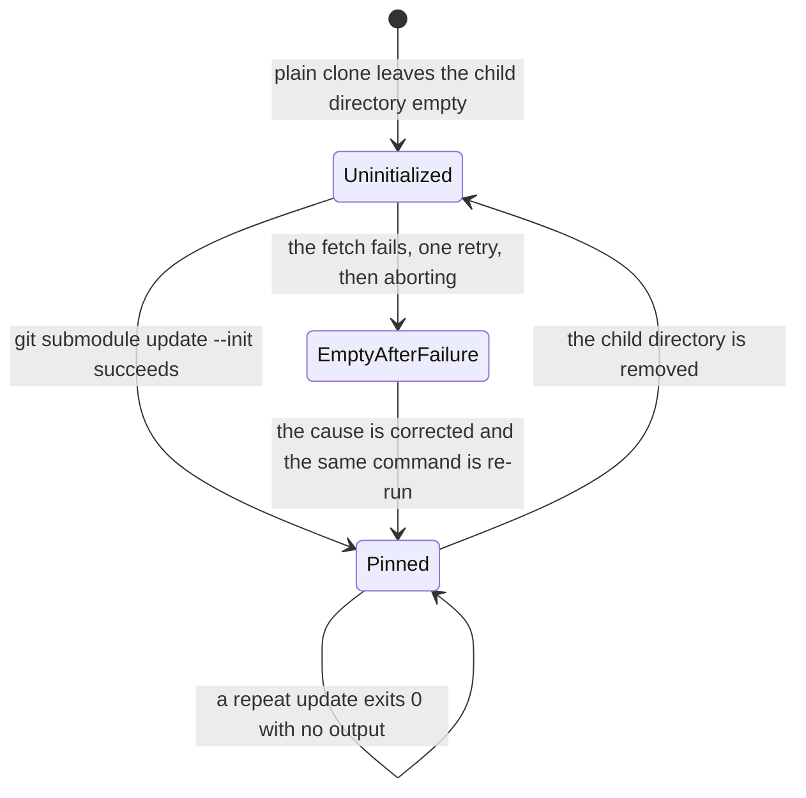

**Member invocation sequence — the key runtime flow.** The exchange is four messages deep: the shell `exec`s a runtime, the runtime reads one file, it writes one line, and it returns a status. Nothing is read from the caller, nothing is buffered between components, and no member holds a connection to anything.

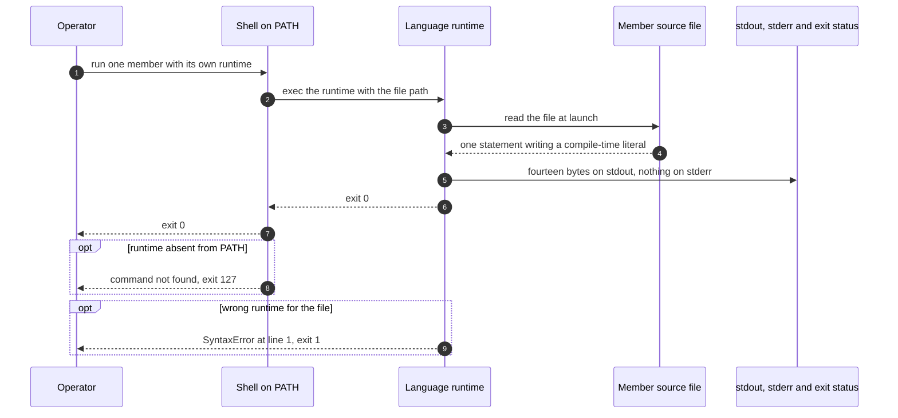


## 5.3 Technical Decisions

The repository records no decision log, design note or architecture document, so nothing in this sub-section can be quoted as stated intent. What follows instead separates two things honestly: the decisions the artifacts *embody*, each with the evidence that establishes it, and the tradeoff each one carries at the scope actually observed.

### 5.3.1 Architecture Style and Tradeoffs

**Style decision.** The system is built as a *collection of independent single-file programs delivered by Git*, rather than as an application with modules, a build, or a runtime composition. Every member is a complete program in one file; the two repositories are joined by a content-addressed pointer rather than by a dependency declaration; and nothing is compiled ahead of use, packaged, or published.

| Aspect | Decision embodied by the artifacts | Benefit observed | Cost or risk observed |
| --- | --- | --- | --- |
| Composition | No shared library, module or generated code: the literal is repeated verbatim in six files | Each member can be read, understood and run in isolation; no build graph, no version skew between modules, no interface to keep compatible | The six members can drift, and one already has in its output bytes — `hello.php` emits no newline where the other five do — and nothing in the tree would detect it |
| Build | No build system and no build artifact: two members compile at run time, four are interpreted directly | Nothing to configure, break or reproduce; the checkout is always the source of truth | Compilation cost is paid on every invocation, and no compiler flag, target version or optimisation is expressed anywhere |
| Dependencies | Zero third-party packages; the only import is Go's standard-library `fmt` | No supply chain, no advisory exposure, no install step, and no registry availability prerequisite | The repository cannot express a version constraint even where one matters, such as the `hello.java`/`public class Hello` naming question |
| Delivery | Git only, with the child fetched through a mode-`160000` gitlink at revision `0664094` from a *different* organization | The consumed child revision is exact and immutable; one `git clone --recurse-submodules` obtains everything; no registry or artifact store is needed | Delivery depends on a second remote the superproject does not control, and a non-recursive clone silently produces half a tree while exiting `0` |
| Execution | One short-lived, single-write process per invocation; no service, daemon, port or listener | Nothing to host, scale, secure at the network edge, or restart; any invocation is safe to repeat | Nothing is shared between invocations, so per-run runtime startup is unavoidable and repeated for even trivial work |
| Interface | One line on stdout plus a process exit status; no configuration file, environment variable or argument is read | The contract is trivially machine-checkable, and results are identical across environments and repetitions | The system can express exactly one output; it cannot be parameterised, and it has no error channel of its own |
| Verification | Manual, operator-driven; no test, assertion, CI job or hook exists | Nothing to maintain, and any host becomes a valid test host by running a member | The six-runtime coverage claim is never checked automatically, and four of the six members could not be executed in this environment |

**Assumptions the style rests on.** Two assumptions are load-bearing and both are unrecorded in the repository: that the host provides each member's runtime on `PATH` (four were absent at inspection), and that the child remote in the other organization stays reachable and retains revision `0664094`. Neither is asserted, verified or monitored by anything in the tree, and neither has a fallback — no mirror, alternate URL, vendored copy or local cache exists.

### 5.3.2 Communication and Delivery Pattern Choices

| Choice | Pattern selected | Alternatives not present in the artifacts | Evidence and effect |
| --- | --- | --- | --- |
| Inter-component communication | **None.** No member calls, imports or otherwise addresses another; data flows only from a file into its own process's stdout | Shared library, message passing, IPC, file handoff, or a coordinating runner | A search of all eight tracked files for import, require, call or socket constructs matched only `hello.go`'s standard-library import; the members are peers with no ordering dependency |
| Delivery protocol | **HTTPS pull of Git objects**, operator-initiated, from two remotes | Package registry, artifact repository, release archive, HTTP file download, or container image | The only URL strings in either working tree are the `.gitmodules` child URL and the local (untracked) remote URL; no manifest or registry coordinate exists anywhere |
| Revision selection | **Content-addressed** by gitlink SHA, not by a branch, tag or version range | Branch tracking, tag pinning, or a declared version range | `.gitmodules` carries only `path` and `url`; zero tags exist in either repository, so a SHA is the only stable identifier available |
| Configuration exchange | **None.** No member reads a configuration file, environment variable or command-line argument | Externalised configuration, feature flags, or environment-specific profiles | A search for input tokens (`argv`, `getenv`, `ENV[`, `stdin`, `process.env`, `ARGV`) returned no matches; the written value is a compile-time literal |
| Result reporting | **Process stdout plus exit status** — 14 bytes, 13 for `hello.php`, with a clean stderr | Log file, structured payload, HTTP response, or metrics endpoint | Verified for `hello.js` and `hello.py` by byte counts under `od -c`; no logging, metric or tracing construct exists in any file |
| Change notification | **None.** Neither remote notifies anything, and nothing polls | Webhooks, scheduled fetches, dependency-update automation | No CI configuration, scheduler, or webhook receiver exists; the pin advances only when a person commits a new gitlink |
| Synchronisation and concurrency | **Not required.** No shared resource, lock, session or transaction exists | Locking, queueing, or idempotency keys | Each member is a stateless single write, so concurrent invocations cannot interfere; this is the reason no concurrency control is designed in |

The delivery pattern is worth one explicit note on rationale: because the child revision is content-addressed and the transport is a plain anonymous HTTPS pull, the system needs no credential, no branch agreement, and no release process to consume the child. The cost of that simplicity is that revision currency is entirely manual — the child's own history shows a README deletion at `0664094` that the superproject merely inherits, and no automation would report a newer child commit.

### 5.3.3 Data Storage and Caching Rationale

**Storage decision.** The Git object store *is* the persistence layer. There is no database, no schema, no migration, no connection string and no application data file anywhere in either tree, because the system produces no data to keep: the single datum the code handles is a compile-time literal, and each member's output exists only as long as its process's output stream.

| Storage aspect | Decision embodied | Tradeoff |
| --- | --- | --- |
| Durable state | The superproject's `.git` (15 objects, one 5.40 KiB pack) plus the child's objects at `.git/modules/submodule_repo_child_level_1` (14 objects, one 5.82 KiB pack) | The whole system is under half a megabyte, but the child's content lives inside the parent's `.git`, so a working-tree copy or archive without `.git` loses three of six members |
| Object format | SHA-1 content-addressed objects — every tracked identifier is 40 hexadecimal characters | Identifiers are verifiable and immutable across hosts; the format offers no collision resistance beyond SHA-1's, and no signature or tag corroborates the pin |
| Application database | None | Nothing to provision, back up, tune or migrate; the system also cannot record, query or replay anything |
| Write path | No member writes to disk. The only writes observed are toolchain-produced: a `__pycache__` directory when `hello.py` is imported, and a `Hello.class` file beside the source when `hello.java` is compiled | Member runs stay side-effect free when executed as scripts, but a consumer asserting a clean tree must account for untracked residue that no `.gitignore` excludes |
| Cache tier | None at any level | No cache to warm, evict, secure or invalidate; equally, the two compiled members pay their full compile cost on every invocation, since no build cache or tracked artifact exists |
| Caching that does occur | Git's own content-addressed deduplication, and the operating system's filesystem cache | Both are incidental to the tools, configured and invalidated by nothing in this repository, and neither is an application cache |
| Backup and recovery ownership | None under the system's control: recoverability is delegated to GitHub's storage of the two repositories | Recovery is a re-clone to an exact revision; the system has no snapshot, replication, retention policy or restore procedure of its own |

The rationale for this shape is not merely that storage is unnecessary; it is that the repository *is* the artifact. Because each consumed byte is content-addressed and tracked, the system's durability requirement reduces to "obtain the commits again from GitHub", and its consistency model reduces to Git's own ref semantics.

### 5.3.4 Security Mechanism Selection

| Mechanism | Selection embodied by the artifacts | Evidence |
| --- | --- | --- |
| Transport security | HTTPS/TLS for both remotes — the only network protocol the system uses | `.gitmodules` declares an `https://` URL; the local remote URL is likewise HTTPS; a recursive clone of the superproject fetched both remotes over HTTPS |
| Credential scope | The child is accessed **anonymously**; the parent remote in this checkout carries an environment-injected GitHub installation token, held only in the untracked local `.git/config` | A credential-free `git clone --recurse-submodules` of the bare GitHub URL succeeded; `grep` over the tracked trees found no token, password or secret; `git ls-files` lists no path under `.git/` |
| Non-interactive credential policy | An empty credential helper, `credential.interactive=false` and `core.askpass=echo`, so an access failure fails fast instead of blocking on a prompt | The local config keys; the observed failure message `fatal: could not read Username for 'https://github.com': No such device or address` produced instead of a hang |
| Input validation | None, and none is required: no member reads argv, environment, stdin, files or the network | Recursive search for input tokens returned no matches in any of the six programs |
| Authorization | Nothing in the system authorizes anything; repository access control is delegated entirely to GitHub and to the operator's credential | No code path contains a role, permission, token check or policy |
| Secret hygiene | No secret exists in tracked content in either repository | `.gitmodules` holds no credential key; the child's own local config stores a token-free URL; no credential helper is configured globally |
| Supply chain | Zero third-party code, so no dependency-verification mechanism is needed or possible | The only import in either repository is the Go standard library's `fmt`; no manifest or lockfile exists, so no SBOM could be generated either |
| Integrity of the consumed revision | Git's content addressing plus the gitlink: the child content is fixed to `0664094` and cannot be substituted by a branch move | `git ls-files -s` shows the mode-`160000` entry naming that SHA; a fresh clone checks out exactly that revision |

**Residual exposure.** Four points are worth stating rather than leaving implied. First, the only sensitive value in the checkout is the environment-injected token in the parent's untracked `.git/config` (a one-hour installation token); it is not needed to run any member and must never be moved into a tracked file such as `.gitmodules`. Second, the pin is a plain content reference: nothing signs it, and neither repository contains a tag, so a consumer cannot distinguish a reviewed revision from any other by metadata alone. Third, the child's availability and access policy are controlled by a different organization, so the superproject cannot guarantee its own completeness. Fourth, since no member handles input, the system has no attack surface in the usual sense — which is the one property that makes the absence of every other control defensible here, and it is exactly why those controls are out of scope per §1.3.2.


### 5.3.5 Decision Trees and Architecture Decision Register

There is no decision record in the repository — no `docs/`, no ADR file, and `README.md` is a single title line. The register below is therefore reconstructed from artifact evidence and marked accordingly, and the "alternatives" column records what is *absent from the tree* rather than claiming an option was weighed and rejected.

**Decision tree — which runtime executes a member.** Because no member is directly executable (every blob is mode `100644`) and nothing in the tree declares a runtime, the choice is made by the operator from the file name alone. There is no dispatcher, launcher or shebang to consult.

```mermaid
flowchart TD
    StartNode(["A tracked member must be executed"]) --> ExtQ{"Which file was named?"}
    ExtQ -->|"hello.go"| GoNode["Go toolchain - go run hello.go"]
    ExtQ -->|"hello.php"| PhpNode["PHP interpreter - php hello.php"]
    ExtQ -->|"hello.rb"| RbNode["Ruby interpreter - ruby hello.rb"]
    ExtQ -->|"hello.js"| JsNode["Node.js - node hello.js"]
    ExtQ -->|"hello.py"| PyNode["Python 3 - python3 hello.py"]
    ExtQ -->|"hello.java"| JavaNode["JDK - javac then java Hello"]
    GoNode --> PathQ{"Runtime present on PATH?"}
    PhpNode --> PathQ
    RbNode --> PathQ
    JsNode --> PathQ
    PyNode --> PathQ
    JavaNode --> PathQ
    PathQ -->|"Yes"| RunNode["Member writes the 14-byte literal and exits 0"]
    PathQ -->|"No"| MissingNode["Shell reports command not found, exit 127, no member code ran"]
```

**Decision tree — how the child content is obtained.** The acquisition route is the one place where the architecture offers a genuine choice with a behavioural difference: the recursive route is complete, the plain route silently incomplete, and the failure branch is where the gitlink's immutability pays off, because the intended revision survives the failure intact.

```mermaid
flowchart TD
    AcqStart(["Child content needed for the three child members"]) --> RouteQ{"Clone recursing into submodules?"}
    RouteQ -->|"Yes"| EightNode["Eight files, child at 0664094, exit 0"]
    RouteQ -->|"No, plain clone"| FiveNode["Five files only, child directory empty, exit 0, status keeps the leading minus"]
    FiveNode --> UpdateNode["git submodule update --init"]
    UpdateNode --> ReachQ{"Child remote reachable and revision 0664094 present?"}
    ReachQ -->|"Yes"| EightNode
    ReachQ -->|"No"| FailNode["One automatic retry, then aborting, exit 1, directory stays empty"]
    FailNode --> FixNode["Correct the url, credentials or access, then re-run the same command"]
    FixNode --> EightNode
    EightNode --> IdemNode["A further update exits 0 with no output"]
```

**Architecture decision register.**

| ADR | Decision | Evidence in the artifacts | Tradeoff accepted |
| --- | --- | --- | --- |
| ADR-01 | One standalone program per language, with no shared library or generated code | Six complete programs, one per file; no imports between files; the only linkage is the gitlink, which is a Git pointer rather than a code reference | The literal is duplicated six times and members can drift — `hello.php` already differs by one byte from the other five with nothing to detect it |
| ADR-02 | No build system, no manifest, no lockfile, no published artifact | No `go.mod`, `composer.json`, `Gemfile`, `package.json`, `pom.xml`, `build.gradle`, Makefile or workflow file exists; nothing is generated or stored | Build-time behaviour lives entirely in whatever toolchain the host has, so no target version, flag or reproducibility guarantee is expressed |
| ADR-03 | Deliver the child as a Git submodule pinned by SHA rather than by vendoring or packaging | `.gitmodules` declares only `path` and `url`; the tree holds a mode-`160000` entry at revision `0664094`; neither repository has a tag | Consumption depends on a second remote; a plain clone is silently incomplete; advancing the pin is a manual two-path commit that no automation audits |
| ADR-04 | Emit a compile-time literal instead of reading input or configuration | Exactly one `Hello, World!` occurrence per program file; a search for input constructs across all eight tracked files found no match | The system can express only one behaviour, and cannot be parameterised or reconfigured per environment — which is also why its output is identical everywhere |
| ADR-05 | Report results as one stdout line plus a process exit status | 14 bytes for five members and 13 for `hello.php`; 0 bytes on stderr; exit `0`; no logging, metric or tracing construct in any file | No history, no telemetry, no queryable record, and no in-band error channel: a failure is visible only to whoever reads the process's stderr |
| ADR-06 | Deliver and operate through Git alone — no CI/CD, container or infrastructure code | No `.github/`, workflow, Dockerfile, Terraform or active hook; `.git/hooks` holds only inactive `*.sample` files; deployment is a clone | Provisioning and verification are manual, host-dependent and unrecorded, so the same repository verifies a complete host and reports an incomplete one as `exit 127` |
| ADR-07 | Host the child in a separate GitHub organization from the superproject | The child URL is under `lakshya-blitzy-only-submodules` while the superproject remote is under `lakshya-blitzy` | The superproject cannot guarantee its own completeness: child availability, access policy and future revisions are another owner's decisions |

**Alternatives not present in the artifacts.**

| Alternative | Status in the repository | Consequence of its absence |
| --- | --- | --- |
| Vendored copy of the child files in the superproject | Absent — the gitlink is the only route to three of the six members | The child is a single source of truth and cannot drift into two copies, but the superproject is not self-contained and cannot be archived by copying the working tree |
| Package or registry distribution (a published artifact to install) | Absent — no manifest, registry coordinate or install step | Nothing to install, but also no versioned release, no dependency resolution, and no reproducibility mechanism beyond the commit SHA |
| Build orchestration and CI verification | Absent | No build configuration to break, and no automated evidence that the six members work on a given host |
| Container image carrying the six runtimes | Absent | The obvious way to deliver the runtimes that the repository requires but does not include is not used, so completeness depends on the host |
| Externalised configuration or input parameters | Absent | Zero configuration surface and identical output everywhere, at the price of a single fixed behaviour |
| Direct-execution scripts (shebang plus the executable bit) | Absent — all eight blobs are mode `100644` | Each member's invocation depends on the operator naming the correct runtime; no `./hello.py` route exists |
| Automated child-revision advancement | Absent — no automation watches the child | The pin changes only by hand, so the superproject never silently adopts a child revision, and equally never learns of one |


## 5.4 Cross-Cutting Concerns

No cross-cutting infrastructure exists in this system — no logging framework, no metrics, no tracing, no health check, no retry policy of its own, no authentication code and no recovery automation. That is a consequence of the architecture rather than an omission within it: with no service, no long-running process, no input and no persistent state, there is nothing for such components to instrument. Each sub-section below states what exists, what the absence means in practice, and what a consumer or operator can observe instead.

### 5.4.1 Monitoring and Observability

**Status: no observability component exists.** A recursive search of all eight tracked files for metric, tracing and health tokens (`prometheus`, `grafana`, `datadog`, `sentry`, `newrelic`, `opentelemetry`, `metric`, `health`, `logger`, `logging`, `syslog`) returned no matches, and no configuration file exists in which a telemetry endpoint or exporter could be declared.

| Observability aspect | Status | Evidence | Observable substitute |
| --- | --- | --- | --- |
| Metrics, counters, timings | Absent | No instrumentation token in any file; no exporter configuration exists | Wall-clock timing taken by the invoking shell — 14 ms for `hello.py`, 29 ms for `hello.js` — against interpreter startup floors of roughly 12 ms and 20 ms |
| Distributed tracing | Absent, and structurally inapplicable | No member calls another, so there is no cross-component call to trace | Nothing to correlate: the whole runtime path is one process reading one file |
| Health or readiness endpoint | Absent | No member binds a port or listens on anything; no service is deployed | Process exit status: `0` when the member ran, `1` on a parse failure, `127` when the runtime is absent |
| Dashboards, alerting, notification | Absent; the operator is the only observer | No alert route, webhook receiver or notification integration exists | Diagnostic text on the invoking process's stderr |
| Centralised logging | Absent | No log shipping, no log file, no log configuration | The single stdout line per invocation, captured by whoever runs it |
| Acquisition-state visibility | Present, but only of Git's own kind | `git submodule status` prints the pinned revision with a leading `-` when uninitialized and a correct marker once checked out | A deliberate status check is the only way to detect an incomplete checkout |
| Automated verification of the system | Absent | No test, assertion, CI job or active hook exists in either repository | Manual comparison of captured stdout with the literal and inspection of the exit status |

The practical consequence is the one recorded in §2.4.7 and §4.5.1: a non-recursive clone exits `0` while delivering five of eight files, so from a pure process-outcome perspective the largest failure mode in the system is indistinguishable from success. Any consumer that needs assurance must assert on the working tree itself — the presence of `submodule_repo_child_level_1/hello.java`, `hello.js` and `hello.py`, or a `git submodule status` line without a leading `-`.

### 5.4.2 Logging and Tracing Strategy

**Status: no logging and no tracing exist in the system.** There is no logging library, level, format, sink, rotation rule or retention policy, and no trace or correlation identifier anywhere in either tree.

- **The stdout write is not a log.** Each member writes exactly one line of fixed content to stdout with no timestamp, level, source identifier or request context. Verified: `hello.js` and `hello.py` each produced 14 bytes on stdout and 0 bytes on stderr. That line is the system's entire output, so it cannot double as a diagnostic record.
- **Stderr stays clean on success.** Nothing in the members writes to stderr at all; the diagnostic text seen in failure cases comes from the shell or the runtime, not from the system's own code — for example `command not found` from the shell (exit `127`) or `SyntaxError` from the runtime (exit `1`).
- **Trace correlation is inapplicable.** Since no member invokes another, there is no call graph across which a trace identifier could propagate. The only correlatable identity in the system is the revision pair — superproject `5ecd4cc` and child `0664094` — which fixes the exact content a result was produced from.
- **There is no log destination to manage.** No member writes a file (the observed toolchain residue is a `__pycache__` directory on Python import and a class file on Java compile, not logging), and no collector, agent or syslog endpoint is configured, so there is nothing to rotate, retain, redact or secure.
- **Observability for the delivery path comes from Git's own stderr text.** Acquisition diagnostics such as `Submodule path '…': checked out '0664094…'`, or on failure `fatal: clone of '<url>' … failed` followed by `Retrying`/`aborting`, are the only run-time narrative the system produces, and they exist only in the invoking terminal's scrollback.

### 5.4.3 Error Handling Patterns

**Status: the system contains no error handling.** A recursive search for error-handling constructs (`try`, `catch`, `except`, `rescue`, `throw`, `panic`, `assert`) across all eight tracked files returned no matches, no member has an error return value, and no member can detect that anything went wrong. Every failure therefore surfaces outside the members, as an exit status and a line of diagnostic text, and is resolved by the operator or by the Git client. The step-by-step failure workflows and their remedies are specified in §4.5; what follows is the architectural pattern — where detection lives, and how much each layer can see.

```mermaid
flowchart TD
    subgraph InProcess["Inside the member process"]
        NoHandler["No try, catch, rescue, throw, panic or assert in any tracked file"]
        NoDetect["No member can detect that anything went wrong"]
    end
    subgraph AtBoundary["At the process boundary - the only detector"]
        SignalNode["Exit status plus a diagnostic line on stderr"]
        ClassesQ{"Which signal appeared?"}
        SignalNode --> ClassesQ
    end
    subgraph InGit["Inside the Git client during acquisition"]
        GitFatal["fatal clone of the url failed, retry scheduled, aborting"]
        GitRetry["Exactly one automatic retry, then exit 1"]
        GitFatal --> GitRetry
    end
    subgraph Observer["Operator - the only observer and the only actor"]
        ReadNode["Reads the stderr text"]
        ActNode["Corrects the cause and re-invokes"]
        ReadNode --> ActNode
    end
    NoHandler --> NoDetect
    NoDetect -->|"nothing in band"| SignalNode
    ClassesQ -->|"exit 127"| MissingRT["Runtime absent from PATH"]
    ClassesQ -->|"exit 1, SyntaxError"| WrongRT["Wrong runtime for the file"]
    ClassesQ -->|"non-zero, compiler text"| CompileRisk["javac rejects public class Hello in hello.java - unverified, no JDK here"]
    GitRetry --> ReadNode
    MissingRT --> ReadNode
    WrongRT --> ReadNode
    CompileRisk --> ReadNode
```

| Failure class | Where it is detected | Observable signal | In-band detectable by the system |
| --- | --- | --- | --- |
| Incomplete checkout | Never — the clone succeeds | Child directory empty, `git submodule status` shows a leading `-`, three of six members absent, exit `0` | No. Nothing reports it; only a deliberate check reveals it |
| Child fetch failure | Git client during acquisition | `fatal: clone of '<url>' … failed`, `Retry scheduled`, then `aborting`; exit `1`; directory stays empty; parent tree stays clean | No — the member never runs, and its only record is the terminal text |
| Runtime absent | Host shell at invocation | `command not found`; exit `127` | No |
| Wrong runtime selected | Language runtime while parsing | `SyntaxError` at line 1 of the member; exit `1` | No — parsing fails before any statement executes |
| Java compilation rejected | JDK at compile time | Compiler text about the public class and file name; non-zero | No — and unverifiable here, since no JDK was present; the only identified compilation risk (F-001-RQ-006) |
| Output does not match the contract | External consumer, after a successful run | stdout differs from the literal while exit status is `0` | No — the literal is a compile-time constant, so a mismatch indicates environment tampering rather than a code fault |

Three patterns characterise the design, and each is deliberate even though none is documented:

- **Fail fast rather than block.** The local Git configuration sets an empty credential helper, `credential.interactive=false` and `core.askpass=echo`, so an access failure returns immediately. Reproduced: an unreachable child URL ended in `fatal: could not read Username for 'https://github.com': No such device or address` instead of hanging on a prompt.
- **Exactly one retry, then abort.** The Git client retries a failed submodule clone once, announcing `Retry scheduled`, and aborts on the second failure with `Failed to clone '…' a second time, aborting`. No configurable retry count, backoff, jitter or circuit breaker exists, and no member contains a loop.
- **Recovery by idempotent re-run.** No operation leaves partial state that a retry could corrupt: correcting the cause and re-running `git submodule update --init` succeeds (exit `0`, revision `0664094` checked out), and an immediately repeated update exits `0` with no output. Because the child revision is content-addressed, the intended revision survives a total fetch failure — only its content is missing — so recovery never requires a decision, only a re-run. The one asymmetry worth noting is that the superproject's own three members have no fallback route at all, while the three child members can also be obtained by cloning the child repository directly.


### 5.4.4 Authentication and Authorization Framework

**Status: the system has no authentication or authorization framework.** No member authenticates a caller, checks a role, validates a token or protects an operation; there is no identity provider, secret manager, API key, session, or policy artefact anywhere in either tree. Every control in this area belongs to the surrounding platform — GitHub for the remotes and the host for local access — and the architecture's own contribution is that it needs almost none, because nothing is served and nothing is read.

| Control area | Status in the system | Evidence |
| --- | --- | --- |
| End-user authentication | Absent and inapplicable — no user, session or credential is handled by any member | No authentication construct in any of the six programs; no member reads input of any kind |
| Authorization / access control | Absent from the code; delegated to GitHub and to the host's file permissions | No role, permission or policy check exists in either tree |
| Remote read access | **Anonymous** for both remotes over HTTPS | A credential-free `git clone --recurse-submodules` of the bare GitHub URL fetched the superproject from `lakshya-blitzy` and the child from the different organization `lakshya-blitzy-only-submodules` |
| Remote write access | Not exercised by the system; nothing pushes, publishes or tags | No release, push or publication step exists; both repositories hold zero tags |
| Declared credentials | None. `.gitmodules` contains no credential key and no secret appears in tracked content | `.gitmodules` is 170 bytes of `path` and `url`; no credential appears in the tracked trees of either repository |
| Locally supplied credential | The parent remote in this checkout carries an environment-injected GitHub installation token, held only in the untracked `.git/config` | The local `remote.origin.url`; `git ls-files` lists no path under `.git/`, so the file is untracked, and a one-hour installation token is not needed to run any member |
| Credential-helper configuration | None — an empty helper, with interaction disabled and a non-interactive askpass | Local keys `credential.helper=` (empty), `credential.interactive=false`, `core.askpass=echo` |
| Non-repudiation / provenance | Not available: commits are unsigned and no tag identifies a released revision | Five commits in each repository, zero tags; nothing in either tree references a signature or verification policy |
| Server-side controls | Not observable from a checkout — for example branch protection on `main` and `2810_01` | Only the two branches and their identical heads are visible; the hosting platform holds any such policy |

**Authorization model in effect.** Effective access is coarse and host-scoped: any principal with a shell on the host and read access to the checkout can run every member and read every byte the system handles, because nothing in the system distinguishes one caller from another. Conversely, no principal can cause the system to expose anything, since it holds no data other than its own source and its own fixed literal. This is the one configuration in which the absence of an authorization framework is not a gap: the system's only protection requirement is that the credential in untracked local configuration never migrates into a tracked file such as `.gitmodules`, and `.gitmodules` — the one file a consumer would read to obtain the child — is deliberately credential-free.


### 5.4.5 Performance Requirements and SLAs

**Status: no performance requirement, SLA, SLO or benchmark is declared or instrumented anywhere in the repository.** There is no target latency, throughput, availability or error-rate figure, no benchmark harness, and no test that measures anything; §1.2.3 reaches the same conclusion, which is why the figures below are measurements and static properties rather than commitments.

| Performance dimension | Requirement declared | Observed or derivable |
| --- | --- | --- |
| Invocation latency | None | 14 ms wall for `python3 …/hello.py` and 29 ms for `node …/hello.js`, against interpreter startup floors of roughly 12 ms and 20 ms — so between 80 and 90 percent of each measured run is runtime startup, not the member's single write |
| Output size and shape | None declared, though §2.2 fixes the contract | Exactly 14 bytes on stdout for five members (`Hello, World!\n`) and 13 bytes for `hello.php`, whose `echo` appends no newline; 0 bytes on stderr |
| Determinism | None declared | Byte-identical output across repeated runs, stdin closed, an empty environment, and extra arguments; there is no branch in any member, so output cannot vary with input |
| Throughput / capacity | None | Inapplicable to the members themselves: each invocation is an independent short-lived process with no shared resource, so repetition and concurrency cannot contend. The only scaling costs are per-run interpreter start-up and one compile per run for the two compiled members, since no build artifact is tracked or cached |
| Availability | None | The system runs no service, so it has no uptime to measure; availability is inherited from GitHub (for acquisition) and the host (for execution) |
| Resource footprint | None | Whole checkout 444 KB; Git object stores 5.40 KiB and 5.82 KiB of packed objects; eight tracked files, 502 bytes of content, 16 lines of program code |
| Failure rate | None | No error counter or log exists; a failure is visible only in the invoking process's exit status and stderr text |
| Cost profile | None | No metered resource is consumed: no cloud service, no database, no storage service and no network traffic beyond two Git fetches |

**Implications of the measured figures.** Three points follow from the timings and the absence of objectives. First, latency is dominated by runtime start-up, so the only meaningful optimisation available would be to remove process creation — which the architecture deliberately avoids by having no long-lived process at all. Second, the two compiled members (`hello.go`, `hello.java`) carry an additional unavoidable cost per run, because nothing is pre-built; the JVM member pays both a compile and a JVM start. Third, since four of six runtimes were absent from the inspection host, the only comparable measurements available are the two interpreted members — any performance statement about the Go, PHP, Ruby and Java members is source-derived rather than measured.


### 5.4.6 Disaster Recovery Procedures

**Status: the system has no disaster-recovery apparatus of its own.** There is no backup, snapshot, replica, mirror, failover target, runbook or recovery script; no data store to restore; and no monitoring that could detect a loss. Recoverability is inherited entirely from two facts about the design: every consumed byte is tracked and content-addressed, so any loss of a working tree is repaired by re-fetching the exact commits, and no member holds state that a restart would need to reconcile.

| Recovery scenario | Recoverable | Mechanism | Residual loss or exposure |
| --- | --- | --- | --- |
| Working tree deleted or corrupted on a host | Yes | Clone again from the parent remote; the child arrives at the pin with `--recurse-submodules` or a follow-up `git submodule update --init` | None for tracked content: `5ecd4cc` and `0664094` are immutable identifiers, and the whole checkout is under half a megabyte |
| Working tree present but child content missing | Yes | `git submodule update --init` — reproduced, exit `0`, `Submodule path '…': checked out '0664094…'` | None; the pin is preserved even after a total fetch failure, so recovery is a re-run rather than a re-decision |
| Accidental local modification or a stray compiled class file | Yes | `git checkout` for tracked files; delete the untracked `Hello.class` or `__pycache__` residue by hand | Uncommitted local edits are unrecoverable by design — nothing in the system snapshots a working tree, and no `.gitignore` marks residue |
| Child fetch fails at acquisition time (network, access, or the URL being wrong) | Yes | Correct the URL, credentials or access and re-run; Git retries once automatically and aborts with exit `1`, leaving the directory empty and the status showing a leading `-` | Time only; the desired revision is never forgotten, and the parent tree remains clean and usable for its three root members throughout |
| Parent or child remote unavailable | Partially | Wait for the remote, or restore read access; both remotes are anonymously readable over HTTPS, so no credential needs refreshing for a read | No alternate URL, mirror, vendored copy or local object cache exists, so no workaround is available inside the system |
| Pinned child revision removed from the child remote | **No** | Nothing — revision `0664094` is the only route to the three child members, and no copy exists under the system's control | This is the system's single unmitigated loss mode: the parent's gitlink would name a revision that no longer exists, and no fallback copy, tag or archive would remain |
| Runtime missing on the host | Yes, given provisioning rights | Install the runtime and re-invoke; the member itself needs no repair | Verification time; the affected members remain unverified until the runtime exists, as happened for Go, PHP, Ruby and Java here |
| Credential expiry (the environment-injected installation token in local config) | Yes | Refresh the token; no member depends on it | Nothing: no member reads the credential, and a read-only clone needs none |

| Recovery attribute | Defined | Observed or derivable |
| --- | --- | --- |
| Recovery time objective | No | One clone plus one submodule fetch — the entire recovery procedure, with no service to restore and no data to replay |
| Recovery point objective | No | Zero for committed content, because every consumed artifact is addressed by commit and tree hash; uncommitted local work has no recovery point at all |
| Backup ownership | Not recorded in the repository | GitHub holds the only copies of both repositories; whether either is archived, replicated or retained beyond the remote's own storage is not visible from a checkout |
| Rollback procedure | No script exists, though the mechanism is structurally available | Check out a different superproject commit, or move the gitlink to a different child revision — each a single commit; both repositories hold zero tags, so a rollback target must be named by commit SHA |
| Failure detection | No | Nothing monitors either remote or any host; a loss is discovered by whoever next attempts an acquisition, or by nobody, since a plain clone reports success when the child is missing |
| Recovery verification | Manual | Compare the working tree against the expected eight files, confirm `git submodule status` shows no leading `-`, and run the members whose runtimes are present |

**The one procedural gap worth stating plainly.** Recovery here is trivial *when the remotes are intact*, and impossible *when the child revision is gone*. The system has no copy of the child content under its own control and no fallback route to it other than the child repository itself, so the durability of three of the six members rests entirely on the other organization's repository retaining commit `0664094` — a dependency the superproject neither records nor monitors. Everything else in the system is recoverable by re-running a command that is safe to repeat.


## 5.5 References

- `.gitmodules` (170 bytes, 3 lines) — the only configuration artefact in the system; established the child path and URL, the absence of any `branch`, `tag`, `depth`, `update` or `ignore` key, and the credential-free cross-organization URL that the delivery and security sub-sections rest on.
- `README.md` (34 bytes) — a single H1 title line; established the absence of any recorded design intent, usage text or interface contract in the repository.
- `hello.go` (77 bytes, 7 lines, blob `b7d2a320…`) — the Go member; established the `package main` / `func main` entry point, the standard-library `fmt` import (the only import in either repository), the newline-appending output call, and the four-space indentation that departs from `gofmt`.
- `hello.php` (28 bytes, 1 line, blob `790c7dc2…`) — the PHP member; established the top-level `echo`, the omitted closing `?>` tag, and the only output contract in the system that omits the trailing newline (13 bytes).
- `hello.rb` (21 bytes, 1 line, blob `5de78a49…`) — the Ruby member; established the top-level `puts` with no `__FILE__ == $PROGRAM_NAME` guard, and therefore the load-time side effect.
- `submodule_repo_child_level_1/` — the child working tree; established the gitlink checkout layout, its three tracked files and its five-commit history including the README deletion at the pinned revision.
- `submodule_repo_child_level_1/.git` (53 bytes) — the gitdir pointer file; established that the child's object store lives inside the superproject's `.git`, the fact behind the silent-loss behaviour of a non-recursive clone or an archive without `.git`.
- `submodule_repo_child_level_1/hello.java` (119 bytes, 5 lines, blob `a605554a…`) — the Java member; established the `public class Hello` / `main` entry point, the implicit `java.lang` dependency, the untracked `Hello.class` residue, and the file-name versus class-name compilation risk.
- `submodule_repo_child_level_1/hello.js` (30 bytes, 1 line, blob `184dfcc9…`) — the JavaScript member; established the module-level `console.log` and the load-time side effect on `require`.
- `submodule_repo_child_level_1/hello.py` (23 bytes, 1 line, blob `7df869a1…`) — the Python member; established the module-level `print`, the import-time side effect, and the `__pycache__` residue.
- `.git/` of the checkout (15 objects, one 5.40 KiB pack) and `.git/modules/submodule_repo_child_level_1/` (14 objects, one 5.82 KiB pack) — established the only durable state in the system, the 40-hexadecimal (SHA-1) object format, the zero-tag revision situation, and the refs that place every branch head at `5ecd4cc` and `0664094`.
- `.git/config` of the checkout (untracked) and the child's local config — established the environment-injected installation token held only in untracked local state, the token-free child URL, and the `credential.helper=`, `credential.interactive=false`, `core.askpass=echo` keys that make an access failure fail fast instead of prompting.
- `.git/hooks/` — contained only inactive `*.sample` files; established that no hook, and therefore no automation of any kind, runs on either repository.
- Repository `github.com/lakshya-blitzy/parent_repo_hello_world_ABK_6771.git` and repository `github.com/lakshya-blitzy-only-submodules/submodule_repo_child_level_1.git` — the two external integration points; a credential-free recursive clone of the first established anonymous HTTPS read of both, including the cross-organization fetch at revision `0664094`.
- This specification's own sections, cited as cross-references rather than as evidence: §1.2.1–§1.2.3 (project context, delivered-capability diagram, declared absence of SLAs and KPIs), §1.3.2 (scope exclusions), §2.2.2 (requirement IDs F-001-RQ-006, F-002-RQ-001 to F-002-RQ-004), §2.4.7 (verification gap), §3.5 (persistence and caching findings), §3.6 (development, delivery and deployment), §4.5 (failure taxonomy, remedies and the WF-08/WF-09 workflows), §4.9.2 (the rendered submodule acquisition sequence).
- No external web source was consulted for this section: every statement is grounded in the checkout, its Git metadata, or commands executed against it. The Mermaid diagrams in §5.2.10 and §5.3.5 were validated by rendering them with `@mermaid-js/mermaid-cli` 12.0.0 (Chrome, sandbox disabled) in the inspection environment; all seven rendered successfully.


# 6. SYSTEM COMPONENTS DESIGN

## 6.1 Core Services Architecture

### 6.1.1 Applicability Determination

**Determination: Core Services Architecture is not applicable for this system.** The repository contains no service, no service boundary, no listener, no inter-component call and no deployment unit that could be scaled, discovered or failed over. Every tracked artifact in the superproject and in its submodule is a standalone source file, a one-line `README.md`, or a three-line `.gitmodules`; the entire program surface is six single-file programs totalling 16 lines of code and 502 bytes, each of which writes one fixed line to standard output and exits. The architecture style established in §5.1.1 is a *polyglot collection of independent single-file programs delivered entirely by Git*, composed **by delivery, not by linkage** — there is no runtime composition anywhere for a core-services architecture to describe.

The service-architecture preconditions below are each absent, and each absence is established by direct inspection rather than by omission from documentation:

| Precondition for a core services architecture | Present | Deciding evidence |
| --- | --- | --- |
| A deployable service exposing a network interface | No | No member binds a port, resolves an address or opens a socket. A recursive search of every non-`.git` file for `server`, `listen`, `socket`, `http`, `api`, `rest`, `rpc` and `grpc` returned no match — the only `port` hit is the substring inside `import "fmt"` on `hello.go:3` |
| Two or more independently deployable runtime units | No | Two delivery units exist (superproject and child), but nothing joins them at run time. The child is reached only through a mode-`160000` gitlink at revision `0664094`, resolved once at acquisition by Git |
| A runtime interface between components | No | No import, `require`, export or call exists between any two of the eight tracked files. The only import in either repository is the Go standard-library package `fmt` (`hello.go:3`); `echo`, `puts`, `console`, `print` and `java.lang.System` are host built-ins |
| Service configuration or orchestration artifacts | No | A tree-wide search for `*.yml`, `*.yaml`, `*.json`, `*.xml`, `*.properties`, `*.toml`, `Dockerfile*`, `Makefile*` and `*.tf` returned nothing. `.git/hooks` holds 14 `*.sample` files and no active hook |
| Service-level state, queues or data stores | No | No database, cache, broker or session store is referenced; no member writes a file. The only datum in the code is the compile-time literal `Hello, World!`, repeated verbatim in six files |
| A service-level objective to design against | No | No SLA, SLO, availability, throughput or latency target is declared or instrumented anywhere (§5.4.5) |

Three structural facts explain the determination:

1. **There is no runtime call graph.** The system's only inter-component edge is a content-addressed Git pointer, which is a delivery-time reference to source code rather than a runtime interface. With no call from one component to another, there is nothing to route, discover, load-balance or break-circuit.
2. **The unit of execution is a short-lived process with no shared resource.** Each invocation is one `exec` of one runtime against one source file, producing one line on stdout and an exit status. Nothing is shared between invocations, so no contention, session, pool or replica set can arise.
3. **The system is stateless and input-free.** No member reads argv, environment variables, stdin, the filesystem or the network, so no capacity, redundancy or failover requirement follows from the workload — there is no workload in the service sense at all.

This determination matches the exclusions already recorded elsewhere in this specification: §1.3.2 excludes *Networking and services* (no sockets, HTTP clients or servers, listening ports or service endpoints) and *Containerisation and infrastructure as code*; §3.6.3 records no container definition and §3.6.5 no CI/CD; §5.3.5 records the Git-only delivery and operation decision as ADR-06; §5.4 records that no logging, metrics, tracing, health-check, retry, authentication or recovery component exists.

**Conditions that would reverse this determination.** The verdict is a property of the artifacts at superproject `5ecd4cc` and child `0664094`, not a permanent characteristic. Any one of the following changes would make the areas in §6.1.2 to §6.1.4 applicable and require this sub-section to be revisited:

| Trigger | What it would introduce |
| --- | --- |
| A member that binds a port or serves requests | A deployable service, a service boundary and a discovery/load-balancing surface |
| A member that invokes another member over a network, socket or IPC channel | An inter-service communication pattern, and therefore timeout, retry and circuit-breaker design |
| A tracked manifest (`go.mod`, `package.json`, `pom.xml`, …) | A build graph and a resolvable dependency surface, which §1.3.2 and §2.4.2 currently record as absent |
| A container, IaC template or CI workflow | Deployment units, orchestration, and auto-scaling or failover configuration |
| Any persistent state or shared resource | Data redundancy, failover and disaster-recovery design requirements |
| More than one host required to satisfy a single invocation | A capacity and routing dimension, which the current one-host, one-process model does not have |


### 6.1.2 Service Components

No service component exists. The system's ten identified components (C-01 to C-10 in §5.1.2) relate to one another by *containment* and *acquisition* only — a working tree contains a file, a gitlink resolves a revision, an operator `exec`s a runtime. No component invokes, addresses, or depends on another at run time, so the concerns below resolve to findings rather than to configurations.

| Required service-component concern | Finding | Evidence |
| --- | --- | --- |
| Service boundaries and responsibilities | **None.** The only boundary is a delivery boundary between two Git working trees, crossed once at acquisition. Responsibility is distributed per file with no coordinator: each of the six programs owns exactly one language's greeting and nothing else | `.gitmodules` declares `path` and `url` only; recursive search found no import, export or call between any two tracked files |
| Inter-service communication patterns | **None.** The system has two protocol families and neither is an inter-service pattern: anonymous git smart HTTP over HTTPS/TLS for inbound acquisition, and native OS process `exec` for invocation (§5.1.3). No message, RPC, socket or shared-memory channel exists | Zero matches for `http`, `api`, `rest`, `rpc`, `grpc`, `message`, `queue`, `kafka`, `socket` across every non-`.git` file |
| Service discovery mechanisms | **None.** The only name resolution is Git's HTTPS remote URL in `.gitmodules` and the operator's `PATH` lookup for a runtime. There is no registry, service name, DNS record or health registry to consult | `.gitmodules:3` is the only URL in tracked content; no member resolves an address |
| Load balancing strategy | **None.** There is no pool of instances to distribute across; a repeated invocation creates a new independent process, and nothing arbitrates between them | No listener and no shared resource exists; §5.4.5 records that repetition and concurrency cannot contend because each invocation is an independent short-lived process |
| Circuit breaker patterns | **None.** No member contains a loop, an error counter or a state machine, and no construct for opening, half-opening or tripping a circuit exists in either tree | Zero matches for `circuit`, `breaker`, `timeout`, `retry` in any tracked file |
| Retry and fallback mechanisms | **No service-level retry, and no fallback at all.** The only retry in the system is the Git client's own: a failed submodule clone is retried exactly once (`Retry scheduled`) and then aborted with exit `1`. There is no mirror, alternate URL, vendored copy or second route to the child content | §5.4.3; §5.3.5 ADR-03 and ADR-07; `.gitmodules` declares one `url` and no `branch`, `tag` or `depth` |

**The one inter-component contract in the system.** The only structured relationship between components is the submodule linkage (C-09), and it is worth stating precisely because it is not a service interface — it is a revision selector:

| Aspect of the linkage | Value |
| --- | --- |
| Declaration site | `.gitmodules` (170 bytes): one `[submodule "submodule_repo_child_level_1"]` section with `path` and `url` |
| Revision binding | Mode-`160000` gitlink in the superproject tree at commit `066409439699a1967ad788413b74dfc3e4914447` |
| Selector type | Content-addressed SHA-1 — no branch, tag, version range or semantic constraint is expressed |
| Resolution time | Acquisition only, during `git clone --recurse-submodules` or `git submodule update --init`; never at run time |

**Inter-service communication is replaced by a shared constant.** Because no component can address another, the six members do not exchange the greeting: each embeds its own copy of the literal `Hello, World!`. Nothing holds that value in a shared place, and the copies have already diverged — `hello.php`'s `echo` appends no newline, so it emits 13 bytes where the other five emit 14 (§2.4.1, §5.3.1). In a service architecture this duplication of a contract would be a configuration-drift risk; here it is a visible property of an architecture with no shared runtime at all.

**Diagram 6.1-1 — Component interaction: one acquisition edge, six peer members, no runtime edge.** The diagram is a *service interaction diagram* for this system, and its most important feature is the absent edge: no line runs between any two of the six member nodes.

```mermaid
flowchart TB
    OperatorNode["Operator shell or consumer harness<br/>names one member file and its own runtime"]
    StdoutNode["stdout - one line of fixed text<br/>14 bytes, 13 for hello.php - plus exit status"]

    subgraph SuperUnit["Superproject delivery unit"]
        ParentTree["Working tree at 5ecd4cc<br/>hello.go - hello.php - hello.rb - README.md - .gitmodules"]
    end

    subgraph LinkUnit["Submodule linkage - the only inter-component edge"]
        GitlinkNode["Gitlink mode 160000 at 0664094<br/>.gitmodules declares path and url only"]
        ChildTree["Child working tree at 0664094<br/>hello.java - hello.js - hello.py"]
        GitlinkNode -->|"checks out exactly one revision"| ChildTree
    end

    subgraph RuntimeUnit["Runtime composition - six peers, zero edges between them"]
        GoNode["hello.go - Go toolchain"]
        PhpNode["hello.php - PHP interpreter"]
        RbNode["hello.rb - Ruby interpreter"]
        JavaNode["hello.java - JDK"]
        JsNode["hello.js - Node.js"]
        PyNode["hello.py - Python 3"]
    end

    ParentRemoteNode["Parent remote<br/>github.com/lakshya-blitzy/parent_repo_hello_world_ABK_6771.git"]
    ChildRemoteNode["Child remote in a different GitHub organization<br/>github.com/lakshya-blitzy-only-submodules/...git"]

    ParentRemoteNode -->|"anonymous HTTPS pull"| ParentTree
    ChildRemoteNode -->|"anonymous HTTPS pull - one automatic retry then abort"| GitlinkNode
    ParentTree -->|"mode 160000 entry references"| GitlinkNode
    OperatorNode -->|"one exec per member"| GoNode
    OperatorNode -->|"one exec per member"| PhpNode
    OperatorNode -->|"one exec per member"| RbNode
    OperatorNode -->|"one exec per member"| JavaNode
    OperatorNode -->|"one exec per member"| JsNode
    OperatorNode -->|"one exec per member"| PyNode
    GoNode --> StdoutNode
    PhpNode --> StdoutNode
    RbNode --> StdoutNode
    JavaNode --> StdoutNode
    JsNode --> StdoutNode
    PyNode --> StdoutNode
```

Reading the diagram: the operator is the only dispatcher and the only observer; the six members are siblings inside one runtime composition with no edge among them; the sole structural relationship between the two delivery units is the gitlink; and the remote nodes are acquisition-time inputs that no running process ever contacts. Compare §5.1.3, which records the same shape as two data flows (acquisition in, one literal out).


### 6.1.3 Scalability Design

No scaling mechanism exists, and none is required: the system has no long-running process, no shared resource and no throughput objective. §2.4.3 and §2.4.4 already record scalability as *not applicable* for the greeting and output-contract features because there is no workload, concurrency or shared state; this sub-section states the same finding at architecture level and records the axes on which the system *does* grow.

| Required scalability concern | Finding | Evidence |
| --- | --- | --- |
| Horizontal scaling approach | **Not applicable.** There is no instance set to widen. Running a member on a second host produces a second independent result, not additional capacity for a shared workload, because no invocation serves another or shares a queue | Each invocation is an independent short-lived process with no shared resource (§5.4.5); no listener, pool or session exists |
| Vertical scaling approach | **Not applicable, and bounded.** The only per-run cost outside the program itself is runtime start-up, so a larger host cannot improve the work: there are 16 lines of program code to execute | 14 ms wall for `hello.py` and 29 ms for `hello.js` against interpreter start-up floors of roughly 12 ms and 20 ms — 80–90 % of each run is start-up (§5.4.5) |
| Auto-scaling triggers and rules | **None.** There is no orchestrator, scheduler, metric or threshold to trigger anything. `.git/hooks` holds 14 inactive `*.sample` files and nothing else | No metric, tracing or health construct exists in any file (§5.4.1); no container or IaC definition exists (§3.6.3, §3.6.4) |
| Resource allocation strategy | **None declared.** The system reserves nothing: no CPU, memory, connection or thread budget is expressed, and no runtime version is constrained, so resource choice belongs entirely to the host's `PATH` and provisioning | Four of six runtimes were absent from the inspection host (Go, PHP, Ruby, JDK), yet nothing in either tree records a requirement or a version |
| Performance optimization techniques | **None in the tree.** No caching, pooling, precompilation, batching or parallelism is present. The single lever that would matter — avoiding process creation — is deliberately unavailable because the architecture has no long-lived process (ADR-06 in §5.3.5) | No cache tier exists at any level (§5.3.3); the two compiled members pay their full compile cost on every run because no build artifact is tracked |
| Capacity planning guidelines | **No target exists to plan against.** No SLA, SLO or benchmark is declared, and no metered resource is consumed — no cloud service, database, storage service or network traffic beyond two Git fetches | §5.4.5; §3.6.6 records deployment as a single clone with no promotion between environments |

**The axes on which the system actually grows.** Growth here is additive breadth, not load: adding a language or a host, never adding capacity for demand.

| Growth axis | Mechanism of growth | Observed cost or limit |
| --- | --- | --- |
| Number of member languages | Add one source file to a tree; no manifest, registry, index or dispatcher needs to change | Close to change-isolated: each program-creating commit in the repository's five-commit history touched exactly one file (§2.4.7) |
| Number of hosts verified | Clone and run the members on another host; results are identical and independent | Per host: six toolchains to provision, of which four were missing here; no version is recorded, so a host that passes today can fail later with no record (§2.4.5) |
| Number of concurrent invocations | Repeat the command, on one host or many | No contention is possible — no lock, queue, session or shared file — so concurrency adds only host CPU pressure from interpreter start-up |
| Child content size | Add files to the child repository, then move the gitlink to a new revision | The superproject consumes one revision and cannot express a range; nothing automates or audits the advance (§5.3.5 ADR-03) |
| Per-invocation cost | Fixed and irreducible at this design | One process creation plus runtime start-up plus one write; the Java member adds a compile and a JVM start on every run (§5.4.5) |

**Capacity planning guidelines in practice.** Because no target is declared, the honest planning statement is a floor rather than a budget: each invocation costs one process creation, one runtime start-up and one fixed write, and there is no path by which additional traffic increases that cost for other callers. An operator sizing a host for this system can plan against three measured or derivable facts — a working tree of 40 KB excluding `.git` (about 444 KB including both Git object stores), 502 bytes and 16 lines of program code in total, and per-run latency dominated by interpreter start-up. Any figure beyond these would be an assertion the repository does not support.

**Diagram 6.1-2 — Scalability architecture: the only execution unit and the absent control plane.** The left column is what a service architecture would scale; nothing in it exists. The right column is the complete execution path, and it is per invocation, not per instance.

```mermaid
flowchart LR
    subgraph AbsentPlane["Scaling control plane - absent in full"]
        NoProxy["No load balancer or reverse proxy"]
        NoMonitor["No metrics source or auto-scaling trigger"]
        NoPool["No replica set, worker pool or scheduler"]
        NoConfig["No resource limits, requests or version constraint"]
    end

    subgraph InvocationPath["The only execution unit - one short-lived process per member"]
        ShellNode["Operator shell resolves the runtime on PATH"]
        ExecNode["exec runtime with one source file path"]
        ReadNode["Runtime reads the file once at launch"]
        WriteNode["One unconditional literal write to stdout"]
        ExitNode["Process exits - exit 0, or 1 on parse failure, or 127 when the runtime is absent"]
        ShellNode --> ExecNode
        ExecNode --> ReadNode
        ReadNode --> WriteNode
        WriteNode --> ExitNode
    end

    subgraph GrowthAxes["Additive growth axes - breadth, not load"]
        MemberAxis["Add one source file per language"]
        HostAxis["Clone and run on another host"]
        RevisionAxis["Move the gitlink to advance child content"]
    end

    ExitNode -->|"repeat as often as required, with no shared resource"| ShellNode
```

Scaling the system therefore means adding files or hosts, and never adding instances of a running component. That is the same conclusion §5.1.1 reaches from the deployment topology side: the architecture has no running instance to monitor, no scale-out axis, and no failure domain beyond the host process and the two Git remotes.


### 6.1.4 Resilience Patterns

No resilience framework is implemented, and the system's tolerance is inherited rather than engineered. Two properties do the work: **every consumed byte is content-addressed in Git**, so any loss of a working tree is repaired by re-fetching an exact commit; and **no member holds state and none reads input**, so a failed run leaves nothing to reconcile and can be repeated indefinitely. §5.4.6 reaches the same conclusion for recovery, and §5.4.3 for error handling; the findings below state it at architecture level.

| Required resilience concern | Finding | Evidence |
| --- | --- | --- |
| Fault tolerance mechanisms | **None inside any component.** No `try`, `catch`, `except`, `rescue`, `throw`, `panic` or `assert` appears in any tracked file, so no member can detect or absorb a fault. Every failure surfaces at the process boundary as an exit status plus a stderr line and is resolved by the operator | Recursive search for error-handling constructs returned no match; §5.4.3 records the observed signals `0`, `1` (parse failure) and `127` (absent runtime) |
| Disaster recovery procedures | **No apparatus; recovery is a re-clone.** No backup, snapshot, replica, runbook or recovery script exists. Because every consumed artifact is addressed by commit and tree hash, the recovery time objective is one clone plus one submodule fetch and the recovery point objective is zero for committed content | §5.4.6; superproject `5ecd4cc` and child `0664094` are immutable identifiers |
| Data redundancy approach | **None under the system's control.** Durability is delegated entirely to GitHub's storage of the two repositories; no mirror, second remote, vendored copy or local object cache exists. Integrity of the consumed revision is assured by Git content addressing plus the gitlink, not by replication | §5.3.3, §5.3.4; the only sensitive value in the checkout is an environment-injected one-hour token held in untracked `.git/config` |
| Failover configurations | **None.** There is no alternate URL, no second remote, no fallback route and no standby. The child lives in a *different* GitHub organization from the superproject, so its availability is another owner's decision — recorded as ADR-07 in §5.3.5 | `.gitmodules` declares a single `url` and no `branch`, `tag` or `depth`; §5.3.1 records that the child-remote assumption has no fallback |
| Service degradation policies | **None — and the one degradation mode that exists is silent.** Nothing throttles, sheds load, or degrades gracefully, because there is no service. The system does degrade in one respect: a non-recursive clone yields five of eight files while exiting `0`, so the largest failure mode is indistinguishable from success | §5.4.1, §5.4.3, §2.4.2 reproduce the silent partial delivery; `git submodule status` prefixes the revision with `-` when uninitialized |

**Failure domains and their containment.** The system has four nested domains, and containment is a property of process isolation rather than of any designed mechanism:

| Failure domain | What contains it | Residual exposure |
| --- | --- | --- |
| One member invocation | Process isolation: the member exits non-zero and the other five are untouched | Nothing is retried and nothing recovers automatically; the operator must correct the cause and re-invoke |
| One host | Nothing is installed or shared, so a host failure costs only the ability to run members there | The six toolchains must be re-provisioned; no version or requirement is recorded anywhere (§2.4.5) |
| Acquisition | Git's own client: one automatic retry of a failed submodule clone, then an abort that leaves the parent tree clean and the child directory empty | No timeout, mirror, alternate URL or backoff is configured; recovery is a re-run of the same idempotent command |
| The child revision | Nothing at all | If revision `0664094` disappears from the child remote, three of six members become unobtainable — the system has no copy of its own |

**The single unmitigated loss mode.** Everything else in the system is recoverable by repeating a command that is safe to repeat, including after a total fetch failure, because the intended revision is remembered by the superproject's gitlink even when its content cannot be fetched. The exception is the pinned child revision: the superproject neither stores a copy of it nor monitors the remote that holds it, so the durability of three of the six members rests entirely outside the system's ownership boundary. That asymmetry — idempotent, effortless recovery for the superproject's own three members, versus an impossible recovery for the child's three if the pin is lost — is the most consequential resilience fact in the architecture (§5.4.6).

**Diagram 6.1-3 — Resilience patterns: containment points, the one retry, and the absent failover path.** The diagram shows where a failure is stopped and, just as importantly, the two nodes on the right for which no mitigation exists.

```mermaid
flowchart TD
    subgraph MemberBoundary["Member process boundary - the only detector"]
        NoHandlerNode["No try, catch, rescue, throw, panic or assert in any tracked file"]
        SignalNode["Exit status plus one diagnostic line on stderr"]
        NoHandlerNode --> SignalNode
    end

    subgraph HostDomain["Host domain - one bad invocation cannot affect the other five"]
        MissingRtNode["Runtime absent from PATH - exit 127"]
        WrongRtNode["Wrong runtime for the file - exit 1, SyntaxError at line 1"]
        CompileRiskNode["javac may reject public class Hello in hello.java - unverified, no JDK present"]
    end

    subgraph GitDomain["Git acquisition domain - one retry, then a clean abort"]
        RetryNode["Exactly one automatic retry, then aborting with exit 1"]
        CleanNode["Parent tree stays clean, child directory stays empty"]
        IdempotentNode["Re-running the same command succeeds - no partial state to repair"]
        RetryNode --> CleanNode
        CleanNode --> IdempotentNode
    end

    subgraph NoFailoverDomain["Remote domain - no failover exists"]
        PinKeptNode["Remote reachable - the exact revision 0664094 is checked out"]
        RemoteDownNode["Remote unreachable - no alternate URL, mirror or vendored copy"]
        PinLostNode["Pinned revision removed from the child remote - three of six members become unobtainable"]
    end

    subgraph SilentDegradation["Silent degradation - no detector inside the system"]
        PartialNode["Plain clone - five of eight files, exit 0, status shows a leading minus"]
        DetectNode["Only a deliberate status or working-tree check reveals it"]
        PartialNode --> DetectNode
    end

    SignalNode --> MissingRtNode
    SignalNode --> WrongRtNode
    SignalNode --> CompileRiskNode
    MissingRtNode --> RetryNode
    WrongRtNode --> RetryNode
    IdempotentNode --> PinKeptNode
    RetryNode --> RemoteDownNode
    RemoteDownNode --> PinLostNode
    PinLostNode --> DetectNode
```

**Resilience the architecture does provide, stated positively.** Three properties are worth recording even though no mechanism implements them: invocations are *idempotent*, because a member performs one write and exits with no side effect beyond its stdout stream; failures are *isolated*, because each invocation is its own process and each member is its own file; and the consumed revision is *immutable*, because the gitlink names a SHA rather than a branch, so recovery never faces a decision about which revision was intended. These are the qualities §5.3.1 lists as the benefits of the no-runtime-composition decision, and they are why a system with no resilience framework is nevertheless difficult to damage.


### 6.1.5 Applicability Matrix and Diagram Index

This sub-section consolidates the determination of §6.1.1 with the three area reviews that follow it, so that a reader can see the whole verdict at once and trace each finding to the section that owns its evidence.

**Diagram index.** All three diagrams required of a core-services-architecture section are present. Because the system has no service topology, each one documents an *absent* structure alongside the structure that exists in its place.

| Diagram | Type | What it establishes |
| --- | --- | --- |
| Diagram 6.1-1 (§6.1.2) | Service interaction | One acquisition-time edge (the gitlink) and six peer members with no edge between any two of them |
| Diagram 6.1-2 (§6.1.3) | Scalability architecture | The scaling control plane in full absence, and the per-invocation execution path that replaces a replica set |
| Diagram 6.1-3 (§6.1.4) | Resilience patterns | Containment points at the process and host layers, the single Git retry, the silent-degradation path, and the two failure nodes with no mitigation |

**Area applicability matrix.**

| Required area | Status | Established by |
| --- | --- | --- |
| Service boundaries and responsibilities | Not applicable — a delivery boundary only, crossed at acquisition | §6.1.2; `.gitmodules` (170 bytes, `path` and `url` only) |
| Inter-service communication patterns | Not applicable — no member addresses another; the protocol families present are acquisition and `exec` | §6.1.2; §5.1.3 records the same two flows |
| Service discovery, load balancing, circuit breaking | Not applicable — no registry, no instance set, no state machine in any file | §6.1.2 |
| Retry and fallback | Only Git's single automatic retry of a failed submodule clone; no fallback route exists | §6.1.2, §6.1.4; §5.4.3, §5.3.5 ADR-03/ADR-07 |
| Horizontal and vertical scaling | Not applicable — no instance set to widen and no work beyond 16 lines of code to accelerate | §6.1.3; §2.4.3, §2.4.4 |
| Auto-scaling triggers, resource allocation | Not applicable — no orchestrator, metric or resource declaration exists | §6.1.3; §3.6.3, §3.6.4 |
| Performance optimisation, capacity planning | No optimisation in-tree; planning rests on start-up-dominated per-run cost, not on a capacity target | §6.1.3; §5.4.5 |
| Fault tolerance | None inside any component; failures are detected only at the process boundary | §6.1.4; §5.4.3 |
| Disaster recovery, data redundancy, failover | No apparatus; recovery is an idempotent re-clone, and the child revision is the one unmitigated loss mode | §6.1.4; §5.4.6, §5.3.3 |
| Service degradation | No policy; the one degradation that occurs — a silently incomplete checkout — emits no signal | §6.1.4; §2.4.2, §5.4.1 |

**Cross-references and their relationship to this section.**

| Section | Relationship |
| --- | --- |
| §1.3.2 Scope — out of scope | Excludes networking and services, and containerisation and infrastructure as code; §6.1.1 depends on that exclusion rather than restating it |
| §2.4.3, §2.4.4 Implementation Considerations | Record scalability as not applicable per feature; §6.1.3 generalises the finding to architecture level |
| §3.6.3, §3.6.4, §3.6.5 Development & Deployment | Establish the absence of containers, IaC and CI/CD that §6.1.3 cites as missing auto-scaling and orchestration surfaces |
| §4.5 Error Handling Flows | Specifies the step-by-step failure workflows whose architectural pattern §6.1.4 summarises |
| §5.1.1–5.1.3 High-Level Architecture | Supplies the architecture style, the component identifiers C-01 to C-10, and the two protocol families used throughout §6.1.2 |
| §5.3.5 Technical Decisions | Records ADR-01 to ADR-07, including the Git-only delivery decision and the cross-organization child ownership that §6.1.4 identifies as an unmitigated exposure |
| §5.4.1–5.4.6 Cross-Cutting Concerns | Own the observability, error-handling, performance and recovery evidence that §6.1.4 cites for resilience |

**Re-evaluation condition.** This entire sub-section holds for the artifacts at superproject `5ecd4cc` and child `0664094`. The trigger list in §6.1.1 states the changes that would make the areas above applicable; until one of them occurs, no service-boundary, scalability or resilience design belongs in this specification, and any figure presented as an SLA, capacity target or recovery-time commitment for this system would be unsupported by the repository.


### 6.1.6 References

No external or web source was consulted for this section; every claim rests on the tracked artifacts below and on direct inspection of the working tree at superproject commit `5ecd4cc` and child revision `0664094`.

**Source files**

- `hello.go` — the Go member; establishes the only `import` in either repository (`fmt`), the single unconditional `fmt.Println` write, and the absence of input, error handling and state
- `hello.php` — the PHP member; establishes the 13-byte output (no trailing newline from `echo`) that §6.1.2 cites as the one divergent copy of the shared literal
- `hello.rb` — the Ruby member; establishes the top-level, load-time side effect and the absence of any guard or module surface
- `hello.java` — the Java member; establishes the single callable entry point `Hello.main`, the unread `String[] args`, and the stateless class that §6.1.2 and §6.1.4 cite
- `hello.js` — the Node.js member; establishes evaluation-time output and no export surface
- `hello.py` — the Python 3 member; establishes module-level output and the import-time side effect
- `README.md` — a single title line (34 bytes); establishes the total absence of in-repository architecture, operations or roadmap documentation
- `.gitmodules` — the only configuration artifact in the system (170 bytes); establishes the single submodule path and `url`, and the absence of any `branch`, `tag`, `commit`, `update`, `depth`, `shallow` or credential key — the basis for §6.1.2's linkage contract and §6.1.4's no-failover finding
- `submodule_repo_child_level_1/.git` — the 53-byte gitlink file (`gitdir: ../.git/modules/submodule_repo_child_level_1`); establishes that the child's object store lives inside the superproject's `.git`

**Folders**

- repository root — the superproject delivery unit: five tracked files, six tracked entries in total, no manifest, no build script, no CI configuration and no infrastructure template
- `submodule_repo_child_level_1/` — the child delivery unit: three tracked files at revision `0664094`, reachable only through the gitlink
- `.git/hooks/` — 14 `*.sample` files and zero active hooks; establishes the absence of any repository-side automation
- `.git/modules/submodule_repo_child_level_1` — the child's object store, referenced by the gitlink file; the location that makes a working-tree copy without `.git` lose three of the six members

**Repository state consulted as evidence**

- `git ls-files` and `git ls-tree HEAD` — six tracked root entries, including the mode-`160000` gitlink at `066409439699a1967ad788413b74dfc3e4914447`
- `git submodule status` — the child checked out at that revision on `heads/2810_01`, with branches `main` and `2810_01` present in both repositories
- `git log --oneline --stat --all` — five commits in the superproject, none of which ever added a service, container, pipeline or deployment artifact
- a recursive keyword search of every non-`.git` file for service, network, deployment, orchestration, observability, retry and container terms — all zero matches except the two verified substring false positives (`import`→`port` in `hello.go:3`, `console.log`→`log` in `hello.js:1`)
- a tree-wide search for `*.yml`, `*.yaml`, `*.json`, `*.xml`, `*.properties`, `*.toml`, `Dockerfile*`, `Makefile*` and `*.tf`, which returned nothing


## 6.2 Database Design

### 6.2.1 Applicability Determination

**Determination: Database Design is not applicable to this system.** The repository defines no schema, holds no records, and contains no code that opens, queries or writes a datastore — embedded, local or remote. The only durable bytes the system owns are its own source files, and those are stored by Git rather than by a storage engine the system configures. Every interaction the code has with the outside world is a single unconditional write to standard output followed by process exit: six programs, 502 bytes of working-tree content, 17 physical lines of source, no input read from argv, environment variables, stdin, the filesystem or the network, and no output channel other than stdout. There is therefore no data model to normalise, no index to tune, no replica to fail over to, no migration to run and no backup to schedule; the terms of a database design have no referent in either the superproject or its submodule.

Two facts make the absence structural rather than merely undocumented, and both are established by direct inspection of the artifacts at superproject `5ecd4cc` and child `0664094`:

- **Nothing in the code handles data.** The single datum any program contains is the compile-time string literal `Hello, World!`, written verbatim in each of the six files instead of being read from a store. No member returns, accumulates or persists anything, so no record, row, document or key exists at any point in a run.
- **Nothing in the repository could name a datastore.** Nine files exist in both working trees (six tracked superproject entries, of which one is the gitlink, plus three child files). The only non-source artifacts are `README.md` (34 bytes, a single title line) and `.gitmodules` (170 bytes, a `path` and a `url`). There is no manifest, configuration file, environment file or schema artifact in which a connection string, credentials or DDL could appear.

| Precondition for a database design | Present | Deciding evidence |
| --- | --- | --- |
| A storage engine, embedded or remote | No | A case-insensitive search of all six programs for `sql`, `sqlite`, `mysql`, `postgres`, `mongo`, `redis`, `dynamo`, `jdbc`, `odbc` and `driver` returned zero matches |
| A schema, data model or DDL artifact | No | No migration script, ORM mapping, model class or DDL statement exists in either tree; the eight tracked source/config files are the complete inventory |
| A connection, DSN or pool | No | Zero matches for `connection`, `pool`, `host` or `port`; the only URL in tracked content is `.gitmodules:3`, the child remote consumed by Git at acquisition, not by any program |
| A query, cursor or transaction | No | No program contains a statement, session, commit or rollback construct — none reads any input at all |
| A record created, updated or deleted at run time | No | Each of the six programs performs one unconditional write to stdout and exits; no file-write, serialisation or persistence call appears in any of them |
| A dataset stored beside the code | No | A tree-wide search for `*.db`, `*.sqlite`, `*.sql`, `*.dump`, `*.csv`, `*.json`, `*.xml`, `*.ini`, `*.env`, `*.properties`, `*.toml`, `*.log` and `*.dat` returned nothing |

**The absence is historical, not incidental.** Enumerating every object name reachable from every ref in both repositories shows that no data-bearing artifact was ever committed, not merely that none is present now: the paths that have existed in the superproject across its five commits are exactly `.gitmodules`, `README.md`, `hello.go`, `hello.php` and `hello.rb`, and the child's history contains only `README.md`, `hello.java`, `hello.js` and `hello.py` (its `README.md` was deleted before the pinned revision, so the child checkout carries three files). A `--diff-filter=D` scan of all refs reports no deleted path other than that documentation file, so no schema, seed dataset, fixture or export has ever existed here to be migrated, archived or restored.

Three structural properties explain the determination:

1. **There is no runtime data path at all.** A database design exists to serve reads and writes; this system has neither. Source flows in from a remote Git object store at acquisition time (§5.1.3), and a fixed literal flows out to a terminal per invocation. No process ever addresses a store, so there is nothing to model, constrain or index.
2. **The only persistent state is version control state, and it stores the source rather than any record.** The superproject's `.git/` (400 KB, 15 objects in one 5.40 KiB pack) and the child's object store at `.git/modules/submodule_repo_child_level_1/` (200 KB, 14 objects in one 5.82 KiB pack) hold commits, trees and blobs — immutable, content-addressed copies of files that already exist in the working tree. This is a durable artifact store, not a database: it exposes no query interface to the programs, no transactional write path from them, and no schema evolution beyond replacing a file. §3.5 records the same facts from the persistence-strategy angle.
3. **No requirement points at a store.** No feature in §2.1 involves records, and no acceptance criterion in §2.2 asserts stored state; the observable contract is one line of text plus an exit status (§2.4.4). Where a specification would normally derive retention, partitioning or replication sizing from an SLA, here no SLA, capacity target or latency budget is declared or instrumented anywhere (§5.4.5), so there is no design pressure a database would relieve.

**Conditions that would reverse this determination.** The verdict is a property of the artifacts at superproject `5ecd4cc` and child `0664094`, not a permanent characteristic. Any one of the following changes would make the areas in §6.2.2 to §6.2.5 applicable and require this sub-section to be revisited:

| Trigger | What it would introduce |
| --- | --- |
| A member that reads or writes a file, socket or database | A data model, a storage engine choice and a schema to version |
| A member that retains state between invocations | Persistence, concurrency control and an eviction or archival policy |
| A dataset, fixture or seed file committed to either tree | Data lifecycle concerns: retention, residency, privacy classification and migration |
| A manifest or configuration file naming a store or its credentials | A connection surface, credential handling and access-control design |
| A query interface, however small (a report, a lookup, a log sink) | Indexing, partitioning and read/write topology decisions |
| A test or CI job asserting stored state | A verification path over data, and therefore test data management |

**How this section answers the prompt's required areas.** Because the determination is a negative one, the areas below are documented as *findings with evidence* rather than as designs, in the same way §6.1.2 to §6.1.4 treat a service architecture. §6.2.2 covers schema design and includes the ERD and schema diagrams for the only structured, persistent, versioned object graph the repository actually has — the Git object model — together with the complete inventory of the constraints that exist in place of indexes. §6.2.3 covers data management (migration, versioning, archival, storage and retrieval, caching) with the data flow diagram. §6.2.4 covers compliance considerations and §6.2.5 performance optimization, including the replication architecture diagram. §6.2.6 consolidates the verdict into a single applicability matrix and diagram index.


### 6.2.2 Schema Design

No database schema exists. This sub-section documents the schema design of the only structured, persistent, versioned object graph the system actually possesses — Git's own object model, which stores the source content that the six programs read — so that the required schema artifact is present and so that the reader can see precisely what stands in the place of an application schema. The application side is uniformly empty: no table, collection, document, key space, view, trigger or foreign key exists anywhere in either repository, and no member opens a store.

#### 6.2.2.1 Entity Relationships

**No application entity exists.** A database entity is a durable, addressable unit of business data with attributes and relationships; this system's only durable units are files whose content is a fixed literal, and no member holds or relates them at run time. The relation that a schema would describe — between two records, tables or aggregates — has no counterpart, because the programs exchange nothing: the only value they share is the string `Hello, World!`, embedded separately in each file and never passed between them (§5.1.3).

| Entity category a schema would normally define | Present | Nearest analogue in this repository |
| --- | --- | --- |
| Application entity or aggregate | No | A source file (e.g. `hello.go`, 77 bytes) — a read-only artifact, not a record the system mutates |
| Relationship or association entity | No | The single mode-`160000` gitlink binding the child revision `0664094` to the path `submodule_repo_child_level_1` |
| Reference or lookup data | No | The literal `Hello, World!`, duplicated once per program instead of stored once and read by all six |
| Metadata or audit entity | No | Git's own commit metadata (author, timestamp, message), written by the Git client rather than by this system |

**The only graph with cardinality is the Git object graph**, which is immutable, content-addressed and built by the Git client. The diagram below is an ERD of that graph — the sole structured relationships the repository persists — included in place of an application ERD that the repository does not contain. Cardinalities are those observed in this checkout: one commit holds one root tree, a tree holds one entry per name, and the gitlink entry points at a commit in a different repository rather than at a file.

```mermaid
erDiagram
    COMMIT ||--|| ROOT_TREE : "names its root"
    ROOT_TREE ||--o{ BLOB : "entry mode 100644 carries content"
    ROOT_TREE ||--o{ GITLINK : "entry mode 160000 carries no content"
    REF ||--|| COMMIT : "points at one revision"
    BLOB ||--|| WORKING_FILE : "materialises as one file"
    GITLINK ||--|| CHILD_COMMIT : "checks out one child revision"
    CHILD_COMMIT ||--|| CHILD_TREE : "names its root"
    CHILD_TREE ||--o{ CHILD_BLOB : "entry mode 100644 carries content"
```

Reading the diagram: `ROOT_TREE` is the superproject tree at `5ecd4cc`, holding five blobs and one gitlink; `CHILD_COMMIT` is `0664094`, whose tree holds three blobs. Every relationship is `||--||` or `||--o{` because nothing is mutable and nothing is added at run time — the graph can only be extended by a new commit, never updated in place. There is no relationship of any kind between a node of this graph and a running process, which is why the graph cannot serve as an application schema.

#### 6.2.2.2 Data Models and Structures

**No data model exists in code.** The system's entire in-memory state is what a language runtime creates for a program that calls one output routine and exits. The most formal data structure anywhere in the repository is the Java parameter `String[] args` in `submodule_repo_child_level_1/hello.java`, and it is declared but never read; the `Hello` class declares no fields, so it is stateless.

| Structure | Carrier | Content and lifetime |
| --- | --- | --- |
| Program frame | Each of the six members | One output call; created and destroyed within one process, never persisted |
| Method parameter | `submodule_repo_child_level_1/hello.java` | `String[] args`, declared and never read; the only formal parameter in the system |
| Stateless type | `submodule_repo_child_level_1/hello.java` | `public class Hello` with no fields to hold a value between calls |
| String literal | All six members | `Hello, World!`, a compile-time constant; no variable, collection or buffer is constructed |

**The physical storage structure that does exist.** Diagram 6.2-1 is the schema diagram for the storage the repository actually has: two working trees and the two Git object stores that hold every byte the system owns. It records the entry modes and object counts observed in this checkout, and it marks the one edge that crosses a repository boundary.

```mermaid
flowchart TB
    subgraph SuperStore["Superproject object store - .git - 400 KB"]
        PackNode["1 packfile - 5.40 KiB<br/>15 objects - 0 loose"]
        IdxNode["Pack index - object id to pack offset"]
        RefNode["Refs - heads and remotes main and 2810_01<br/>all at 5ecd4cc - zero tags"]
        ConfigNode["Untracked .git/config - 906 bytes"]
        PackNode --- IdxNode
    end

    subgraph SuperTree["Superproject working tree - 5 files - 502 bytes with the child"]
        GoNode["hello.go - b7d2a320 - 77 B"]
        PhpNode["hello.php - 790c7dc2 - 28 B"]
        RbNode["hello.rb - 5de78a49 - 21 B"]
        ReadmeNode["README.md - 03b000b3 - 34 B"]
        ModulesNode[".gitmodules - a25aba76 - 170 B"]
    end

    subgraph ChildStore["Child object store - .git/modules/submodule_repo_child_level_1 - 200 KB"]
        ChildPackNode["1 packfile - 5.82 KiB<br/>14 objects - 0 loose"]
        ChildRefNode["Refs at 0664094 - heads main and 2810_01"]
        PointerNode["Child .git file - 53 bytes<br/>gitdir: ../.git/modules/submodule_repo_child_level_1"]
    end

    subgraph ChildTree["Child working tree at 0664094 - 3 files"]
        JavaNode["hello.java - a605554a - 119 B"]
        JsNode["hello.js - 184dfcc9 - 30 B"]
        PyNode["hello.py - 7df869a1 - 23 B"]
    end

    GitlinkNode["Gitlink entry mode 160000<br/>066409439699a1967ad788413b74dfc3e4914447"]

    RefNode -->|"checks out"| SuperTree
    PackNode -->|"materialises blobs"| SuperTree
    SuperTree -->|"contains the mode 160000 entry"| GitlinkNode
    GitlinkNode -->|"resolves one child revision"| ChildRefNode
    ChildPackNode -->|"materialises blobs"| ChildTree
    PointerNode -->|"redirects the child working tree into the parent store"| ChildStore
    ChildStore -->|"supplies objects"| ChildTree
```

**Complete inventory of stored objects and their constraints.** The table below is the schema definition in the only form this system has it: the six superproject tree entries plus the three child entries, with the object id and byte size each one carries. Object ids are abbreviated for readability; sizes are exact byte counts.

| Path | Mode | Object id | Size |
| --- | --- | --- | --- |
| `.gitmodules` | `100644` | `a25aba76` | 170 B |
| `README.md` | `100644` | `03b000b3` | 34 B |
| `hello.go` | `100644` | `b7d2a320` | 77 B |
| `hello.php` | `100644` | `790c7dc2` | 28 B |
| `hello.rb` | `100644` | `5de78a49` | 21 B |
| `submodule_repo_child_level_1` | `160000` | `06640943` | gitlink, no content |
| `hello.java` (child) | `100644` | `a605554a` | 119 B |
| `hello.js` (child) | `100644` | `184dfcc9` | 30 B |
| `hello.py` (child) | `100644` | `7df869a1` | 23 B |

Two structural properties of this schema are worth stating because they govern every data-management question in §6.2.3. First, **the model has no mutable records**: an object id is the hash of its content, so a change produces a new object rather than an update, and the previous version remains present. Second, **the gitlink is the only entry that stores no content** — it carries a child commit id, which means three of the system's eight tracked files are reachable only through a second repository's object store (§6.1.4).

#### 6.2.2.3 Indexing Strategy

**No index exists, and none can exist, because there is no key, predicate or query.** An index serves retrieval by a search key; nothing in this system searches anything. No member opens a store, no member issues a statement, and no access path is taken at run time — each program reads its own source file once at process launch and writes one literal. There is consequently no access-pattern profile to optimise, no cardinality to estimate, and no selectivity to trade a write cost against.

| Indexing concern a schema would address | Present | Nearest analogue in this repository |
| --- | --- | --- |
| Primary key or unique key | No | The object id itself: content-addressed hashing makes identity a property of the bytes, not of a declared key |
| Secondary or covering index | No | The pack index inside `.git/` (object id → pack offset), written automatically by the Git client; it is not declared, tuned or queried by this system |
| Composite or partial index | No | None — no column set, ordered access or predicate exists to index |
| Index maintenance and bloat | No | Git repacks its own packs; the superproject holds 15 objects in one 5.40 KiB pack and zero loose objects, so no maintenance obligation exists in-tree |

**All constraints in the system.** Because the prompt requires every constraint to be documented, the table below lists each constraint that actually exists, its scope and what enforces it. None of these is declared by this repository; all are Git's built-in invariants, which is why the system has constraints at all despite having no schema language.

| Constraint | Scope | Enforced by |
| --- | --- | --- |
| Object identity by content hash | Every blob, tree and commit in both object stores | The Git client's hashing at write time; ids such as `b7d2a320` and `a605554a` are derived from content |
| One entry per name within a tree | Superproject tree at `5ecd4cc` (6 entries) and child tree at `0664094` (3 entries) | Git tree construction, which cannot hold two entries of the same name |
| A gitlink entry carries no file content | `submodule_repo_child_level_1`, mode `160000` | Git, which stores only the referenced commit id `066409439699a1967ad788413b74dfc3e4914447` |
| No unmerged state left in the index | Working tree of either repository | Git refuses to complete an operation that would leave a conflict unresolved; `git status` reports a clean tree here |
| Byte-exact reproduction of a tracked file | All eight tracked files, 502 bytes in total | Checkout compares stored size and content against the blob; `wc -c` matches every listed size |

**Constraints that deliberately do not exist**, and their consequence: there is no primary key, no foreign key, no `NOT NULL`, no check constraint, no unique constraint beyond the tree-name invariant, no default value, no trigger and no view — so nothing prevents a member from duplicating the shared literal, and one already differs in byte count (`hello.php` writes 13 bytes against 14 for the other five, §2.4.1). No referential rule connects the superproject's gitlink to the child repository beyond the commit id it names, which is why removing that revision from the child remote would break three of six members with no constraint violated anywhere (§6.1.4).

#### 6.2.2.4 Partitioning Approach

**No partitioning exists at any level.** There is no store to split, no key range to divide, no row count to distribute and no growth in data volume to absorb: the total persisted content is 502 bytes of working-tree payload across 29 objects in two packfiles. Partitioning is also unnecessary for the only growth axis the system has, which is additive breadth — one file per language, with each program-creating commit in the history touching exactly one file (§6.1.3).

| Partitioning dimension | Present | Nearest analogue in this repository |
| --- | --- | --- |
| Range partitioning | No | None — no ordered key, timestamp column or sequence exists |
| Hash partitioning or sharding | No | The object id is a hash, but it is a content address, not a distribution key; all objects of a repository live in one pack |
| List or directory partitioning | No | The two-repository split follows an ownership boundary (a different GitHub organization), not a data key (§5.3.5 ADR-07) |
| Time-based partitioning or rotation | No | Git history is append-only per commit; no rotation, TTL or window exists in either tree |

The structural consequence is that the system's storage is *co-located by repository, not partitioned by data*: the superproject's 15 objects occupy a single 5.40 KiB pack and the child's 14 objects a single 5.82 KiB pack. The one storage split that exists is a boundary rather than a partition — the child's object store sits inside the parent's `.git` directory and is reached through the 53-byte `gitdir:` pointer file, which is why archiving the working tree without `.git` loses the child's three files entirely (§3.5.2).

#### 6.2.2.5 Replication Configuration

**No replication is configured.** The system has no primary, no secondary, no standby, no replication stream, no log shipping, no replica lag to monitor and no failover mechanism. Durability of the stored artifacts is delegated entirely to the third-party hosting of the two Git remotes (§3.5.4), and the system holds no copy of anything it consumes.

| Replication concern | Present | Nearest analogue and its limitation |
| --- | --- | --- |
| Primary / replica topology | No | A `git clone` produces a complete independent object store (15 and 14 objects), but only if an operator makes one; nothing keeps two copies in step |
| Synchronous or asynchronous mode | No | Every clone is a full, one-shot copy of an immutable history, so no mode, lag or consistency window is expressed |
| Replication factor or quorum | No | No setting of any kind exists; `.gitmodules` declares one `url` and no `replica`, `mirror` or `depth` key |
| Failover and promotion | No | No alternate URL, second remote, mirror or vendored copy exists; a plain clone additionally omits the child with no error (§2.4.2) |
| Replication of the child content into the parent | No | The parent object store holds no child objects at all — the gitlink names a revision that lives in a different organization's repository |

Diagram 6.2-2 is the required replication architecture diagram. Because no replication topology exists, it documents the full absence on the left and, on the right, the content-addressed mechanism that substitutes for it: an immutable revision identifier per repository, resolved once at acquisition, plus Git's single automatic retry. The two nodes at the bottom are the exposures for which no replication and no failover exist.

```mermaid
flowchart TD
    subgraph AbsentReplication["Replication topology - absent in full"]
        NoPrimary["No primary or write primary"]
        NoReplica["No replica, standby or mirror"]
        NoMode["No synchronous or asynchronous mode"]
        NoLag["No replication lag or consistency window"]
        NoPromote["No promotion or failover step"]
    end

    subgraph Substitute["What exists in place of replication - content-addressed retrieval"]
        ParentRemoteNode["Parent remote<br/>github.com/lakshya-blitzy/parent_repo_hello_world_ABK_6771.git"]
        ChildRemoteNode["Child remote in a different GitHub organization<br/>github.com/lakshya-blitzy-only-submodules/...git"]
        SuperRevNode["Immutable revision 5ecd4cc<br/>superproject tree with 5 files and the gitlink"]
        ChildRevNode["Immutable revision 0664094<br/>child tree with 3 files"]
        RetryNode["One automatic retry of a failed submodule fetch, then abort with exit 1"]
        ParentRemoteNode -->|"anonymous HTTPS pull"| SuperRevNode
        ChildRemoteNode -->|"anonymous HTTPS pull of one revision"| ChildRevNode
        ChildRemoteNode --> RetryNode
        SuperRevNode -->|"mode 160000 names the child revision"| ChildRevNode
    end

    subgraph Exposures["Exposures with no replica and no failover"]
        OrgSplitNode["Cross-organization ownership - the child's availability is another owner's decision"]
        PinLossNode["Pinned revision 0664094 removed from the child remote - 3 of 6 members become unobtainable"]
    end

    NoReplica -.->|"recovery is a repeated fetch instead"| RetryNode
    ChildRevNode --> OrgSplitNode
    OrgSplitNode --> PinLossNode
```

Two consequences follow, and §6.1.4 records them as the system's resilience findings: recovery is *idempotent re-fetch* rather than failover, because the intended revision is remembered by the superproject's gitlink even when its content cannot be fetched; and the durability of three of the six members rests entirely outside the system's ownership boundary, because neither remote is under this system's control and no second copy exists.

#### 6.2.2.6 Backup Architecture

**No backup exists, and no backup apparatus exists to configure one.** There is no backup job, no schedule, no snapshot, no dump, no archive target, no retention window and no restore script. No cron entry, CI workflow or active Git hook could perform one either: `.git/hooks` holds 14 inactive `*.sample` files and no active hook, and neither repository contains a pipeline definition (§3.6.5).

| Backup concern | Present | What exists instead |
| --- | --- | --- |
| Backup artifact and target | No | The working tree plus `.git` is the only copy under the system's control; no external target, bucket or volume is referenced (§3.5.4) |
| Schedule and frequency | No | Nothing is scheduled; backups do not exist as a concept in either tree |
| Retention window | No | Git history is retained indefinitely by the remote; no expiry, pruning or rotation rule is declared |
| Restore procedure | No script | Re-running an idempotent `git clone --recurse-submodules`; no runbook or recovery script exists (§6.1.4) |
| Verification and test restore | No | No check asserts a restorable state; the deepest available verification is `git submodule status`, whose leading `-` reveals an uninitialised child |

**Recovery properties that substitute for a backup architecture.** Every consumed byte is content-addressed and immutable, so recovery is a re-fetch of a named revision rather than a restore from a copy: superproject `5ecd4cc` and child `0664094` are exact identifiers, and a working tree lost in full can be rebuilt by repeating one command. Three limits qualify that property, all recorded from evidence rather than assumed. First, **a copy that excludes `.git` is not restorable as a system**, because the child working tree reaches its object store through the 53-byte `gitdir:` pointer file and a non-recursive clone silently yields five of eight files while exiting `0` (§2.4.2, §5.1.2). Second, **the child revision has no second copy under the system's ownership**, so if `0664094` is removed from the foreign organization's repository, three of six members cannot be recovered by any means available to this system. Third, **nothing is measured**: no recovery point objective and no recovery time objective is declared anywhere in the repository, and no artifact exists from which one could be derived beyond the trivial statement that committed content has zero recovery-point exposure because its identifier is permanent.


### 6.2.3 Data Management

No data is managed at run time, because no member reads or writes any store. What the system does manage is *source content*, and it manages it with Git alone: content enters from two remotes, is stored content-addressed in two object stores, is materialized into a working tree, and leaves as one line on standard output. This sub-section documents that lifecycle in place of a data-management design, and records each prompt area — migration, versioning, archival, storage and retrieval, caching — as a finding against the artifacts.

#### 6.2.3.1 Migration Procedures

**No migration procedure exists, and no migration tool could be applied.** There is no schema, so there is no structural change to migrate; no DDL, seed dataset, fixture or export has ever been committed (§6.2.1), so there is no data to transform; and no tool — no Flyway, Liquibase, Alembic, Django migration, Rails migration, Knex script, migration runner or shell script — appears in either tree. A change to the stored content is a new commit, and a change to what a consumer receives is a new checkout.

| Migration concern | Present | What a change actually requires |
| --- | --- | --- |
| Schema migration or DDL change | No | Not applicable — no schema exists; changing a file's content changes a blob's identity, not a structure |
| Data migration or backfill | No | Not applicable — no dataset exists to transform, and the only datum is a compile-time literal |
| Migration tooling or versioned scripts | No | None — no migration directory, script, runner or manifest exists in either tree |
| Rollback of a migration | No | Check out the previous commit; the superseded object remains in the object store, so reversal is a pointer move rather than an undo script |

**The nearest thing to a migration that the history contains.** The superproject's five commits show how change is expressed here: `fafe605` (Initial commit, adding `README.md`), `dd1dd3e` (Create hello.go, 7 lines added), `2cb5454` (Create hello.rb, 1 line), `8be4abc` (Create hello.php, 1 line), and `5ecd4cc` (Add cross-org submodule, touching `.gitmodules` and the gitlink — 2 files, 4 insertions). The child's five commits are `c9bac6c` (Initial commit, `README.md`), `0cffdc1` (Create hello.js), `b16b93a` (Create hello.py), `a64c831` (Create hello.java) and `0664094` (Delete README.md — the pinned revision). Two properties of that history matter for data management: **each program-adding commit touched exactly one file** (change isolation, §2.4.7), and **the only multi-path change ever made was advancing the child pin**, which required `.gitmodules` and the gitlink to move together. That two-path change is the system's only structural "migration", and nothing automates, validates or audits it (§2.4.2, §3.6.5).

#### 6.2.3.2 Versioning Strategy

**Versioning is commit identity, and it is the only versioning the system has.** No member, manifest or configuration file declares a version number, no semantic-version string appears anywhere, and neither repository carries a single tag: `git tag` returns zero entries in the superproject and zero in the child. The version of what a consumer receives is therefore a commit id — `5ecd4cc73efeb6c8af0874a76b168eaf66000e76` for the superproject, `066409439699a1967ad788413b74dfc3e4914447` for the child content.

| Versioning concern | Present | Value in this repository |
| --- | --- | --- |
| Release or product version identifier | No | Zero tags in either repository, so no release number, changelog or artifact version exists |
| Runtime or dependency version constraint | No | No version is pinned for any of the six toolchains; the executing implementation is whatever the host's `PATH` supplies (§2.4.5) |
| Content revision binding | Yes — the one versioning mechanism | A mode-`160000` gitlink pins child commit `0664094`; `refs/heads/main` and `refs/heads/2810_01` both point at `5ecd4cc` in the superproject and at `0664094` in the child |
| Version granularity | Per tree, not per record | Nothing carries an individual version — a blob's identity *is* its content hash, so a modified file is a new object rather than a new version of a record |

Two consequences follow. First, **versioning is immutable and unforgeable**: because a commit id is derived from its content and parent, the consumed revision cannot be altered without changing the identifier, and the pin therefore freezes exactly one child revision rather than tracking a branch. Second, **an advance is deliberate and unmonitored**: moving the pin is a two-path commit, and no CI job, Dependabot or Renovate configuration watches it, so the alignment between the pin and the child's current head is unenforced and breaks on the child's next commit (§2.4.2). At inspection the pin equaled the child's head on `heads/2810_01`, but that is a coincidence of timing rather than a maintained invariant.

#### 6.2.3.3 Archival Policies

**No archival policy exists.** Nothing is archived, expired, rotated, pruned or tiered: no lifecycle rule, TTL, retention window or storage class is declared anywhere, and no archive target exists (§3.5.4). What stands in place of an archive is that *the full history is retained by default* — Git keeps every commit of both repositories indefinitely in the object stores, so nothing a consumer once received becomes unrecoverable through expiry.

| Archival concern | Present | What exists instead |
| --- | --- | --- |
| Archive tier or cold storage | No | The two Git object stores only: 400 KB for the superproject (15 objects, one 5.40 KiB pack, zero loose) and 200 KB for the child (14 objects, one 5.82 KiB pack) |
| Age-based retention or expiry | No | No retention rule exists; history length is whatever the two remotes hold — five commits each at inspection |
| Purge, prune or erasure path | No | A path would have to be deleted in a new commit; the object then remains in history unless the branch is rewritten, which nothing here does |
| Historical read access | Yes, in effect | Any earlier commit is readable with `git show` or `git checkout`; the superseded `README.md` of the child, for example, survives in commit `c9bac6c` after its deletion at `0664094` |

The one archival-relevant fact worth recording is a gap rather than a policy: the child's documentation was deleted at the pinned revision, so the content a recursive clone yields contains no documentation at all, and the earlier `README.md` — a single line, `# submodule_repo_child_level_1` — is reachable only from history or from the standalone clone route (§2.4.6).

#### 6.2.3.4 Data Storage and Retrieval Mechanisms

**Storage is content-addressed file storage inside two Git object stores; retrieval is a full-copy clone followed by a direct file read.** The mechanism has four steps and no query language at any of them: Git stores each file's bytes as a blob whose name is the hash of that content; a tree names its entries with modes and object ids (§6.2.2.2); a commit names a tree and a parent; and a checkout materializes blobs into the working tree, from which a runtime reads a file once at process launch. Retrieval is exhaustive rather than selective — a clone fetches a whole history, not a subset — and there is no read path, write path, cursor, prepared statement, transaction or locking protocol for any program to use. Diagram 6.2-4 shows every data path in the system and the persistence paths that are absent.

```mermaid
flowchart LR
    subgraph Inbound["Inbound storage path - acquisition, once per checkout"]
        ParentRemoteFlow["Parent remote over HTTPS"]
        ChildRemoteFlow["Child remote over HTTPS - separate organization"]
        ParentStoreFlow["Superproject object store<br/>15 objects - one 5.40 KiB pack"]
        ChildStoreFlow["Child object store inside the parent .git<br/>14 objects - one 5.82 KiB pack"]
        SuperTreeFlow["Superproject working tree - 5 files"]
        ChildTreeFlow["Child working tree - 3 files"]
        ParentRemoteFlow -->|"pack objects"| ParentStoreFlow
        ChildRemoteFlow -->|"pack objects at revision 0664094"| ChildStoreFlow
        ParentStoreFlow -->|"materialise blobs"| SuperTreeFlow
        ChildStoreFlow -->|"materialise blobs"| ChildTreeFlow
    end

    subgraph ReadPath["Read path - one process, one file, one write"]
        LaunchFlow["Runtime reads its own source file once at launch"]
        ComputeFlow["One unconditional write of the fixed literal"]
        StdoutFlow["Standard output - 14 bytes, 13 for hello.php"]
        ExitFlow["Process exit status 0"]
        LaunchFlow --> ComputeFlow
        ComputeFlow --> StdoutFlow
        StdoutFlow --> ExitFlow
    end

    subgraph AbsentPaths["Absent persistence paths - no counterpart in any member"]
        NoQueryFlow["No query, statement or cursor"]
        NoWriteFlow["No insert, update, delete or transaction"]
        NoSessionFlow["No session, connection or lock"]
        NoFileWriteFlow["No file write - no output is persisted by any program"]
    end

    SuperTreeFlow -->|"source read at launch"| LaunchFlow
    ChildTreeFlow -->|"source read at launch"| LaunchFlow
    ComputeFlow -.->|"no write path exists"| NoWriteFlow
    LaunchFlow -.->|"no query path exists"| NoQueryFlow
    NoWriteFlow -.-> NoSessionFlow
    NoSessionFlow -.-> NoFileWriteFlow
```

Two retrieval characteristics deserve to be stated explicitly, because they are the mechanism's real cost and its real guarantee. **Retrieval is all-or-nothing per clone, not per requested datum**: obtaining three child files requires resolving one gitlink and fetching a child repository's objects, and a non-recursive clone delivers neither while reporting success. **Retrieval is byte-exact and verifiable**: because a blob's identity is the hash of its content, a retrieved file either matches the stored hash or fails, which is why `wc -c` reproduces every listed size exactly (502 bytes across the eight tracked files).

#### 6.2.3.5 Caching Policies

**No caching policy exists at any layer of the system.** There is no application cache, HTTP cache, CDN, session store, query cache, object cache or build cache; no cache library is referenced in any of the six programs; and no cache configuration key, TTL or eviction rule appears in either tree. There is nothing to invalidate either — no member retains state between invocations, so no value can become stale.

| Caching layer | Present | Nearest thing that occurs, and who controls it |
| --- | --- | --- |
| Application or query cache | No | None; each process computes the same literal on every run and holds nothing afterwards |
| Session or shared in-memory cache | No | None; no member creates a session, and no shared resource exists between invocations (§6.1.3) |
| Content or edge cache | No | None; the only inbound transfers are Git fetches of an immutable revision, which need no revalidation |
| Tool-internal cache | Yes, unintentionally | Git's content-addressed object store deduplicates identical content, and the operating system caches file pages for the 502 bytes of source; neither is configured, tuned or evicted by this repository (§3.5.3) |

The one caching-shaped behaviour that *is* observable belongs to the toolchains rather than to the system: because no build artifact is tracked, the two compiled members pay their full compile cost on every run, and each interpreted member pays its interpreter start-up — 14 ms wall for `hello.py` and 29 ms for `hello.js` against start-up floors of roughly 12 ms and 20 ms (§5.4.5). A build or bytecode cache would be the conventional remedy, and its deliberate absence follows from the Git-only delivery decision recorded as ADR-06 in §5.3.5.


### 6.2.4 Compliance Considerations

No compliance control is implemented in this system, because no regulated data passes through it: no member reads input, no member writes a store, and the only datum in any program is a fixed public literal. The controls that would ordinarily be designed here therefore resolve to two kinds of finding — the *organisational* controls inherited from GitHub hosting the two repositories, and the *gaps* that follow from having no mechanism at all. Both are recorded below, with the retention, privacy, audit and access facts established by direct inspection.

#### 6.2.4.1 Data Retention Rules

**No retention rule exists, and there is no store for one to govern.** Neither tree contains a lifecycle policy, TTL, retention window, storage-class declaration or expiry job; there is no configuration file in which such a rule could be expressed (§6.2.1). What the system does have is a *de facto* indefinite retention of source history: both repositories hold all five of their commits, no pruning or branch rewriting is configured, and Git never discards a reachable object — the two object stores at inspection held 15 and 14 objects in single packs with zero loose objects.

| Retention concern | Present | Finding |
| --- | --- | --- |
| Declared retention period | No | None; nothing in either tree states how long anything is kept |
| Retention of program output | Not applicable | Output is a transient stdout line; no file, log or store receives it, so nothing persists from a run |
| Retention of source history | Yes, by default | Every commit remains reachable in both object stores; earlier content such as the child's deleted `README.md` is still readable at `c9bac6c` |
| Erasure or deletion path | No procedure | Deleting a path in a new commit leaves the content in history, so it remains recoverable by anyone with the object store; no erasure procedure exists |

Three retention facts carry compliance weight. First, **no personal data is retained by any program**, because no program handles data at all. Second, **personal data is nevertheless retained at rest in the Git object store**: all ten commits across both repositories carry author and committer name, email address and timestamp metadata — at inspection two identities appeared, one work address and one machine-local address of the form `user@<hostname>.local` — and that metadata is immutable in the commit object, so removing it would require rewriting history, which nothing in this system documents or performs. Third, **redistribution terms are undefined**: no `LICENSE`, `COPYING` or `NOTICE` file exists in either tree, so the terms under which the consumed source may be redistributed or reused are unstated (§2.4.7).

#### 6.2.4.2 Backup and Fault Tolerance Policies

**No backup policy and no fault-tolerance policy is declared or implemented.** There is no backup, snapshot, replica or recovery script; nothing is scheduled; and no `.git/hooks` hook is active (14 `*.sample` files, zero live) that could trigger one. The backup architecture behind this finding is documented in §6.2.2.6.

| Policy area | Finding | Evidence |
| --- | --- | --- |
| Backup frequency and retention | None declared; no job, schedule or target exists | §6.2.2.6; no CI or cron artifact in either tree (§3.6.5) |
| Recovery objectives | None declared — no RPO or RTO appears anywhere | §5.4.5; §6.1.4 records the same absence at architecture level |
| Recovery mechanism | Idempotent re-clone of an immutable revision, repeated until it succeeds | Superproject `5ecd4cc` and child `0664094` are content-addressed, so recovery needs no decision about which revision was intended |
| Fault containment | Process isolation: a failing member exits non-zero without affecting the other five, and a failed fetch leaves a clean tree with an empty child directory | §6.1.4; Git performs one automatic retry, then aborts with exit `1` |
| Residual exposure | No redundancy for the child revision: if `0664094` is removed from the foreign organization's repository, three of six members cannot be recovered | `.gitmodules` declares one `url` and no mirror; the parent object store holds no child objects |
| Silent degradation | A non-recursive clone yields five of eight files while exiting `0`; only `git submodule status` (leading `-`) reveals it | §2.4.2 reproduces the behaviour; no in-tree check detects it (§2.4.7) |

The two properties that make this tolerable are worth stating positively: recovery is *safe to repeat* because no run mutates any store, and the systems' own recoverability requires no artifact beyond the two remotes, because every consumed byte is identified by a hash rather than by a mutable pointer.

#### 6.2.4.3 Privacy Controls

**No privacy control is implemented, and no personal data is processed at run time.** The system has no input surface whatsoever — no member reads argv, environment variables, stdin, the filesystem or the network — so it cannot collect, transmit or infer any personal datum; the only value it emits is the compile-time literal `Hello, World!`, identical in every copy but one (13 versus 14 bytes, §2.4.1).

| Privacy aspect | Finding | Evidence |
| --- | --- | --- |
| Data classification of program data | Public, non-personal: a fixed literal that is part of the program text | All six members; no variable, parameter or input exists to carry anything else |
| Collection, processing or transmission | None; no sink and no network client exists in any program | No input read; no third-party code is resolved (§2.4.3) |
| Personal data at rest in the repository | Commit metadata: author and committer name, email and timestamp in all ten commits, immutable in the commit object | `git log` on both repositories; two identities present, one machine-local |
| Credential material at rest | One environment-injected GitHub installation token, valid for roughly one hour, held only in the untracked 906-byte `.git/config`; never written to a tracked file, and no credential helper is configured | `git config --local` key list; `git ls-files` lists no path under `.git/` |
| Data residency | No application store exists, so no residency constraint applies; the two repositories reside wherever GitHub hosts them | §3.5.5 reaches the same conclusion |
| Local residue | Running a member can leave untracked artifacts beside the source — a `__pycache__` bytecode directory on importing `hello.py`, and a class file on compiling `hello.java` — and neither repository has a `.gitignore`, so such residue appears as untracked content | §2.4.1, §3.5.2 |

The one privacy-relevant asymmetry is that the system processes nothing while the *repository* holds personal data: contributor identities are permanent in the commit graph, so any privacy obligation touching them falls on history rewriting at the remote rather than on any control inside this system.

#### 6.2.4.4 Audit Mechanisms

**No audit mechanism exists at the application level.** No member writes a log line, emits a metric, opens a tracing span or records an event; there is no log sink, no monitoring integration and no telemetry endpoint anywhere in either tree (§5.4.1). Each invocation leaves exactly two observable artifacts — a line on stdout and an exit status — and neither is persisted by the system.

| Audit concern | Finding | Evidence |
| --- | --- | --- |
| Application audit log or event record | None; no logging library or sink is referenced by any member | Six programs contain one output call each |
| Change audit trail | Git commit history: five commits per repository, each with author, committer, timestamp and message | `git log --all --stat` — changes are described per commit (`Create hello.rb`, `Add cross-org submodule`, …) |
| History of local ref movement | The local reflog only, and only because `core.logallrefupdates` is set in the untracked local configuration; it is not shared with any remote and is therefore not an audit trail for others | `.git/config` key list |
| Automated audit or gate | None — no CI job, no active hook, no policy check; `.git/hooks` holds 14 inactive samples | §3.6.5 |
| Tamper evidence | Strong for content: a commit id is derived from its content and parent, and the gitlink names an exact child revision, so the consumed revision cannot change unnoticed | Mode-`160000` entry at `066409439699a1967ad788413b74dfc3e4914447` |
| Evidence of which members were exercised | Absent — nothing records which of the six programs a verification run actually ran, which is why a green result from two members says nothing about the other four | §2.4.5, §2.4.7 |

#### 6.2.4.5 Access Controls

**No access control is implemented in code; every access decision belongs to GitHub and to the host's filesystem.** There is no authentication, authorisation, role, permission or session construct in any of the six programs, no credential is read by any of them, and no protected resource exists at run time — each member writes to its own stdout stream and exits. The repository therefore has exactly two access surfaces, both external to it.

| Access surface | Control in place | Finding |
| --- | --- | --- |
| Read of either repository | GitHub hosting policy | Anonymous HTTPS read is sufficient: `ls-remote` and a credential-free recursive clone both succeeded, so the content is publicly readable (§3.6.6) |
| Write to either repository | GitHub authentication | Not exercised by this system; the system performs no push. The two remotes are in *different* organizations, so write authority over the child is not implied by write authority over the superproject (§2.4.2) |
| Local checkout on the host | Filesystem permissions | All eight tracked files are mode `100644` (`rw-r--r--`) and none is `100755`, so no member is marked executable in Git; the checkout is owner-writable, and host-level access control is not configured by anything in the repository |
| Credentials in local configuration | None stored by the repository | `.git/config` is untracked (906 bytes) and holds a token-bearing `remote.origin.url`; `credential.helper` is unset, so no helper persists credentials, and the token is not needed to read either repository or to run any member |
| Secret handling policy | None declared | No `.gitignore`, `.gitattributes`, secret-scanning configuration or branch-protection artifact exists in either tree, so nothing prevents a credential from being committed into `.gitmodules` or a source file |

The absence of an in-tree policy is the substantive access-control finding: because no check exists, a credential committed into `.gitmodules` or a source file would be published without any mechanism noticing — the same class of unguarded change that §2.4.3 records for the zero-dependency property.


### 6.2.5 Performance Optimization

There is no performance to optimise on the data side, because no data operation is ever performed: no statement is parsed, no plan is chosen, no row is fetched and no connection is opened. The system's entire measured cost is process creation plus interpreter start-up plus one write, and the only stored payload is 502 bytes of source across 29 objects in two packs. Each area below is therefore recorded as a finding, with the substitution — where one exists — identified explicitly.

#### 6.2.5.1 Query Optimization Patterns

**No query exists to optimise.** No member issues a statement, builds a query, prepares a plan or fetches a row; no query builder, ORM or database driver is referenced in any of the six programs; and no access path is defined that a planner could choose between, because no predicate is ever evaluated. The only "lookup" the system performs is a runtime reading its own source file once at launch, which is a path-based file read rather than an indexed access.

| Optimisation pattern | Present | Nearest analogue and why it does not apply |
| --- | --- | --- |
| Index selection or covering index | No | No key, predicate or access path exists (§6.2.2.3) |
| Statement preparation or plan reuse | No | No statement is issued at all, and no process outlives its single write, so nothing could be reused |
| Join or aggregation strategy | No | Nothing is joined or aggregated; the six programs share no value at run time (§5.1.3) |
| N+1 or chatty-access avoidance | No | Nothing is fetched per item; the only I/O is a whole-history fetch at acquisition and one file read per run |

The one *retrieval*-shaped cost in the system is acquisition, and it is bounded and already amortised: a recursive clone transfers two packfiles (5.40 KiB and 5.82 KiB) once, delivering both delivery units in full, and no later operation re-reads the network. Expressed as a performance property rather than a tuning decision, retrieval is *pay-once*: the network cost is paid at clone time and never again, because the revision named by the gitlink never changes.

#### 6.2.5.2 Caching Strategy

**No caching strategy exists at any layer** — no query cache, object cache, session store, HTTP cache, CDN or build cache, and no cache key, TTL or eviction policy in either tree (§6.2.3.5). There is consequently no cache hit ratio to improve, nothing to warm, and nothing to invalidate, because no member retains state between invocations and every run recomputes the same fixed literal.

| Caching layer | Present | Consequence recorded elsewhere |
| --- | --- | --- |
| Application or query cache | No | Nothing to cache: one literal write per process, then exit (§6.2.3.5) |
| Shared or session cache | No | No shared resource exists between invocations, so no contention or coherence question arises (§6.1.3) |
| Build or bytecode cache | No | Both compiled members pay their full compilation on every run because no build artifact is tracked; the four interpreted members pay interpreter start-up each time (§6.1.3) |
| Tool-internal deduplication | Yes, unintentionally | Git's content-addressed store holds identical content once, and the OS caches the 502 bytes of file pages; neither is configured by this repository (§3.5.3) |

The measurable consequence is that per-run latency is dominated by start-up rather than by any data access: §5.4.5 records 14 ms wall for `hello.py` and 29 ms for `hello.js`, against interpreter start-up floors of roughly 12 ms and 20 ms — approximately 80–90 % of each run. A bytecode or build cache would be the conventional remedy, and it is deliberately absent under the Git-only delivery decision recorded as ADR-06 in §5.3.5.

#### 6.2.5.3 Connection Pooling

**No connection is opened, so no pool exists.** No member creates a socket, client handle, session or channel; there is no connection string anywhere in either tree; and no library that would manage connections is referenced. The system's only network activity is Git's acquisition-time HTTPS fetch, performed by the Git client rather than by any program in this repository — so even that connection is outside the system's lifecycle, and it is opened and closed once per clone.

| Pooling concern | Finding |
| --- | --- |
| Pooled resource type | None — no database connection, socket, HTTP client, session or thread pool is created |
| Pool sizing, timeouts, health checks | None exist; no configuration key of any kind appears in either tree |
| Connection lifecycle | Per invocation, a member creates no connection at all; at acquisition, the Git client opens one HTTPS connection (two in the recursive path) and closes it |
| Consequence of the absence | There is nothing to exhaust, leak or hold open, and no idle-connection cost; the trade-off is that every run pays full process and runtime start-up instead (§6.2.5.2) |

#### 6.2.5.4 Read/Write Splitting

**No read/write split exists, and no write path exists to send to a primary.** The system performs no write of any kind at run time: no member inserts, updates, deletes or persists anything, so there is no primary to direct writes to and no replica to read from. Its only write-shaped action happens once, at authoring time — a commit, performed manually by a contributor — and its only read is a working-tree file read by a runtime.

| Splitting concern | Present | What exists instead |
| --- | --- | --- |
| Primary for writes | No | Authorship is a Git commit pushed to a remote; no program writes anything |
| Replica for reads | No | Each checkout is an independent full copy of the object store, created on demand rather than configured as a replica (§6.2.2.5) |
| Routing, consistency or lag handling | No | No router, proxy or load balancer exists, and no lag or staleness applies because every copy is an immutable revision |
| Distribution of read load | None needed | Each invocation reads only its own source file; no read is shared, and repetition adds no contention (§6.1.3) |

Diagram 6.2-5 shows the topology that stands in place of read/write splitting: there is no primary and no replica, but any number of independent checkouts may exist, each pinned to the same immutable revision, so consistency is guaranteed by content addressing rather than by replication or routing. The dashed nodes mark the routing and promotion machinery that a split topology would require and that does not exist here.

```mermaid
flowchart LR
    subgraph NoTopology["Read/write split topology - absent"]
        NoPrimaryNode["No write primary"]
        NoReplicaNode["No read replica"]
        NoRouterNode["No router, proxy or load balancer"]
        NoLagNode["No lag, staleness or consistency window"]
    end

    subgraph ManualWrite["The only write path - authoring time, by hand"]
        CommitNode["Contributor commits a change"]
        PushNode["Push over HTTPS to the owning remote"]
        CommitNode --> PushNode
    end

    subgraph ImmutableReads["Every read path - immutable revisions, no routing"]
        ParentRevNode["Superproject revision 5ecd4cc"]
        ChildRevNode["Child revision 0664094 named by the gitlink"]
        CheckoutANode["Checkout A - 8 files, 502 bytes"]
        CheckoutBNode["Checkout B - independent and identical"]
        MemberRunNode["One member reads one source file once and writes one line"]
        ParentRevNode --> CheckoutANode
        ChildRevNode --> CheckoutANode
        ParentRevNode --> CheckoutBNode
        ChildRevNode --> CheckoutBNode
        CheckoutANode --> MemberRunNode
        CheckoutBNode --> MemberRunNode
    end

    PushNode -->|"publishes the revision every checkout pins"| ParentRevNode
    NoRouterNode -.->|"not required - a checkout resolves its revision directly"| CheckoutANode
    NoLagNode -.->|"not applicable - no copy is ever stale"| CheckoutBNode
```

Reading the diagram: consistency is a property of the identifier rather than of a replication protocol — two checkouts taken months apart contain byte-identical content, because both resolve `5ecd4cc` and `0664094`. The scaling axis is the number of independent checkouts, and each one carries the full 444 KB footprint.

#### 6.2.5.5 Batch Processing Approach

**No batch processing exists.** No member iterates over a collection, processes a stream, or aggregates a result set; each program performs exactly one operation and exits, so there is nothing to batch, chunk or schedule. Nor is there a scheduler, queue, worker pool or job runner in either tree that could execute bulk work, and no CI job exists to sequence anything (§3.6.5).

| Batching concern | Present | Nearest analogue and its limit |
| --- | --- | --- |
| Bulk read or write of records | No | Not applicable — no record set exists; a "batch" of members is simply several independent invocations |
| Chunking or pagination | No | Nothing is paginated, because no query returns a result set |
| Scheduled or periodic jobs | No | No cron entry, scheduler or workflow exists; `.git/hooks` holds 14 inactive samples and zero live hooks |
| Aggregation across items | No | No member consumes another's output, so no aggregate can be formed inside the system (§5.1.3) |
| Bulk transfer of content | Yes, at acquisition only | Git fetches a whole history as one pack (5.40 KiB and 5.82 KiB) with delta compression rather than object-by-object requests — the system's only bulk operation, and one performed by the Git client |

The practical batching unit in this system is the *verification run*, not a data job: covering all six members means six separate invocations of six toolchains on one host, with no aggregate runner to sequence them, which is why full coverage depends on host provisioning and cannot be batched by any artifact in the repository (§2.4.5).


### 6.2.6 Applicability Matrix and Diagram Index

This sub-section consolidates the determination of §6.2.1 with the four area reviews that follow it, so a reader can see the whole verdict at once and trace each finding to the sub-section that owns its evidence.

**Applicability matrix.**

| Required area | Status | Established by |
| --- | --- | --- |
| Entity relationships | Not applicable — no application entity exists; the only relationships are Git's own object graph | §6.2.2.1; zero database terms matched across all eight tracked files |
| Data models and structures | Not applicable — four ephemeral in-memory structures, one of them an unread `String[] args` | §6.2.2.2; the six members' sources |
| Indexing strategy | Not applicable — no key, predicate or access path exists; the pack index is a Git internal | §6.2.2.3; pack state 15 and 14 objects, zero loose |
| Partitioning approach | Not applicable — storage is co-located by repository (5.40 KiB and 5.82 KiB packs), not partitioned by key | §6.2.2.4; §3.5.2 for the gitdir pointer that splits the two stores |
| Replication configuration | Not applicable — no primary, replica, mode, lag or failover; durability delegated to GitHub | §6.2.2.5; `.gitmodules` declares one `url` |
| Backup architecture | Not applicable — no job, schedule, target or restore script; recovery is an idempotent re-clone | §6.2.2.6; §6.1.4 for the containment and exposure analysis |
| Migration procedures | Not applicable — no schema or dataset to migrate; the only structural change is the two-path pin advance | §6.2.3.1; both five-commit histories |
| Versioning strategy | Commit identity only — zero tags in either repository and no runtime version constrained | §6.2.3.2; §2.4.5, §3.6.5 |
| Archival policies | None — history is retained indefinitely by default; no tier, TTL, prune or purge exists | §6.2.3.3; the child's deleted `README.md` as the worked example |
| Data storage and retrieval | Content-addressed Git object storage plus one file read per run; retrieval is all-or-nothing per clone | §6.2.3.4; 502 bytes over eight files, byte-exact against blob sizes |
| Caching policies | None at any layer; Git deduplication and the OS page cache are the only analogues | §6.2.3.5; §3.5.3 |
| Data retention rules | None declared; personal data persists only as immutable commit metadata | §6.2.4.1; ten commits, two contributor identities, no `LICENSE` file |
| Backup and fault tolerance | No policy; process isolation and repeatable re-fetch are what exist | §6.2.4.2; the silent partial-delivery path reproduced in §2.4.2 |
| Privacy controls | No control needed at run time — no input surface; one one-hour token in untracked `.git/config` | §6.2.4.3; local-config key list and `git ls-files` |
| Audit mechanisms | No application audit record; Git history and the local reflog are the only trails | §6.2.4.4; 14 inactive hooks and zero active |
| Access controls | None in code; read is anonymous and write is the owning organisation's decision | §6.2.4.5; §3.6.6, §2.4.2 |
| Query optimisation, caching, pooling, splitting, batching | All not applicable — no query, connection, write path or bulk job exists | §6.2.5.1 to §6.2.5.5; §5.4.5 for the measured per-run costs |

**Diagram index.** All three diagrams the section prompt requires are present, and two further diagrams record the structures that stand in place of the absent ones. Numbering follows the order in which each diagram is introduced in the body; the ERD in §6.2.2.1 is indexed as Diagram 6.2-3.

| Diagram | Type | What it establishes |
| --- | --- | --- |
| Diagram 6.2-1 (§6.2.2.2) | Database schema (physical storage) | Both working trees and both object stores, their sizes, entry modes, object counts, and the gitlink edge that crosses the repository boundary |
| Diagram 6.2-2 (§6.2.2.5) | Replication architecture | The replication topology in full absence on one side, and the content-addressed retrieval mechanism plus Git's single retry on the other |
| Diagram 6.2-3 (§6.2.2.1) | ERD | The Git object graph — commit, tree, blob, gitlink, ref — as the only relationship structure the repository persists |
| Diagram 6.2-4 (§6.2.3.4) | Data flow | Every data path in the system: inbound acquisition, the single read-and-write process path, and the four absent persistence paths |
| Diagram 6.2-5 (§6.2.5.4) | Replication and read/write topology | The absent split topology marked as not required, beside independent checkouts pinned to immutable revisions |

**Prompt-to-diagram coverage.** The three required diagram types resolve as follows: the database schema diagram is Diagram 6.2-1, supported by the ERD in Diagram 6.2-3; the data flow diagram is Diagram 6.2-4; and the replication architecture diagram is Diagram 6.2-2, with Diagram 6.2-5 covering the read/write topology variant of the same subject. Every index, key and constraint that exists in the system is listed in the single table in §6.2.2.3, and every object the system stores is listed in the nine-row inventory in §6.2.2.2.

**Cross-references and their relationship to this section.**

| Section | Relationship |
| --- | --- |
| §2.4 Implementation Considerations | Owns the per-feature findings this section draws on: no version pinning, no test or CI, and the untracked residue a run can leave |
| §3.5 Databases & Storage | Establishes the absence of databases, persistence and caching at the technology level; §6.2.2 to §6.2.5 restate it at design level and add the schema, migration, replication and constraint inventories |
| §3.6 Development & Deployment | Supplies the no-CI/CD, no-tag and clone-is-deployment facts used in §6.2.3.1, §6.2.3.2 and §6.2.4.2 |
| §5.1 High-Level Architecture | Supplies the architecture style, the component identifiers C-01 to C-10, the two protocol families and the key-stores list that §6.2.2 and §6.2.3.4 build on |
| §5.3.5 Technical Decisions | Records ADR-06 (Git-only delivery and operation) and ADR-07 (cross-organization child ownership) that §6.2.5.2 and §6.2.2.5 cite |
| §5.4.5 Cross-Cutting Concerns | Owns the measured per-run latencies and start-up proportions used in §6.2.5.2 |
| §6.1 Core Services Architecture | The parallel not-applicable determination; §6.1.4 owns the resilience and recovery analysis that §6.2.2.6 and §6.2.4.2 summarise on the storage side |

**Re-evaluation condition.** Every statement in this section holds for the artifacts at superproject `5ecd4cc` and child `0664094`. The trigger list in §6.2.1 states the changes that would make a database design applicable; until one of them occurs, no schema, index, migration, retention or replication design belongs in this specification, and any figure presented as a query latency, storage capacity or backup interval for this system would be unsupported by the repository.


### 6.2.7 References

No web source was consulted for this section. Every claim rests on the tracked artifacts listed below and on direct inspection of the working tree at superproject commit `5ecd4cc73efeb6c8af0874a76b168eaf66000e76` and child revision `066409439699a1967ad788413b74dfc3e4914447`.

**Source files**

- `hello.go` — the Go member (77 bytes, blob `b7d2a320`); establishes the only `import` in either repository (`fmt` on line 3) and the single unconditional `fmt.Println` write, and shows there is no store, no query and no retained state
- `hello.php` — the PHP member (28 bytes, blob `790c7dc2`); establishes the 13-byte output that makes one of the six copies of the shared literal diverge in byte count (§6.2.2.3)
- `hello.rb` — the Ruby member (21 bytes, blob `5de78a49`); establishes the top-level, load-time execution and the absence of any module or persistence surface
- `submodule_repo_child_level_1/hello.java` — the Java member (119 bytes, blob `a605554a`); establishes the only formal parameter in the system (`String[] args`, declared and never read) and the stateless `Hello` class that §6.2.2.2 records as the nearest thing to a data structure present
- `submodule_repo_child_level_1/hello.js` — the Node.js member (30 bytes, blob `184dfcc9`); establishes evaluation-time output with no export surface and no cache or connection use
- `submodule_repo_child_level_1/hello.py` — the Python 3 member (23 bytes, blob `7df869a1`); establishes module-level output and the import-time side effect that produces the untracked `__pycache__` residue cited in §6.2.4.3
- `README.md` — a single H1 title line (34 bytes, blob `03b000b3`); establishes the total absence of in-repository documentation, and with it the absence of any data-management, retention or access-control policy statement
- `.gitmodules` — the only configuration artifact in the system (170 bytes, blob `a25aba76`, 3 lines); establishes the single submodule `path` and `url`, and the absence of any `branch`, `tag`, `commit`, `depth`, `mirror`, `update` or credential key — the basis for the versioning finding in §6.2.3.2 and the replication and failover findings in §6.2.2.5
- `submodule_repo_child_level_1/.git` — the 53-byte pointer file (`gitdir: ../.git/modules/submodule_repo_child_level_1`); establishes that the child's object store lives inside the superproject's `.git`, and therefore that an archive or non-recursive clone loses three of the eight tracked files (§6.2.2.4, §6.2.2.6)

**Folders**

- repository root — the superproject delivery unit: five tracked files plus the gitlink, 502 bytes of working-tree content, no manifest, no schema artifact, no data file and no migration script
- `submodule_repo_child_level_1/` — the child delivery unit: three tracked files at revision `0664094`, reachable only through the mode-`160000` gitlink
- `.git/` — the superproject object store: 400 KB, 15 objects in one 5.40 KiB pack, zero loose objects, refs `main` and `2810_01` both at `5ecd4cc`, zero tags, and the untracked 906-byte `config` cited in §6.2.4.3 and §6.2.4.5
- `.git/modules/submodule_repo_child_level_1/` — the child object store: 200 KB, 14 objects in one 5.82 KiB pack, refs at `0664094`; the location that makes a working-tree copy without `.git` unrestorable
- `.git/hooks/` — 14 `*.sample` files and zero active hooks; establishes the absence of any repository-side automation that could perform a backup, migration or audit (§6.2.4.2, §6.2.4.4)

**Repository state consulted as evidence**

- `git ls-files -s` and `git ls-tree HEAD -r` — the nine entries with their modes and object ids reproduced in §6.2.2.2, including the gitlink at `066409439699a1967ad788413b74dfc3e4914447`
- `git ls-tree main -r` in both repositories and `git submodule status` — both superproject branches carry the same tree, and the child is checked out at `0664094` on `heads/2810_01` with `main` and `2810_01` present
- `git count-objects -vH` in both repositories — 15 objects in a 5.40 KiB pack and 14 in a 5.82 KiB pack, each with zero loose, prunable or garbage objects
- `git rev-list --objects --all` in both repositories — the complete set of path names ever present (five superproject names, four child names), establishing that no data-bearing artifact was ever committed
- `git log --all --stat` in both repositories — the five five-commit histories quoted in §6.2.3.1, including the two-path pin advance at `5ecd4cc` and the child `README.md` deletion at the pinned revision
- `git log --diff-filter=D --name-only` and `git tag` in both repositories — no deleted path other than the child documentation file, and zero tags in either repository
- `git config --local --list` — the local key set used in §6.2.4.3 and §6.2.4.5 (`remote.origin.url` token-bearing, `credential.helper` unset)
- case-insensitive recursive searches of every non-`.git` file for `sql`, `sqlite`, `mysql`, `postgres`, `mongo`, `redis`, `dynamo`, `jdbc`, `odbc`, `driver`, `connection`, `pool`, `ORM`, `hibernate`, `sequelize`, `sqlalchemy`, `active record`, `migration`, `schema`, `index`, `cache`, `backup`, `persist`, `storage` and `table` — zero matches, the primary evidence for the determination in §6.2.1
- searches of all eight tracked files for file-I/O and input APIs (`open(`, `fopen`, `File`, `readFile`, `writeFile`, stdin, `gets`, `input(`, `argv`, `args[`, `getenv`, `environ`, `Scanner`, `BufferedReader`, `fstream`) — zero matches, establishing that no member reads or writes anything
- a tree-wide search for data-bearing file extensions (`*.db`, `*.sqlite`, `*.sql`, `*.dump`, `*.csv`, `*.json`, `*.xml`, `*.ini`, `*.env`, `*.properties`, `*.toml`, `*.log`, `*.dat`) and for `LICENSE`, `COPYING` or `NOTICE` files — no matches, the basis for §6.2.1's dataset finding and §6.2.4.1's licensing gap
- `wc -c` over all eight tracked files — 502 bytes total, matching every blob size listed in §6.2.2.2


## 6.3 Integration Architecture

### 6.3.1 Applicability Determination

**Determination: Integration Architecture is not applicable for this system.** Nothing in either repository exposes an interface another system could call, and nothing in any program calls, subscribes to, or exchanges data with another system. The system's complete runtime behaviour is six independent single-file programs, each of which writes one fixed line to its own standard output stream and exits; the only cross-boundary activity anywhere in the repository is Git's acquisition of source code, which is performed by the Git client before any program runs and which no program participates in. There is no API to design, no message to route, and no external service contract to negotiate, because there is no interface — inbound or outbound — in the delivered artifacts.

The integration-architecture preconditions below are each absent, and each absence is established by direct inspection of the working trees rather than by omission from documentation. A case-insensitive search of every non-`.git` file in both trees (nine files, including the 53-byte child `gitdir:` pointer) for API, network, authentication, messaging and gateway terms returned four matches in total: `https` and `url` on `.gitmodules:3`, which form the child remote declaration Git consumes at acquisition, and the substring `port` inside `import "fmt"` on `hello.go:3`.

| Precondition for an integration architecture | Present | Deciding evidence |
| --- | --- | --- |
| An inbound interface — listener, endpoint or port | No | No member binds a port, opens a socket or accepts a connection; zero matches for `listen`, `bind`, `socket`, `endpoint`, `route`, `handler` or `middleware` in either tree |
| An outbound call to another system from code | No | No HTTP client, SDK, connector or RPC stub is referenced by any member; zero matches for `http`, `api`, `rest`, `grpc`, `request`, `fetch` or `client` outside the `.gitmodules` URL |
| A message broker, queue or event stream | No | Zero matches for `queue`, `kafka`, `amqp`, `event`, `publish`, `subscribe`, `stream` or `webhook`; no member produces or consumes a message |
| A contract artifact describing an interface | No | No OpenAPI, Swagger, AsyncAPI, WSDL, Protocol Buffers, GraphQL SDL or JSON Schema file exists; a tree-wide scan for `*.yml`, `*.yaml`, `*.json`, `*.xml`, `*.toml`, `*.ini` and `*.properties` returned nothing, so `.gitmodules` is the only configuration artifact in the system |
| Authentication or authorization machinery | No | Zero matches for `auth`, `token`, `oauth`, `jwt` or `apikey` in tracked content; no member reads a credential, and no check gates any operation |
| A second system to exchange data with at run time | No | The six members share no import, call, pipe, file or queue; each embeds its own copy of the literal `Hello, World!` rather than receiving it from anywhere (§5.1.3) |
| An external dependency declared in tracked content | Yes — exactly one | `.gitmodules` declares one `path` and one `url`; the URL is read by the Git client at acquisition and by no member program |

Three structural facts explain why the determination is negative rather than merely undocumented:

1. **No program has an I/O path other than stdout.** A recursive search of all six members for input, network and file APIs (`argv`, `getenv`, `stdin`, `args[`, `open(`, `socket`, `http`, `read`) matched only the `.gitmodules` URL and the Go standard-library import. Each program therefore cannot address another system even in principle: it has no channel through which a request could leave or a payload could arrive.
2. **The one cross-boundary act is acquisition, not integration.** Git fetches a superproject revision and, through the mode-`160000` gitlink at `066409439699a1967ad788413b74dfc3e4914447`, one child revision, materializing eight files once per checkout. This is a source-delivery step performed by an operator-invoked client tool; it transfers no application data, it runs no business logic, and it is the same act whether the source is fetched from GitHub or read from a local path. §4.4.1 records it as the system's only multi-system flow, and §5.1.4 lists the six external parties it involves.
3. **There is no integration surface to configure.** The repository contains no manifest, no environment file, no endpoint list, no credential store and no schema artifact — `.gitmodules`, at 170 bytes and three lines, is the only configuration file in either tree, and it names a source rather than an interface. A gateway, rate limit, versioning scheme or contract could not be declared here without first introducing an artifact category the repository does not have.

**How this section answers the prompt's required areas.** Because the determination is negative, the areas below are documented as findings with evidence, in the same way §6.1.2 to §6.1.4 treat a service architecture and §6.2.2 to §6.2.5 treat a database design. §6.3.2 covers API design, recording the two interface families that do exist in place of an API and the absence of authentication, authorization, rate limiting, versioning and interface documentation. §6.3.3 covers message processing, where the message-flow diagram records the absent pipeline beside the only two carriers in the system. §6.3.4 covers external systems, with the complete inventory of external dependencies, the integration flow and the sequence diagrams for the two key flows. §6.3.5 consolidates the verdict into a single applicability matrix and diagram index.

**Conditions that would reverse this determination.** The verdict is a property of the artifacts at superproject `5ecd4cc` and child `0664094`, not a permanent characteristic. Any one of the following changes would make the areas in §6.3.2 to §6.3.4 applicable and require this sub-section to be revisited:

| Trigger | What it would introduce |
| --- | --- |
| A member that calls an HTTP endpoint, SDK or RPC service | Protocol selection, authentication, retry and timeout policy, and a versioned external contract |
| A member that binds a port or handles a request | API design in full: resource model, methods, status codes, rate limiting, versioning and published interface documentation |
| A tracked interface descriptor (OpenAPI, AsyncAPI, `.proto`, GraphQL SDL) | A machine-readable contract to version, validate and break-manage |
| A broker, queue, topic or webhook subscription | Asynchronous messaging, delivery guarantees, ordering and dead-letter handling |
| A manifest naming a package registry or cloud service | Third-party integration, credential handling and dependency-resolution concerns |
| A scheduled or triggered job (CI workflow, cron entry, active Git hook) | Batch and event-driven processing, and the trigger surface to initiate it |
| Consumption of one member's output by another member or service | An inter-component data flow, and with it a message schema and an integration test surface |


### 6.3.2 API Design

No API exists in this system, in any sense the word carries here: no resource model, no method set, no request router, no status-code contract, no representation format, no version, and no published interface description. What the system does have is two *interface families* that cross a boundary, and both belong to mechanisms the host provides rather than to interfaces this repository defines — acquisition, where the Git client reads a remote, and invocation, where a shell runs a runtime against one source file and reads its output stream. The six areas below are recorded as findings against those two families, with the API machinery that would ordinarily be specified listed as absent and evidenced.

#### 6.3.2.1 Protocol Specifications

**No application-level protocol is specified, implemented or consumed.** No member speaks HTTP, gRPC, SOAP, GraphQL or any RPC dialect, and none defines a wire format: zero matches for `http`, `api`, `rest`, `soap`, `graphql`, `grpc`, `rpc`, `content-type`, `header` or `json` appear in the six programs, and no schema, `.proto` or SDL file exists in either tree. The protocols in play are the two that the host provides.

| Interface family | Protocol | Direction and initiator | Declared where |
| --- | --- | --- | --- |
| Acquisition | Git smart HTTP over HTTPS and TLS — `GET /info/refs?service=git-upload-pack` then `POST /git-upload-pack` | Inbound pull, operator-initiated, completed before any program runs | `https` scheme on `.gitmodules:3`; the rest is the Git client's default |
| Invocation | Operating-system process interface — `exec` of a runtime with one file path; result returned as a byte stream plus a process status | Outbound from the shell, then a return to the shell; one exchange per run | Not declared anywhere; it is the host's `PATH` lookup and the runtime's own entry-point convention |
| Revision selection | Git object protocol — the mode-`160000` gitlink names a child commit | Inbound, resolved as part of acquisition | The superproject tree entry `160000 066409439699a1967ad788413b74dfc3e4914447` |

Three protocol facts qualify the table. First, **acquisition is pull-only**: no member pushes, no webhook is registered, and nothing polls or subscribes, so there is no callback path, no message receipt and no server-side hook in either repository (`.git/hooks` holds 14 inactive `*.sample` files and zero active hooks). Second, **the transport is host-default throughout**: the local Git configuration sets no `http.version`, no proxy and no `sslVerify` override, leaving HTTP semantics, TLS negotiation, certificate validation and DNS entirely to the host's Git build and TLS stack. Third, **the invocation interface carries no structured payload**: its input is a path resolved by the shell, and its output is the fixed literal plus an exit status, so there is no framing, no serialization and nothing to negotiate.

**Diagram 6.3-1 — API architecture: two interface families, no API substrate.** The upper block is the API machinery a specified interface would require; none of it exists. The lower blocks are the two real interfaces, with the acquisition edge marked as anonymous and the invocation edge marked as credential-free.

```mermaid
flowchart TB
    subgraph AbsentApi["API substrate - absent in full"]
        NoListener["No listener, port or endpoint"]
        NoDescriptorFile["No OpenAPI, Swagger or AsyncAPI document"]
        NoAuthCheck["No authentication or authorization check"]
        NoLimitRule["No rate limit, quota or throttle"]
        NoVersionScheme["No version path, header or media type"]
        NoGatewayNode["No gateway, proxy, ingress or middleware"]
    end

    subgraph InterfaceA["Interface family A - acquisition, operator-initiated, before any program runs"]
        OpNode["Operator shell"]
        GitClientNode["Git client - smart HTTP transport"]
        ParentRemoteNode["Parent remote over HTTPS and TLS"]
        ChildRemoteNode["Child remote over HTTPS and TLS, different organization"]
        TreeNode["Working tree - 8 files at 5ecd4cc and 0664094"]
        OpNode -->|"git clone or submodule update --init"| GitClientNode
        GitClientNode -->|"anonymous read, no credential required"| ParentRemoteNode
        GitClientNode -->|"one revision named by the gitlink"| ChildRemoteNode
        GitClientNode -->|"materialises blobs"| TreeNode
    end

    subgraph InterfaceB["Interface family B - invocation and result, once per run"]
        ShellNode["Shell resolves the runtime on PATH"]
        RuntimeNode["Runtime exec - reads one source file"]
        StdoutNode["stdout - one line, 14 bytes, 13 for hello.php"]
        StatusNode["Exit status - 0, 1 or 127"]
        ShellNode --> RuntimeNode
        RuntimeNode --> StdoutNode
        RuntimeNode --> StatusNode
    end

    TreeNode -->|"source read at launch"| RuntimeNode
    NoGatewayNode -.->|"no intermediary exists on either path"| GitClientNode
    NoAuthCheck -.->|"no credential presented by any program"| RuntimeNode
    NoDescriptorFile -.->|"no interface document exists to publish"| OpNode
```

Reading the diagram: every node in `AbsentApi` is unreferenced by the delivered artifacts, so the two interface families connect directly to their endpoints with nothing between them. Compare §5.1.3, which records the same two families as the system's complete protocol surface, and §4.4.1, which inventories the payload each acquisition interface carries.

#### 6.3.2.2 Authentication Methods

**No authentication is implemented, and none is required by any interface the system uses.** No member presents a credential, reads one, or branches on one; there is no OAuth or OIDC client, no API key, no bearer token, no client certificate and no mTLS configuration anywhere in either tree. The only authentication that occurs happens between the Git client and GitHub, entirely outside the repository's code.

| Authentication aspect | Present | Finding and evidence |
| --- | --- | --- |
| Credential in tracked content | No | `.gitmodules` declares `path` and `url` only — no credential key, no token; a search of tracked content for `token`, `secret` or `password` returns no match |
| Credential required for read | No | Credential-free `ls-remote` succeeded against both remotes: the parent returned `HEAD`, `refs/heads/2810_01` and `refs/heads/main` at `5ecd4cc`, the child returned `HEAD` and `refs/heads/main` at `0664094`, both exit `0` |
| Credential present locally | Yes, for the parent only | The untracked 906-byte `.git/config` carries `remote.origin.url` with an `x-access-token` installation credential; the child's local configuration stores a token-free URL |
| Credential persistence | No helper | `credential.helper` is set to an empty value and `credential.interactive=false`; no helper is configured, so nothing is written to a credential store |
| Authentication failure behaviour | Non-interactive by design | With the child URL rewritten to an unreachable repository, the fetch exited `1` with `fatal: could not read Username for 'https://github.com': No such device or address` — the non-interactive settings turn an authentication prompt into a deterministic failure rather than a hang |

The consequence for integration design is that authentication is a *deployment* property, not a system property: because both remotes resolve anonymously, the system can be obtained and run with no credential at all, and the one credential present in this checkout exists only to authorise the harness that created it. §3.4.2 records the same posture from the third-party-service angle, including the token's one-hour validity, and §3.4.2 notes the constraint that follows: because `.gitmodules` and the gitlink are tracked while the token is not, committing the token into a tracked file is the only route by which this system could leak a credential.

#### 6.3.2.3 Authorization Framework

**No authorization framework exists, and no authorization decision is taken by any component of the system.** There is no role, scope, policy, permission list, claim or subject in the repository; nothing is gated, so nothing needs a grant; and no member reads a principal, since no member reads input of any kind. The two access decisions that do occur are made by systems the repository does not configure.

| Access surface | Who decides | Finding |
| --- | --- | --- |
| Read of either remote | GitHub's hosting policy | Anonymous HTTPS read is sufficient for both, verified by credential-free `ls-remote` and a credential-free recursive clone; the system's whole acquisition path therefore requires no authorization grant |
| Write to either remote | GitHub's authentication and repository permissions | Not exercised by the system — no member pushes, tags or opens a change request. The child sits in a different GitHub organization from the superproject (`lakshya-blitzy-only-submodules` versus `lakshya-blitzy`), so write authority over the superproject implies nothing about the child |
| Read of a source file at run time | The host filesystem and the invoking user's identity | All eight tracked files are mode `100644` (`rw-r--r--`); none is `100755`, so no member is marked executable in Git and a run depends on the invoking user's filesystem rights |
| Write to the checkout | The host filesystem | Only the toolchain can write, and only residue: importing `hello.py` creates an untracked `__pycache__` directory and compiling `hello.java` would leave a class file; no `.gitignore` exists to suppress either |

One authorization-shaped coupling is worth stating because it is the only way an access decision can break integration: because the child revision is fetched from a foreign organization's repository, the availability of three of the six members depends on that repository remaining publicly readable. If read access to the child were withdrawn, acquisition would fail after Git's single automatic retry and abort with exit `1`, leaving the parent working tree clean and the child directory empty — a failure the repository has no artifact to detect or alert on. No in-tree control exists on either side of that boundary: there is no secret-scanning configuration, no branch-protection artifact and no policy file in either tree.

#### 6.3.2.4 Rate Limiting Strategy

**No rate limiting strategy exists at any layer.** There is no quota, throttle, token bucket, concurrency limit, queue-depth limit or load-shedding rule in either tree; there is no gateway or proxy to impose one (§6.3.4.3); and no member makes a request that could be limited, since the only outbound traffic is the Git client's acquisition fetch. Zero matches for `rate`, `limit`, `throttl`, `quota`, `backoff` or `circuit` appear in the six programs.

| Rate-limiting concern | Present | Finding |
| --- | --- | --- |
| Client-side limit or breaker | No | No counter, no state machine and no conditional branch exists in any member; each program performs one unconditional write and exits |
| Server-side limit the system observes | No | GitHub applies its own limits to its Git endpoints, but the repository neither reads a limit header, handles a rejection, nor backs off; the behaviour is entirely the Git client's default |
| Retry and backoff policy | Only Git's built-in retry | A failed submodule clone is retried exactly once with no delay configuration and then aborted with exit `1`; no `timeout`, `retry`, `backoff` or delay key exists in tracked content |
| Per-run cost that a limit would govern | Not applicable | Each run is one process creation, one runtime start-up and one 14-byte write, performed locally with no network involvement at all — 14 ms for `hello.py` and 29 ms for `hello.js` against interpreter start-up floors of roughly 12 ms and 20 ms (§5.4.5) |

The practical consequence is that the system cannot be rate-limited by anything it controls, and equally cannot respect a limit imposed on it: repetition is bounded only by the host's CPU and by GitHub's own service-side policy during acquisition, and nothing in the repository measures, reports or adapts to either.

#### 6.3.2.5 Versioning Approach

**No interface versioning scheme exists; commit identity is the only versioning the system has.** No member, manifest or configuration file declares a version number — the token `version` does not appear anywhere in tracked content — and neither repository carries a single tag (`git tag` returns zero entries in both). There is therefore no versioned path segment, no version header, no media-type parameter and no deprecation window, because there is no interface whose evolution they would govern.

| Versioning concern | Present | Value in this repository |
| --- | --- | --- |
| Interface or API version | No | No version string exists in any file; nothing is published to consumers under a version identifier |
| Release or artifact version | No | Zero tags in the superproject and zero in the child; a release is a commit, and delivery is a clone (§3.6.6) |
| Content revision binding | Yes — the one mechanism | The mode-`160000` gitlink pins child commit `066409439699a1967ad788413b74dfc3e4914447`; the superproject is consumed at `5ecd4cc73efeb6c8af0874a76b168eaf66000e76`, with `refs/heads/main` and `refs/heads/2810_01` both at that revision |
| Compatibility or deprecation policy | No | No changelog, no compatibility statement and no licence file exists; a breaking change is simply a different commit id |

Two properties follow, and both are unusual relative to a versioned API. **The binding is exact and immutable**: because a commit id is derived from its content and its parents, the consumed revision cannot drift, so a consumer never faces a version-selection decision — it receives one revision or a failed fetch. **The binding is also unforgeable but unenforced**: `.gitmodules` declares no `branch`, `tag`, `commit`, `depth` or `update` key, so the pin is the sole selector, and nothing — no CI job, no dependency bot, no hook — watches it or advances it (§2.4.2, §3.6.5). At inspection the pin happened to equal the child's own head on `heads/2810_01`, which is a coincidence of timing rather than a maintained invariant.

#### 6.3.2.6 Documentation Standards

**No interface documentation standard is applied, and no interface document exists.** The repository's entire documentation is `README.md`: 34 bytes, one H1 heading (`# parent_repo_hello_world_ABK_6771`), no trailing newline, no usage instructions, no protocol description, no version, no licence and no contribution guidance. A tree-wide scan for `*.yml`, `*.yaml`, `*.json`, `*.xml`, `*.toml`, `*.ini`, `*.properties` and `*.cfg` returned nothing, so no OpenAPI or Swagger document, no AsyncAPI definition, no WSDL, no `.proto`, no GraphQL SDL, no JSON Schema and no Postman collection exists to be maintained — and with them, no generator configuration, no lint rule and no doc-publishing pipeline.

| Documentation concern | Present | Nearest artefact and its limit |
| --- | --- | --- |
| Machine-readable interface description | No | `.gitmodules` (170 bytes) declares a source location — one `path` and one `url` — and describes no interface, no method and no payload |
| Usage or operator documentation | No | `README.md` states the repository name and nothing else; the invocation commands (`go run hello.go`, `php hello.php`, `ruby hello.rb`, `node`, `python3`, `javac`/`java`) are recorded only in this specification, not in the tree |
| Output-contract documentation | No | The one contract a consumer depends on — the exact stdout bytes and the exit status — is asserted externally by the operator's checker; §4.4.2 specifies it here, and no file in either tree states it |
| Documentation tooling or gate | No | No doc generator, no linter, no CI job and no active hook exists; `.git/hooks` holds 14 `*.sample` files and zero live hooks, so nothing verifies that documentation is accurate or present |

The absence is consequential for consumers rather than merely untidy: a consumer of these six programs has no in-repository statement of the exact output bytes, of the fact that `hello.php` emits 13 bytes while the other five emit 14 with a trailing newline, or of the exit-status meanings (`0` success, `1` runtime or parse failure, `127` runtime absent from `PATH`). Those behaviours are observable and reproducible, and §4.4.2 and §5.4.3 record them in this specification, but the repository itself documents none of them.


### 6.3.3 Message Processing

No message processing occurs in this system, and no messaging apparatus exists to configure. There is no producer, no broker, no topic, no subscription, no queue, no stream, no batch job, no scheduler and no dead-letter path in either tree: a case-insensitive search of every non-`.git` file for `queue`, `kafka`, `rabbit`, `amqp`, `sqs`, `sns`, `pubsub`, `publish`, `subscribe`, `event`, `stream`, `batch`, `retry`, `backoff`, `idempot` or `circuit` returned nothing. What the system has instead is two *carriers*, both of them host mechanisms rather than messaging constructs: the Git client's packfile transfer at acquisition, which moves a whole history in one exchange, and the process output stream at run time, which carries one fixed record per process. The five areas below record that substitution with evidence.

#### 6.3.3.1 Event Processing Patterns

**No event pattern is implemented in any form — no publish/subscribe, no event bus, no polling, no listening, no observer, and no trigger.** No member registers a handler, opens a socket, watches a path or waits on input; each program executes one straight-line write and exits. Nothing in either tree can initiate work on its own either: `.git/hooks` contains 14 `*.sample` files and zero active hooks, there is no CI workflow, no cron entry, no scheduled job and no server process, so every execution begins with an operator's command and ends with the process's exit.

| Event-processing concern | Present | Finding and evidence |
| --- | --- | --- |
| Event producers and consumers | No | No member emits or receives an event; the six members exchange nothing and each holds its own copy of the literal (§5.1.3) |
| Broker, topic or subscription | No | No broker client library is referenced and no broker address appears anywhere; zero matches for `kafka`, `rabbit`, `amqp`, `pubsub` or `webhook` |
| Event source or trigger | No | Nothing polls, subscribes or listens; the only trigger in the system is a human running one command, and no scheduler or active hook exists to substitute for one |
| Reactive behaviour | Only Git's internal retry | A failed submodule clone is retried once by the Git client itself and then aborted — an error-handling path inside a tool, not an event handler, and the sole reactive behaviour anywhere in the system |

**Diagram 6.3-2 — Message flow: an absent pipeline beside the only two carriers.** The five nodes of `AbsentPipeline` are the messaging components a message-flow diagram would normally connect; none is referenced by any artifact. The two carrier blocks are the complete set of transfers the system performs, and the dashed edges mark the two connections that do not exist.

```mermaid
flowchart LR
    subgraph AbsentPipeline["Asynchronous pipeline - absent in full"]
        NoProducerNode["No producer, publisher or event emitter"]
        NoBrokerNode["No broker, queue, topic or exchange"]
        NoConsumerNode["No subscriber, worker or consumer group"]
        NoDeliveryNode["No delivery guarantee, ack, offset or dead-letter path"]
        NoTriggerNode["No scheduler, cron entry or trigger"]
    end

    subgraph CarrierOne["Carrier 1 - bulk object transfer at acquisition, one exchange per checkout"]
        RemoteOne["Remote repository object store"]
        PackNode["Packfile - 5.40 KiB superproject, 5.82 KiB child"]
        StoreNode["Local object store - 15 and 14 objects"]
        WorkTreeNode["Materialised files - 8 across two trees"]
        RemoteOne -->|"smart HTTP upload-pack response"| PackNode
        PackNode -->|"unpacked once and indexed by object id"| StoreNode
        StoreNode -->|"checked out into the working tree"| WorkTreeNode
    end

    subgraph CarrierTwo["Carrier 2 - a single record at run time, one write per process"]
        MemberNode["One member process"]
        LineNode["One line - 14 bytes, 13 for hello.php"]
        CheckerNode["External checker outside both working trees"]
        MemberNode -->|"unconditional write, no acknowledgement"| LineNode
        LineNode -->|"captured from the stream by the caller"| CheckerNode
    end

    WorkTreeNode -->|"source read once at launch"| MemberNode
    NoBrokerNode -.->|"no queue stands between the two carriers"| CheckerNode
    NoTriggerNode -.->|"nothing in either tree initiates a run"| MemberNode
    NoDeliveryNode -.->|"no record is retried, redelivered or parked"| LineNode
```

Reading the diagram: the two carriers never meet. Carrier 1 completes before any program starts, carries source bytes rather than messages, and has no sender or receiver in the code — the Git client is both. Carrier 2 carries a single record that nothing inside either tree consumes, which is why its consumer is drawn outside the delivery units.

#### 6.3.3.2 Message Queue Architecture

**No queue exists, and no queue-shaped component is present.** There is no broker process, no in-memory or on-disk queue, no topic or exchange, no consumer group, no offset, no acknowledgement, no visibility timeout and no dead-letter queue. No queue client is referenced by any member, and no configuration file exists in which a queue name, endpoint or credential could be declared — `.gitmodules` remains the only configuration artifact in the system, and it declares a source location.

| Queue concern | Present | Nearest mechanism and why it is not a queue |
| --- | --- | --- |
| Durable queue or message store | No | The Git object store holds immutable, content-addressed objects indexed by hash — a repository, not a work queue; nothing consumes and deletes from it |
| Delivery and acknowledgement semantics | No | The process boundary delivers one line to the caller's stream with no acknowledgement, receipt, offset commit or redelivery; the write cannot fail for a consumer's absence because no consumer is known to exist |
| Ordering and concurrency control | Not applicable | Each invocation is its own process with no shared resource, so there is nothing to order, serialize or lock; no thread, pool, lock or mutex appears in any member |
| Back-pressure or depth limit | No | Nothing measures queue depth, lag or throughput, and no metric, counter or health signal exists in either tree (§5.4.1) |

The structural reason there is no queue architecture is that the system never has work waiting for a worker: each member is fully determined by its own source text, so there is nothing to enqueue, nothing to schedule and nothing to consume. What looks like asynchrony in the acquisition flow is not — the shell blocks until the process exits, and Git's transfer is a single request/response exchange rather than a queued delivery.

#### 6.3.3.3 Stream Processing Design

**No stream processing exists.** There is no stream abstraction, no window, no watermark, no checkpoint, no offset, no partition, no consumer lag and no back-pressure mechanism in either tree, and no library that would supply one is referenced by any member. The system does write to a byte stream — standard output — but it writes exactly one record and exits, so the write has no continuity to process: there is no second record, no ordering question, no late arrival, and no reader inside the tree.

| Stream-processing concern | Present | Finding |
| --- | --- | --- |
| Continuous source or sink | No | The only continuous medium is the Git packfile, and it is transferred once as a whole unit with delta compression — a bulk transfer, not a stream the system processes |
| Stateful operator or windowing | No | No aggregation, join, window or timer exists; no member holds state between invocations, so no checkpoint or state store is needed (§6.1.3) |
| Ordering, exactly-once or replay | No | One record per process, written once, with no identifier, sequence number or replay path; repetition is a new independent invocation rather than a redelivery |
| Throughput and lag measurement | No | No metric, tracing span or log line is emitted by any member; the observable surface is the line itself plus the exit status (§5.4.1) |

The consequence for integration is that a consumer cannot treat this system's output as a stream in the processing sense: it cannot resume from an offset, deduplicate by key, or rely on ordering across the six members, because the six are independent processes whose outputs are unrelated. Treating the six outputs as one logical sequence would require the consumer to impose that order itself — nothing in the repository expresses it (§6.3.3.4).

#### 6.3.3.4 Batch Processing Flows

**No batch processing flow exists, in the repository or in its operation.** No member iterates over a collection, pages through a result set, chunks a payload or aggregates partial results; no aggregate runner, job definition, dependency graph or schedule exists anywhere; and no CI job is present to sequence anything (`.git/hooks` holds only inactive samples, and no workflow file exists in either tree).

| Batch concern | Present | What exists instead |
| --- | --- | --- |
| Bulk data movement | Yes, once per checkout | Git fetches the whole history of each repository as one packfile — 15 objects in 5.40 KiB for the superproject and 14 objects in 5.82 KiB for the child — with delta compression rather than object-by-object requests |
| Chunking, paging or partial fetch | No | No member requests a subset of anything; Git's own shallow and partial-fetch features are not configured, since `.gitmodules` declares no `depth` or `shallow` key |
| Scheduled or recurring job | No | Nothing recurs: there is no cron entry, no workflow, no active hook and no long-running process |
| Aggregate verification run | No | Covering all six members means six separate invocations of six toolchains chosen by an operator; no runner, manifest or assertion exists in the tree, so nothing records which members a sweep actually exercised (§2.4.7) |

Two properties of this non-batch reality matter to a consumer. First, **the only enforced ordering is filesystem state**: the child fetch must complete before the three child members can be run, and Git enforces that by leaving `submodule_repo_child_level_1/` empty until the fetch succeeds — there is no ordering construct, only the absence of files (§4.4.1). Second, **a sweep has no resume point**: because nothing records progress, an operator who abandons a six-member check midway has no way to know which members were exercised, and the four runtimes that were absent on the inspection host (Go, PHP, Ruby and the JDK) would each fail with exit `127` without disturbing the others (§5.4.3).

#### 6.3.3.5 Error Handling Strategy

**No error-handling strategy is implemented in code, and failures are handled only at the process boundary.** Not one of the six programs contains a `try`, `catch`, `except`, `rescue`, `throw`, `panic` or `assert` construct, and none branches on an error value; each performs one unconditional write and returns. Everything a failure can produce therefore surfaces outside the program, as an exit status plus a diagnostic line on standard error, and is resolved by the operator rather than by the system.

| Error-handling concern | Present | Finding and evidence |
| --- | --- | --- |
| In-process detection and recovery | No | Zero matches for error-handling constructs across the six members; no member validates anything, because no member has an input to validate |
| Failure taxonomy | Three statuses | Exit `0` on success; exit `1` when a runtime rejects the source (a `SyntaxError` at line 1 for a file belonging to another language); exit `127` when the runtime is absent from `PATH`, in which case no process is created at all |
| Retry and redelivery | Only Git's single retry | A failed submodule clone is retried exactly once, then aborted with exit `1`, leaving the parent working tree clean and the child directory empty; a re-run after correcting the cause succeeds, and an immediately repeated update is an idempotent no-op |
| Alerting, dead-lettering, circuit breaking | No | No metric, log sink, alert, dead-letter store or breaker state exists; the only notification is Git's own stderr text, and the operator is the only observer and the only actor |

The strategy's one significant weakness is that its largest failure mode is silent. A plain clone that omits `--recurse-submodules` yields five of the eight files and still exits `0`, and only a deliberate `git submodule status` reveals the gap through a leading `-` before the revision (§2.4.2, §6.1.4). Nothing in either repository detects, reports or prevents that outcome, and no in-tree assertion defines what a complete checkout is.

**Diagram 6.3-3 — Result-record delivery: one write, three outcomes, no acknowledgement.** The sequence shows the complete delivery semantics of the system's run-time carrier, including the two failure branches that never produce a record at all.

```mermaid
sequenceDiagram
    autonumber
    participant Op as Operator shell
    participant RT as Language runtime
    participant Src as Source file in the working tree
    participant Out as stdout stream
    participant Chk as External checker

    Op->>RT: resolve runtime on PATH and exec it with one file path
    Note over Op,RT: no credential, no header, no queue and no acknowledgement
    RT->>Src: read the file once at launch
    Src-->>RT: source text holding one literal and one output call
    alt runtime present and source parses
        RT->>Out: write Hello, World! - 14 bytes, 13 for hello.php
        RT-->>Op: exit 0
        Op->>Chk: deliver the captured line and the status
        Note over Chk: external assertion only - no consumer exists inside either tree
    else source is not valid for this runtime
        RT-->>Op: exit 1 with a SyntaxError line on stderr
        Note over Out: stdout stays empty
    else runtime absent from PATH
        Op-->>Op: exit 127, command not found
        Note over RT: no process is created at all
    end
    Note over Op,Chk: nothing is retried, buffered, acknowledged or dead-lettered
```

Reading the diagram: the only guaranteed outcome of the exchange is a status, and the only guaranteed content is a fixed literal in the success branch. There is no receipt, no redelivery and no persistence, so a lost line cannot be recovered from the system's side — it must be produced again by repeating an invocation that is safe to repeat.


### 6.3.4 External Systems

The system touches two external systems and no others: GitHub, which hosts the two Git remotes it reads source from, and the host platform, which supplies the runtimes, the filesystem and the network stack it depends on. Both relationships are ones the repository declares or presupposes rather than integrates with — no member holds a client, a connection, an endpoint or a credential — and both are exercised at acquisition, before any program runs. The four areas below inventory those dependencies completely and record the interfaces the system has instead of an integration with any of them.

#### 6.3.4.1 Third-Party Integration Patterns

Only one third-party *service* appears anywhere in the system: GitHub, reached as a Git remote over HTTPS and TLS (§3.4.1). The remaining external dependencies are host platform facilities rather than services, and none of them is declared in tracked content. The inventory below is complete for the artifacts at `5ecd4cc` and `0664094`: a tree-wide scan found no other configuration artifact besides `.gitmodules`, so no further endpoint, registry, SDK, broker, identity provider, monitoring backend or cloud service could be named anywhere.

| External dependency | Type and direction | Exchange pattern | Evidence |
| --- | --- | --- | --- |
| `github.com/lakshya-blitzy/parent_repo_hello_world_ABK_6771.git` | Source hosting, inbound | Operator-initiated pull of refs and objects at clone or fetch time; no push, no webhook, no polling | Anonymous `ls-remote` returned `HEAD`, `refs/heads/2810_01` and `refs/heads/main` at `5ecd4cc`, exit `0` |
| `github.com/lakshya-blitzy-only-submodules/submodule_repo_child_level_1.git` (a different organisation) | Cross-organisation source hosting, inbound | Pull of exactly the one revision named by the gitlink, at recursive clone or `submodule update --init` | `.gitmodules:3`; anonymous `ls-remote` returned `HEAD` and `refs/heads/main` at `0664094`, exit `0` |
| Host language runtimes — Go, PHP, Ruby, Node.js, Python 3, JDK | Execution platform, in-process | One `exec` per invocation with a single file path; result is stdout, stderr and an exit status | Four of the six were absent on the inspection host (`exit 127`); no version constraint is recorded for any of them |
| Host platform — DNS, TLS and HTTP stack; filesystem; `PATH` | Runtime substrate, implicit | Host defaults for transport, storage and lookup; nothing in the repository configures any of them | Local configuration sets no `http.version`, no proxy and no `sslVerify` override; the checkout is 40 KB excluding `.git` and 444 KB including both object stores |
| Operator shell and external checker | Invocation and verification interface | Command in; one text line plus an exit status out | The consumer holds the expected literal; no in-tree assertion, runner or CI job exists (§4.4.2) |
| Environment-supplied GitHub credential | Optional authentication supply, not used by the system | Token embedded in the parent remote's URL at runtime and held only in untracked local configuration | `credential.helper` is empty and both remotes read anonymously, so the system runs with no credential at all |

**The pattern the system uses is source delivery, not runtime integration.** Four properties define it and distinguish it from every conventional third-party integration pattern. It is **pull-only and operator-initiated**: nothing subscribes, polls or reacts, and the only inbound traffic completes before any program starts. It is **content-addressed**: the child revision is selected by the gitlink hash rather than by a branch, tag or version range, so the fetched content is fixed regardless of where the child's default branch later moves. It is **dependency-free above the platform line**: the only imported code in either repository is the Go standard-library package `fmt`, and `echo`, `puts`, `console`, `print` and `java.lang.System` are host built-ins, so no package registry, SDK or third-party library is integrated. And it is **configuration-poor by construction**: with `.gitmodules` as the sole configuration artifact, the pattern has no surface in which an endpoint, a retry policy, a credential or a mapping could be expressed.

**Diagram 6.3-4 — Integration flow: the complete external dependency surface.** The two external systems are drawn as the remote pair and the host platform; the dashed edge marks the one dependency that exists without being required.

```mermaid
flowchart LR
    subgraph HostBoundary["System boundary - one developer host"]
        GitClientNode["Git client 2.43.0, the whole integration mechanism"]
        TreeNode["Working tree - 8 files across two delivery units"]
        RuntimeNode["Six language runtimes - Go, PHP, Ruby, Node.js, Python 3, JDK"]
        ShellNode["Operator shell or consumer harness"]
        StdoutNode["stdout - one line - plus exit status"]
    end

    subgraph GitHubRemote["External system 1 - GitHub over HTTPS and TLS, anonymous read only"]
        ParentRepoNode["lakshya-blitzy parent_repo_hello_world_ABK_6771 - organisation A"]
        ChildRepoNode["lakshya-blitzy-only-submodules submodule_repo_child_level_1 - organisation B"]
    end

    subgraph HostStack["External system 2 - host platform, supplied rather than declared"]
        DnsNode["DNS, TLS and HTTP stack"]
        FsNode["Filesystem - 40 KB working tree, 444 KB with both object stores"]
        PathNode["PATH lookup, the only service discovery in the system"]
    end

    TokenNode["Untracked local token in .git/config, parent remote only"]

    ParentRepoNode -->|"clone or fetch, 5 files plus the gitlink"| GitClientNode
    ChildRepoNode -->|"one revision at 0664094, resolved through the gitlink"| GitClientNode
    DnsNode -->|"transport for both fetches"| GitClientNode
    GitClientNode --> TreeNode
    PathNode -->|"resolves each runtime"| RuntimeNode
    TreeNode -->|"source read at launch"| RuntimeNode
    ShellNode -->|"one exec per member"| RuntimeNode
    RuntimeNode --> StdoutNode
    FsNode -->|"stores the checkout"| TreeNode
    TokenNode -.->|"present but not required - both remotes read anonymously"| ParentRepoNode
```

Reading the diagram: every external edge terminates at the Git client or at a runtime, and no edge originates in a member program. The host platform block is a dependency of the whole system yet contains nothing the repository declares, which is why a host that lacks a runtime reports `exit 127` rather than a configuration error.

**Integration dependencies deliberately absent.** No HTTP API, database, message broker, cache, identity provider, secret manager, artifact or package registry, telemetry backend, cloud service, container registry, function platform or infrastructure-as-a-service endpoint is referenced by any file in either tree. §5.1.4 reaches the same conclusion from the interface angle, and §3.4.4 from the cloud-service angle.

#### 6.3.4.2 Legacy System Interfaces

**No legacy system interface exists, and none is needed.** There is no mainframe or midrange adapter, no EDI or flat-file exchange, no SOAP or WSDL endpoint, no database link, no COM, CORBA or RMI bridge, no named pipe or shared-memory segment, no fixed-width record layout and no batch submission interface anywhere in either tree — because there is no second system to bridge to. Each of the six members is a self-contained program whose entire input is its own source text and whose entire output is one line, so there is no data shape that would require translation.

| Legacy-interface concern | Present | Finding |
| --- | --- | --- |
| Adapter, shim, facade or translation layer | No | No file in either tree exists for the purpose of adaptation; the repository holds six programs, a README and a submodule declaration, and `git` history shows no adapter has ever been committed |
| Stable wire or file format for exchange | No | No serialization of any kind occurs; nothing is written to a file, and no member emits structured data (§6.3.3.3) |
| Compatibility or deprecation layer | No | No versioned endpoint, no dual-write path and no compatibility shim exists; a change is a new commit that replaces the previous content |
| Long-lived protocol or record contract | Only the process contract | The nearest analogue is the POSIX process interface — `exec` in, stdout and an exit status out — a stable host convention rather than a legacy system's interface |

The one compatibility concern that *does* exist is with the host toolchain rather than with a legacy system: `submodule_repo_child_level_1/hello.java` declares `public class Hello` in a compilation unit named `hello.java`, and a JDK normally requires a public type's name to match its file name. No JDK was present on the inspection host, so the behaviour is unverified and is recorded as the system's single identified technical risk (§2.2.2, F-001-RQ-006; §6.1.4). It is worth noting that the system has no mechanism to accommodate such a variance even if it were observed: there is no build script, no wrapper and no adapter in which a workaround could live.

#### 6.3.4.3 API Gateway Configuration

**No gateway, proxy or intermediary of any kind is configured, and none could be configured from the artifacts present.** There is no API gateway, reverse proxy, ingress controller, service mesh, API-management layer, web application firewall or middleware component in either tree; no route table, upstream definition, virtual host, listener, certificate, plugin or policy file exists; and with no second configuration artifact besides `.gitmodules`, there is no format in which such a definition could be expressed.

| Gateway concern | Present | Finding |
| --- | --- | --- |
| Ingress front for an API | No | There is no API to front and no process that listens: no member binds a port, and zero matches for `listen`, `bind`, `ingress`, `proxy` or `gateway` appear in either tree |
| Routing, rewriting or versioning rules | No | No route, path prefix, rewrite rule or version segment exists; acquisition addresses two fixed remote URLs declared on `.gitmodules:3` |
| Authentication, throttling or policy enforcement | No | Nothing authenticates at a gateway and no limit is imposed or observed (§6.3.2.2, §6.3.2.4); the only credential in play lives in untracked local configuration and is not required |
| Certificate or TLS termination managed in-tree | No | TLS is entirely the host stack's default; the repository tracks no certificate, keystore or trust anchor, and sets no `sslVerify` override |

The one component that could be mistaken for an intermediary is the Git client itself, and it is not one: it is the endpoint consumer of the two remotes, it holds no routing configuration beyond the URLs it is given, and it performs no policy, transformation or enforcement function. Similarly, the runtime is not a proxy between a caller and a service — it reads one local file and writes to its own output stream.

#### 6.3.4.4 External Service Contracts

**Four external contracts exist, and none is a service contract in the negotiated sense — each is a convention the system depends on rather than an agreement it enforces.** Documenting them matters because they are the system's entire integration surface, and because two of them can fail silently or terminally.

| Contract | Counterparty | Term the system depends on | Where it is expressed |
| --- | --- | --- | --- |
| Git smart HTTP over HTTPS and TLS | Both GitHub remotes | Anonymous read of refs and objects; whole-history packfile transfer; one automatic retry of a failed submodule fetch, then an abort with exit `1` | Implicit — the `https` scheme on `.gitmodules:3` plus the Git client's own defaults |
| Revision availability | The child's organisation | Revision `066409439699a1967ad788413b74dfc3e4914447` remains present and publicly readable | The mode-`160000` gitlink in the superproject tree; `.gitmodules` declares no `branch`, `tag`, `depth` or mirror key |
| Submodule declaration | The Git client | `path` and `url` name a source; the revision comes from the tree entry, not from a branch | `.gitmodules`, 170 bytes, three lines, no credential and no revision key |
| Output and status | The invoking shell and the external checker | Exactly `Hello, World!` — 14 bytes with a trailing newline for five members and 13 for `hello.php` — with empty stderr and status `0`, `1` or `127` | Nowhere in either tree; specified in §4.4.2 and verified by the consumer |

**Diagram 6.3-5 — External interaction sequence: acquisition, retry and abort.** This sequence shows the acquisition conversation at contract level, including the credential posture and the failure branch that terminates the integration.

```mermaid
sequenceDiagram
    autonumber
    participant Op as Operator
    participant Git as Git client
    participant Parent as Superproject remote, organisation A
    participant Child as Child remote, organisation B
    participant WT as Working tree

    Op->>Git: clone superproject URL, optionally with --recurse-submodules
    Note over Op,Git: no credential needed - both remotes are read anonymously
    Git->>Parent: HTTPS request for refs from git-upload-pack
    Parent-->>Git: HEAD, refs/heads/main and refs/heads/2810_01 at 5ecd4cc
    Git->>WT: write README.md, hello.go, hello.php, hello.rb and .gitmodules
    alt recursive clone, or a later git submodule update --init
        Git->>Child: fetch the revision named by the gitlink
        Child-->>Git: objects for commit 0664094
        Git->>WT: write hello.java, hello.js, hello.py and the gitdir pointer
        Git-->>Op: exit 0 - eight files, status shows 0664094 with no leading minus
    else fetch fails
        Git->>Child: retry once, with no configured backoff or timeout
        Child-->>Git: failure again
        Git-->>Op: exit 1 - failed to clone a second time, aborting
        Note over WT: child directory stays empty, parent tree stays clean, status keeps the leading minus
    end
    Note over Op,WT: no mirror, no alternate URL and no vendored copy exists as a fallback
```

The failure branch was reproduced by pointing the child URL at a nonexistent repository: the first attempt reported `fatal: could not read Username for 'https://github.com': No such device or address` and a scheduled retry, the second attempt failed identically, and the operation aborted with exit `1` — leaving the parent working tree clean, the child directory empty and `git submodule status` showing the leading minus that marks an uninitialised submodule. Correcting the URL and re-running the same command succeeded, and an immediately repeated update exited `0` with no output.

**Service-level requirements: none declared, and none measurable.** No SLA, SLO, availability target, latency budget, throughput figure or recovery objective is stated or instrumented anywhere in either tree (§5.4.5, §5.1.4). What the artifacts actually guarantee is narrower and worth stating precisely: a fetch either resolves the exact revision requested or fails with a non-zero status; a member either writes the literal and exits `0` or fails without producing a record; and neither the remotes nor the runtimes are under this system's control, so no availability figure can be derived from anything in the repository.

**Residual external exposure.** Three limits follow from the contracts above, and each is an accepted property of the design rather than a defect. First, **the pinned revision has no second copy under this system's ownership**: the superproject stores no child objects, `.gitmodules` declares no mirror or alternate URL, and the child sits in a different organisation, so if revision `0664094` is removed or made private, three of the six members become unobtainable with no fallback (§6.1.4). Second, **incompleteness is silent**: a clone without `--recurse-submodules` delivers five of eight files and exits `0`, and only an explicit status check reveals the gap (§2.4.2). Third, **no attestation beyond the object hash vouches for the fetched content**: the gitlink proves which revision was intended, not who produced it, since neither repository carries a tag, a signature or a release artifact to verify against.


### 6.3.5 Applicability Matrix and Diagram Index

This sub-section consolidates the determination of §6.3.1 with the three area reviews that follow it, so a reader can see the whole verdict at once and trace every finding to the sub-section that owns its evidence.

**Applicability matrix.**

| Required area | Status | Established by |
| --- | --- | --- |
| Protocol specifications | Not applicable — no application protocol is defined or consumed; two host-supplied interface families exist instead | §6.3.2.1; `.gitmodules` declares only an `https` source, and no member references a protocol |
| Authentication methods | Not applicable — no credential is read, presented or persisted by the system; both remotes read anonymously | §6.3.2.2; credential-free `ls-remote` on both remotes, exit `0`; `credential.helper` empty |
| Authorization framework | Not applicable — no role, scope or policy exists; the two access decisions belong to GitHub and to the host filesystem | §6.3.2.3; the system performs no push, and all eight tracked files are mode `100644` |
| Rate limiting strategy | None — no quota, throttle, breaker or backoff anywhere; only Git's single built-in retry exists | §6.3.2.4; zero matches for `rate`, `limit`, `throttl`, `quota`, `backoff`, `circuit` |
| Versioning approach | Commit identity only — zero tags in either repository and no version token in tracked content; the gitlink pin is the sole selector | §6.3.2.5; `git tag` empty in both repositories; no `branch`/`tag` key in `.gitmodules` |
| Documentation standards | None applied — `README.md` is a 34-byte title line, and no interface descriptor, generator or doc gate exists | §6.3.2.6; tree-wide scan for schema and descriptor formats returned nothing |
| Event processing patterns | Not applicable — no producer, subscriber, bus, poller or listener; nothing in either tree initiates work | §6.3.3.1; zero matches for `event`, `publish`, `subscribe`, `webhook`; zero active hooks |
| Message queue architecture | Not applicable — no broker, queue, topic, offset, acknowledgement or dead-letter path | §6.3.3.2; the only two carriers are the packfile transfer and the process output stream |
| Stream processing design | Not applicable — no window, watermark, checkpoint, partition or back-pressure mechanism | §6.3.3.3; one record per process, no reader inside either tree |
| Batch processing flows | Not applicable — the only bulk operation is Git's whole-history packfile fetch; a six-member sweep is six manual invocations | §6.3.3.4; packfiles of 5.40 KiB and 5.82 KiB; no runner, scheduler or aggregate assertion exists |
| Error handling strategy | Boundary-only — no in-code handler; statuses `0`/`1`/`127` plus stderr, one Git retry, and one silent degradation mode | §6.3.3.5, Diagram 6.3-3; zero matches for `try`, `catch`, `except`, `rescue`, `panic`, `throw`, `assert` |
| Third-party integration patterns | One service integrated — GitHub as a Git remote — under a pull-only, operator-initiated, content-addressed source-delivery pattern | §6.3.4.1, Diagram 6.3-4; §3.4.1; anonymous read verified on both remotes |
| Legacy system interfaces | Not applicable — no adapter, format, deprecation layer or second system to bridge to | §6.3.4.2; the nearest analogue is the POSIX process contract |
| API gateway configuration | Not applicable — no gateway, proxy, ingress or middleware, and no artifact category in which to declare one | §6.3.4.3; `.gitmodules` is the only configuration file in the system |
| External service contracts | Four conventions, none negotiated — Git transport, revision availability, submodule declaration, output and status | §6.3.4.4; §4.4.2 for the output contract; no SLA declared anywhere |
| Required diagrams | All present, each documenting an absent structure beside the structure that exists in its place | Diagrams 6.3-1 to 6.3-5 (index below) |

**Diagram index.** The three diagram types the prompt requires are present — integration flow, API architecture and message flow — and two sequence diagrams cover the key flows.

| Diagram | Type | What it establishes |
| --- | --- | --- |
| Diagram 6.3-1 (§6.3.2.1) | API architecture | The six-part API substrate in full absence, beside the two interface families that exist: acquisition through the Git client, and invocation through the process boundary |
| Diagram 6.3-2 (§6.3.3.1) | Message flow | The absent asynchronous pipeline beside the only two carriers in the system — the acquisition packfile and the single run-time record — and the two connections that do not exist between them |
| Diagram 6.3-3 (§6.3.3.5) | Sequence — result delivery | The complete delivery semantics of a run: one write, no acknowledgement, and the two failure branches (`exit 1`, `exit 127`) that produce no record at all |
| Diagram 6.3-4 (§6.3.4.1) | Integration flow | The complete external dependency surface: two GitHub remotes in different organisations, the host platform stack, and the single optional credential, none of whose edges terminate in a member program |
| Diagram 6.3-5 (§6.3.4.4) | Sequence — external interaction | The acquisition conversation with both remotes at contract level, including the credential posture, the one automatic retry, the abort with exit `1`, and the absence of any fallback route |

**Prompt-to-diagram coverage.** The integration flow diagram is Diagram 6.3-4; the API architecture diagram is Diagram 6.3-1; the message flow diagram is Diagram 6.3-2; and the sequence diagrams for key flows are Diagram 6.3-5 for the acquisition (external interaction) flow and Diagram 6.3-3 for the invocation and result-delivery flow. Every external dependency the system has is listed in the single table in §6.3.4.1, and every interface it presents is covered by the two interface families in §6.3.2.1.

**Cross-references and their relationship to this section.**

| Section | Relationship |
| --- | --- |
| §1.3.2 Scope — out of scope | Excludes networking and services, and containerisation and infrastructure as code; §6.3.1 depends on that exclusion rather than restating it |
| §2.2.2, §2.4.2, §2.4.5 Implementation Considerations | Own the requirement-level findings this section draws on: the `hello.java` compilation risk, the silent partial checkout, and the absence of any version constraint on the six runtimes |
| §3.4 Third-Party Services | Establishes GitHub as the only third-party service, the authentication posture including the one-hour installation token, and the absence of monitoring and cloud services; §6.3.4.1 restates the inventory at integration level and adds the contract table |
| §3.6.5, §3.6.6 Development & Deployment | Supply the no-CI/CD, no-tag and clone-is-deployment facts used in §6.3.2.5, §6.3.3.4 and §6.3.4.4 |
| §4.4 Integration Workflows | Owns the workflow-level acquisition and output-contract specifications (§4.4.1, §4.4.2) that this section cites, and reaches the same conclusion on events and batch in §4.4.3 |
| §5.1 High-Level Architecture | Supplies the architecture style, the component identifiers C-01 to C-10, the two protocol families and the six external integration points that §6.3.2.1 and §6.3.4.1 build on |
| §5.3.5 Technical Decisions | Records ADR-06 (Git-only delivery and operation) and ADR-07 (cross-organization child ownership) that §6.3.2.5 and §6.3.4.4 cite as the decisions behind the pin and the residual exposure |
| §5.4.1, §5.4.3, §5.4.5 Cross-Cutting Concerns | Own the observability, error-handling and performance evidence used in §6.3.3.5 and §6.3.4.4 |
| §6.1 Core Services Architecture, §6.2 Database Design | The parallel not-applicable determinations; §6.1.4 owns the resilience and recovery analysis and §6.2.3.4 the storage and retrieval mechanism that this section cites on the acquisition side |

**Re-evaluation condition.** Every statement in this section holds for the artifacts at superproject `5ecd4cc` and child `0664094`. The trigger list in §6.3.1 states the changes that would make an integration architecture applicable; until one of them occurs, no API, message-processing, gateway or external-contract design belongs in this specification, and any figure presented as an API rate limit, message throughput or third-party SLA for this system would be unsupported by the repository.


### 6.3.6 References

No web source was consulted for this section. Every claim rests on the tracked artifacts listed below and on direct inspection of the working tree at superproject commit `5ecd4cc73efeb6c8af0874a76b168eaf66000e76` and child revision `066409439699a1967ad788413b74dfc3e4914447`.

**Source files**

- `.gitmodules` — the only configuration artifact in the system (170 bytes, three lines, blob `a25aba76`); establishes the single submodule `path` and `url`, and the absence of any `branch`, `tag`, `commit`, `update`, `depth`, `shallow`, `mirror` or credential key — the basis for the revision-binding finding in §6.3.2.5, the no-fallback finding in §6.3.4.4 and the credential finding in §6.3.2.2
- `hello.go` — the Go member (77 bytes, blob `b7d2a320`); establishes the only `import` in either repository (the standard-library package `fmt` on line 3, the source of the one substring false positive in the absence search) and the single unconditional output write that leaves no channel for an outbound call
- `hello.php` — the PHP member (28 bytes, blob `790c7dc2`); establishes the 13-byte output that makes one of the six copies of the shared literal diverge from the other five, cited as the reason the output contract must be documented outside the tree (§6.3.2.6)
- `hello.rb` — the Ruby member (21 bytes, blob `5de78a49`); establishes top-level, load-time execution with no guard, module or interface surface
- `README.md` — a single H1 title line (34 bytes, blob `03b000b3`, no trailing newline); establishes the total absence of in-repository documentation, and with it the absence of any documented interface, version or usage statement (§6.3.2.6)
- `submodule_repo_child_level_1/hello.java` — the Java member (119 bytes, blob `a605554a`); establishes the only formal parameter in the system (`String[] args`, never read), the stateless `Hello` class, and the toolchain-compatibility risk recorded in §6.3.4.2
- `submodule_repo_child_level_1/hello.js` — the Node.js member (30 bytes, blob `184dfcc9`); establishes evaluation-time output with no export surface and no client or connection use
- `submodule_repo_child_level_1/hello.py` — the Python 3 member (23 bytes, blob `7df869a1`); establishes module-level output and the import-time side effect that writes untracked `__pycache__` residue, cited in §6.3.2.3
- `submodule_repo_child_level_1/.git` — the 53-byte pointer file (`gitdir: ../.git/modules/submodule_repo_child_level_1`); establishes that the child reaches its object store through the parent's `.git`, and therefore that a copy without `.git` loses three of the eight tracked files

**Folders**

- repository root — the superproject delivery unit: five tracked files plus the gitlink, 40 KB excluding `.git`, no manifest, no descriptor, no endpoint list, no CI configuration and no `.gitignore`
- `submodule_repo_child_level_1/` — the child delivery unit: three tracked files at revision `0664094`, reachable only through the mode-`160000` gitlink, and the directory whose emptiness is the system's only enforced ordering signal
- `.git/` — the superproject object store: 15 objects in one 5.40 KiB pack with zero loose objects, refs `main` and `2810_01` both at `5ecd4cc`, zero tags, 14 inactive `*.sample` hooks and zero active, plus the untracked 906-byte `config` that holds the token-bearing parent remote URL
- `.git/modules/submodule_repo_child_level_1/` — the child object store: 14 objects in one 5.82 KiB pack, refs at `0664094`; the location that makes a working-tree copy without `.git` unrestorable
- `.git/hooks/` — 14 `*.sample` files and no active hook; establishes that no repository-side automation exists to trigger, sequence, retry, alert or batch anything (§6.3.3.1, §6.3.3.4)

**Repository state consulted as evidence**

- `git ls-files -s` and `git ls-tree HEAD` — the six superproject entries and their modes and object ids, including the gitlink `160000 066409439699a1967ad788413b74dfc3e4914447`
- `git submodule status` — the child checked out at the pinned revision on `heads/2810_01`, its leading space confirming pin and working tree agree; the leading-minus form of the same output is the only detector of an uninitialised child
- `git config --local --list` — the complete local key set used in §6.3.2.2 and §6.3.2.3: `remote.origin.url` carrying an `x-access-token` credential, `credential.helper` empty, `credential.interactive=false`, `core.askpass=echo`, and the token-free `submodule.submodule_repo_child_level_1.url`; no `http.version`, proxy or `sslVerify` key exists
- `git remote -v` — `origin` fetch and push URLs for the superproject, both token-bearing in this checkout, confirming that no second remote, mirror or fallback is configured
- `git branch -a`, `git tag`, `git log --oneline` — five commits per repository, branches `main` and `2810_01` at `5ecd4cc` and `0664094` respectively, and zero tags in either repository
- `git -c credential.helper= ls-remote` against both remote URLs — the anonymous-read proof for §6.3.2.2: the parent returned `HEAD`, `refs/heads/2810_01` and `refs/heads/main` at `5ecd4cc`, the child returned `HEAD` and `refs/heads/main` at `0664094`, both exit `0`
- `git count-objects -vH` in both repositories — 15 objects in one 5.40 KiB pack and 14 in one 5.82 KiB pack, each with zero loose objects, the figures quoted in Diagrams 6.3-2 and 6.3-4
- a case-insensitive recursive search of every non-`.git` file for API, protocol, authentication, rate-limit, versioning, messaging, event, gateway and middleware terms — four matches in total (`.gitmodules:3` for `https` and `url`, `hello.go:3` for the substring `port` inside `import "fmt"`), the primary evidence for the determination in §6.3.1 and for the absence findings throughout §6.3.2 and §6.3.3
- a tree-wide scan for `*.yml`, `*.yaml`, `*.json`, `*.xml`, `*.toml`, `*.ini`, `*.properties`, `*.env`, `Dockerfile*`, `Makefile*`, `*.tf`, `*.sh`, `LICENSE*`, `go.mod`, `package.json`, `pom.xml`, `requirements.txt`, `.gitignore` and `.gitattributes` — no matches, establishing that `.gitmodules` is the only configuration artifact and that no descriptor, policy or manifest exists (§6.3.2.6, §6.3.4.3)
- `ls -A .git/hooks` and an executable-hook scan — 14 `*.sample` files and zero active hooks, the evidence for §6.3.3.1 and §6.3.3.4
- `wc -c` over every non-`.git` file — the byte counts quoted throughout: 170, 34, 77, 28, 21 for the root files, 53 for the child pointer, 119, 30, 23 for the child members
- the acquisition failure and retry behaviour quoted in §6.3.4.4 — reproduced during this repository's inspection by pointing the child URL at a nonexistent repository (`fatal: could not read Username for 'https://github.com'`, one scheduled retry, then `Failed to clone a second time, aborting`, exit `1`), and documented at workflow level in §4.4.1 and §4.5.4 and at architecture level in §6.1.4


## 6.4 Security Architecture

### 6.4.1 Applicability Determination

**Determination: Detailed Security Architecture is not applicable for this system.** The repository contains no identity, no principal, no credential, no session, no token, no password, no role, no permission, no policy, no cryptographic operation, no key material, no ciphertext, no audit record and no protected resource. It also contains no inbound interface — nothing in either working tree binds a port, opens a socket or accepts a connection — and no member program reads input of any kind, so even in principle no request could arrive that a security control would have to mediate. The entire program surface is six single-file programs totalling 16 lines and 502 bytes, each of which writes one fixed line to standard output and exits. There is no component to authenticate a caller, no resource to authorize access to, and no data whose confidentiality, integrity or availability the system itself must enforce.

The determination is established by direct inspection of the artifacts rather than by omission from documentation. A recursive, case-insensitive search of every non-`.git` file in both trees for authentication, authorization, session, credential, cryptographic and policy terms — `auth`, `token`, `password`, `secret`, `encrypt`, `credential`, `session`, `jwt`, `oauth`, `permission`, `role`, `tls`, `ssl`, `cert`, `sanitiz`, `hash`, `login`, `user`, `acl` — returned **zero matches**, and a per-file search for import, network, process and filesystem APIs across all six members matched exactly one line: `import "fmt"` on `hello.go:3`. Each precondition a security architecture exists to satisfy is therefore absent, and each absence has a deciding piece of evidence:

| Precondition for a security architecture | Present | Deciding evidence |
| --- | --- | --- |
| An identity to authenticate | No | No member handles a user, account, principal or credential; no member reads input of any kind, so no identity can be presented |
| An inbound interface to protect | No | No member binds a port, opens a socket or accepts a connection; zero matches for `listen`, `bind`, `socket`, `endpoint` in either tree |
| A privilege or resource to authorize | No | Zero matches for `role`, `permission`, `policy`, `scope`, `acl` or `grant`; the only resources are the source files themselves and the two Git remotes |
| A secret, key or ciphertext to manage | No | Zero matches for `secret`, `key`, `crypto`, `encrypt`, `hash`, `password` in tracked content; the checkout holds no key, certificate or keystore file |
| Data requiring protection | No | The only business datum in the code is the compile-time literal `Hello, World!`, repeated verbatim in six files; nothing is read, stored or written back |
| A session or token to issue and validate | No | No session object, cookie jar, token issuer, token validator or refresh path exists in either tree |
| An audit trail to produce | No | No logging library, level, format, sink, rotation rule, retention policy or correlation identifier exists (§5.4.2) |
| A control to enforce at a defined point | No | No interceptor, middleware, filter, gateway or active Git hook exists; `.git/hooks` holds 14 `*.sample` files and **zero** active hooks |

Three structural facts explain why the determination is a property of the design rather than a documentation gap:

1. **Every program is input-free, so it has no attack surface to defend.** No member reads argv, environment variables, standard input, a file, the network or a socket; the printed value is a compile-time constant. A control that authenticates a caller, authorizes a request or sanitizes an input has nothing to act on, because there is no path along which untrusted data could reach any sink.
2. **The system holds no data and offers no service, so it has no asset to protect beyond its own source text.** The only security-relevant question the architecture poses is whether the *content it consumes* is authentic and complete, and whether the *credential in its local Git configuration* stays out of tracked content — both of which the following sub-sections treat as findings rather than as designs.
3. **Every boundary crossing is supplied by the host or by the platform, not by this repository.** Transport security comes from the host's TLS stack, remote read access is decided by GitHub, and local file access is decided by the host filesystem. The repository configures none of them — `.gitmodules`, at 170 bytes and three lines, is the only configuration artifact in the system.

This determination is consistent with the parallel findings already recorded in this specification: §5.4.4 states that no authentication or authorization framework exists; §3.4.2 records the authentication posture of the only third-party service; §3.5.5 records that no encryption at rest, masking or key management exists because there is nothing to protect; §3.6.3 and §3.6.4 record the absence of containers and infrastructure as code, and therefore of any hardened deployment baseline; and §6.1, §6.2 and §6.3 reach the equivalent "not applicable" determinations for core services, database design and integration architecture.

#### 6.4.1.1 Standard Security Practices Followed Instead

Because no security architecture belongs inside the system, the controls that govern it are standard platform and process practices that operate around the artifacts rather than within them. Each practice below is stated with the mechanism that delivers it and the evidence that it is genuinely in force in this repository, so that the reader can distinguish a control that is *observed* from one that is merely conventional.

| Standard practice | Where it operates | Status in this repository |
| --- | --- | --- |
| No credential in tracked content | Every tracked file in both trees | **In force.** Tracked content contains no token, secret or password; `.gitmodules` declares only `path` and `url`, and no credential key exists in it |
| Transport encryption by default | Host TLS stack, for both Git fetches | **In force.** Both remotes are addressed with the `https` scheme; the repository sets no `sslVerify`, proxy or `http.version` override that could weaken validation |
| Anonymous, read-only access to sources | Both GitHub remotes | **In force.** Credential-free `ls-remote` succeeded against both remotes (exit 0), so no standing credential is needed to obtain or run the system |
| Credential isolation from deliverables | Untracked local Git configuration | **In force.** The only credential in the checkout lives in `.git/config`; `git ls-files` lists no path under `.git/`, so no tracked artifact carries it |
| Fail closed rather than prompt | Git's credential subsystem | **In force.** `credential.helper` is empty, `credential.interactive=false` and `core.askpass=echo`; an inaccessible remote fails deterministically with `could not read Username for 'https://github.com': No such device or address` and exit 1 instead of blocking (§5.4.3) |
| Least privilege by having no interface | The delivered programs | **In force.** Nothing listens, nothing accepts a request, and no member executes an external command or opens a file, so there is no privilege to escalate |
| Cryptographic integrity of consumed content | Git content addressing plus the gitlink pin | **In force.** The consumed child revision is named by SHA-1 (`066409439699a1967ad788413b74dfc3e4914447`) rather than by a branch or tag, so the content fetched cannot drift |
| No third-party code in the supply chain | All six members | **In force.** The only import in either repository is the Go standard library package `fmt`; `echo`, `puts`, `console`, `print` and `java.lang.System` are host built-ins, and no package manifest or lockfile exists |
| No secret scanning, signing or hardening gate needed | — | **Not applicable, but also not implemented.** There is no secret-scanning configuration, no commit-signing policy, no branch-protection artifact, no dependency scanner and no CI gate anywhere in either tree (§3.6.5) |
| Restrictive file modes on delivered content | Host filesystem | **Observed.** All eight tracked files — including `.gitmodules` and `.git/config` — carry mode `644`; no member is marked executable. Directory modes are `2755` (group-setgid, world read/execute) |
| No local credential store to leak | Host credential subsystem | **In force.** `~/.git-credentials`, `~/.netrc` and a `gh` host configuration are all absent, consistent with the empty credential helper |

The two entries marked *not implemented* are the deliberate gap in the practice set, and they matter more than the rest: because no automation watches either repository, nothing detects a credential committed by mistake, nothing verifies that a fetched revision was produced by a trusted author, and nothing advances or audits the child pin. §6.4.6 and §6.4.7 record those gaps as control and compliance findings rather than leaving them implicit.

#### 6.4.1.2 Conditions That Would Reverse This Determination

The verdict is a property of the artifacts at superproject `5ecd4cc` and child `0664094`, not a permanent characteristic. Any one of the following changes would make the authentication, authorization and data-protection areas in §6.4.2 to §6.4.4 applicable, and would require this sub-section to be revisited.

| Trigger | What it would introduce |
| --- | --- |
| A member that binds a port, serves a request or calls an external API | An inbound surface or outbound credential, and with it authentication of callers or of the system to a peer |
| A member that reads argv, environment variables, a file, stdin or the network | An input path and therefore input validation, and the first genuine attack surface in the system |
| A tracked manifest naming a package registry or cloud service | A resolvable third-party dependency graph, with supply-chain, licence and vulnerability-management obligations |
| A tracked secret, key, certificate or credential of any kind | Key management, rotation, revocation and secret-scanning obligations that currently have nothing to act on |
| Any persistent state — a database, cache, queue or file written by a member | Data at rest, and with it classification, encryption-at-rest, retention, masking and backup-security requirements |
| A CI/CD workflow, container image or IaC template | A build and deployment pipeline with its own credential handling and hardened-baseline requirements |
| Multi-tenancy, or more than one caller whose access must differ | A principal model, roles and a policy enforcement point — the entire authorization area |
| A published artifact, release or tag | Provenance and non-repudiation obligations that unsigned commits and zero tags currently leave open |

Until one of these occurs, no authentication framework, authorization model, encryption scheme or audit trail belongs in this specification, and any figure presented here as a password policy, a session timeout, a key-rotation interval or a compliance certification for this system would be unsupported by the repository.

### 6.4.2 Authentication Framework

**No authentication framework exists in this system.** No member authenticates a caller, presents a credential, validates a token or establishes a session; there is no identity provider, directory, service account, certificate, API key, password store or multi-factor mechanism anywhere in either tree. Every authentication act that occurs around the system is performed by two parties the repository does not configure — the Git client against GitHub during acquisition, and the host shell against the filesystem during invocation. The five areas below are documented as findings with evidence, in the same way §3.4.2 and §5.4.4 record the posture from the third-party-service and cross-cutting angles.

#### 6.4.2.1 Identity Management

No identity is created, stored, resolved or asserted by the system. `git ls-files` accounts for all six tracked superproject entries and all three child files, and no file among them defines or references a user, account, group, tenant, service identity, client certificate or subject claim — zero matches for `user`, `login`, `principal`, `account`, `subject` or `identity` appear in tracked content.

| Identity concern | Present | Finding |
| --- | --- | --- |
| Identity provider, directory or SSO | No | No Auth0, Okta, Entra, Keycloak, LDAP or equivalent is referenced; no configuration artifact exists in which an issuer or client id could be declared |
| Local account or user store | No | No user table, credential file, `.htpasswd` or equivalent exists; the checkout holds nine files in total, none of them a credential store |
| Service identity or machine credential | No | No member authenticates as anything; the system has no outbound call that would require it |
| Client certificate or mutual TLS | No | No certificate, keystore, trust anchor or `sslCert`/`sslKey` setting exists in tracked content or in local Git configuration |
| Effective identity at run time | Host only | The invoking operating-system user is the system's only effective identity, and no member reads it — the effective access boundary is the host's filesystem rights, not a system-managed principal |

The practical consequence is that identity management here is entirely a **deployment** property. Because both remotes resolve anonymously, the system can be obtained and run by any principal with network read access to `github.com` and a shell on a host carrying the relevant runtime; conversely no principal can cause the system to expose anything, because it holds no data other than its own source text and writes only a fixed literal.

#### 6.4.2.2 Multi-Factor Authentication

No multi-factor authentication exists, in any form, at any layer of the system. There is no second-factor challenge, no one-time password, no hardware token, no WebAuthn or FIDO2 credential, and no step-up authentication path — such constructs have no place to live, because there is no primary authentication step for them to supplement.

| MFA concern | Present | Finding |
| --- | --- | --- |
| Primary authentication step to strengthen | No | No member authenticates anyone, so no second factor could be added to an existing flow |
| Second-factor mechanism | No | Zero matches for `mfa`, `totp`, `otp`, `webauthn`, `fido`, `2fa` in tracked content; no authenticator library is imported |
| Enforcement policy or configuration | No | No policy artifact, no identity-provider configuration and no authentication middleware exists in which MFA could be required |
| Where MFA would actually apply | Outside the repository | GitHub account security for whichever human pushes changes; the system performs no pushes, opens no change requests and publishes nothing, so MFA is a contributor-platform concern rather than a system control |

#### 6.4.2.3 Session Management

No session is created, tracked or terminated by the system, and no session abstraction exists in any member. Each invocation is a single short-lived process that reads one file, performs one write and exits; there is no state carried between invocations, so there is no session identifier, no fixation risk, no rotation, no idle timeout and no logout path to define.

| Session concern | Present | Finding |
| --- | --- | --- |
| Session store or session identifier | No | No cookie jar, session object, ticket, token cache or server-side session store is referenced; no member holds state between runs |
| Session lifetime and timeout | Not applicable, but bounded by process life | The nearest analogue is process lifetime measured in milliseconds: 14 ms wall for `hello.py` and 29 ms for `hello.js`, against interpreter start-up floors of roughly 12 ms and 20 ms (§5.4.5) |
| Session fixation, rotation or revocation | No | Not applicable — nothing is issued, so nothing can be fixed, rotated or revoked |
| Concurrency or session affinity | No | Invocations share no resource, so two concurrent runs cannot contend for or observe one another's state (§6.1.3) |
| Cross-invocation continuity | No | The system carries nothing forward; the only correlatable identity across two runs is the revision pair `5ecd4cc` and `0664094` (§5.4.2) |

The one setting in the system that resembles session policy is Git's per-invocation credential lookup, and it is configured to fail rather than persist: `credential.helper` is empty and `credential.interactive=false`, so no credential is retained between commands and no interactive prompt can open.

#### 6.4.2.4 Token Handling

No token is issued, validated, refreshed or stored by any member of this system; zero matches for `token`, `jwt`, `bearer`, `oauth` or `apikey` appear in tracked content, and no token-handling library is imported. The system nonetheless sits beside exactly one token, and how it is handled is the security fact most worth recording in this section.

| Token handling concern | Finding | Evidence |
| --- | --- | --- |
| Token issued by the system | **None.** No member mints, signs or returns a token; there is no issuer, no audience, no signing key and no claim set in either tree | Zero matches for `token`/`jwt` in tracked content |
| Token held in tracked content | **None.** `.gitmodules` declares `path` and `url` only — no credential key, and no token appears in any tracked artifact of either repository | `.gitmodules` is 170 bytes, three lines; `git ls-files` lists no path under `.git/` |
| Token present locally | **Yes — one, for the parent remote only.** The 906-byte untracked `.git/config` carries `remote.origin.url` with an embedded `x-access-token` credential, and this checkout's `git remote -v` shows it in both the fetch and the push URL. The child's local URL is token-free | Local Git configuration; §3.4.2 decodes the token's own claims as `iss: github`, `aud: authnd`, `ver: 3` with a one-hour validity window |
| Token persistence | **None.** With `credential.helper` empty and `credential.interactive=false`, nothing is written to a credential store, and no host credential store exists (`~/.git-credentials`, `~/.netrc` and a `gh` hosts file are all absent) | Local Git configuration; host filesystem |
| Token required to run the system | **No.** No member reads the credential, and every read the system needs succeeds without it, so a token-free clone runs all six members identically | Credential-free `ls-remote` and recursive clone both exit 0 (§5.4.4) |
| Rotation, revocation or TTL policy | **None in the repository.** No rotation schedule, revocation route, expiry handling or TTL configuration exists; the token's one-hour lifetime is imposed by the issuing environment, not by any artifact here | No token, TTL or expiry key appears in tracked content or in local Git configuration beyond the URL itself |
| Local exposure of the token-bearing file | **Mode `644`, inside `.git/` at the checkout path.** The file is readable by any principal that can read the checkout, and the checkout under inspection sits under `/tmp`; because it is inside `.git/`, a working-tree copy that excludes `.git` does not carry it, but an archive that includes `.git` does | `stat` reports `.git/config` at mode `644`, owner `root:root` |

**The one credential risk this architecture has.** Because `.git/modules` and the gitlink are tracked while the token lives only in untracked local configuration, the single route by which this system could leak a production credential is committing that token into a tracked file — `.gitmodules`, a member source file, or any new file a contributor adds. The design keeps the two separate, and the file a consumer would read to obtain the child (`.gitmodules`) is deliberately credential-free. Nothing in either repository *detects* such a mistake: there is no secret-scanning configuration, no pre-commit hook (`.git/hooks` holds 14 `*.sample` files and zero active hooks) and no CI job that could fail on it (§6.4.6).

#### 6.4.2.5 Password Policies

No password policy exists, because no password exists: no password is defined, stored, transmitted, verified, reset or expired anywhere in the system, and zero matches for `password` or `passwd` appear in tracked content. There is no hashing algorithm, no salt, no key-derivation function, no complexity rule, no length rule, no rotation interval, no lockout threshold and no reuse history — the artifacts in which such a policy would be expressed do not exist.

| Password concern | Present | Finding |
| --- | --- | --- |
| Password store or hash | No | No password file, hash, salt or KDF is present in either tree; the checkout holds nine files, all of them source, documentation or Git metadata |
| Password validation or complexity rule | No | No validation function, policy file or configuration key exists; no member reads a credential to validate |
| Rotation, expiry or lockout | No | Not applicable — nothing is issued or checked, and no counter or threshold exists in any member |
| Nearest credential surface | Git's credential subsystem | It is configured empty and non-interactive (`credential.helper=`, `credential.interactive=false`, `core.askpass=echo`), so no password is prompted for, cached or written |

Consistent with §1.3.2's exclusion of user management and with §5.4.4's finding, password policy is recorded here as not applicable rather than as an unimplemented requirement: the system has no authentication event against which a password would be checked.

**Diagram 6.4-1 — Authentication flow: the absent pipeline beside what actually authenticates.** The upper block is the authentication machinery a specified framework would require; none of it is referenced by any artifact. The two lower blocks are the only credential-relevant exchanges the system performs, and both terminate outside the delivered programs.

```mermaid
flowchart TD
    subgraph AbsentAuth["Authentication pipeline - absent in full"]
        NoIdpNode["No identity provider, directory or service account"]
        NoMfaNode["No second factor, MFA challenge or step-up path"]
        NoSessionNode["No session store, session id or timeout"]
        NoPasswordNode["No password, hash, salt or KDF"]
        NoTokenNode["No token issued, refreshed or validated by any member"]
    end

    subgraph AcquisitionAuth["What actually authenticates - Git client against GitHub, once per acquisition"]
        OpNode["Operator on the host"]
        GitClientNode["Git client 2.43.0"]
        CredSubsystemNode["Host credential subsystem - helper empty, interaction disabled, askpass non-interactive"]
        ParentRemoteNode["Parent remote over HTTPS and TLS - organisation A"]
        ChildRemoteNode["Child remote over HTTPS and TLS - organisation B"]
        TreeAuthNode["Working tree - 8 files at 5ecd4cc and 0664094"]
        OpNode -->|"git clone --recurse-submodules"| GitClientNode
        GitClientNode --> CredSubsystemNode
        CredSubsystemNode -->|"no credential presented - anonymous read succeeds"| ParentRemoteNode
        CredSubsystemNode -->|"no credential presented - anonymous read succeeds"| ChildRemoteNode
        ParentRemoteNode --> TreeAuthNode
        ChildRemoteNode --> TreeAuthNode
    end

    subgraph RuntimeAuth["Invocation - no authentication step exists at all"]
        ShellAuthNode["Shell resolves the runtime on PATH"]
        RuntimeAuthNode["Runtime exec - reads one source file"]
        OutAuthNode["stdout one line plus exit status 0, 1 or 127"]
        ShellAuthNode --> RuntimeAuthNode
        RuntimeAuthNode --> OutAuthNode
    end

    TokenAuthNode["Optional environment-injected installation token - untracked .git/config - one hour - not required to read or run"]

    TreeAuthNode -->|"source read at launch"| RuntimeAuthNode
    TokenAuthNode -.->|"authorises harness write operations only, never a member"| ParentRemoteNode
    NoTokenNode -.->|"no member issues, reads or validates a credential"| RuntimeAuthNode
    NoSessionNode -.->|"nothing persists between invocations"| ShellAuthNode
```

Reading the diagram: no node inside `AbsentAuth` is referenced by any artifact, so both real exchanges connect directly to their endpoints with no control between them. The authentication that occurs is entirely remote-facing and entirely anonymous; the invocation path has no authentication step to draw, because a local process reading a local file presents nothing. Compare §6.3.2.2, which records the same posture at interface level, and §5.4.4, which records it at cross-cutting level.

### 6.4.3 Authorization System

**No authorization system exists in this system.** No member checks a role, evaluates a permission, consults a policy, gates an operation or records an access decision; there is no principal model, no role assignment, no permission store, no policy engine, no enforcement point and no audit trail anywhere in either tree. Nothing is gated, so nothing needs a grant. The four access decisions that actually occur are taken by two systems the repository does not configure — GitHub, for reads and writes of the two remotes, and the host filesystem, for reads and writes of the checkout. The five areas below record that with evidence, and §6.3.2.3 reaches the same conclusion from the integration angle.

#### 6.4.3.1 Role-Based Access Control

No role-based access control exists, and no role model of any kind is present. A recursive, case-insensitive search of every non-`.git` file in both trees returned zero matches for `role`, `rbac`, `permission`, `acl`, `scope`, `claim`, `group`, `grant` and `policy`; no member reads a principal, so no member could branch on one.

| RBAC concern | Present | Finding |
| --- | --- | --- |
| Role definition or assignment | No | No role, group, claim, scope or tenant artefact exists in either tree, and there is no store in which an assignment could be recorded |
| Role-to-permission mapping | No | No permission list, policy document, matrix or configuration key exists to express a mapping |
| Role evaluation at run time | No | No member branches on any condition; each of the six programs takes one straight-line path with no conditional statement and no input to test |
| Effective access model | Coarse and host-scoped | Any principal with a shell on the host and read access to the checkout can run every member and read every byte the system handles, because the system distinguishes no callers — and conversely can be caused to disclose nothing, since it holds no data beyond its own source text |

The one authorization-shaped relationship in the system is between two *organizations* rather than between principals: the child repository lives in a different GitHub organization from the superproject (`lakshya-blitzy-only-submodules` versus `lakshya-blitzy`), recorded as ADR-07 in §5.3.5. Write authority over the superproject confers nothing over the child, which is why the availability of three of the six programs depends on another owner's access policy rather than on any control this repository holds (§6.4.3.3).

#### 6.4.3.2 Permission Management

No permission management capability exists: nothing can be granted, revoked, listed, escalated or delegated by the system, because it exposes no administrative interface and holds no permission model. There is no management console, no CLI, no settings file and no API through which an entitlement could be changed; a change in effective access would be a change at GitHub or at the host filesystem, entirely outside the delivered artifacts.

| Access surface | Who decides | Finding |
| --- | --- | --- |
| Read of either remote | GitHub's hosting policy | **Anonymous HTTPS read is sufficient for both.** Credential-free `ls-remote` returned all refs on both remotes with exit 0, so the system's entire acquisition path needs no grant at all |
| Write to either remote | GitHub's authentication and repository permissions | **Not exercised.** No member pushes, tags, opens a change request or publishes; both repositories hold zero tags and the only credential present is the harness-supplied token in untracked local configuration (§3.4.2) |
| Read of a source file at run time | Host filesystem and the invoking user's identity | **All eight tracked files are mode `644`.** None is `100755`, so no member is marked executable in Git and a run depends entirely on the invoking user's filesystem rights; directory modes are `2755` |
| Write to the checkout | Host filesystem | **Only the toolchain writes, and only residue.** Importing `hello.py` creates an untracked `__pycache__` directory and compiling `hello.java` would leave a class file beside the source; no `.gitignore` exists in either tree to suppress or flag either (§3.5.2) |

Two consequences follow. First, because no permission is enforced inside the system, the only meaningful access hardening available is at the host: restrictive filesystem modes on the checkout, and limiting which principals receive a shell on the host. Second, because the token-bearing `.git/config` is covered by the same `644` mode as the source files, any principal able to read the checkout can read that credential — which is an argument for treating the checkout as a credential-bearing artifact rather than as ordinary source (§6.4.5).

#### 6.4.3.3 Resource Authorization

No resource authorization occurs, because no protected resource exists. The system's only resources are the nine files in the checkout (including the submodule's 53-byte `gitdir:` pointer) and the two Git remotes it reads; no member gates access to any of them, and since no member reads input, no access request can be expressed at all.

| Resource | Protection mechanism | Finding |
| --- | --- | --- |
| The six member programs | None inside the system | Any principal with read access to the checkout can execute them; the files are mode `644` and the system performs no check before a run |
| The only business datum, the literal `Hello, World!` | None, and none needed | It is a compile-time constant in six source files, is public by construction, and is written to a local stream; there is no confidentiality or integrity requirement attaching to it |
| The two Git remotes | GitHub's own access policy | Read is anonymous; the repository configures nothing on either side and holds no policy artifact, no branch-protection file and no secret-scanning configuration (§6.3.2.3) |
| The pinned child revision `0664094` | Availability only, and not under this system's control | The gitlink names a revision; it grants no right to it. If the child's organization withdraws public read access or removes the revision, three of six programs become unobtainable after one automatic retry and an abort with exit 1 (§6.1.4, §6.3.4.4) |
| The credential in local Git configuration | Host filesystem mode only | Mode `644`; no encryption, no vault and no access control beyond the filesystem (§6.4.2.4) |

The fourth row is the only authorization-dependent failure the system can suffer, and it is worth stating precisely: it is not a privilege escalation, a broken access control or a missing grant inside the system, but the withdrawal of a *third party's* permission to read a repository this system has no authority over. No control in either tree can detect, prevent or report it.

#### 6.4.3.4 Policy Enforcement Points

No policy enforcement point exists at any layer, and no policy decision point exists for one to consult. Nothing intercepts a request, filters an input, authorizes an operation or blocks a call, because there is no request, no input, no operation to authorize and no policy to apply.

| Enforcement layer | Present | What enforces, if anything |
| --- | --- | --- |
| Inside a member program | No | No conditional statement exists in any of the six programs, so no code path can deny anything; there is no interceptor, middleware, filter or guard |
| Repository-side automation | No | `.git/hooks` contains 14 `*.sample` files and **zero** active hooks, so no commit, push or merge can be gated locally (§3.6.5) |
| Build or deployment pipeline | No | No CI/CD workflow, container build, IaC template or admission control exists in either tree, so no pipeline stage performs a check (§3.6.5) |
| Edge or network intermediary | No | No gateway, reverse proxy, ingress controller, service mesh or web application firewall is configured, and there is no listening process for one to front (§6.3.4.3) |
| Outside the repository | GitHub; host filesystem | Both decisions are real but are taken by systems this repository neither configures nor can observe from a checkout — the system's only functioning enforcement points are two it does not own |

The practical reading is that the enforcement surface of this system is entirely borrowed. Two consequences are worth recording for a reader assessing it: any control assertion about this system is in fact an assertion about GitHub's configuration and the host's configuration, neither of which is version-controlled with the artifacts it governs; and any check that must run *inside* the repository would require introducing a hook, a workflow or a wrapper the repository does not have.

#### 6.4.3.5 Audit Logging

No audit logging exists in this system, and no audit record is produced by any component. There is no logging library, no log level, no log format, no sink, no rotation rule, no retention policy, no correlation identifier, no alert route and no tamper protection — the constructs an audit trail is made of do not appear in either tree (§5.4.2).

| Audit concern | Present | Nearest substitute, and its limit |
| --- | --- | --- |
| Authentication and authorization events | No | Nothing authenticates and nothing authorizes, so there is no access-decision event to record |
| Application event log | No | The single stdout line is **not** an audit record: it is 14 bytes of fixed text (13 for `hello.php`) with no timestamp, severity, principal, source identifier, request context or correlation id |
| Who ran what, and when | No | Only the host's own process accounting and the operator's terminal scrollback record an invocation, and both are outside the repository and outside the system's control |
| Change history | Partial — Git history only | Git provides an append-only record of five commits per repository, each additive and content-addressed, but commits are **unsigned** and neither repository carries a tag, so provenance is limited to the object hash and no non-repudiation is available (§5.4.4) |
| Secret or credential access | No | The token in local configuration is read by the Git client, not by any member, and nothing records that read |
| Retention, tamper protection, alerting | No | Nothing to retain, no sink to protect and no alert route exists; a failure is visible only in the invoking process's exit status and stderr text (§5.4.3) |

The consequence is that this system cannot answer any of the questions an audit trail exists to answer. After an incident, what can be reconstructed is limited to the immutable revision pair that fixes exactly which content produced a result — superproject `5ecd4cc` and child `0664094` — together with Git's commit metadata; what cannot be reconstructed is who invoked what, when, with what authority or with what outcome.

**Diagram 6.4-2 — Authorization flow: three real decisions, no policy engine, one denial path.** The upper block is the authorization machinery a specified model would require; none of it is referenced by any artifact. The blocks below are the only access decisions the system participates in, and the dashed edges mark the two connections that do not exist.

```mermaid
flowchart TD
    subgraph AbsentAuthz["Authorization machinery - absent in full"]
        NoPdpNode["No policy decision point or policy artifact"]
        NoRoleNode["No role, permission, scope or principal model"]
        NoPeNode["No interceptor, middleware, filter or guard"]
        NoAuditNode["No audit record, log sink or retention rule"]
    end

    subgraph RealDecisions["The three access decisions that actually occur"]
        OpShellNode["Operator shell on the host"]
        ReadRemoteQ{"Read a remote?"}
        WriteRemoteQ{"Write a remote?"}
        ReadTreeQ{"Read the checkout?"}

        ReadRemoteQ -->|"yes - GitHub allows anonymous read"| GrantReadNode["Refs and objects returned - exit 0"]
        ReadRemoteQ -->|"no - child organisation withdraws read"| DenyReadNode["One automatic retry, then abort with exit 1"]
        GrantReadNode --> TreeWriteNode["Working tree materialised - 8 files at 5ecd4cc and 0664094"]
        TreeWriteNode --> RunNode["Shell execs one runtime against one source file"]
        RunNode --> OutNode["stdout one line plus exit status"]
        WriteRemoteQ -->|"never attempted by the system"| NoWriteNode["No push, no tag, no change request, no publication"]
        ReadTreeQ -->|"host decides - files are mode 644"| HostRightsNode["Access equals the invoking user's filesystem rights"]
    end

    TokenAuthzNode["Harness installation token in untracked .git/config - mode 644 - not required for any read"]

    OpShellNode --> ReadRemoteQ
    OpShellNode --> WriteRemoteQ
    OpShellNode --> ReadTreeQ
    DenyReadNode --> EmptyChildNode["Child directory stays empty - three of six members absent"]
    TokenAuthzNode -.->|"authorises harness writes only, and is never read by a member"| WriteRemoteQ
    NoPdpNode -.->|"no decision is computed; GitHub and the hostfilesystem decide"| ReadRemoteQ
    NoAuditNode -.->|"no access decision is recorded anywhere"| OutNode
    NoPeNode -.->|"nothing intercepts the invocation path"| RunNode
```

Reading the diagram: every real decision terminates at GitHub or at the host, never inside a member; the only denial path the system can meet is the withdrawal of anonymous read access to the child repository, and it produces a silent-looking success at the clone level only when the fetch is skipped entirely (§6.1.4). Compare §6.3.2.3, which records the same two decisions at integration level.

### 6.4.4 Data Protection

**No data protection mechanism is implemented in this system, because the system holds no data requiring protection.** No member reads, stores, transmits or writes back a datum; the only value in the code is the compile-time literal `Hello, World!`, repeated verbatim in six source files and public by construction. There is no application-level encryption, no hashing, no key material, no masking rule and no compliance control anywhere in either tree — a recursive, case-insensitive search of every non-`.git` file returned zero matches for `encrypt`, `cipher`, `aes`, `rsa`, `sha`, `hash`, `crypto`, `pem`, `keystore` and `mask`. §3.5.5 records the same finding from the storage angle; the five areas below state it as a data-protection finding and identify the one asset that genuinely needs handling — the credential in untracked local Git configuration.

#### 6.4.4.1 Encryption Standards

No encryption standard is applied, declared or required by the system at any layer it controls. No cryptographic library is imported — the only `import` in either repository is the Go standard-library package `fmt` on `hello.go:3` — and no algorithm, key size, mode, padding scheme, cipher suite or protocol version appears in tracked content.

| Cryptographic function | Present | Provider, and whether this repository configures it |
| --- | --- | --- |
| Confidentiality of data at rest | No, and none needed | There is no store of application data to encrypt; the only files are source text, documentation and Git metadata (§3.5.5) |
| Confidentiality in transit | Yes, implicitly | The host's TLS stack, over the `https` scheme on `.gitmodules:3`. The repository sets no `sslVerify` override, no proxy, no `http.version` and no cipher-suite preference, so the negotiated parameters are the host Git build's defaults |
| Integrity of consumed content | Yes, structurally | Git's own content addressing (object ids derived from content) plus the mode-`160000` gitlink pin, which fixes the child revision to `066409439699a1967ad788413b74dfc3e4914447` regardless of what the child's default branch later does |
| Hashing, signing or message authentication in application code | No | No digest, MAC, signature or verification call appears in any of the six programs; there is no signing library and no signed artifact |
| Password or secret hashing | No | No password, salt, KDF or hash exists anywhere in either tree (§6.4.2.5) |
| Certificate or key file in the repository | No | The complete file inventory is nine files — six programs, `README.md`, `.gitmodules` and a 53-byte `gitdir:` pointer — so no `.pem`, `.key`, `.crt`, `.p12` or `.jks` file can exist |

Two properties of this posture are worth stating plainly. First, the transport protection the system relies on is **inherited and unconfigured**: the repository neither pins nor constrains it, so its strength is a property of whichever host performs the clone. Second, the integrity guarantee the system actually depends on is **not cryptographic in the application sense but content-addressed**: because the gitlink names a SHA rather than a branch or tag, the content fetched cannot drift — but nothing proves who produced it, since neither repository carries a signature, an attestation or even a tag (§6.4.7).

#### 6.4.4.2 Key Management

No key management exists, because the repository holds no key material of any kind. There is no private key, public key, certificate, keystore, trust anchor, symmetric secret, initialization vector or nonce in either tree; no key-management service, hardware security module or secret manager is referenced; and no rotation interval, revocation route, generation policy or custody record is declared.

| Key-management concern | Present | Finding |
| --- | --- | --- |
| Key or certificate material in tracked content | No | The nine-file inventory contains no key, certificate or keystore; `.gitmodules` declares only `path` and `url` |
| Trust anchor or CA bundle in the repository | No | TLS trust comes entirely from the host's certificate store; the repository tracks no CA bundle and sets no `http.sslCAInfo` |
| External key or secret service | No | No KMS, HSM, Vault, cloud secret manager or equivalent is referenced, and no configuration artifact exists in which one could be declared (§3.4.4) |
| Generation, rotation, revocation | No | No key is generated by the system, so none can be rotated or revoked; no rotation schedule or expiry key appears in tracked content or in local Git configuration |
| Nearest key-like value | The harness installation token | A bearer credential held only in the untracked 906-byte `.git/config` at mode `644`. It is generated and rotated by the environment that injects it, has a one-hour validity window, is not persisted by any credential helper, and is not needed to read either remote or to run any member (§6.4.2.4) |

The absence is total rather than partial, and therefore the key-management obligations that normally follow from cryptography — custody, rotation, separation of duties, destruction — have nothing to govern here. What replaces them is a much narrower rule, stated in §6.4.1.1 and §6.4.2.4: the one credential in the checkout must never be moved into a tracked file, and no automation exists to detect a violation of that rule.

#### 6.4.4.3 Data Masking Rules

No data masking rule exists, and none is applicable. Masking, redaction, tokenization, pseudonymization and format-preserving substitution all presuppose an input stream containing values that must not be disclosed; this system has no input stream, no data store and no disclosure channel, so there is nothing to mask and no place in which a masking rule could be expressed or enforced.

| Masking concern | Present | Finding |
| --- | --- | --- |
| Regulated or personal data handled | No | The only business datum is the fixed public literal `Hello, World!`; no personal, financial, health or otherwise regulated data is read, derived, stored or transmitted (§3.5.5) |
| Masking, redaction or tokenization capability | No | Zero matches for `mask`, `redact`, `anonymi`, `pseudonym` or `tokeniz` in tracked content; no masking library is imported |
| Log or output scrubbing | No, and none needed | The single stdout line is a compile-time constant, so it cannot vary with any input and cannot carry a value that would need scrubbing |
| Nearest disclosure surface | The token in local Git configuration | It is never printed by any member and appears only in the local remote URL; no member reads it, so no member could log it — the risk is a contributor or tooling committing it, not an application emitting it (§6.4.2.4) |
| Data classification driver | None | No classification label, sensitivity tag or data-handling policy exists in either tree, because there is no data whose handling could differ by class |

#### 6.4.4.4 Secure Communication

Transport is secured by default for the only two network exchanges the system performs, and it is secured entirely by the host stack rather than by anything in the repository. There is no communication to secure in the other direction: nothing listens, nothing accepts a callback, and no webhook is registered, so the system has no inbound channel at all.

| Channel | Direction and frequency | Protection | Configured in this repository |
| --- | --- | --- | --- |
| Parent remote acquisition | Inbound pull, once per clone or fetch | Git smart HTTP over HTTPS and TLS, anonymous read | Only the `https` scheme on `.gitmodules:3`; no `sslVerify`, proxy, `http.version` or CA setting exists |
| Child remote acquisition | Inbound pull of one pinned revision, once per acquisition | Git smart HTTP over HTTPS and TLS, anonymous read | Only the same `https` scheme; the child's local URL is token-free |
| Runtime invocation | Local process boundary, once per member | Not applicable — `exec` on the same host | Nothing; the shell resolves the runtime on `PATH` and passes one file path |
| Output delivery to the consumer | Local stream, once per member | None, and none needed — the value is a public literal | Nothing; the caller captures stdout and reads the exit status |
| Inbound network service | None | None, because no channel exists | Nothing listens; no listener, port, socket, endpoint or webhook appears in either tree |

Three qualifications matter to a reader assessing this posture. First, **the transport is host-default throughout**, so protocol version, cipher selection, certificate validation and name resolution are properties of the host's Git build and TLS stack, not of the artifacts; a consumer that needs a specific standard must impose it at the host. Second, **there is no message-level protection** — no signing, no encryption of payloads, no nonce or timestamp — which is acceptable only because the payload is public source code. Third, **the system has no inbound attack surface whatsoever**, which is the strongest single security property of the design and arises directly from §1.3.2's exclusion of networking and services: there is no port to scan, no endpoint to fuzz and no handler to exploit.

#### 6.4.4.5 Compliance Controls

No compliance control is implemented, declared or evidenced in the repository. There is no licence file, no privacy notice, no data-processing record, no retention or deletion schedule, no consent mechanism, no security policy document, no incident-response procedure and no certification or attestation of any kind — the complete documentation surface is `README.md`, a single 34-byte title line with no trailing newline (§3.6.1, §6.3.2.6).

| Control family | Present | Finding |
| --- | --- | --- |
| Data classification, retention and deletion | No | No data is handled, so no classification, retention or deletion control has an object; the repository's only durable state is its own Git object store |
| Access control and least privilege | Borrowed, not owned | The two real access decisions belong to GitHub and to the host filesystem; the repository configures neither and holds no policy artifact (§6.4.3.4) |
| Cryptographic protection | Transport only, inherited | TLS by host default; no application cryptography and no key management to govern (§6.4.4.1, §6.4.4.2) |
| Change and release management | Partial — Git only | Five commits per repository provide an append-only history, but commits are unsigned, neither repository carries a tag, and no review, approval or release gate exists anywhere (§6.4.7) |
| Vulnerability and dependency management | No | No manifest, lockfile or dependency scanner exists; the only imported code is the Go standard library, and the six host toolchains are unversioned and unscanned (§2.4.5) |
| Security monitoring, logging and incident response | No | No logging, metric, alert route or runbook exists; the observable surface is one stdout line and an exit status (§5.4.1, §6.4.3.5) |
| Business continuity and recovery | Inherited, with one gap | Recovery is an idempotent re-clone of content-addressed revisions, but the pinned child revision has no copy under this system's control (§5.4.6, §6.1.4) |

The pattern is consistent across every family: the control either is not applicable because the system has no asset, input or interface to govern, or it is *borrowed* from the host and the GitHub platform without being owned, configured or version-controlled alongside the artifacts. §6.4.7 states which specific compliance regimes follow from that posture and what a consumer cannot verify as a result.

### 6.4.5 Security Zones and Trust Boundaries

The system has no designed security perimeter, because it has nothing to enclose: no service, no data store, no inbound interface and no privileged operation. What it does have is a small set of zones it spans and boundaries it crosses, and those are worth recording precisely — not because a control guards each crossing, but because they locate the three properties that actually matter for this system: write access to the checkout, the credential in local Git configuration, and the availability of an externally owned revision.

#### 6.4.5.1 Zone Definitions

Six zones are identifiable from the artifacts and the observed checkout. Three lie inside the system's own boundary, one is the medium it crosses, and two lie outside it entirely.

| Ref | Zone | What it contains | Trust posture |
| --- | --- | --- | --- |
| Z-1 | Host execution zone | The six language runtimes resolved through `PATH`, the operator's shell, and the host's TLS, DNS and HTTP stacks | Trusted for execution; untrusted as a network. Supplied entirely by the host; nothing about it is declared in the repository |
| Z-2 | Source and delivery zone | The two working trees — eight tracked files totalling 502 bytes across six programs, `README.md` and `.gitmodules` | Trusted content, untrusted modification. Content is public; its sole security-relevant property is that write access to it determines what gets run |
| Z-3 | Git metadata zone | `.git/` (400 KB, 15 objects in one pack) and `.git/modules/submodule_repo_child_level_1` (200 KB, 14 objects), plus the untracked 906-byte `.git/config` that holds the token-bearing parent remote URL | **The most sensitive zone in the checkout.** It is the only place a credential exists, and it is untracked, unencrypted and mode `644` |
| Z-4 | Transport zone | The host stack that carries both Git fetches: DNS, TLS and HTTP | Semi-trusted and entirely unconfigured. The repository sets no `sslVerify`, proxy, `http.version` or CA setting, so every parameter is a host default (§6.4.4.4) |
| Z-5 | Remote source zone | Two GitHub repositories in two different organisations: `lakshya-blitzy` (superproject) and `lakshya-blitzy-only-submodules` (child) | Untrusted-by-ownership: read anonymously, never written by the system, and outside any authority the superproject holds (ADR-07, §5.3.5) |
| Z-6 | Consumer zone | Whatever invokes a member and captures its stdout and exit status, including any external checker | Outside both working trees; the system cannot observe it, authenticate it or restrict what it does with the output |

The distinction between Z-2 and Z-3 is the single most consequential line in this diagram, and it is easy to misread. The tracked artifacts that describe the child are `.gitmodules` and the mode-`160000` gitlink entry — both in Z-2. The child's *object store* lives in `.git/modules/submodule_repo_child_level_1`, which is untracked, inside Z-3. And the credential lives in `.git/config`, also untracked, inside Z-3. A copy of the working tree that excludes `.git` therefore loses three of the eight files and loses the credential along with them; a copy that includes `.git` loses nothing and carries the credential with it. Neither outcome is something the repository records or tests.

#### 6.4.5.2 Trust Boundaries and Crossings

Five boundaries separate the zones, and each is crossed by exactly one mechanism. None of the crossings is authenticated by the system, and only one — write access to Z-2 — is a genuine integrity control point.

| Boundary | Crossing mechanism | Control in force | Residual risk |
| --- | --- | --- | --- |
| B-1: Z-1 ↔ Z-5 (host to remotes) | Git smart HTTP over HTTPS and TLS, inbound pull only, operator-initiated | Transport encryption by host default; anonymous read, so no credential is presented or needed | Trust is placed in the host's TLS stack and in GitHub's own service integrity; neither is pinned, constrained or verified in-tree |
| B-2: Z-5a ↔ Z-5b (superproject organisation to child organisation) | The `.gitmodules` `url` plus the gitlink revision `0664094` | **None that this system owns.** The pin fixes *which* revision, never *who* produced it | The child's availability and content are another owner's decision; if the revision is removed or made private, three of six programs become unobtainable with no fallback (§6.1.4) |
| B-3: Z-2 ↔ Z-3 (working tree to Git metadata) | Filesystem reads by the Git client and by the runtimes; writes of toolchain residue | File modes only: all eight tracked files are `644`, and `.git/config` is likewise `644`. There is no encryption, no vault and no `.gitignore` | Any principal able to read the checkout can read the credential; any principal able to write the checkout can alter what is executed |
| B-4: Z-2 ↔ Z-1 (source to process) | `exec` of one runtime with one file path, once per member | None, and none needed: the file is trusted content on the same host, and no member reads input | A modified source file is indistinguishable from the original at run time; integrity rests on the Git object hash, not on any check made before a run |
| B-5: Z-1 ↔ Z-6 (host to consumer) | Capture of stdout and the exit status | None | The system cannot authenticate its caller, restrict the use of its output, or record that a run occurred (§6.4.3.5) |

**The only genuine integrity control point is B-3.** Every other boundary either needs no control (B-4, B-5) or is defended by a system this repository does not own (B-1, B-2). Write access to Z-2 is different: whoever can modify a file in a working tree decides what the next run executes, and the only thing that would reveal such a modification is a comparison against the Git object hash — an act nothing in either repository performs, since there is no test, no CI job and no active hook. Conversely, a mismatch between stdout and the expected literal cannot indicate a code fault, because the literal is a compile-time constant; it can only indicate that the environment was tampered with (§5.4.3).

#### 6.4.5.3 Assets and Their Protection

The complete assets the system touches reduce to four, and their protection is almost entirely inherited.

| Asset | Location | Protection in force | Sensitivity |
| --- | --- | --- | --- |
| Source content (8 files, 502 bytes) | Z-2, and immutable copies in Z-3 and Z-5 | Git content addressing plus the gitlink pin for integrity; host file modes for local write access | Public by design; integrity is what matters, since it determines what runs |
| Harness installation token | Z-3 only — the untracked 906-byte `.git/config` | Filesystem mode `644` and nothing else: no encryption, no helper, no vault, no expiry handling by the system | **The only sensitive value in the checkout.** Bearer credential with a one-hour window; authorises harness writes, is not needed by any member, and is absent from every tracked artifact (§6.4.2.4) |
| Immutable revision identity | Z-5, referenced from Z-2's gitlink | Content addressing; no tag, no signature, no attestation | Not confidential, but the pin is the only route to three of the six programs, so its *availability* is the system's one unmitigated loss mode |
| The greeting literal | Z-2, six copies | None, and none needed | Public, fixed and non-variable; the only datum the code handles (§3.5.5) |

**Diagram 6.4-3 — Security zone diagram: six zones, five boundaries, one genuine control point.** The dashed edges are the two crossings that carry no system-owned control, and the credential node is drawn inside Z-3 to make its isolation from the tracked artifacts explicit.

```mermaid
flowchart TD
    subgraph Zone5["Z-5 Remote source zone - untrusted by ownership, read anonymously"]
        RemoteOrgANode["Organisation A - lakshya-blitzy<br/>superproject parent_repo_hello_world_ABK_6771"]
        RemoteOrgBNode["Organisation B - lakshya-blitzy-only-submodules<br/>child submodule_repo_child_level_1"]
        GitlinkPinNode["Gitlink pin at revision 0664094<br/>mode 160000 - names a revision, grants no right"]
        RemoteOrgANode -->|"B-2 cross-organisation boundary - no control owned here"| GitlinkPinNode
        GitlinkPinNode --> RemoteOrgBNode
    end

    subgraph Zone4["Z-4 Transport zone - host stack, entirely unconfigured"]
        DnsTlsNode["DNS, TLS and HTTP from the host<br/>no sslVerify, proxy, http.version or CA setting in-tree"]
    end

    subgraph Zone1["Z-1 Host execution zone - trusted to execute, untrusted as a network"]
        OperatorNode["Operator shell on the host"]
        RuntimesNode["Six runtimes resolved on PATH - Go, PHP, Ruby, Node.js, Python 3, JDK, all unversioned"]
        HostFsNode["Host filesystem - files at mode 644, directories at 2755"]
    end

    subgraph Zone2["Z-2 Source and delivery zone - the only integrity control point"]
        TreeFilesNode["Eight tracked files, 502 bytes<br/>hello.go, hello.php, hello.rb, hello.java, hello.js, hello.py, README.md, .gitmodules"]
        GitmodulesNode[".gitmodules - 170 bytes<br/>path and url only, explicitly credential-free"]
    end

    subgraph Zone3["Z-3 Git metadata zone - the most sensitive zone in the checkout"]
        ObjectStoreNode["Object stores - .git 400 KB, .git/modules/... 200 KB<br/>untracked, content-addressed, immutable"]
        ConfigNode["Untracked .git/config - 906 bytes, mode 644<br/>THE ONLY CREDENTIAL: one-hour installation token"]
    end

    subgraph Zone6["Z-6 Consumer zone - outside both working trees"]
        ConsumerNode["Invoking process or external checker<br/>captures stdout and exit status 0, 1 or 127"]
    end

    RemoteOrgANode -->|"B-1 anonymous pull over HTTPS and TLS"| DnsTlsNode
    DnsTlsNode --> ObjectStoreNode
    ObjectStoreNode -->|"checkout writes tracked files"| TreeFilesNode
    ConfigNode -.->|"B-3 write access to the tree is the one real control point"| TreeFilesNode
    ConfigNode -.->|"credential is never referenced by a tracked artifact"| GitmodulesNode
    TreeFilesNode -->|"B-4 exec one runtime with one source file"| RuntimesNode
    RuntimesNode -->|"B-5 one fixed line plus a status"| ConsumerNode
    HostFsNode -->|"enforces modes on every path above"| TreeFilesNode
    OperatorNode -->|"initiates acquisition and every invocation"| RuntimesNode
```

Reading the diagram: the credential node sits in Z-3 and has **no edge to any tracked artifact**, which is the property that keeps the system free of stored secrets; the only edge that constitutes a real control point is B-3, because it is the only crossing where a change of state alters what the system will execute; and the cross-organisation loop through `GitlinkPinNode` is drawn inside Z-5 to show that the revision binding is declared in the superproject but resolved against a repository another owner controls.

### 6.4.6 Security Control Matrix

This sub-section consolidates the security posture of the system into a single control view, so a reader can see at once which controls are in force, which are inherited from a platform the repository does not own, which are genuinely absent, and which are not applicable because the system has no asset, input or interface to govern. Every status is evidenced in §6.4.1 to §6.4.5 or in the cross-referenced sections.

**Status vocabulary.** *Structural* — enforced by the system's own shape rather than by an explicit mechanism. *Inherited* — supplied by GitHub or by the host platform, and not configured or version-controlled by this repository. *Absent* — a control that standard practice would expect and that no artifact provides. *Not applicable* — no asset, input, interface or event exists for the control to act on.

#### 6.4.6.1 Control Matrix by Domain

| Control domain | Control | Status | Mechanism or owner |
| --- | --- | --- | --- |
| Identity and access | No credential in tracked content | Structural | Tracked content holds no token, secret or password; `.gitmodules` declares only `path` and `url` |
| Identity and access | Credential isolated from deliverables | Structural | The single token lives in untracked `.git/config`; `git ls-files` lists no path under `.git/` |
| Identity and access | Anonymous, read-only source access | Structural | Both remotes resolve without a credential; credential-free `ls-remote` returned all refs, exit 0 |
| Identity and access | Fail-closed credential behaviour | Structural | `credential.helper=` empty, `credential.interactive=false`, `core.askpass=echo` — an inaccessible remote fails with exit 1 instead of prompting |
| Identity and access | User authentication, MFA, session and password controls | Not applicable | No principal, input or authentication event exists anywhere in either tree |
| Authorization | No privileged operation to gate | Structural | Nothing listens, nothing is served and no member executes an external command or opens a file |
| Authorization | Access control for reads and writes | Inherited | GitHub's hosting policy for both remotes; the host filesystem for the checkout |
| Authorization | Roles, permissions, policy engine, enforcement point | Not applicable | Zero matches for `role`, `permission`, `policy`, `scope`, `acl`; zero active hooks; no gateway or middleware |
| Cryptography | Transport encryption on both fetches | Inherited | Host TLS stack over the `https` scheme on `.gitmodules:3`; no `sslVerify`, proxy or CA override in-tree |
| Cryptography | Application cryptography, key management, rotation | Not applicable | No cipher, key, certificate, keystore or KMS reference exists; the nine-file inventory contains no key material |
| Cryptography | Integrity of consumed content | Structural | Git content addressing plus the mode-`160000` gitlink pin at `0664094`, which cannot drift |
| Data protection | Data classification, masking, retention, deletion | Not applicable | The only datum is the compile-time literal `Hello, World!`; nothing is read, stored or written back |
| Data protection | Encryption at rest | Not applicable, with one exception | No application store exists; the token-bearing `.git/config` is unencrypted at mode `644` and protected only by the filesystem |
| Network and perimeter | No inbound attack surface | Structural | No listener, port, socket, endpoint, webhook or callback exists in either tree |
| Network and perimeter | Gateway, WAF, ingress, rate limiting, mTLS | Not applicable | No listening process exists, and no configuration artifact exists in which such a control could be declared |
| Logging and monitoring | Audit trail, log sink, alerting, retention | Absent | No logging library, level, sink, rotation or retention rule exists; the 14-byte stdout line carries no timestamp, principal or event (§5.4.1, §6.4.3.5) |
| Logging and monitoring | Change history | Inherited, partial | Git's append-only commit history — five commits per repository — with no signature and no tag (§5.4.2) |
| Supply chain | Third-party code in the delivered programs | Structural | The only import in either repository is the Go standard library `fmt`; all other calls are host built-ins |
| Supply chain | Dependency and toolchain inventory, vulnerability scanning | Absent | No manifest, lockfile or scanner exists; the six host toolchains are unversioned and unscanned (§2.4.5) |
| Supply chain | Provenance, signing or attestation of fetched content | Absent | Unsigned commits, zero tags in either repository; the gitlink proves which revision, never who produced it (§5.4.4) |
| Supply chain | Mirroring or a second copy of the pinned child revision | Absent | No mirror, alternate URL or vendored copy exists, so the pin is the sole route to three of the six programs (§6.1.4) |
| Change and release | Review, approval and release gate | Absent | No CI/CD workflow, no branch-protection artifact and no release automation exists (§3.6.5) |
| Change and release | Pre-commit or server-side policy hook | Absent | `.git/hooks` holds 14 `*.sample` files and zero active hooks; no secret-scanning configuration exists |
| Development hygiene | Restrictive file modes on delivered content | Structural, plus host | All eight tracked files are mode `644` and none is executable; directories are `2755` |
| Development hygiene | Ignore rules for toolchain residue | Absent | No `.gitignore` exists, so `__pycache__` and any compiled `.class` file appear as untracked modifications |
| Resilience | Immutable, content-addressed consumed revisions | Structural | Superproject `5ecd4cc` and child `0664094` are immutable identifiers; recovery is an idempotent re-clone |
| Resilience | Backup, failover, monitoring of either remote | Absent | Durability is delegated entirely to GitHub; nothing detects a loss of the pinned revision or of a remote (§5.4.6) |

#### 6.4.6.2 Prompt-Area Coverage Matrix

| Required area | Status | Established by |
| --- | --- | --- |
| Identity management | Not applicable — no principal, directory or service identity is handled; the invoking OS user is the only effective identity | §6.4.2.1 |
| Multi-factor authentication | Not applicable — no primary authentication step exists to strengthen; MFA is a contributor-platform concern only | §6.4.2.2 |
| Session management | Not applicable — no state persists between invocations; process lifetime is the only analogue | §6.4.2.3 |
| Token handling | No system-issued token; the one credential is an untracked, one-hour, environment-supplied installation token in `.git/config` | §6.4.2.4, Diagram 6.4-1; §3.4.2 |
| Password policies | Not applicable — no password is defined, stored, verified or reset anywhere | §6.4.2.5 |
| Role-based access control | Not applicable — no role, group, scope or claim exists; access is coarse and host-scoped | §6.4.3.1 |
| Permission management | Not applicable — no grant, revoke or delegation path; the four access surfaces belong to GitHub and the host | §6.4.3.2 |
| Resource authorization | Not applicable — no protected resource exists; the only authorization-dependent failure is withdrawal of the child's public read access | §6.4.3.3 |
| Policy enforcement points | None — no interceptor, hook, gateway or middleware; the only functioning enforcement is borrowed from GitHub and the host | §6.4.3.4 |
| Audit logging | Absent — no log, sink, retention or correlation id; only Git history and the operator's scrollback substitute | §6.4.3.5, Diagram 6.4-2 |
| Encryption standards | Transport only, inherited and unconfigured; no application cryptography; integrity assured by content addressing | §6.4.4.1 |
| Key management | Not applicable — no key, certificate or trust anchor exists; no KMS, rotation or revocation applies | §6.4.4.2 |
| Data masking rules | Not applicable — no input stream, store or disclosure channel exists for a masking rule to govern | §6.4.4.3 |
| Secure communication | HTTPS and TLS by host default on the only two outbound exchanges; no inbound channel exists at all | §6.4.4.4 |
| Compliance controls | None implemented or declared; controls are borrowed from the host and platform rather than owned | §6.4.4.5, §6.4.7 |

#### 6.4.6.3 Residual Risk Register

Only four risks survive the analysis, and each is a property of the design or of the environment rather than a defect in the code.

| Ref | Risk | Exposure | Mitigation available |
| --- | --- | --- | --- |
| R-01 | **The credential in untracked `.git/config` is committed into a tracked file** — the single route by which this system could leak a production credential | High impact, low likelihood: nothing detects it, since there is no secret scanner, no active hook and no CI gate | Standard practice, not implemented: enable secret scanning, require a pre-commit check, and keep the token out of any file a contributor edits (§6.4.2.4) |
| R-02 | **The pinned child revision becomes unobtainable** — removed, or the child organisation withdraws public read access | High impact, unmitigated: three of six programs become unreachable with no mirror, vendored copy or alternate URL | Standard practice, not implemented: mirror the pinned revision inside the owning organisation, or pin a tag and retain a copy (§6.1.4, §6.4.7) |
| R-03 | **Fetched content is unauthenticated beyond its object hash** — no signature, attestation or tag vouches for who produced the child revision | Moderate: the pin fixes *which* content, never *whose*, so a compromised child repository yields malicious content at a valid hash | Standard practice, not implemented: signed commits or a signed release tag, verified at acquisition (§5.4.4) |
| R-04 | **The token-bearing `.git/config` sits in a shared, world-readable location at mode `644`** | Moderate: any principal able to read the checkout reads the credential; the one-hour window limits the blast radius | Immediate and available: restrictive modes on the checkout, a private working directory, and a short-lived token — which the environment already provides |

#### 6.4.6.4 Diagram Index

All three diagram types the prompt requires are present. Because the system has no security architecture, each documents the *absent* structure beside the structure that exists in its place.

| Diagram | Type | What it establishes |
| --- | --- | --- |
| Diagram 6.4-1 (§6.4.2) | Authentication flow | The authentication pipeline in full absence, beside the only two credential-relevant exchanges — anonymous acquisition, and an invocation path with no authentication step at all |
| Diagram 6.4-2 (§6.4.3) | Authorization flow | No policy decision point or enforcement point, the three real access decisions and their external owners, and the one denial path the system can meet |
| Diagram 6.4-3 (§6.4.5) | Security zone | Six zones and five boundaries, the credential isolated inside the Git metadata zone with no edge to any tracked artifact, and B-3 as the only genuine integrity control point |

**Cross-references and their relationship to this section.**

| Section | Relationship |
| --- | --- |
| §1.3.2 Scope — out of scope | Excludes networking and services, and containerisation and infrastructure as code; §6.4.4.4 and §6.4.6.1 depend on that exclusion rather than restating it |
| §2.4.5, §2.4.7 Implementation Considerations | Own the unversioned-toolchain and verification-gap findings that R-02 and the supply-chain rows rest on |
| §3.4.2 Third-Party Services | Establishes the authentication posture and the token's decoded claims and validity window; §6.4.2.4 restates them at framework level |
| §3.5.5 Databases & Storage | Establishes the data classification, retention and encryption-at-rest findings that §6.4.4.1 and §6.4.4.3 build on |
| §3.6.3, §3.6.4, §3.6.5 Development & Deployment | Supply the no-container, no-IaC and no-CI/CD facts behind the absent change and release gates |
| §5.4.2, §5.4.4, §5.4.6 Cross-Cutting Concerns | Own the logging, authentication and recovery evidence cited in §6.4.3.5 and R-02 |
| §6.1.4 Resilience Patterns | Owns the unmitigated loss mode that R-02 states as a security exposure |
| §6.3.2.2, §6.3.2.3 Integration Architecture | Record the same authentication and authorization findings at interface level |

**Re-evaluation condition.** Every status in this matrix holds for the artifacts at superproject `5ecd4cc` and child `0664094`. The trigger list in §6.4.1.2 states the changes that would make an authentication, authorization or data-protection design applicable; until one of them occurs, a control shown here as *not applicable* has no object to govern, and a control shown as *absent* remains a gap that standard practice would close at the platform level rather than inside these six programs.

### 6.4.7 Compliance Requirements

No compliance regime is declared, referenced or evidenced anywhere in this system. Neither repository contains a licence file, a privacy notice, a data-processing record, a retention or deletion schedule, a consent mechanism, a security policy, an incident-response procedure, a control matrix, an audit report or a certification — the complete documentation surface is `README.md`, a single 34-byte title line (§3.6.1, §6.3.2.6). The question this sub-section must answer, therefore, is not which regime the system complies with but which regimes have any object to apply to.

#### 6.4.7.1 Regime Applicability

| Regime or control set | Applicable | Basis for the finding |
| --- | --- | --- |
| GDPR, UK GDPR, CCPA/CPRA and equivalent privacy law | No | No personal data is processed, stored or transmitted: the system reads no input, keeps no record, and its only datum is the fixed public literal `Hello, World!`. There is no data subject, no controller-processor relationship and no lawful-basis question |
| HIPAA and other health-data regimes | No | No protected health information exists, and no member handles, transmits or stores any record of any kind |
| PCI DSS and payment-data standards | No | There is no payment path, no cardholder data, no stored credential for a payment system and no service that could be assessed against the standard's requirements |
| SOX, financial-reporting and audit regimes | No | No financial data is processed and no business process runs; there is no transaction, no ledger and no control over financial reporting |
| ISO/IEC 27001, SOC 2 and equivalent certification frameworks | No, for the artifacts | The system has no service, no customer data and no operating control environment that a certification could scope. Such a framework would apply to whichever organisation hosts or develops the repository, not to the six delivered programs |
| Export, import and cryptographic-control regulation | No declaration exists | No application cryptography is implemented, so there is no algorithm or key length to declare; the TLS in play is the host's own, and the repository tracks no cryptographic component |
| Open-source licence compliance and attribution | Partially, and unwatched | No `LICENSE` file exists and no dependency manifest or lockfile declares a third-party component, so there is nothing in-tree to attribute. The unmanaged exposure is outside the tree: the six language runtimes and the Git client are third-party software whose licences nothing here tracks (§2.4.5) |
| Secure-development frameworks such as NIST SSDF or OWASP ASVS | No, as implemented controls | No requirement, design-review, code-review, test, scanner or release gate exists. §3.6.5 records the absence of CI/CD in full, and `.git/hooks` holds 14 `*.sample` files with zero active hooks |
| Accessibility and interface-regulation regimes | No | There is no user interface, no rendered output and no interaction surface; the system emits one line on a stream |

#### 6.4.7.2 Compliance-Relevant Facts

Although no regime applies, a consumer integrating or auditing this system can rely on a small number of verifiable facts. Recording them is useful precisely because they are what an auditor would otherwise request and be unable to find.

| Fact a consumer can rely on | How it is established |
| --- | --- |
| No credential appears in any tracked artifact of either repository | `.gitmodules` is 170 bytes of `path` and `url`; a search of tracked content for `token`, `secret` and `password` returns no match |
| No personal or regulated data is handled | The only datum in the code is the compile-time literal; no member reads argv, environment, stdin, a file or the network |
| No third-party code is included in the delivered programs | The only import in either repository is the Go standard library `fmt` on `hello.go:3`; every other call is a host built-in |
| The consumed child content is fixed and cannot drift | The mode-`160000` gitlink names revision `066409439699a1967ad788413b74dfc3e4914447`; `.gitmodules` declares no `branch`, `tag` or `update` key |
| Both source repositories are readable without a credential | Credential-free `ls-remote` succeeded against both remotes with exit 0, and a credential-free recursive clone produced all eight files |
| The system exposes no inbound surface and processes no request | No member binds a port, opens a socket or accepts a connection; no webhook or callback is registered anywhere |
| Recovery restores an exact, immutable revision | Superproject `5ecd4cc` and child `0664094` are content-addressed identifiers, so recovery is an idempotent re-clone with a zero recovery point objective for committed content (§5.4.6) |

#### 6.4.7.3 Attestation Gap

Four things a compliance or security review would normally be able to verify are unavailable from these artifacts. Each is a genuine limitation on any assurance statement made about this system.

| What cannot be verified | Why, and what would close it |
| --- | --- |
| **Who produced the consumed child content** | Commits are unsigned in both repositories and neither carries a tag, so a valid object hash proves integrity but not authorship. Closing it requires signed commits or a signed release tag verified at acquisition |
| **That the delivered content is unmodified today** | Nothing in either repository checks the working tree against its object hash: there is no test, no assertion, no CI job and no active hook. Closing it requires a verification step outside the system |
| **That no credential has ever entered tracked history** | No secret-scanning configuration exists, so a credential committed and later removed would leave no local detector. Closing it requires server-side scanning or a history scan performed by the consumer |
| **Which toolchain versions actually produced a result** | No manifest, lockfile or version constraint exists for any of the six runtimes, and four were absent from the inspection host; the environment that last verified the system is recorded nowhere (§2.4.5, §3.1.3) |

#### 6.4.7.4 Compliance Practices to Adopt Outside the Repository

Because no control inside these six programs can close the gaps above, the remaining measures belong to the platform and to the owner's process rather than to the artifacts. Each is a standard practice, and none is currently implemented anywhere in either tree — they are stated here as the measures that would make the system's posture defensible, not as controls it already has.

| Practice | What it closes | Where it would be implemented |
| --- | --- | --- |
| Enable secret scanning and a pre-commit check | R-01 — the only route by which this system could leak a production credential | GitHub repository settings; a hook or a workflow, since `.git/hooks` holds no active hook |
| Mirror the pinned child revision into the owning organisation | R-02 — the one unmitigated loss mode, where three of six programs become unobtainable | A clone of the child inside `lakshya-blitzy`, with the `.gitmodules` URL repointed |
| Sign commits and tag a released revision | R-03 — provenance, and the absence of any release identifier | Each repository; both currently hold zero tags |
| Record a toolchain inventory with versions | The unverifiable environment finding above | A tracked manifest or a documented provisioning baseline, neither of which exists |
| Add a `.gitignore` for toolchain residue | Untracked `__pycache__` and compiled `.class` files appearing as tree modifications | Repository root; none exists today |
| Apply branch protection and a review gate to `main` and `2810_01` | The absent change and release control | The hosting platform; policy is not observable from a checkout (§5.4.4) |
| Add a licence file and an SBOM for the runtimes and Git client | Open-source attribution for the unmanaged third-party layer | Repository root, and a provisioning record for the toolchains |

Until at least the first three are in place, any compliance statement made about this system rests on the platform's controls rather than on the system's own, and the residual risks R-01 to R-04 in §6.4.6.3 remain open.

### 6.4.8 Applicability Matrix and Diagram Index

This sub-section consolidates the determination of §6.4.1 with the area reviews that follow it, so a reader can see the whole verdict at once and trace every finding to the sub-section that owns its evidence.

**The verdict in one paragraph.** Detailed Security Architecture is not applicable for this system. The repository contains no identity, principal, credential store, session, token issuer, role, permission, policy, cryptographic operation, key material, audit record or protected resource, and it exposes no inbound interface; each of the six programs is 16 lines of executable code in total across the repository, reads no input, and writes one fixed literal to standard output before exiting. Every control that operates around this system is borrowed — transport encryption from the host's TLS stack, remote access decisions from GitHub, local file access from the host filesystem — and the repository owns, configures and version-controls none of them. The controls that do hold from the system's own shape are structural: no credential in tracked content, no inbound attack surface, no third-party code in the delivered programs, and immutable content-addressed revisions.

#### 6.4.8.1 Consolidated Applicability Matrix

| Required area | Verdict | Owning sub-section |
| --- | --- | --- |
| Authentication framework — identity, MFA, sessions, tokens, passwords | Not applicable; the only credential is untracked, environment-supplied and one hour long | §6.4.2; Diagram 6.4-1 |
| Authorization system — RBAC, permissions, resource authorization, enforcement points, audit logging | Not applicable; no principal and no gated operation exist, and the two real access decisions belong to GitHub and the host | §6.4.3; Diagram 6.4-2 |
| Data protection — encryption, key management, masking, secure communication | Not applicable except for inherited transport protection; there is no data, key or disclosure channel to protect | §6.4.4 |
| Security zones and trust boundaries | Present as an analysis, not as a control set: six zones, five boundaries, one genuine integrity control point | §6.4.5; Diagram 6.4-3 |
| Security control matrix | Produced; of 28 controls, 12 hold structurally, 5 are inherited, 9 are absent and the remainder are not applicable | §6.4.6 |
| Compliance requirements | No regime applies to the delivered artifacts; four attestation gaps remain open and seven practices would close them | §6.4.7 |
| Required diagrams — authentication flow, authorization flow, security zone | All present, each documenting an absent structure beside the structure that exists in its place | Diagrams 6.4-1 to 6.4-3 |

#### 6.4.8.2 Diagram Index

| Diagram | Type | What it establishes |
| --- | --- | --- |
| Diagram 6.4-1 (§6.4.2) | Authentication flow | The authentication pipeline in full absence, beside the only two credential-relevant exchanges: an entirely anonymous acquisition, and an invocation path that has no authentication step to draw |
| Diagram 6.4-2 (§6.4.3) | Authorization flow | No policy decision point or enforcement point; the three real access decisions with their external owners; and the one denial path the system can meet — withdrawal of anonymous read access to the child |
| Diagram 6.4-3 (§6.4.5) | Security zone | Six zones and five boundaries; the credential isolated inside the Git metadata zone with no edge to any tracked artifact; and boundary B-3, write access to the checkout, as the only crossing where a change of state alters what the system will execute |

**Prompt-to-diagram coverage.** The prompt's three required diagrams map one-to-one onto the index above: the authentication flow diagram is Diagram 6.4-1, the authorization flow diagram is Diagram 6.4-2, and the security zone diagram is Diagram 6.4-3. No fourth diagram is required, and none is added, because the system has no perimeter, no data flow and no privileged operation that a further diagram would clarify.

#### 6.4.8.3 Cross-References

| Section | Relationship |
| --- | --- |
| §1.2.3, §1.3.2 Scope | Supply the "internal engineering sample" framing and exclude networking, services, containerisation and infrastructure as code; §6.4.1 and §6.4.4.4 depend on those exclusions rather than restating them |
| §2.4.5, §2.4.7 Implementation Considerations | Own the unversioned-toolchain and verification-gap findings behind R-02 and the supply-chain rows of §6.4.6.1 |
| §3.1.3, §3.1.4 Programming Languages | Own the six-runtime inventory and the invocation commands, which §6.4.5.1 cites for the host execution zone |
| §3.4.2 Third-Party Services | Establishes the authentication posture including the token's decoded claims, audience and one-hour validity; §6.4.2.4 restates it at framework level |
| §3.5.2, §3.5.5 Databases & Storage | Establish the storage layout, the toolchain-residue exposure and the data-classification finding that §6.4.4.1 and §6.4.4.3 build on |
| §3.6.3, §3.6.4, §3.6.5 Development & Deployment | Supply the no-container, no-IaC and no-CI/CD facts behind the absent change and release gates in §6.4.6.1 |
| §5.3.5 Technical Decisions | Records ADR-06 (Git-only delivery and operation) and ADR-07 (cross-organization child ownership), which §6.4.3.1 and B-2 of §6.4.5.2 cite |
| §5.4.1, §5.4.2, §5.4.3, §5.4.4 Cross-Cutting Concerns | Own the observability, logging, error-handling and authentication findings cited in §6.4.3.5 and §6.4.6.1 |
| §5.4.6 Disaster Recovery Procedures | Owns the recovery evidence behind R-02 and the immutability control |
| §6.1.4, §6.2, §6.3 Core Services, Database Design, Integration Architecture | The parallel "not applicable" determinations; §6.3.2.2 and §6.3.2.3 record the same authentication and authorization findings at interface level |

#### 6.4.8.4 Re-evaluation Condition

Every statement in this section holds for the artifacts at superproject `5ecd4cc` and child `0664094`. The trigger list in §6.4.1.2 names the changes that would make an authentication, authorization or data-protection design applicable: any inbound interface, any input read by a member, any tracked manifest, secret, key, credential or persistent store, any pipeline or deployment artifact, any multi-tenancy, or any published release. Until one of them occurs, the areas above remain not applicable, and the absent controls listed in §6.4.6.1 remain gaps to be closed at the platform level rather than defects in these six programs.

### 6.4.9 References

No web source was consulted for this section; every claim rests on the tracked artifacts listed below and on direct inspection of the working tree at superproject commit `5ecd4cc73efeb6c8af0874a76b168eaf66000e76` and child revision `066409439699a1967ad788413b74dfc3e4914447`. Where a fact was established by another section rather than re-derived here, the owning section is named.

**Source files**

- `.gitmodules` — the only configuration artifact in the system (170 bytes, three lines, blob `a25aba76`); establishes the single submodule `path` and `url`, the absence of any `branch`, `tag`, `commit`, `update`, `depth` or credential key, and therefore the credential-free-declaration and no-fallback findings in §6.4.1.1, §6.4.4.1 and B-2 of §6.4.5.2
- `hello.go` — the Go member (77 bytes, blob `b7d2a320`); establishes the only `import` in either repository (the standard library package `fmt` on line 3), which is the basis for the no-third-party-code control, and the single unconditional output write that leaves no channel for a credential, an input or an outbound call
- `hello.php` — the PHP member (28 bytes, blob `790c7dc2`, no trailing newline); establishes the 13-byte output that makes one of the six copies of the literal diverge from the other five, cited in §6.4.3.5 as the reason the stdout line cannot serve as a uniform audit record
- `hello.rb` — the Ruby member (21 bytes, blob `5de78a49`); establishes top-level, load-time execution with no guard, module or interface surface
- `submodule_repo_child_level_1/hello.java` — the Java member (119 bytes); establishes the only formal parameter in the system (`String[] args`, declared and never read), the stateless `Hello` class, and the compilation risk recorded in §6.4.1's trigger list
- `submodule_repo_child_level_1/hello.js` — the Node.js member (30 bytes); establishes evaluation-time output with no export surface and no client, socket or connection use
- `submodule_repo_child_level_1/hello.py` — the Python 3 member (23 bytes); establishes module-level output and the import-time side effect that writes untracked `__pycache__` residue, cited in §6.4.3.2
- `README.md` — a single H1 title line (34 bytes, blob `03b000b3`, no trailing newline); establishes the total absence of any declared licence, privacy notice, security policy or control documentation, the basis for §6.4.4.5 and §6.4.7
- `submodule_repo_child_level_1/.git` — the 53-byte pointer file (`gitdir: ../.git/modules/submodule_repo_child_level_1`); establishes that the child's object store lives inside the parent's `.git`, which is why §6.4.5.1 locates that content in zone Z-3 and not in the working tree

**Folders**

- repository root — the superproject delivery unit: five tracked files plus the mode-`160000` gitlink, 40 KB excluding `.git`; contains no manifest, lockfile, CI configuration, container definition, infrastructure template, `.gitignore` or licence file
- `submodule_repo_child_level_1/` — the child delivery unit: three tracked files at revision `0664094`, reachable only through the gitlink; the directory whose emptiness is the system's only enforced ordering signal
- `.git/` — the superproject object store: 15 objects in one 5.40 KiB pack, zero loose objects, branches `main` and `2810_01` both at `5ecd4cc`, zero tags, plus the untracked 906-byte `config` that holds the token-bearing parent remote URL — the sole asset of zone Z-3
- `.git/modules/submodule_repo_child_level_1/` — the child object store: 14 objects in one 5.82 KiB pack; the second asset of Z-3 and the content a `.git`-excluding copy would lose
- `.git/hooks/` — 14 `*.sample` files and **zero** active hooks; establishes the absence of any local policy enforcement or audit point, cited in §6.4.3.4, §6.4.4.5 and the R-01 mitigation column

**Repository state consulted as evidence**

- `git ls-files` and `git ls-files -s` — the six tracked superproject entries with their modes: `100644` for `.gitmodules`, `README.md`, `hello.go`, `hello.php` and `hello.rb`, and `160000` for the gitlink at `066409439699a1967ad788413b74dfc3e4914447`
- `git rev-list --objects --all` — five commits and eleven objects (five trees, six blobs); the full-history proof that no security-relevant file, key, certificate or credential exists in any commit, branch or reachable object, which is what makes §6.4.1's zero-match finding a property of the repository rather than of the working tree alone
- `git branch -a`, `git tag`, `git stash list` — branches `main`, `2810_01`, `origin/main`, `origin/2810_01` and `origin/HEAD`; **zero tags** and no stash, establishing the absence of any release identifier in §6.4.7.3
- `git log --oneline` — the five additive commit subjects (`Add cross-org submodule`, `Create hello.php`, `Create hello.rb`, `Create hello.go`, `Initial commit`); establishes that no commit ever added a control, a policy artifact or a pipeline stage
- `git submodule status` — the child checked out at `0664094` on `heads/2810_01`, confirming the pin and the working tree agree
- `git config --local --list` — the complete local key set used in §6.4.2.3, §6.4.2.4 and §6.4.6.1: `credential.helper=` (empty), `credential.interactive=false`, `core.askpass=echo`, `core.filemode=true`, `remote.origin.url` carrying an `x-access-token` credential, and the token-free `submodule.submodule_repo_child_level_1.url`; no `http.version`, `http.proxy`, `sslVerify` or CA key exists
- `git remote -v` — both fetch and push URLs for the parent remote are token-bearing in this checkout, while the child's local URL is token-free; confirms that no second remote, mirror or fallback is configured
- `grep -rInE "auth|token|password|secret|encrypt|credential|session|jwt|oauth|permission|role|tls|ssl|cert|sanitiz|hash|login|user|ACL" . --exclude-dir=.git` — **exit status 1, no matches** over the entire repository; the primary evidence for the determination in §6.4.1 and for the absence findings throughout §6.4.2 to §6.4.4
- a per-file search of all six members for import, network, operating-system, process and filesystem APIs (`import|require|use |include|crypto|net|os\.|process|Environment|getenv|exec|file|open|socket|http`) — exactly one match, `hello.go:3:import "fmt"`, establishing that the delivered programs contain no cryptographic, network, environment, process-spawn or filesystem call
- `find . -path ./.git -prune -o -type f -print` — the complete nine-file inventory of the checkout (eight tracked files plus the child `gitdir:` pointer); this establishes that no key, certificate, keystore, `.pem`, `.env` or credential file exists, since every file is enumerated
- `wc -c` over every non-`.git` file — the byte counts quoted throughout: 170, 34, 77, 28, 21 at the root, 53 for the child pointer, and 119, 30, 23 in the child, totalling 502 bytes of tracked content
- `stat -c '%a %U:%G %n'` — **mode `644` on all eight tracked files, including `.git/config`**, and mode `2755` on `.`, `.git`, `.git/hooks`, `.git/modules` and the child directory, all owned `root:root`; the basis for the B-3 boundary and R-04 in §6.4.5.2 and §6.4.6.3
- a presence check for `~/.git-credentials`, `~/.netrc`, `~/.config/gh/hosts.yml`, `~/.ssh/id_rsa`, `~/.ssh/id_ed25519` and `~/.aws/credentials` — **all absent**, consistent with the empty credential helper and cited in §6.4.1.1 and §6.4.2.4 as evidence that no credential store exists on the host
- an active-hook count under `.git/hooks` — `0` active, 14 `*.sample` present
- credential-free `ls-remote` against both remote URLs — the anonymous-read proof relied on in §6.4.1.1, §6.4.3.2 and §6.4.7.2. This result is recorded and reproduced in §3.4.1, §5.4.4 and §6.3.2.2 and is cited here from those sections rather than re-derived

**Specification sections consulted for cross-reference**

- §1.2, §1.3 — system framing and scope exclusions, which §6.4.1 and §6.4.4.4 depend on
- §3.4.2 — the token's decoded claims (`iss: github`, `aud: authnd`, `ver: 3`), its one-hour validity window and the credential-boundary constraint cited in §6.4.2.4
- §3.5.5 — data classification, retention and encryption-at-rest findings carried into §6.4.4
- §5.4.2, §5.4.3, §5.4.4, §5.4.6 — logging, error-handling, authentication and recovery evidence cited in §6.4.3.5, §6.4.4.5 and R-02
- §6.1, §6.2, §6.3 — the sibling "not applicable" determinations, whose conventions this section follows

## 6.5 Monitoring and Observability

### 6.5.1 Applicability Determination

**Determination: Detailed Monitoring Architecture is not applicable for this system.** The repository contains no long-running process, no service, no listener, no shared resource, no user, no request, no queue and no persistent application data. Its complete runtime behaviour is six independent single-file programs, each of which writes one fixed line to its own standard output stream and exits within milliseconds; the entire program surface is 16 lines and 502 bytes across eight tracked files. There is nothing whose state could be sampled, nothing whose saturation could be tracked and no component that could emit a metric, a span or a log record.

The determination rests on direct inspection of both working trees rather than on omission from documentation. A case-insensitive recursive search of every non-`.git` file — the complete inventory is nine files, being the eight tracked source and configuration files plus the submodule's 53-byte `gitdir:` pointer — for 40 observability and operations terms (`prometheus`, `grafana`, `otel`, `opentelemetry`, `sentry`, `datadog`, `dynatrace`, `newrelic`, `cloudwatch`, `statsd`, `collectd`, `nagios`, `zabbix`, `splunk`, `logstash`, `fluentd`, `journald`, `syslog`, `alertmanager`, `pagerduty`, `opsgenie`, `oncall`, `postmortem`, `slo`, `sli`, `error budget`, `healthcheck`, `liveness`, `readiness`, `probe`, `uptime`, `telemetry`, `instrument`, `dashboard`, `threshold`, `escalat`, `incident`, `runbook`, `logrotat`, `retention`) returned **zero matches**. The single `log` substring anywhere in the tree is the output call in `submodule_repo_child_level_1/hello.js:1`, and it is a console write rather than a logging facility. No agent, SDK, exporter, collector, time-series store, tracing backend, log shipper, alert rule, receiver, notification channel or dashboard artifact exists, and no configuration file exists in which one could be declared: the only configuration artifact in the system is `.gitmodules`, 170 bytes and three lines, declaring one submodule `path` and one `url`.

| Precondition for a monitoring architecture | Present | Deciding evidence |
| --- | --- | --- |
| A long-running process whose state could be sampled | No | Each invocation is one `exec` of one runtime against one source file, followed by one write and an exit within milliseconds (§5.4.5) |
| An instrumented code path that emits telemetry | No | Zero matches for any telemetry token in either tree; the six programs total 16 lines and contain no counter, timer or span |
| A service or listener producing request telemetry | No | No member binds a port, opens a socket or accepts a connection (§6.1.1, §6.3.2.1) |
| A shared resource whose saturation could be tracked | No | No queue, pool, lock, cache, session or shared file exists; every invocation is independent (§6.1.3) |
| A dependency whose health could be observed | No | The only imported code in either repository is the Go standard-library package `fmt` (`hello.go:3`); every other call is a host built-in |
| A metric stream to aggregate or store | No | The only runtime output is 14 bytes of fixed text — 13 for `hello.php` — plus an exit status; no scrape endpoint and no backend can be configured here |
| A log record to collect, rotate or retain | No | The stdout line carries no timestamp, level, source identifier or context, and stderr is empty on success — 0 bytes measured for both runnable members (§5.4.2) |
| A multi-component call graph to trace | No | Six peer members with zero edges between them; the only inter-component edge is an acquisition-time Git pointer (§6.1.2) |
| An alert recipient, channel or escalation owner | No | No notification integration, webhook, receiver, paging route or on-call artifact exists in either tree |
| A dashboard with a consumer and a query source | No | The operator's terminal is the only observation surface; no query engine, panel definition or backend is referenced |
| A monitoring configuration artifact | No | `.gitmodules` is the only configuration file in the system; a tree-wide scan for `*.yml`, `*.yaml`, `*.json`, `*.toml`, `*.ini`, `*.properties` and `*.env` returned nothing |

Three structural facts explain why the verdict is a property of the design rather than a documentation gap:

1. **The unit of execution is a short-lived, stateless, input-free process.** It reads one source file at launch, performs one unconditional write, and exits. Nothing survives the invocation, so there is no interval over which a sample could be taken, no gauge whose value could drift and no state a monitor could observe changing.
2. **There is no shared resource and no concurrency anywhere.** The system has no pool, queue, lock, cache, session or database, so the signals monitoring exists to produce — saturation, queue depth, contention, error rate, replica health — cannot arise. Repetition and parallel invocation are simply independent processes with nothing in common (§6.1.3, §5.4.5).
3. **The observable surface is already complete and bounded.** One process yields exactly three facts: one line on stdout whose bytes are fixed by a compile-time literal, an exit status drawn from `0`, `1` or `127`, and diagnostics on stderr in the failure branches (§4.5.1). A single assertion on those three facts is strictly more informative than any metric stream that could be derived from them, which is why the practices in §6.5.1.1 are sufficient rather than a degraded substitute.

This determination is consistent with the findings recorded elsewhere in this specification: §5.4.1 states that no observability component exists and lists the observable substitutes; §5.4.2 records that the stdout write is not a log and that no tracing, sink, rotation or retention rule exists; §4.5.4 records that error notification is a line of stderr text with the operator as the only observer; §3.4.4 records no monitoring, telemetry or cloud service; §1.3.2 excludes error handling, logging and observability from scope; and §6.1 to §6.4 reach the equivalent "not applicable" determinations for core services, database design, integration architecture and security architecture.

#### 6.5.1.1 Basic Monitoring Practices Followed Instead

Because the system requires nothing beyond basic monitoring, the practices below are what stand in for a monitoring architecture. Each is stated with the mechanism that delivers it and its verified status in this repository, so that a reader can distinguish a practice that is *in force today* from one that is *merely available to an operator* and from one that is *not implemented at all*.

| Basic monitoring practice | Mechanism | Status in this repository |
| --- | --- | --- |
| Exit-status assertion | The consumer checks the process status: `0` ran, `1` runtime or parse failure, `127` runtime absent from `PATH` | **In force, external.** No member inspects any result; the check lives in the invoking shell or harness (§4.5.1) |
| Byte-exact stdout assertion | Compare captured stdout with the literal: 14 bytes for five members, 13 for `hello.php`, which appends no newline | **In force, external.** Verified 14 bytes on stdout and 0 bytes on stderr for both runnable members |
| Stderr emptiness check | Treat any diagnostic text as a failure signal, since membership code never writes to stderr | **In force, external.** Measured 0 bytes of stderr for `python3 hello.py` and `node hello.js` |
| Revision-identity pinning | Record and report the exact content a result came from: superproject `5ecd4cc` and child `0664094` | **In force, structural.** Every consumed artifact is content-addressed, so this pair is the system's only correlation identity (§5.4.2) |
| Checkout-completeness check | Run `git submodule status` and read the leading marker, or count the files in `submodule_repo_child_level_1/` | **In force, manual.** The only detector of the largest failure mode: a plain clone delivers five of eight files and still exits `0` (§2.4.2, §5.4.1) |
| Toolchain-presence check | Invoke each member's own runtime and read the result; a missing runtime gives `command not found` with exit `127` | **In force, manual.** Two of six runtimes were present on the inspection host; Go, PHP, Ruby and the JDK returned exit `127` |
| Per-invocation timing by the shell | Measure wall-clock around one invocation; the shell or its timing facility is the only stopwatch available | **Available, manual.** Medians of 11.9 ms for `hello.py` and 24.5 ms for `hello.js` over 20 runs each, both dominated by interpreter start-up (§6.5.3.2) |
| Acquisition narrative from Git's own stderr | Read Git's progress and failure messages during clone or submodule update | **In force, incidental.** Messages such as `Submodule path '…': checked out '0664094…'`, `Retry scheduled` or `aborting` are the only run-time narrative the system produces (§5.4.2, §4.5.2) |
| Change record from Git history | Inspect the commit log for what changed, when, and by whom | **In force, structural.** Five additive commits per repository, none of which ever added a monitoring, pipeline or deployment artifact |
| Automated runner, CI gate, log file, retention rule | A repeatable harness that runs all six members and asserts the contract, with a sink that retains the result | **Not implemented.** There is no test, no active hook (`.git/hooks` holds 14 `*.sample` files and zero live hooks), no workflow and no log sink (§3.6.5, §5.4.1) |

The last row is the genuine gap, and it is the one this section's remaining sub-sections record rather than invent: because nothing runs the members automatically and nothing persists their output, every practice above depends on an operator choosing to perform it. The consequence is the silent-degradation mode the specification records repeatedly — a clone that exits `0` while three of the six members are absent, which no basic practice detects unless the operator deliberately checks the working tree rather than the process status.

#### 6.5.1.2 Conditions That Would Reverse This Determination

The verdict is a property of the artifacts at superproject `5ecd4cc` and child `0664094`, not a permanent characteristic. Any one of the following changes would make the areas in §6.5.2 to §6.5.4 applicable and require this sub-section to be revisited.

| Trigger | What it would introduce |
| --- | --- |
| A member that runs as a long-lived process or service | A sampling interval, a health surface and a lifespan over which metrics and alerts become meaningful |
| A tracked manifest naming a telemetry library, SDK or backend | An instrumentation layer, a metric or span stream, and a scrape or export endpoint to operate |
| A member that writes a log file or a structured record | Log aggregation in full: levels, formats, sinks, rotation, retention and correlation identifiers |
| A member that calls another member or an external system | A call graph, and with it distributed tracing, span propagation and latency attribution |
| A member that reads input, exposes an interface or holds state | Requests to count, errors to rate, users to segment and data whose health can be observed |
| Any shared resource — a queue, pool, cache or database | Saturation and capacity signals, and thresholds that could meaningfully trigger |
| A CI workflow, active hook or scheduled runner | Automated verification and a durable place to publish results, replacing manual assertions |
| A deployment to more than one host or environment | Host-level and environment-level monitoring, aggregation and comparison |
| A declared SLA, SLO or availability target | Objectives to measure against, and error budgets or burn-rate alerts to derive from them |
| More than one consumer whose experience must differ | Segmentation, per-consumer dashboards and business-metric reporting obligations |

Until at least one of these occurs, no metrics pipeline, log aggregator, tracing system, alert rule or dashboard belongs in this specification, and any figure presented here as a throughput rate, error rate, availability percentage or alert-response commitment for this system would be unsupported by the repository.


### 6.5.2 Monitoring Infrastructure

No monitoring infrastructure exists in this system, at any layer and in any form. There is no agent, no SDK, no exporter, no collector, no time-series store, no log shipper, no tracing backend, no alert rule engine, no notification receiver and no dashboard product anywhere in either tree: the whole-tree search described in §6.5.1 returned zero matches, and no configuration artifact exists in which a telemetry destination could be declared. The five areas below record that absence with evidence, and state in each case what an operator can observe in place of the missing mechanism. §5.4.1 owns the same finding from the cross-cutting-concerns angle; this sub-section states it at infrastructure level.

#### 6.5.2.1 Metrics Collection

**No metric is collected, emitted, exported or stored.** No member increments a counter, records a duration, samples a gauge or exposes a metrics endpoint; no library that would supply such a capability is imported (the only import in either repository is the Go standard-library package `fmt` on `hello.go:3`); and there is no scrape target, exporter port or push gateway, because no process listens on anything and no interface exists to be scraped. No metric name, label, cardinality rule, aggregation interval or retention window appears in tracked content, and `.gitmodules` — the only configuration file in the system, 170 bytes and three lines — declares a source location rather than an endpoint.

Two consequences follow directly. First, **the system cannot produce a time series at all**: an invocation lasts milliseconds and ends, so even hypothetical in-process instrumentation would emit one sample per process with no continuity to aggregate. Second, **no metric definition can be authored from the artifacts**, because the quantities a monitoring system would carry are not represented anywhere. What does exist is a small set of quantities an *external* observer can derive, unchanged, from every invocation. They are defined below as this section's metrics definitions, with the instrumented column making explicit that none of them is instrumented.

| Metric (as derivable) | Definition and derivation | Source signal | Instrumented |
| --- | --- | --- | --- |
| `member_exit_status` | Process status of one invocation of one member with its own runtime | The process boundary; `0`, `1` or `127` (§4.5.1) | No — read by the caller |
| `member_stdout_bytes` | Exact byte count of the single stdout line, asserted against the literal | Captured stdout; 14 bytes, 13 for `hello.php` | No — asserted by the caller |
| `member_stderr_bytes` | Byte count of diagnostic text; zero on success, runtime text on failure | Captured stderr; measured `0` for both runnable members | No — asserted by the caller |
| `invocation_wall_ms` | Wall-clock duration of one invocation, measured by the invoking shell | Host clock around the `exec`; medians of 11.9 ms and 24.5 ms measured (§6.5.3.2) | No — shell stopwatch only |
| `checkout_file_count` | Number of files materialised in the working tree, expected eight | `find` over the tree; a plain clone yields five | No — manual check only |
| `submodule_pin_state` | Whether the pinned child revision is checked out, read from the leading marker | `git submodule status`; a leading `-` means uninitialised (§4.5.1) | No — deliberate check only |
| `toolchain_presence` | Whether each member's own runtime resolves on `PATH` | Invocation result; an absent runtime gives exit `127` | No — per-member probe only |
| `revision_identity` | The content a result was produced from, as an immutable pair | Git object ids `5ecd4cc` and `0664094` | No — but structurally guaranteed (§5.4.2) |

The last column is the finding, not a formatting choice: every quantity a monitoring system would carry exists here only as something a human or an external harness chooses to measure. Nothing accumulates, nothing is retained across runs, and nothing is comparable between two hosts except by repeating the measurement.

#### 6.5.2.2 Log Aggregation

**No log is produced by the system, and no aggregation apparatus exists to receive one.** There is no logging library, no level, no format, no sink, no rotation rule, no retention policy and no correlation identifier in either tree; no shipper or collector is configured; and there is no file for a log to land in, since no member creates, opens or writes a file. The single stdout write per invocation is the system's entire output and is not a log record — it carries no timestamp, severity, source identifier, principal or request context, so it cannot serve as a diagnostic record (§5.4.2).

| Logging concern | Present | What exists instead |
| --- | --- | --- |
| Log library, level and format | No | The language built-ins `fmt.Println`, `echo`, `puts`, `console.log`, `print` and `System.out.println`, each writing one fixed line |
| Sink, shipper and collector | No | The invoking terminal's stream; nothing ships, buffers or persists it |
| Rotation and retention policy | No | Nothing to rotate: no log file exists in either working tree, and no `.gitignore` marks one |
| Structured fields or correlation identifiers | No | No field, key, trace id or span id appears in any output; the only correlatable identity is the revision pair `5ecd4cc`/`0664094` |
| Failure diagnostics | Indirect only | Text on stderr emitted by the shell, the runtime or the Git client — never by the system's own code (§5.4.3) |
| Acquisition narrative | Git's own stderr | Messages such as `Submodule path '…': checked out '…'`, `Retry scheduled` or `aborting`, visible only in the invoking terminal's scrollback (§4.5.2) |

Because stdout, stderr and the Git client's messages all terminate in the terminal buffer of whoever ran the command, the practical aggregation surface is the operator's scrollback and, at best, a shell redirect chosen by that operator. Nothing in the repository selects, formats, timestamps or retains any of it.

#### 6.5.2.3 Distributed Tracing

**No tracing exists, and the concern is structurally inapplicable rather than merely unimplemented.** No member emits a span, propagates a trace context, samples a request or records a duration; no tracing library, agent or collector is referenced; and no header, baggage item or correlation field appears in any file. The reason is architectural: a trace exists to follow one logical operation across component boundaries, and this system has no such boundary to cross. The six members are peers that exchange nothing — no member invokes, addresses or imports another, and each embeds its own copy of the literal `Hello, World!` rather than receiving it (§6.1.2, §5.1.3).

| Tracing concern | Present | Finding |
| --- | --- | --- |
| Trace context propagation | No | Zero matches for span, trace, baggage or correlation tokens; no member calls another, so no context has anywhere to travel |
| Span emission and collector | No | No agent, exporter or collector is configured, and no artifact category exists in which to configure one |
| Cross-component latency attribution | Not applicable | The complete runtime path is one process reading one file and writing once; there is no second hop to attribute latency to (§6.3.2.1) |
| Sampling, storage and query | No | Nothing is sampled or stored; the only trace-like artefact is the acquisition sequence Git prints to stderr |
| Correlation across runs | Revision identity only | The immutable pair `5ecd4cc`/`0664094` fixes exactly which content produced a result, which is the one correlation the system can offer (§5.4.2) |

The nearest thing to a trace in this system is the Git acquisition conversation — refs requested, objects received, revision checked out — and it is produced by the Git client, not by any delivered program, and is retained nowhere.

#### 6.5.2.4 Alert Management

**No alerting capability exists.** There is no alert rule, threshold definition, evaluation interval, severity mapping, receiver, notification channel, deduplication rule, silence window, inhibition rule or escalation timer anywhere in either tree, and no alert-manager-equivalent component is referenced. Nothing evaluates a condition on a schedule, because nothing runs on a schedule: there is no long-running process, no CI job, no cron entry and no active hook (`.git/hooks` holds 14 `*.sample` files and zero live hooks, §3.6.5).

| Alerting concern | Present | Finding |
| --- | --- | --- |
| Rule and threshold definition | No | No rule artifact and no numeric metric to evaluate; the only evaluable conditions are the exact-match assertions listed in §6.5.6 |
| Evaluation loop | No | No daemon, scheduler, workflow, active hook or polling process exists in either tree |
| Receiver, channel and recipient | No | No notification integration, webhook, mail route, chat webhook or paging service is configured |
| Deduplication, silence and inhibition | No | No alert is generated, so none is grouped, muted or suppressed; no state machine exists |
| Escalation and acknowledgement | No | No on-call artifact, roster, timer or acknowledgement path exists (§6.5.4.2) |

What substitutes for an alert is the diagnostic text a failure writes to the invoking process's stderr, read by whoever is at the terminal. That is precisely the posture §4.5.4 records: no log file, alert route, metric, trace, error-reporting service or notification integration exists.

#### 6.5.2.5 Dashboard Design

**No dashboard exists, and no dashboard artifact is referenced.** There is no dashboard product, no data source, no query, no panel definition, no variable, no refresh interval and no shareable view anywhere in either repository; a tree-wide scan for `*.yml`, `*.yaml`, `*.json`, `*.toml`, `*.ini`, `*.properties` and `*.env` found nothing, and `.gitmodules` remains the only configuration file in the system, so no dashboard definition could be declared even in principle. The system's entire visual surface is whatever an operator's terminal shows.

Because a dashboard is only as good as the stream behind it, the honest statement of this area is a layout that *can* be populated from the four command outputs available, drawn in Diagram 6.5-3 (§6.5.5) alongside the panels that would stay permanently empty. The distinction matters to a reader deciding how the system is to be watched:

- **Panels an operator can fill today, by hand:** revision identity (`5ecd4cc`/`0664094`), working-tree file count against the expected eight, the `git submodule status` marker, the toolchain-presence matrix for the six runtimes, per-member exit status, stdout byte count against 13 or 14, stderr byte count against zero, and per-invocation wall-clock against the interpreter start-up floor.
- **Panels that would remain empty:** request rate, error rate, latency percentiles, resource saturation, queue depth, replica or instance count, and any live alert feed — none of which has a source, because the system serves no requests, shares no resource and fires no alerts.

No dashboard product is recommended here, because nothing in the artifacts would feed one: the quantities above change only when a host is re-provisioned, the pin is moved or a file is edited, and each is verified by a single command.


### 6.5.3 Observability Patterns

No observability pattern is implemented in this system, in the sense that expression carries in a monitored service: there is no health endpoint to poll, no performance or business metric to chart, no objective to measure against and no capacity signal to track. What the system has instead is a small, complete and fully deterministic observable surface — one line on stdout, an exit status, diagnostics on stderr in failure branches, and Git's own acquisition messages — and the five areas below record how each observability concern maps onto it. §6.5.6 states the assertions that turn this surface into a check.

#### 6.5.3.1 Health Checks

**No health check exists, and none can exist in the conventional sense.** No member binds a port, opens a socket or accepts a connection, so there is no `/health`, `/ready` or `/live` endpoint to poll, no status payload and no liveness or readiness probe configuration; no orchestrator or scheduler is present to perform a probe; and no member inspects its own runtime environment, so nothing inside the system can report its own condition. The nearest and only health signals are produced *by* an invocation rather than by a check on it.

| Health-check concept | Present | Substitute in this system |
| --- | --- | --- |
| Liveness (is the unit alive?) | No — the concept does not apply | There is no unit to be alive: each invocation is a process that runs and exits within milliseconds, so "alive" reduces to "did the process start" |
| Readiness (can it serve?) | No — nothing serves | Serving is not part of the system; readiness reduces to whether the member's runtime is provisioned on the host |
| Deep health probe with a status payload | No | Invoke the member and assert the contract: exit `0`, exactly 14 bytes on stdout (13 for `hello.php`), 0 bytes on stderr (§4.4.2) |
| Dependency health check | No | The only dependency is the host runtime; a missing one gives `command not found` and exit `127`, which is the entire dependency signal |
| Delivery-path health check | No — but a reliable manual check exists | `git submodule status` printing a leading `-`, or an empty `submodule_repo_child_level_1/`, is the only detector of an incomplete checkout (§2.4.2, §5.4.1) |

The substitution is exact rather than approximate for a system of this shape: running the member *is* the deep test, because the member has no state that could be healthy while the run fails, and no partial mode in which it could start but not work. What the system cannot do is report its own health unprompted from a long-lived process, which is why the host-provisioning check (invoking each of the six members once and reading the result) is the only complete health procedure available.

#### 6.5.3.2 Performance Metrics

**No performance metric is instrumented, and no performance objective is declared.** There is no counter, histogram, timer or percentile anywhere in either tree; no metric name or aggregation window appears in tracked content; and no target latency, throughput, error rate or availability figure is stated (§5.4.5, §2.4.3). The figures below are therefore measurements taken by an external stopwatch around the process boundary, not instrumented observations, and they are reported with their dispersion because a single sample of a start-up-dominated run is not a meaningful performance statement.

| Measured quantity | Observed value | Interpretation | Coverage |
| --- | --- | --- | --- |
| `hello.py` invocation wall time | median 11.9 ms over 20 runs; mean 11.9 ms; range 10.5–13.6 ms | Interpreter start-up dominates the run entirely | Measured; Python 3.12.3 present |
| `hello.js` invocation wall time | median 24.5 ms over 20 runs; mean 24.7 ms; range 21.6–27.9 ms | Interpreter start-up dominates the run entirely | Measured; Node v22.23.3 present |
| Interpreter start-up floor | `python3 -c pass` median 11.8 ms | The member's own work adds roughly a tenth of a millisecond, i.e. one write | Measured on the same host |
| Single-run figures recorded earlier | 14 ms for `hello.py`, 29 ms for `hello.js` | Same host class, same start-up-dominated shape; §5.4.5 records these single-run values | Cross-reference; consistent in magnitude with the medians above |
| Output payload | 14 bytes on stdout (13 for `hello.php`), 0 bytes on stderr | Fixed by a compile-time literal, so it cannot vary with load | Measured for both runnable members |
| Members with no measured latency | 4 of 6 — Go, PHP, Ruby, Java | Their runtimes were absent (`exit 127`), so any latency statement about them would be source-derived rather than measured | Not measured |

Three points follow. The measured dispersion (10.5–13.6 ms and 21.6–27.9 ms) is wider than the work being measured, which is the clearest evidence that **latency here is a property of the host's runtime start-up, not of the program**. The **only optimisation the measurements suggest** — eliminating process creation — is deliberately unavailable, because the architecture has no long-lived process to reuse (ADR-06, §5.3.5). And because four of the six runtimes were missing, this is the one performance dimension where the specification cannot be complete, which §2.4.5 and §3.1.3 record as a verification gap rather than a finding.

#### 6.5.3.3 Business Metrics

**No business metric exists, and the system emits nothing a business metric could be computed from.** The system's business functions are the six greeting members, the Git-only delivery mechanism that carries them, and the independence of the child repository (§2.1, §2.2 features F-001 to F-006); each is a fixed, single-outcome capability with no volume, no rate, no user and no revenue dimension. No counter, tally, funnel, event or identifier is emitted by any member — the output is a compile-time literal that cannot vary — so there is no signal from which a business measure could be aggregated.

| Business-relevant question | Nearest derivable signal | Why it is not a metric |
| --- | --- | --- |
| Did the capability produce its result? | Exit status `0` plus a 14-byte (13 for `hello.php`) stdout match | Boolean outcome per invocation; nothing counts, aggregates or retains it |
| How much of the capability set is exercisable here? | Toolchain presence: 2 of 6 runtimes present, 4 absent with `exit 127` | A point-in-time provisioning fact, not a measured rate, and recorded only if an operator runs the probe |
| Was the delivery complete? | Working-tree file count of 8, or the `git submodule status` marker | Verified only by deliberate check; the largest failure mode exits `0` and reports nothing (§2.4.2) |
| Which content produced the result? | Revision identity `5ecd4cc` and child `0664094` | An immutable identity, not a measurement; it enables correlation, not counting |
| Who or how many consumed the result? | Nothing | No member records a caller, and no invocation leaves a trace anywhere in either tree (§6.5.4.4) |

Any business or usage reporting for this system must therefore be produced by the consumer that invokes the members, outside both working trees, and it will report on the consumer's own activity rather than on anything the system emits. That is the same boundary §6.3.4.1 draws for the external checker, and it is why the specification states no business KPI anywhere.

#### 6.5.3.4 SLA Monitoring

**No SLA, SLO, objective, error budget or benchmark is declared or monitored, and no availability figure is derivable from the artifacts.** The repository contains no target, no threshold, no measurement window and no reporting artifact; the only documentation surface is `README.md`, a 34-byte title line (§3.6.1, §5.4.5). The system also runs no service, so it has no uptime to measure: availability belongs to two things the repository does not control — GitHub, for the two remote reads that make acquisition possible, and the host, for the runtimes and the filesystem that make execution possible (§6.3.4.4).

What can be stated as an SLA position is limited to the guarantees the artifacts actually establish. They are stated below as the system's contractual terms in the sense §6.3.4.4 uses for external contracts: each is verifiable, and each is stated with what it does *not* cover.

| Contractual term | Established by | Limit of the guarantee |
| --- | --- | --- |
| A successful run writes exactly `Hello, World!` with a trailing newline — 14 bytes — and 13 bytes from `hello.php` | The single unconditional write in each member; measured 14 bytes for the two runnable members | No latency, throughput or repetition guarantee accompanies it |
| A run reports its outcome as exit `0` (ran), `1` (runtime or parse failure) or `127` (runtime absent) | The process boundary; reproduced for all three classes (§4.5.1) | A successful status does not imply a complete checkout, and `0` can accompany a missing child |
| A fetch resolves either the exact pinned revision `0664094` or fails with a non-zero status | The mode-`160000` gitlink plus Git's one automatic retry and abort (§4.5.2) | No availability or timing commitment attaches to the remote, which another organisation owns |
| Output is byte-identical across repeats, environments and arguments | No member reads input; there is no branch in any of the six programs | Determinism says nothing about whether a runtime is present on a given host |
| No credential is required to obtain or to run the system | Anonymous read verified on both remotes; no member reads a credential | Nothing about the durability of the pinned revision, which has no second copy under this system's control (§5.4.6, §6.1.4) |

**SLA requirements, stated for the record: none exist.** Nothing in either tree declares or measures availability, latency, throughput, error rate, recovery time or recovery point for this system, and the specification deliberately declines to invent them. A consumer that needs a service-level commitment must impose it externally — for example by running the six-member sweep on a schedule of its own choosing and asserting the contract above — and must accept that the availability of the acquisition path is a property of GitHub's service and of the child repository's continued public readability, neither of which is instrumented or monitored anywhere in this system.

#### 6.5.3.5 Capacity Tracking

**No capacity is tracked, and no capacity target exists to track against.** There is no metering of any kind: no counter, gauge, quota, watermark, limit, autoscaler, scheduler or admission control appears in either tree, and no metered resource is consumed at run time — no cloud service, no database, no storage service and no network traffic beyond the two Git fetches that perform acquisition (§5.4.5). Capacity here is a provisioning fact about a single developer host rather than a demand-driven quantity, because each invocation is an independent short-lived process with no shared resource, so repetition and concurrency cannot contend (§6.1.3).

| Capacity dimension | Measured or derivable value | Growth mechanism | Tracking mechanism |
| --- | --- | --- | --- |
| Working-tree size | 40 KB excluding `.git`; 444 KB including both object stores | Add source files, or advance the child pin to a larger revision | None — `du` by hand |
| Tracked content | 8 files, 502 bytes, 16 lines of program code | One file per added language (§2.4.7) | None — `git ls-files`, `wc` |
| Git object stores | 15 objects in a 5.40 KiB pack (superproject); 14 objects in a 5.82 KiB pack (child) | One commit per change; five commits per repository today | None — `git count-objects -vH` |
| Host toolchain requirement | 6 runtimes needed, 2 present on the inspection host | Provisioning another runtime on another host | None — per-member probe only, and four members returned `exit 127` here |
| Per-invocation cost | One process creation plus runtime start-up plus a single 14-byte write; median 11.9 ms (`hello.py`) and 24.5 ms (`hello.js`) | More invocations add host CPU pressure only; no shared resource is contended | None — shell stopwatch only |
| Concurrency ceiling | Not applicable, and not bounded by the system | Parallel invocations are independent processes | None — nothing measures, limits or reports concurrency |

**Capacity planning for this system is therefore a floor, not a budget**, and the honest statement of it is three measured facts: the whole checkout is under half a megabyte, the complete program surface is 502 bytes across 16 lines, and per-run cost is dominated by runtime start-up rather than by the member's work. An operator sizing a host can plan against those figures and against the six-toolchain provisioning requirement; any figure offered beyond them — a requests-per-second ceiling, a memory watermark, an autoscaling trigger — would be unsupported by the repository.


### 6.5.4 Incident Response

No incident-response apparatus exists in this system: no alert route, no on-call rotation, no severity taxonomy, no escalation policy, no runbook, no post-mortem template, no incident register and no improvement tracker. Nothing in either tree defines who is notified, when, or what they should do; the complete response mechanism is Git's own single retry followed by an abort, and an operator reading text at a terminal. The five areas below record that with evidence and set out the procedures that are derivable from the artifacts themselves, so that a reader has something actionable even though the repository ships no procedure.

#### 6.5.4.1 Alert Routing

**No alert is routed anywhere, because there is no routing layer.** No notification integration, webhook receiver, mail route, chat webhook, paging service, SMS gateway, ticket connector or event bus is referenced in either tree; no severity, priority, group or route key exists; and nothing evaluates a condition, so nothing initiates a route. What a failure produces is a diagnostic line on the stderr stream of the process that failed, and the recipient of that line is whoever is at the terminal that invoked it.

| Signal | Route today | Recipient | Reachable when unattended |
| --- | --- | --- | --- |
| Member exit status `1` or `127` and the runtime's stderr text | The invoking terminal's stderr stream | The operator or harness that ran the command | No — unseen unless the caller captures or reports it |
| Member stdout mismatch against the literal | Nothing; the mismatch is visible only to a checker that asserts on it | The consumer's own assertion logic | No — the system records nothing |
| Git acquisition failure text (`fatal: clone of … failed`, `Retry scheduled`, `aborting`) | Git's stderr, during a clone or submodule update | The operator running Git | No — terminal scrollback only |
| Incomplete checkout (leading `-` in `git submodule status`, empty child directory) | No route at all; the clone exits `0` | Nobody, unless an operator deliberately checks | No — silent by construction (§2.4.2, §5.4.1) |
| Java compilation rejection, if it occurs | Compiler text on stderr, non-zero status | The operator running `javac` | No — and unverified, since no JDK was present (F-001-RQ-006) |

Two properties of this substitution matter operationally. First, **the route carries no metadata**: the diagnostic identifies neither the time, the host, the invoking user nor the revision, so a message that reaches the wrong terminal cannot be reconstructed later (§6.5.4.4). Second, **the most consequential failure has no route at all** — a plain clone that omits the submodule exits `0` and prints nothing, so an operator who reads only process outcomes will never be alerted to it. Any alerting improvement to this system is therefore first an *assertion* problem (check the working tree) and only secondarily a *notification* problem.

#### 6.5.4.2 Escalation Procedures

**No escalation procedure exists.** There is no on-call rotation, roster, contact list, severity classification, acknowledgement requirement, response-time commitment, escalation timer or management path anywhere in either tree, and no incident-management artifact of any kind — the repository's entire documentation is a 34-byte `README.md` title line (§3.6.1). The only escalation-like behaviour in the system is mechanical and belongs to the Git client: a failed submodule fetch is retried exactly once and then aborted with exit `1` (§4.5.2).

| Escalation concern | Present | Nearest behaviour |
| --- | --- | --- |
| Severity classification | No | Failure classes are distinguishable by exit status (`0`, `1`, `127`) and by text, but nothing assigns them a severity |
| Acknowledgement and response timer | No | Nothing tracks that a failure occurred, so nothing can measure a response to it |
| On-call rotation or contact path | No | The only "escalation" is the Git client's single automatic retry, which requires no human at all |
| Management or vendor escalation | No | There is no vendor relationship in the system; the only external dependency is GitHub plus the child repository's owning organisation (ADR-07, §5.3.5) |
| Multi-level triage | No | The only derivable ordering is the failure taxonomy of §4.5.1, applied below |

**The only ordering derivable from the artifacts.** In the absence of a formal procedure, the triage order that the failure taxonomy implies is: (1) check the process status and the exact stderr text, which separate a missing runtime (`127`) from a parse failure (`1`); (2) check whether the failure occurred during acquisition or during invocation, because the two have entirely different remedies and different actors; (3) check the working tree and `git submodule status` whenever an invocation succeeded but a child member is absent, since that case exits `0` and is indistinguishable from success at the process boundary; and (4) treat an output mismatch under status `0` as an environment fault rather than a code fault, because the printed value is a compile-time constant and no code path can vary it. Beyond that ordering, escalation requires the *owner* of the affected repository rather than any artefact in this system, and the two organisations involved make that ownership boundary explicit: write authority over the superproject confers nothing over the child.

#### 6.5.4.3 Runbooks

**No runbook file exists in either repository.** There is no `RUNBOOK.md`, no `docs/` folder, no operational note, no troubleshooting guide and no incident checklist; `README.md` states the repository name and nothing else, and the invocation commands themselves are documented nowhere in the tree (§3.6.1, §6.3.2.6). The procedures below are therefore reconstructed from the failure taxonomy of §4.5.1, the acquisition flow of §4.5.2 and the invocation flows of §4.5.3, each of which was reproduced against this repository's own files. They are stated as runbooks because they are complete, repeatable and safe to repeat — not because the repository ships them.

| Runbook | Trigger and symptom | Diagnosis | Corrective action |
| --- | --- | --- | --- |
| RB-01 Incomplete checkout | Five files instead of eight; `submodule_repo_child_level_1/` empty; clone exited `0` | `git submodule status` shows a leading `-` before the revision | Run `git submodule update --init`; an immediately repeated update exits `0` with no output, so the step is idempotent |
| RB-02 Child fetch failure | `fatal: clone of '<url>' … failed`, `Retry scheduled`, then `aborting`; exit `1`; child directory still empty | Confirm network reach, then confirm the revision `0664094` is present and publicly readable in the child organisation | Correct the URL, access or network path and re-run the same update command; the pin is never lost, so no decision is required |
| RB-03 Runtime absent | Shell reports `command not found`; exit `127`; no member code ran | Identify which of the six runtimes is missing on this host | Provision that runtime, then re-invoke; the member itself needs no change (§3.6.4) |
| RB-04 Wrong runtime selected | Runtime reports `SyntaxError` at line 1 of the member; exit `1` | Compare the file's language with the runtime invoked | Re-invoke with the member's own runtime, e.g. `ruby hello.rb` rather than `node hello.rb` |
| RB-05 Java compilation rejected | Compiler text about the public class and the file name; non-zero status | Confirm whether a JDK is present at all; **unverified here, since no JDK existed on the inspection host** | Rename the compilation unit or the class so they agree, or launch the single source file directly; this is the system's one identified technical risk (F-001-RQ-006) |
| RB-06 Output mismatch with status `0` | Captured stdout differs from the literal while the exit status is `0` | Verify the file's bytes against the Git object hash, since the literal is a compile-time constant | Treat as environment tampering rather than a code fault; restore the file from Git and re-invoke (§5.4.3) |

Every corrective action above is safe to repeat, which is the property that makes these runbooks sufficient without automation: no invocation leaves partial state beyond an untracked `__pycache__` directory after a Python import and a class file after a Java compile, and no operation requires a rollback before a retry (§4.5.4, §5.4.6). Their one shared limitation is the same as the system's: nothing detects RB-01 unless a human thinks to look.

#### 6.5.4.4 Post-Mortem Processes

**No post-mortem process exists, and no incident record is produced.** There is no incident register, timeline, root-cause template, action-item tracker or review requirement anywhere in either tree; and nothing in the system records that an invocation happened, so there is no event log to post-mortem *from*. The reconstructable evidence is limited to Git's immutable history and whatever the operator retained by hand.

| Post-mortem question | Answerable | Evidence available |
| --- | --- | --- |
| Which content produced the failed result? | Yes, exactly | The immutable pair `5ecd4cc` (superproject) and `0664094` (child), both content-addressed (§5.4.2) |
| What changed, when, and by whom? | Partly | Git's commit history — five additive commits per repository, with author and timestamp metadata, and no signatures |
| Who ran what, when, and with what authority? | No | No member records a caller; there is no audit trail, log sink or access record (§6.4.3.5) |
| What was the outcome of that specific run? | Only if captured | The exit status and stderr text exist solely in the invoking terminal's scrollback or in the consumer's own record |
| Which host and toolchain versions were in play? | No | No version constraint or inventory exists for any of the six runtimes, and four were absent on the inspection host (§2.4.5, §3.1.3) |
| Was the failure detected automatically? | No | Nothing monitors, alerts or asserts; detection is always an operator action or an external checker (§6.5.4.1) |

The practical consequence for a retro review is that **causation can be bounded but not attributed**. The revision pair pins exactly which bytes were involved, which is genuinely valuable; what cannot be recovered is the human and environmental context — who invoked the command, on which host, with which toolchain versions, and what they saw. Any serious post-mortem for this system therefore depends on the consumer's own capture of stdout and exit status, because the system itself keeps no record.

#### 6.5.4.5 Improvement Tracking

**No improvement-tracking mechanism exists inside the repository.** There is no issue template, no change log, no roadmap, no release note, no tag, no version identifier and no metric to regress against; the improvement surface is Git history alone, which records five additive commits per repository, each touching one file (§2.4.7). Nothing gates a change either: `.git/hooks` holds 14 `*.sample` files and zero active hooks, there is no CI workflow, no review requirement in-tree and no test to fail (§3.6.5, §6.4.6.1).

| Improvement mechanism | Present | What exists instead |
| --- | --- | --- |
| Issue or defect register | No | Nothing in the tree; the Git remotes may carry platform-side issues, which are not observable from a checkout |
| Change log or release note | No | Commit subjects only — `Add cross-org submodule`, `Create hello.php`, `Create hello.rb`, `Create hello.go`, `Initial commit` |
| Release identifier or tag | No | Zero tags in either repository; a release is a commit and delivery is a clone (§3.6.6) |
| Verification gate before a change lands | No | No test, no active hook, no workflow and no branch-protection artifact in-tree |
| Trend or regression data | No | No metric is retained across runs, so nothing can regress measurably; each check is a fresh assertion (§6.5.2.1) |
| Recorded open gaps to carry forward | No | The gaps are stated only in this specification — for example the silent partial checkout (§2.4.2), the unversioned toolchains (§2.4.5) and the missing automated sweep (§6.5.1.1) |

Because no metric persists, improvement in this system can only be observed as a change of *state* rather than as a trend: a runtime that is now present on a host, a checkout that is now complete, a member that now exits `0` where it previously returned `127`. The four gaps worth carrying forward are the ones this section's own thresholds would surface earliest — the absence of an automated six-member assertion, the absence of any version record for the toolchains, the unverified Java compilation risk, and the silent partial checkout that no process outcome reveals. Closing any of them means adding an artifact the repository does not have, which is the same conclusion §6.5.1.1 reaches about the basic practices.


### 6.5.5 Monitoring Architecture, Alert Flow and Dashboard Diagrams

The three diagrams required of a monitoring-and-observability section are drawn below. Because the system has no monitoring architecture, each one documents the *absent* structure alongside the structure that exists in its place, and each is annotated with what it does and does not establish. All three were render-validated as Mermaid v10 syntax before inclusion.

**Diagram 6.5-1 — Monitoring architecture: the absent infrastructure beside the three observable surfaces.** The upper block is the monitoring machinery a specified architecture would require; none of it is referenced by any artifact. The three lower blocks are the only places the system can be observed from: acquisition, invocation, and the external observation that consumes their output. The dashed edges are the five connections that do not exist.

```mermaid
flowchart TB
    subgraph AbsentMon["Monitoring infrastructure - absent in full"]
        NoAgent["No agent, SDK or exporter in any file"]
        NoStore["No metrics backend and no time-series store"]
        NoSpan["No tracing collector or span exporter"]
        NoShip["No log shipper, sink or rotation rule"]
        NoRule["No alert rule, receiver or notification channel"]
        NoPanel["No dashboard product, panel or query"]
    end

    subgraph Acquisition["Acquisition - narrated only by the Git client"]
        GitClient["Git client 2.43.0"]
        RemoteA["Parent remote - organisation A"]
        RemoteB["Child remote - organisation B"]
        Tree["Working tree - 8 files at 5ecd4cc and 0664094"]
        GitText["Git stderr text and exit status"]
        GitClient --> RemoteA
        GitClient --> RemoteB
        GitClient --> Tree
        GitClient --> GitText
    end

    subgraph Invocation["Invocation - one short-lived process per member"]
        Shell["Operator shell or consumer harness"]
        Runtime["One of six language runtimes"]
        Stdout["stdout - one line, 14 bytes, 13 for hello.php"]
        Stderr["stderr - empty on success, runtime text on failure"]
        Status["Exit status - 0, 1 or 127"]
        Shell --> Runtime
        Runtime --> Stdout
        Runtime --> Stderr
        Runtime --> Status
    end

    subgraph Observation["Observation - external, manual and unretained"]
        Checker["External checker outside both working trees"]
        Operator["Operator - the only observer and the only actor"]
        Scrollback["Terminal scrollback - the only retained record"]
        Checker --> Operator
        Operator --> Scrollback
    end

    Tree --> Runtime
    Stdout --> Checker
    Stderr --> Checker
    Status --> Checker
    GitText --> Operator
    NoAgent -.-> Runtime
    NoStore -.-> Stdout
    NoShip -.-> Scrollback
    NoRule -.-> Operator
    NoPanel -.-> Operator
    NoSpan -.-> Runtime
```

Reading the diagram: every node in `AbsentMon` has only dashed edges, meaning no artifact references it; the three solid flows are complete and terminate at the operator or the external checker; and nothing in `Invocation` writes to anything that outlives the process. Compare §5.4.1, which records the same shape as a table of observable substitutes, and §6.3.4.1, which records the two external parties involved in acquisition.

**Diagram 6.5-2 — Alert flow: signals, external detection, and the absent routing and escalation layers.** The flow shows what happens from a symptom to a resolution, with the machinery that does not exist drawn explicitly at steps 3 and 6. Detection never occurs inside either working tree.

```mermaid
flowchart TD
    Start(["Symptom occurs"])
    subgraph Signals["Step 1 - the signals the system can emit"]
        SigExit["Member exit status 1 or 127"]
        SigStderr["Diagnostic text on stderr"]
        SigGit["Git stderr text during acquisition"]
        SigMarker["git submodule status leading minus, or empty child directory"]
        SigCount["Working-tree file count below eight"]
        SigBytes["Captured stdout not exactly 14 bytes, 13 for hello.php"]
    end

    subgraph Detection["Step 2 - detection is always external"]
        Detector{"Does anything inside either tree detect it?"}
        NoDetector["No - no instrumentation, no active hook, no CI job"]
        Checker["External checker or operator compares the signals against the contract"]
        NoDetector --> Checker
    end

    subgraph Routing["Step 3 - no routing layer exists"]
        NoRoute["No alert manager, receiver, channel, dedup or silence rule"]
        Transport["The only transport is the invoking process's stderr stream"]
        Recipient["Operator at the terminal that ran the command"]
        NoRoute -.-> Transport
        Transport --> Recipient
    end

    subgraph Triage["Step 4 - triage by failure class"]
        WhichFailure{"Did the failure occur during acquisition or invocation?"}
        AcqBranch["Acquisition - apply Runbook RB-01 or RB-02"]
        InvBranch["Invocation - apply Runbook RB-03, RB-04 or RB-05"]
        WhichFailure -->|acquisition| AcqBranch
        WhichFailure -->|invocation| InvBranch
    end

    subgraph Resolution["Step 5 - resolution is operator action"]
        Act["Correct the cause and re-run the same idempotent command"]
        Verify["Re-assert stdout bytes, exit status and the submodule marker"]
        Repeat["Repeat as needed - no partial state to repair"]
        Act --> Verify
        Verify --> Repeat
    end

    subgraph NoEscalation["Escalation machinery - absent in full"]
        NoOncall["No on-call rotation or paging integration"]
        NoSeverity["No severity taxonomy, acknowledgement or escalation timer"]
        NoRegister["No incident register, post-mortem or improvement tracker"]
    end

    Start --> Signals
    SigExit --> Detector
    SigStderr --> Detector
    SigGit --> Detector
    SigMarker --> Detector
    SigCount --> Detector
    SigBytes --> Detector
    Checker --> WhichFailure
    Recipient --> WhichFailure
    AcqBranch --> Act
    InvBranch --> Act
    NoOncall -.-> Recipient
    NoSeverity -.-> WhichFailure
    NoRegister -.-> Repeat
```

Reading the diagram: step 2 always answers *no*, so the checker is the only decision-maker in the flow; step 3 contains no alert manager, which is why the transport is the terminal's own stderr stream; and the two runbook branches are the only triage that exists, derived from the failure taxonomy of §4.5.1 rather than from any procedure the repository ships. The step-3 and step-6 gaps are what an alerting platform would fill, and nothing inside this system can fill them because nothing here evaluates a condition or schedules work.

**Diagram 6.5-3 — Dashboard layout: the panels the available outputs can fill, and the panels that would stay empty.** This is the operator-side view that four command outputs can populate — not a deliverable of the repository, and not a reference to any dashboard product, since none is named anywhere in either tree.

```mermaid
flowchart TB
    Title["Operator status view - assembled by hand from four command outputs; no dashboard product exists"]

    subgraph Row1["Panel row 1 - delivery identity and completeness"]
        P1a["Revision identity<br/>superproject 5ecd4cc, child 0664094"]
        P1b["Working-tree file count<br/>expected 8; a plain clone yields 5"]
        P1c["Submodule marker<br/>leading space checked out, leading minus not initialised"]
        P1a --> P1b
        P1b --> P1c
    end

    subgraph Row2["Panel row 2 - toolchain presence matrix"]
        P2a["Present on this host<br/>Node v22.23.3, Python 3.12.3"]
        P2b["Absent on this host<br/>Go, PHP, Ruby, JDK - exit 127"]
        P2a --> P2b
    end

    subgraph Row3["Panel row 3 - per-member result"]
        P3a["Member exit status<br/>0 ran, 1 parse or runtime failure, 127 runtime absent"]
        P3b["stdout literal match<br/>14 bytes, 13 for hello.php"]
        P3c["stderr bytes<br/>0 on success"]
        P3a --> P3b
        P3b --> P3c
    end

    subgraph Row4["Panel row 4 - per-invocation latency"]
        P4a["hello.py<br/>median 11.9 ms over 20 runs, range 10.5-13.6 ms"]
        P4b["hello.js<br/>median 24.5 ms over 20 runs, range 21.6-27.9 ms"]
        P4c["Interpreter floor<br/>python3 -c pass 11.8 ms median - start-up dominates"]
        P4a --> P4b
        P4b --> P4c
    end

    subgraph EmptyRow["Panel row 5 - permanently empty for this system"]
        E1["Request rate, error rate, latency percentiles<br/>no service and no metric stream"]
        E2["Resource saturation, queue depth, replica count<br/>no shared resource and no instance set"]
        E3["Live alert feed and threshold breaches<br/>no alert rule exists to fire"]
        E1 --> E2
        E2 --> E3
    end

    Title --> P1a
    Title --> P2a
    Title --> P3a
    Title --> P4a
    Title --> E1
```

Reading the diagram: rows 1 to 4 are fully populated by hand from `git ls-remote`-free local commands — `git rev-parse`, `find`, `git submodule status`, a per-runtime `command -v`, one invocation per member, and a shell stopwatch — while row 5 has no source at all. The dashboard's only refresh trigger is a change of host, of pin, or of file content; there is no time series to make a refresh interval meaningful.

**Diagram index and prompt coverage.** All three diagram types the prompt requires are present, and each documents an absent structure beside the structure that exists in its place.

| Diagram | Type | What it establishes |
| --- | --- | --- |
| Diagram 6.5-1 (§6.5.5) | Monitoring architecture | The monitoring infrastructure in full absence, and the three observable surfaces — acquisition, invocation, external observation — that replace it, with no retained record anywhere inside the system |
| Diagram 6.5-2 (§6.5.5) | Alert flow | Signals, an always-external detection step, the absent routing layer, triage by failure class, operator resolution, and the absent escalation machinery |
| Diagram 6.5-3 (§6.5.5) | Dashboard layout | The four panel rows the available command outputs can fill, and the panels that remain permanently empty because no service, shared resource or alert rule exists |

No fourth diagram is added. The acquisition sequence already rendered in §4.9.2 and the member-invocation failure flow in §4.5.3 cover the two flows this section would otherwise redraw, and the failure taxonomy table in §4.5.1 already carries the exit-status semantics that Diagram 6.5-2 references.


### 6.5.6 Alert Threshold Matrix

No threshold is configured anywhere in this system: there is no rule artifact, no evaluation engine, no comparison operator in any member and no scheduled evaluation. What follows is therefore a *threshold matrix in specification form* — the complete set of conditions that indicate a fault, each expressed as an assertion a checker or an operator can apply, and each traceable to a signal the system actually produces. In any monitored service such a matrix would carry numeric bounds and warning zones; here every threshold is an exact-match or set-membership test, because the system has no numeric metric and no continuous quantity that could drift into a warning band.

**Severity vocabulary.** Because no severity taxonomy exists in the repository, the vocabulary below is defined here to give the matrix meaning; it is derived from the failure taxonomy in §4.5.1 and from the blast radius each condition has in §6.1.4.

| Severity | Meaning | Blast radius in this system |
| --- | --- | --- |
| S1 — Blocking | A member or the delivery of a member set cannot complete at all | The affected member never runs, or three of six members are absent from the tree |
| S2 — Degraded | Some members are unverifiable or their output cannot be trusted | Between one and six members cannot be confirmed; the rest run normally |
| S3 — Advisory | A drift or provisioning fact with no immediate failure | Content identity, toolchain versions or file inventory diverge from what was recorded |

| Signal | Fault condition (threshold) | Severity | Response |
| --- | --- | --- | --- |
| Member exit status (`0` = ran) | Status is not `0` | S1 | Apply RB-03 if the status is `127`, RB-04 if it is `1` with `SyntaxError` text (§6.5.4.3) |
| Runtime resolution | `command not found` with status `127`; the runtime does not resolve on `PATH` | S2 | Provision the runtime, or record the member as unverified (§3.6.4) |
| Member stdout bytes | Captured stdout is not exactly 14 bytes, or not exactly 13 bytes for `hello.php` | S1 | Apply RB-06: treat as environment tampering, verify the file against its Git object hash |
| Member stdout content | Captured stdout differs from `Hello, World!` while the status is `0` | S1 | Apply RB-06; the literal is a compile-time constant, so no code path can vary it |
| Member stderr bytes | stderr is non-empty on a run whose status is `0` | S2 | Read the diagnostic; a non-empty stderr with a successful status means the runtime, not the member, wrote it |
| Checkout completeness | Working-tree file count is below eight, or `submodule_repo_child_level_1/` is empty | S1 | Apply RB-01: run `git submodule update --init`, which is idempotent |
| Submodule pin marker | `git submodule status` prefixes the revision with `-` (uninitialised) rather than a space | S1 | Apply RB-01; the pin is never lost, only its content is missing |
| Child fetch outcome | Exit status `1` with `fatal: clone of … failed`, `Retry scheduled` or `aborting` on stderr | S1 | Apply RB-02: correct URL, access or network path and re-run (§4.5.2) |
| Java compilation outcome | Non-zero status with compiler text about the public class and the file name | S2 | Apply RB-05; **unverified**, since no JDK was present on the inspection host (F-001-RQ-006) |
| Revision identity | Superproject is not `5ecd4cc`, or the gitlink does not resolve to `0664094` | S3 | Confirm the intended revision deliberately; both are immutable, so a mismatch means different content, not drift |
| Toolchain inventory | Fewer than six runtimes are available on a host, or a runtime's version is unrecorded | S3 | Record the versions observed; no version constraint exists to compare against (§2.4.5) |
| Invocation duration | Wall-clock exceeds the runtime's own start-up floor by a wide margin | S3 | Re-measure: medians of 11.9 ms (`hello.py`) and 24.5 ms (`hello.js`) are start-up-dominated, so only a large excursion is meaningful (§6.5.3.2) |
| Metric absence | No metric, log line or span is available for a run | S3 | Expected, not a fault: the system emits none, and this row exists only to record that a monitoring-based check cannot be substituted here |

**Two properties of this matrix govern how it is used.** First, **every threshold is an assertion on a single invocation or a single inspection**, not a rate over a window: there is no averaging interval, no consecutive-failure count, no flap detection and no hysteresis, because nothing runs continuously and no state is carried between runs. Second, **nothing evaluates it inside the system** — the matrix is the specification a consumer's checker or an operator's eye implements, and the correct place to instantiate it is the external checker recorded in §6.3.4.1. A checker that implements these thirteen rows and runs them across all six members on every host closes the four gaps §6.5.4.5 lists as open: it detects the silent partial checkout, records toolchain presence, surfaces the Java compilation risk and substitutes for the missing automated sweep.


### 6.5.7 Applicability Matrix, Diagram Index and Cross-References

This sub-section consolidates the determination of §6.5.1 with the area reviews that follow it, so that a reader can see the whole verdict at once and trace every finding to the sub-section that owns its evidence.

**The verdict in one paragraph.** Detailed Monitoring Architecture is not applicable for this system. The repository holds no agent, exporter, collector, metric, log, span, alert rule, receiver, dashboard or monitoring configuration of any kind; a case-insensitive search of every non-`.git` file for 40 observability and operations terms returned zero matches, and the only configuration artifact in the system is a three-line `.gitmodules` declaring one submodule `path` and one `url`. The system's complete observable surface is one fixed line on stdout (14 bytes, 13 from `hello.php`), an exit status drawn from `0`, `1` or `127`, diagnostics on stderr in failure branches, and Git's own acquisition messages — all of it produced per invocation and retained nowhere. Basic monitoring practices, applied externally, are sufficient and are what §6.5.1.1 records: an exit-status assertion, a byte-exact stdout assertion, a stderr emptiness check, immutable revision identity, and deliberate checks of checkout completeness and toolchain presence. The verification gap is not measurement but automation: nothing runs the members, asserts the contract or retains the result.

#### 6.5.7.1 Consolidated Applicability Matrix

| Required area | Verdict | Owning sub-section |
| --- | --- | --- |
| Metrics collection | Not applicable — no counter, gauge, timer, exporter or backend; the eight derivable quantities are all externally observed (§6.5.2.1) | §6.5.2.1; metrics definitions table |
| Log aggregation | Not applicable — no library, level, sink, rotation or retention; the stdout line is not a log record, and stderr is empty on success | §6.5.2.2; §5.4.2 |
| Distributed tracing | Structurally inapplicable — no member calls another, so no context could propagate; only the revision pair correlates a run | §6.5.2.3; §6.1.2 |
| Alert management | Absent — no rule, evaluation loop, receiver, channel, dedup, silence or escalation timer exists in either tree | §6.5.2.4; §4.5.4 |
| Dashboard design | Absent — no product, data source, query or panel definition; four panel rows can be filled by hand, the fifth stays empty | §6.5.2.5; Diagram 6.5-3 |
| Health checks | Not applicable as endpoints — nothing listens; a member's own run is the deep test, and `git submodule status` is the delivery check | §6.5.3.1; Diagram 6.5-1 |
| Performance metrics | Not instrumented — medians of 11.9 ms and 24.5 ms measured externally; start-up dominates, and four of six runtimes are unmeasured | §6.5.3.2; §5.4.5 |
| Business metrics | Not applicable — the outputs are fixed literals; any usage reporting belongs to the consumer, outside both working trees | §6.5.3.3; §2.1, §2.2 |
| SLA monitoring | No SLA, SLO, benchmark or error budget is declared or measured; five contractual terms are the only guarantees, each with a stated limit | §6.5.3.4; §6.3.4.4 |
| Capacity tracking | No metering, quota or autoscaling; planning rests on a 40 KB tree, 444 KB with object stores, 502 bytes of content and start-up-dominated cost | §6.5.3.5; §6.1.3 |
| Alert routing | Absent — the only transport is the invoking process's stderr stream, and the largest failure mode is silent by construction | §6.5.4.1; Diagram 6.5-2 |
| Escalation procedures | Absent — no severity taxonomy, on-call path, acknowledgement or timer; the only mechanical escalation is Git's single retry then abort | §6.5.4.2; §4.5.2 |
| Runbooks | No runbook file exists; six procedures (RB-01 to RB-06) are reconstructed from the reproduced failure taxonomy and are each safe to repeat | §6.5.4.3; §4.5.1 to §4.5.4 |
| Post-mortem processes | Absent, and causation can be bounded but not attributed: the revision pair is exact, while who ran what and when is recorded nowhere | §6.5.4.4; §6.4.3.5 |
| Improvement tracking | Absent — no issue register, change log, tag, review gate or trend data; improvement is observable only as a change of state | §6.5.4.5; §3.6.5 |
| Alert threshold matrix | Produced as specification, not configuration: thirteen exact-match assertions across the signals that exist, with a defined severity vocabulary | §6.5.6 |
| SLA requirements documented | Documented as absent, with the five verifiable contractual terms and their limits stated instead of invented figures | §6.5.3.4 |
| Metrics definitions in tables (≤4 columns) | Produced in the required form; every table in this section uses four columns or fewer | §6.5.2.1 and throughout |
| Required diagrams — monitoring architecture, alert flow, dashboard layout | All three present, render-validated, each documenting an absent structure beside the structure that exists in its place | Diagrams 6.5-1 to 6.5-3 (§6.5.5) |

#### 6.5.7.2 Diagram Index and Prompt Coverage

| Diagram | Type | What it establishes |
| --- | --- | --- |
| Diagram 6.5-1 (§6.5.5) | Monitoring architecture | The monitoring infrastructure in full absence beside the three observable surfaces — acquisition, invocation and external observation — with no retained record anywhere inside the system |
| Diagram 6.5-2 (§6.5.5) | Alert flow | Signals, an always-external detection step, the absent routing layer, triage by failure class, operator resolution, and the absent escalation machinery |
| Diagram 6.5-3 (§6.5.5) | Dashboard layout | The four panel rows the available command outputs can fill, and the panels that remain permanently empty for this system |

**Prompt-to-diagram coverage.** The prompt's three required diagrams map one-to-one onto the index above: the monitoring architecture diagram is Diagram 6.5-1, the alert flow diagram is Diagram 6.5-2, and the dashboard layout is Diagram 6.5-3. No fourth diagram is added, because the two flows a further diagram might clarify are already rendered elsewhere in this specification — the acquisition sequence in §4.9.2 and the member-invocation failure flow in §4.5.3 — and the exit-status semantics Diagram 6.5-2 depends on are tabulated in §4.5.1.

#### 6.5.7.3 Cross-References

| Section | Relationship |
| --- | --- |
| §1.2.3, §1.3.2 System Overview and Scope | Declare no SLA, KPI or benchmark, and exclude observability, logging and error handling from scope; §6.5.1 and §6.5.3.4 depend on those exclusions rather than restating them |
| §2.1, §2.2 Feature Catalog and Functional Requirements | Supply the six feature and requirement identifiers (F-001 to F-006, `F-00X-RQ-00Y`) that §6.5.3.3 maps onto the only derivable business signals |
| §2.4.2, §2.4.5, §2.4.7 Implementation Considerations | Own the silent partial checkout, the unversioned toolchains and the verification gap that §6.5.1.1 and §6.5.4.5 cite as the open items |
| §3.1.3, §3.6.1, §3.6.4, §3.6.5 Development & Deployment | Supply the six-runtime inventory, the observed toolchain versions, and the absence of containers, IaC and CI/CD behind the missing automated sweep |
| §3.4.4 Third-Party Services | Establishes that no monitoring, telemetry or cloud service is used; §6.5.2 builds on that finding rather than re-deriving it |
| §4.5.1 to §4.5.4 Error Handling Flows | Own the failure taxonomy, the acquisition failure and recovery flow, the invocation failure flow, and the retry/fallback/notification table that §6.5.4.1 to §6.5.4.3 and §6.5.6 draw on |
| §4.4.2, §4.9.2 Integration Workflows | Own the output contract asserted throughout this section (14 bytes, 13 for `hello.php`, exit `0`, empty stderr) and the acquisition sequence that Diagram 6.5-2 references rather than redraws |
| §5.3.5 Technical Decisions | Records ADR-06 (Git-only delivery and operation) and ADR-07 (cross-organization child ownership), which explain why no process is long-lived enough to monitor and why the child's availability is another owner's |
| §5.4.1, §5.4.2, §5.4.5, §5.4.6 Cross-Cutting Concerns | Own the observability, logging, performance and recovery evidence this section cites and re-states at architecture level |
| §6.1, §6.2, §6.3, §6.4 Sibling Architecture Sections | The parallel "not applicable" determinations; §6.1.3 supplies the no-shared-resource finding behind §6.5.3.5, §6.1.4 the failure domains, §6.4.3.5 the absent audit trail behind §6.5.4.4, and §6.4.6.3 the open gaps §6.5.4.5 carries forward |

#### 6.5.7.4 Re-evaluation Condition

Every statement in this section holds for the artifacts at superproject `5ecd4cc73efeb6c8af0874a76b168eaf66000e76` and child revision `066409439699a1967ad788413b74dfc3e4914447`. The trigger list in §6.5.1.2 names the changes that would make a monitoring architecture applicable — a long-lived process or service, a telemetry dependency, a log file, any input or interface, any shared resource, a pipeline or scheduled runner, more than one host, or a declared objective. Until one of them occurs, the areas above remain not applicable, the threshold matrix in §6.5.6 remains a specification for an external checker rather than a configuration, and any figure presented as a throughput rate, error rate, availability percentage or alert-response commitment for this system would be unsupported by the repository.


### 6.5.8 References

No web source was consulted for this section; every claim rests on the tracked artifacts listed below and on direct inspection of the working tree at superproject commit `5ecd4cc73efeb6c8af0874a76b168eaf66000e76` and child revision `066409439699a1967ad788413b74dfc3e4914447`. Where a fact is owned by another section rather than re-derived here, the owning section is named in the entry. Measurements quoted in §6.5.3.2 were taken on the inspection host with Python 3.12.3 and Node v22.23.3 present and Go, PHP, Ruby and the JDK absent.

**Source files**

- `hello.go` — the Go member (77 bytes, blob `b7d2a320`, 7 lines); establishes the only `import` in either repository (`fmt`, line 3), which is the evidence behind the no-instrumentation finding in §6.5.2.1, and the single unconditional `fmt.Println` write that fixes the 14-byte stdout contract asserted throughout §6.5.1.1 and §6.5.6
- `hello.php` — the PHP member (28 bytes, blob `790c7dc2`, one line, no closing `?>` tag); establishes the 13-byte stdout case that makes one of the six members diverge from the other five, quoted in the metrics table, the threshold matrix and the dashboard layout
- `hello.rb` — the Ruby member (21 bytes, blob `5de78a49`); establishes top-level load-time execution with no guard or interface surface, and is the file used to reproduce the wrong-runtime failure (`node hello.rb`, exit `1`) behind Runbook RB-04
- `README.md` — a single H1 title line (34 bytes, blob `03b000b3`, no trailing newline); establishes the total absence of any runbook, operational note, monitoring policy, SLA statement or incident procedure in the repository (§6.5.4.3, §6.5.3.4)
- `.gitmodules` — the only configuration artifact in the system (170 bytes, blob `a25aba76`, three lines); establishes that one submodule `path` and one `url` are the entire configuration surface, that no telemetry endpoint, alert route or dashboard definition could be declared here, and that no `branch`, `tag`, `depth` or `update` key pins the child (§6.5.1, §6.5.2)
- `submodule_repo_child_level_1/hello.java` — the Java member (119 bytes, blob `a605554a`, 5 lines); establishes the sole compilation risk — `public class Hello` in a unit named `hello.java` — carried through Runbook RB-05 and the threshold matrix as unverified, since no JDK was present
- `submodule_repo_child_level_1/hello.js` — the Node.js member (30 bytes, blob `184dfcc9`); establishes evaluation-time output, the measured 24.5 ms median invocation time, and the one `log` substring in the tree (`console.log`), which is an output call rather than a logging facility (§6.5.2.2)
- `submodule_repo_child_level_1/hello.py` — the Python 3 member (23 bytes, blob `7df869a1`); establishes module-level output, the measured 11.9 ms median invocation time, and the import-time `__pycache__` residue referenced in the runbook idempotency note
- `submodule_repo_child_level_1/.git` — the 53-byte pointer file (`gitdir: ../.git/modules/submodule_repo_child_level_1`); establishes that the child content is reached through the parent's object store, and therefore that the checkout-completeness threshold in §6.5.6 has no in-tree detector

**Folders**

- repository root — the superproject delivery unit: five tracked files plus the gitlink, 40 KB excluding `.git`; contains no manifest, pipeline, hook, log sink, dashboard definition or monitoring configuration
- `submodule_repo_child_level_1/` — the child delivery unit at revision `0664094`; its files are the three members whose absence is the system's only silent failure mode, and therefore the target of Runbook RB-01 and of the checkout-completeness threshold
- `.git/` — the superproject object store: 15 objects in one 5.40 KiB pack, branches `main` and `2810_01` both at `5ecd4cc`, zero tags, 14 inactive `*.sample` hooks and zero live hooks — the evidence that nothing evaluates an alert rule on a schedule (§6.5.2.4, §6.5.4.5)
- `.git/modules/submodule_repo_child_level_1/` — the child object store: 14 objects in one 5.82 KiB pack, refs at `0664094`
- `.git/hooks/` — 14 `*.sample` files and no active hook; establishes the absence of any repository-side automation that could run an assertion, emit an alert or gate an improvement

**Repository state consulted as evidence**

- `git rev-parse HEAD` and `git rev-parse HEAD:submodule_repo_child_level_1` — `5ecd4cc73efeb6c8af0874a76b168eaf66000e76` and `066409439699a1967ad788413b74dfc3e4914447`, the immutable revision pair used as the system's only correlation identity throughout this section
- `git submodule status` — ` 066409439699a1967ad788413b74dfc3e4914447 submodule_repo_child_level_1 (heads/2810_01)`, the leading-space form that signals a correctly initialised child; the leading-minus form is the marker asserted in the threshold matrix and RB-01
- `git ls-files`, `git rev-list --objects --all` and `git log --all --diff-filter=A --name-only` — six tracked superproject entries, 15 objects, and the complete set of paths ever added (`.gitmodules`, `README.md`, `hello.go`, `hello.php`, `hello.rb`, `submodule_repo_child_level_1`); establishes that no monitoring, pipeline, dashboard or alert artifact has ever existed in any branch or commit
- `git log --oneline` — five commits per repository, all additive and one file each; the only change record the system has (§6.5.4.5)
- `git tag`, `git stash list` and an active-hook count under `.git/hooks` — zero tags, no stash, 14 `*.sample` files and zero live hooks
- a recursive case-insensitive search of every non-`.git` file for 40 observability and operations terms (`prometheus`, `grafana`, `otel`, `opentelemetry`, `sentry`, `datadog`, `dynatrace`, `newrelic`, `cloudwatch`, `statsd`, `collectd`, `nagios`, `zabbix`, `splunk`, `logstash`, `fluentd`, `journald`, `syslog`, `alertmanager`, `pagerduty`, `opsgenie`, `oncall`, `postmortem`, `slo`, `sli`, `error budget`, `healthcheck`, `liveness`, `readiness`, `probe`, `uptime`, `telemetry`, `instrument`, `dashboard`, `threshold`, `escalat`, `incident`, `runbook`, `logrotat`, `retention`) — **zero matches**, the primary evidence for the determination in §6.5.1 and for every absence finding in §6.5.2 to §6.5.4
- a recursive search for the single `log` token — the only match in the tree is `submodule_repo_child_level_1/hello.js:1`, confirming that no logging facility, level, sink or retention rule exists
- `find . -name .blitzyignore` and a tree-wide inventory — no exclusion file exists, and the checkout holds exactly nine files (the eight tracked files plus the child `gitdir:` pointer); no `*.yml`, `*.yaml`, `*.json`, `*.xml`, `*.toml`, `*.ini`, `*.properties` or `*.env` file exists in which a telemetry or dashboard configuration could be declared
- runtime detection with `command -v` and `--version` — `node v22.23.3` and `python3 3.12.3` present; `go`, `php`, `ruby`, `java` and `javac` absent, each invocation returning exit `127` with `command not found`; the basis for the toolchain-presence panel, the coverage limit in §6.5.3.2 and the unverified status of RB-05
- 20 timed invocations of each runnable member — `python3 …/hello.py` min 10.5 ms, median 11.9 ms, mean 11.9 ms, max 13.6 ms; `node …/hello.js` min 21.6 ms, median 24.5 ms, mean 24.7 ms, max 27.9 ms; both with exit `0`, 14 bytes on stdout (`Hello, World!\n`) and 0 bytes on stderr; and `python3 -c pass` at a median 11.8 ms as the interpreter start-up floor — the measurements in §6.5.3.2 and the latency threshold in §6.5.6
- invocation failure reproductions — `node hello.rb` exits `1` with a runtime `SyntaxError` at line 1 (RB-04, threshold row for wrong runtime); `go run hello.go` and `ruby hello.rb` exit `127` (RB-03, toolchain-presence threshold)
- `du -sh` and `wc -c` over the checkout — 40 KB excluding `.git`, 400 KB for `.git`, 444 KB in total, nine files, 502 bytes of tracked content across 16 lines of program code; the capacity figures in §6.5.3.5
- the failure taxonomy, acquisition failure and recovery flow, invocation failure flow and retry/notification table of §4.5.1 to §4.5.4 — cited rather than re-derived; they are the source of Runbooks RB-01 to RB-06 and of the acquisition branch in Diagram 6.5-2
- the observability, logging, error-handling, performance and recovery findings of §5.4.1, §5.4.2, §5.4.3, §5.4.5 and §5.4.6 — cited for the absent-observability posture, the not-a-log finding, the exit-status semantics, the recorded single-run latencies (14 ms and 29 ms) and the recovery/durability limits
- the no-manifest, no-container, no-IaC and no-CI/CD findings of §3.6.1, §3.6.3, §3.6.4 and §3.6.5, the no-monitoring-service finding of §3.4.4, and the scope exclusions of §1.3.2 — cited as the missing surfaces behind §6.5.2.4, §6.5.4.1 and §6.5.4.5
- the parallel determinations and matrices of §6.1.3, §6.1.4, §6.2, §6.3, §6.4.3.5 and §6.4.6.3 — cited for the no-shared-resource finding, the failure domains, the not-applicable conventions this section follows, the absent audit trail and the open gaps carried forward
- the output contract of §4.4.2 and the acquisition sequence of §4.9.2 — cited as the asserted contract in §6.5.5 and §6.5.6, and referenced instead of redrawing the acquisition sequence

**Diagrams validated**

- Diagram 6.5-1 (monitoring architecture), Diagram 6.5-2 (alert flow) and Diagram 6.5-3 (dashboard layout) were rendered with the Mermaid CLI (`mmdc`, mermaid-cli 12.0.0, Chrome in no-sandbox mode) and all three rendered to SVG with exit status 0; key labels from each diagram were confirmed present in the generated output.


## 6.6 Testing Strategy

### 6.6.1 Applicability Determination

**Determination: Detailed Testing Strategy is not applicable for this system.** The repository holds no logic to exercise, no input to vary, no interface to drive, no collaborator to isolate and no state to verify. Its complete program surface is **six independent single-file programs totalling 16 lines and 502 bytes**, and each one performs exactly one operation: an unconditional write of the compile-time literal `Hello, World!` to its own standard output stream, followed by process exit. There is no branch, no loop, no exception handler, no parameter that is read, no persisted datum and no interaction between members, so the categories a testing strategy normally populates — unit isolation, integration surfaces, end-to-end journeys, database fixtures, UI automation, cross-browser matrices — have nothing in this system to attach to.

The determination rests on direct inspection of both working trees rather than on omission from documentation. A recursive case-insensitive search of every non-`.git` file for test and assertion terms (`test`, `assert`, `expect`, `spec`, `mock`, `stub`, `jest`, `mocha`, `junit`, `pytest`, `unittest`, `minitest`, `rspec`, `phpunit`, `go test`, `coverage`) returned **zero matches**, and a filename search over the same trees for `*test*`, `*spec*`, `Makefile*`, `*.yml`, `*.yaml`, `*.toml`, `*.json`, `*.xml`, `*.gradle`, `Gemfile*`, `composer*` and `go.mod` returned **nothing**. Neither discovery nor collection finds a test to run: `python3 -m unittest discover` reports `Ran 0 tests` and `python3 -m pytest --collect-only` reports `no tests collected in 0.00s`. No configuration artifact exists in which a test could be declared, because the only configuration file in the system is `.gitmodules` — 170 bytes, three lines, one submodule `path` and one `url`.

| Precondition for a testing strategy | Present | Deciding evidence |
| --- | --- | --- |
| A decision, branch or boundary to exercise | No | Zero branches across the six programs; each contains one unconditional statement (`hello.php:1`, `hello.rb:1`, `hello.js:1`, `hello.py:1`, `hello.java:3`, `hello.go:6`) |
| An input or parameter whose variation could be tested | No | No member reads argv, environment variables, stdin, files or the network; `hello.java`'s `String[] args` is declared and never read |
| A callable or exported surface to drive | No | Declaration surface is empty everywhere: `hello.go` is `package main` with an unexported `main`, `hello.js` and `hello.py` define no symbol at all, and `hello.java` exposes one JVM entry point |
| A collaborator, service or dependency to isolate | No | The only import in either repository is the Go standard-library package `fmt` (`hello.go:3`); every other call is a host built-in, so there is nothing to mock or stub |
| Persisted state or a schema to verify | No | No member creates, opens or writes a file; no database, schema, migration or connection string appears in either tree |
| A long-running process, endpoint or UI to exercise | No | Each invocation is one `exec`, one write and an exit within milliseconds; no port is bound, no socket opened, no browser or rendering surface exists |
| A test framework, runner or dependency manifest | No | Zero framework matches anywhere; with no `go.mod`, `composer.json`, `Gemfile`, `package.json`, `pom.xml` or `build.gradle`, there is no manifest in which to declare one |
| A place to run tests automatically and publish results | No | No CI workflow exists, `.git/hooks` holds 14 `*.sample` files and zero live hooks, and nothing is scheduled |
| A coverage or success metric to compare against | No | No coverage tool is installed or configured, no threshold is declared anywhere, and no result is retained between runs |

Three structural facts make the verdict a property of the design rather than a gap in the documentation:

1. **The unit of execution is short-lived, stateless and input-free.** Its entire behaviour is fixed by a compile-time literal, so no input, ordering, clock or concurrent invocation can change the result: output is byte-identical across repeats, hosts and arguments. A test can only restate a constant, and it cannot fail for a reason attributable to the code.
2. **There is no boundary to test across.** The six members exchange nothing — no member calls, imports or addresses another, and each embeds its own copy of the literal rather than receiving it (§5.1.3). The only inter-component edge in the system is an acquisition-time Git pointer, the mode-`160000` gitlink. Unit, integration and end-to-end concerns therefore collapse onto the *same single assertion* rather than forming a pyramid.
3. **The observable surface is already complete and bounded.** One process yields exactly three facts: one line on stdout whose bytes are fixed by a literal (14 bytes, 13 for `hello.php`), an exit status drawn from `0`, `1` or `127`, and diagnostics on stderr in the failure branches. A single assertion on those three facts is exhaustively stronger than any layered test suite over the same artifacts.

This determination is consistent with findings recorded elsewhere in this specification: §2.4.4 (F-004) states that the output contract is "a convention held by the consumer: no assertion, test framework, or CI job exists anywhere in the tree"; §2.4.5 (F-005) records the multi-toolchain verification surface and its coverage limit; §2.4.7 records the cross-feature verification gap and the fact that a green result from one member says nothing about the other five; §3.6.5 records no CI/CD of any kind; §5.1.1 records the result interface asserted below; §6.1 to §6.5 reach the equivalent "not applicable" determinations for core services, database design, integration architecture, security architecture, and monitoring and observability; and §1.3.2 excludes error handling, logging and observability from scope.

#### 6.6.1.1 Basic Unit Testing Approach Followed Instead

Because the system requires nothing beyond basic unit testing, the practices below are what stand in for a testing strategy. Each is stated with the mechanism that delivers it and its verified status here, so a reader can separate a practice that is *in force today* from one that is *merely available to an operator* and from one that is *not implemented at all*.

| Basic unit-testing practice | Mechanism | Command | Status in this repository |
| --- | --- | --- | --- |
| Single-member smoke test | One runtime `exec` against one source file; the member's own run is its test | `python3 submodule_repo_child_level_1/hello.py` | **In force, external.** Executed; 14 bytes on stdout, 0 on stderr, exit `0` |
| Byte-exact stdout assertion | Compare captured stdout against the literal, counting bytes | `... \| wc -c` against 14, or 13 for `hello.php` | **In force, external.** Verified 14 bytes for both runnable members; `hello.php`'s 13 bytes are source-derived |
| Exit-status assertion | Read the process status: `0` ran, `1` runtime or parse failure, `127` runtime absent from `PATH` | Shell `$?` after the invocation | **In force, external.** Exit `0` reproduced for both runnable members |
| Stderr emptiness check | Treat any diagnostic text as a failure signal, since no member writes to stderr | Redirect stderr and measure its byte count | **In force, external.** Measured 0 bytes on every successful run |
| Standalone syntax validation | A checker that validates without executing, where the language provides one | `node --check submodule_repo_child_level_1/hello.js` | **Available, external.** Exits `0`; the only such checker on the observed host |
| Six-member sweep | Invoke all six members with their own runtimes and assert the contract across the set | One invocation per member, no aggregate runner | **Not implemented.** 2 of 6 runtimes were present on the observed host, so the sweep cannot complete there |
| Automated harness | A repeatable script or job that runs the sweep and retains the result | None exists | **Not implemented** (§2.4.7, §6.6.3.1) |
| Checkout-completeness gate | Confirm the working tree holds 8 files, or read the `git submodule status` marker, before testing | `find` over the tree; `git submodule status` | **In force, manual.** A plain clone yields 5 files and still exits `0` (§2.4.2) |

**Unit test cases derivable from the artifacts.** The table below is the complete unit-test set this system supports: one case per member, each an exact-match assertion. It is stated as a table rather than a suite because it consists of six constant comparisons.

| Member | Invocation | Expected stdout bytes | Expected status |
| --- | --- | --- | --- |
| `hello.go` | `go run hello.go` | 14 | 0 |
| `hello.php` | `php hello.php` | 13 — `echo` appends no newline | 0 |
| `hello.rb` | `ruby hello.rb` | 14 | 0 |
| `submodule_repo_child_level_1/hello.js` | `node submodule_repo_child_level_1/hello.js` | 14 | 0 — verified |
| `submodule_repo_child_level_1/hello.py` | `python3 submodule_repo_child_level_1/hello.py` | 14 | 0 — verified |
| `submodule_repo_child_level_1/hello.java` | `javac` then `java Hello` | 14 | 0 — **unverified**, no JDK present (F-001-RQ-006) |

**Negative cases worth asserting**, because they are the only failures this system can exhibit: invoking a member with a foreign runtime (`node hello.rb`) exits `1` with a `SyntaxError` at line 1; invoking with an unprovisioned runtime exits `127` with `command not found`; a stdout mismatch under status `0` indicates environment tampering rather than a code fault, since the literal is a compile-time constant; and a plain (non-recursive) clone exits `0` while silently omitting three of the six members. Runbooks RB-01 to RB-06 in §6.5.4.3 give the corrective action for each.

**Mocking strategy: none, and deliberately so.** The system has nothing to stub. Its only collaborators are the runtime itself and the operating system's process and stream interfaces, both of which are asserted rather than replaced, because replacing either would destroy the only evidence available: a mocked stdout would assert the mock, and a mocked runtime would assert nothing about the member. Two load-time behaviours make this concrete and constrain how a harness may be written. `puts` in `hello.rb:1`, `console.log` in `hello.js:1` and `print` in `hello.py:1` execute when the file is loaded, so `require`-ing or importing a member *prints the line as an import-time side effect* rather than exposing a function to call — reproduced for the Python member, where `import hello` printed `Hello, World!`. A harness must therefore capture the member's own execution (subprocess capture, or a captured stream) instead of importing the module to reach a callable. `hello.java` differs: the class body holds no field and the work sits inside `public static void main`, so it is the one member whose behaviour could in principle be invoked in-process.

**Test-data management.** There is no test data. No fixture, seed, migration, environment variable, credential or file is needed, and no member reads one. What a test consumes is a single constant pair per member — expected stdout bytes and expected exit status — which is fixed in the source itself and cannot drift with the environment. The one data-management obligation is **teardown of untracked residue**: importing `hello.py` writes a `__pycache__` directory inside `submodule_repo_child_level_1/`, and compiling `hello.java` would write a class file beside it. Neither tree contains a `.gitignore`, so this residue surfaces as untracked content — verified, as `git status --short` reports ` ? submodule_repo_child_level_1` once `__pycache__` exists — and a harness that asserts a clean tree must remove it between runs.

**Test organization and naming conventions.** None is established by the repository, and none can be inherited from an existing suite, because no suite exists. Should one be introduced it must be *added as a new artifact* rather than slotted into an existing layout, and its naming would follow each runtime's own default: `test_*.py` for standard-library `unittest` discovery and for `pytest` on the Python member; `*_test.go` alongside a module file for the Go member, since no `go.mod` exists today and `go test` needs a package context; a sibling test class in a `Hello.java`-compatible unit for the Java member. The `submodule_repo_child_level_1/` directory belongs to another repository (§1.3.2, §5.3.5 ADR-07), so a suite added there could not be committed by the superproject's owner.

**Coverage requirements: no percentage target is meaningful here.** Statement coverage over a program containing one unconditional statement is binary — 0 % if the member is never run, effectively 100 % the moment it runs once — so it distinguishes nothing between a passing and a failing state. Branch coverage cannot be computed at all, because no member contains a branch, and a branch-coverage threshold would therefore be satisfied vacuously rather than usefully. At file granularity the denominators are tiny and coarse: 16 lines and 502 bytes of program code spread over six programs, so skipping one member moves a line-coverage figure by roughly a sixth while the failure it hides is a silent absence of a quarter of the delivered files. The equivalent requirement that *is* meaningful is therefore a **count, not a percentage — 6 of 6 members exercised on a host that has all six runtimes** — which is precisely the coverage limitation §2.4.5 (F-005) records and the reason §6.6.4.1 states member-set coverage rather than a line-coverage target.

**Illustrative test patterns.** The two patterns below are not present in the repository; they are shown because the prompt for this section requires an example, and because the assertion shape they demonstrate is the same for all six members.

```bash
out=$(python3 submodule_repo_child_level_1/hello.py) || exit 1
[ "$out" = "Hello, World!" ]   # 13 bytes, not 14, for hello.php
```

```python
import subprocess
r = subprocess.run(["python3", "hello.py"], capture_output=True)
assert (r.returncode, r.stdout, r.stderr) == (0, b"Hello, World!\n", b"")
```

#### 6.6.1.2 Conditions That Would Reverse This Determination

The verdict is a property of the artifacts at superproject commit `5ecd4cc` and child revision `0664094`, not a permanent characteristic. Any one of the following changes would make the areas in §6.6.2 to §6.6.4 applicable and require this sub-section to be revisited.

| Trigger | What it would introduce |
| --- | --- |
| A decision, branch, loop or error path in any member | Inputs worth varying and outcomes worth distinguishing — the precondition unit testing is built on |
| A member that reads argv, environment, stdin, a file or the network | Parameterised and negative-path cases, plus input-validation testing |
| A manifest naming a dependency or test library | A resolvable dependency graph, a runner to configure, and mocking boundaries to define |
| A member that calls another member or an external system | A real integration surface, contract tests and stubbed collaborators |
| A member that writes a file, database or message | State to set up, assert on and tear down |
| A long-running process, listener or interface | Concurrency, lifecycle and performance cases that a single write cannot express |
| A UI, rendered document or any visual surface | UI automation and a cross-browser or cross-renderer matrix |
| A CI workflow, active Git hook or scheduled runner | Automated triggers, parallel execution, published test reports and a gate that can fail a change |
| A declared coverage, success-rate or latency target | A metric to compute, retain and regress against |
| A JDK on the test host that resolves F-001-RQ-006 | Not a reversal but a narrowing: it would convert the one unverified member's compile risk into a verified outcome |

Until at least one of these occurs, no framework choice, coverage target, test pyramid, environment matrix or quality gate belongs in this specification, and any figure presented here as a coverage percentage, pass rate or latency budget for this system would be unsupported by the repository.


### 6.6.2 Testing Approach

The three layers below are documented for completeness and each is answered with its applicability status, its evidence, and — where a layer does apply — the test shape that fits this system. The layering is largely nominal here: because the six members share no code path, the same single assertion serves as the unit test, the integration test and the end-to-end test, differing only in how many members one run covers.

#### 6.6.2.1 Unit Testing

**Applicability: applies, in the minimal smoke-test form documented in §6.6.1.1.** There is no unit of logic to isolate, so the unit under test is a whole member process and the test is its invocation plus an assertion on its three observable facts.

**Testing frameworks and tools.** No framework is selected by the repository, because there is no artifact in which to select one; the table below records what each member's language distribution offers and what the observed host actually has, so that a reader can see the gap between availability and adoption. Availability is a property of the host, not of the repository: no runtime version is constrained anywhere (§3.1.3, §2.4.5).

| Framework or tool | Language and scope it would cover | Availability on the observed host | Status in this repository |
| --- | --- | --- | --- |
| Python `unittest` (standard library) | `hello.py` — test cases, discovery, assertions | Available; `unittest` imports from `/usr/lib/python3.12/unittest/` | No test module to discover: `python3 -m unittest discover` reports `Ran 0 tests` |
| `pytest` 9.1.1 | `hello.py` — runner, fixtures, parametrisation | Installed and importable | `--collect-only` reports `no tests collected in 0.00s` |
| Python `doctest` (standard library) | `hello.py` — inline examples in docstrings | Available | No member contains a docstring or an example block |
| Node.js built-in test runner (`node --test`) | `submodule_repo_child_level_1/hello.js` — `node:test` cases | Available on Node v22.23.3 | No test file exists, and no `package.json` exists to declare a `test` script |
| Go `testing` package and `go test` | `hello.go` — `*_test.go` cases in package `main` | Unavailable: no Go toolchain on the host | Additionally no `go.mod` exists, so a package context would have to be introduced first |
| Ruby `minitest` / `test-unit` (standard library) | `hello.rb` — test cases and assertions | Unavailable: no Ruby interpreter on the host | A test would ship with the interpreter, not with the repository |
| PHPUnit | `hello.php` — the standard PHP test framework | Unavailable: no PHP interpreter, and PHPUnit is a Composer package | No `composer.json` exists in which to declare the dependency |
| JUnit | `submodule_repo_child_level_1/hello.java` — Java test framework | Unavailable: no JDK on the host | No `pom.xml` or `build.gradle` exists to resolve it |
| `node --check` | `hello.js` — parse validation without execution | Available | Exits `0`; the only static checker verified against this tree |
| `git` 2.43.0 | Delivery checks: `submodule status`, `rev-parse`, `ls-files` | Available | The one verification tool the system's own delivery depends on |
| Shell with `wc` / `od` | Byte-exact measurement of stdout and stderr | Available | The mechanism behind every byte-count assertion in this section |
| Coverage tooling (`coverage`, `nyc`, SimpleCov, JaCoCo) | Coverage measurement for any member | None installed, and `python3 -m coverage` reports `No module named coverage` | No coverage figure can be produced without adding a tool the repository does not reference |

**Test organization structure.** None exists. There is no test directory, no test file, no shared helper and no runner configuration in either working tree, and no manifest in which to declare one — the complete configuration surface of the system is `.gitmodules`, three lines, a submodule `path` and a `url`. A suite therefore has to be *introduced* rather than extended, and its structure is not constrained by anything the repository already does. Two structural constraints do apply to any such introduction: a test placed under `submodule_repo_child_level_1/` would live in a different repository owned by a different organization (§1.3.2, ADR-07 in §5.3.5), so it could not be committed by the superproject's owner; and a superproject-side test that exercises the child members must accept that it will fail on an incomplete checkout for delivery reasons rather than for code reasons (RB-01).

**Mocking strategy.** No mock, stub, fake, spy or test double exists, and none is warranted: there is no collaborator, service, clock, random source, filesystem path, network call or third-party library in any member to replace. The only interactions the code performs are a write to its own standard output stream and the return of a process exit status, and both are the subject of the assertion rather than a candidate for substitution — replacing stdout with a capture object would assert the capture, and replacing the runtime with a stub would assert nothing about the member. Two load-time behaviours constrain how a harness must be written rather than what it must mock: `puts` at `hello.rb:1`, `console.log` at `hello.js:1` and `print` at `hello.py:1` all execute when the file is *loaded*, so importing or requiring a member prints the line as a side effect instead of exposing a callable — reproduced for the Python member, where `import hello` printed `Hello, World!`. A harness must therefore capture the member's own process output; only `hello.java` holds its work inside a static entry point that could in principle be invoked in-process.

**Code coverage requirements.** No coverage target is declared, no coverage tool is installed, and no percentage would discriminate a passing result from a failing one. Statement coverage over a one-statement program is binary — 0 % unexecuted, effectively 100 % after a single run — and branch coverage is undefined because no member contains a branch; a branch-coverage gate would be satisfied vacuously. At the whole-tree granularity the denominator is 16 lines and 502 bytes across six programs, so one skipped member moves a line figure by roughly a sixth while concealing the absence of a quarter of the delivered files. The requirement that carries information is therefore **member-set coverage: 6 of 6 members exercised on a host provisioned with all six runtimes** (§6.6.4.1), which four of six runtimes being absent on the observed host prevents from being met there.

**Test naming conventions.** The repository establishes none, so a convention can only be adopted from each runtime's own discovery defaults when a suite is first introduced: `test_*.py` for standard-library `unittest` discovery and for `pytest` on the Python member; `*_test.go` in package `main` for the Go member, alongside a module file that does not exist today; a test class in a unit name that agrees with the public class for the Java member, which is also where F-001-RQ-006's file-name risk lives; and `<name>.test.js` with `node:test` for the JavaScript member. Because these are language conventions rather than repository facts, a reader should treat them as the shape a first suite would take, not as a standard this system already follows.

**Test data management.** The test data is a pair of constants per member — expected stdout bytes and expected exit status — with no fixture, seed, migration, environment variable, credential or input file involved and no member reading one. Table 6.6-1 in §6.6.1.1 lists the pairs, and the one deviation worth encoding explicitly is `hello.php`'s 13-byte stdout, which differs from the other five members' 14 bytes because `echo` appends no newline (C-03 in §5.1.2). The obligation that does exist is **teardown of untracked residue**: importing the Python member writes `submodule_repo_child_level_1/__pycache__/`, and compiling the Java member writes a class file beside its source. Neither tree contains a `.gitignore`, so such residue appears as untracked content — verified, with `git status --short` reporting ` ? submodule_repo_child_level_1` once `__pycache__` exists — and any harness that asserts a clean tree must remove it between runs.

#### 6.6.2.2 Integration Testing

**Applicability: no service, API or database integration exists to test; the only integration in the system is the delivery path, and that is testable and is tested manually today.**

**Service integration test approach.** The six members are peers that exchange nothing, so there is no intra-system service integration to exercise (§5.1.3, §6.1.2). The one integration that does exist is acquisition-time: the superproject consumes the child repository through a mode-`160000` gitlink pinned at revision `066409439699a1967ad788413b74dfc3e4914447`, declared in `.gitmodules` by `path` and `url` alone. That integration is testable without executing a single member, and the assertions below are the whole of it.

| Integration assertion | Expected result | How it is checked | Status |
| --- | --- | --- | --- |
| Complete delivery | 8 files in the working tree, 3 of them under `submodule_repo_child_level_1/` | `find` over the tree, or `git ls-files` plus the submodule listing | **In force, manual.** A plain clone yields 5 files and still exits `0` |
| Pin resolution | The gitlink resolves to `0664094…`, and `git submodule status` prefixes it with a space, not `-` | `git rev-parse HEAD:submodule_repo_child_level_1`; `git submodule status` | **In force, manual.** Verified at `0664094396…` on branch `heads/2810_01` |
| Gitlink-to-working-tree agreement | The checked-out child revision equals the pinned revision | `git submodule status` compared with the superproject gitlink | **In force, manual.** Equal at inspection |
| Child store locality | The child's objects live inside the superproject's `.git`, reached by the 53-byte `gitdir:` pointer file | `cat submodule_repo_child_level_1/.git` | **In force, structural.** Anything that copies the tree without `.git` loses the child |
| Update idempotency | A repeated `git submodule update --init` exits `0` and prints nothing | Run the command twice | **Available, manual.** No partial state to repair |
| Acquisition failure | A failed child fetch exits `1` with `fatal: clone of … failed`, `Retry scheduled` and then `aborting` | Break the URL, access or network path deliberately | **Available, manual.** Runbook RB-02 in §6.5.4.3 |
| Credential-free acquisition | Both remotes are readable anonymously over HTTPS | Recursive clone with no credential helper configured | **In force, structural.** Verified; a token must never enter `.gitmodules` or the gitlink (§2.4.2) |

**API testing strategy: not applicable.** The system exposes no HTTP API, endpoint, route, schema, serialised payload or versioned contract; nothing in either tree opens a socket, binds a port or accepts a connection, and no interface definition artifact exists in which a contract could be stated. The only contract the system has is the stdout/exit-status convention asserted in §6.6.1.1, and §2.4.4 (F-004) records that it is held by the consumer rather than declared in the tree. Contract testing, schema validation, request/response fixtures and endpoint authentication tests therefore have no subject here.

**Database integration testing: not applicable.** There is no database, no schema, no migration, no ORM, no driver, no connection string and no persisted record anywhere in either repository (§6.2 reaches the same determination). No member creates, opens, reads or writes a file, so there is no store to seed, isolate, migrate, roll back or assert against, and no test-database instance to provision.

**External service mocking.** The only external parties are the two GitHub remotes — the superproject's own and the child's, the latter owned by a different organization (§5.1.4). No HTTP mock, fixture server, cassette, container or stub is configured, and none is required, because the consumed revision is content-addressed: the pin `0664094…` can be verified against the local object store under `.git/modules/submodule_repo_child_level_1/` with no network access at all, which makes the *hermetic* form of this check strictly stronger than a mock would be — a mock would confirm that a test double was reachable, while the local check confirms the exact bytes were delivered. An acquisition-path test that wants to avoid the network should therefore assert the gitlink and the local object store rather than intercept a Git transfer, and any test that does exercise the network should record which remotes it reached, since a failure there is an availability fault of another organization's service rather than a defect in this system.

**Test environment management.** No environment configuration exists to manage: there is no container, no infrastructure template, no dev/test/stage/prod separation, no `.env` file, no variable a member reads, and no parameter that could differ between a test and a production run (§3.6.3, §3.6.4). The environment reduces to a host carrying a checkout plus the runtimes, and the completeness of that environment is itself the result under test — making host provisioning the one variable that determines what a test run can conclude.

| Environment requirement | Mechanism | Observed state |
| --- | --- | --- |
| Git client with submodule support | Git on `PATH`; HTTPS reachability of both remotes | Present: Git 2.43.0; both remotes readable |
| Complete checkout | Recursive clone, or `git submodule update --init` after a plain clone | Present: 8 files, pin at `0664094…` |
| All six language runtimes | Host provisioning; nothing installs or records them | **Incomplete: 2 of 6.** Node v22.23.3 and Python 3.12.3 present; Go, PHP, Ruby, `javac`/`java` absent (`exit 127`) |
| Runtime identity record | A version manifest or lockfile | None exists; no runtime version is constrained or recorded in either tree |
| Writable filesystem for residue | Toolchain cache and compilation output | Available; residue is untracked because no `.gitignore` exists |
| No network, credential or service dependency at run time | Members read no input and call nothing | In force: no member performs any I/O beyond its own stdout write |

#### 6.6.2.3 End-to-End Testing

**Applicability: the system has no user journey, no UI and no cross-component flow, so end-to-end testing reduces to the same invocation assertion applied across the whole member set — a six-member sweep.** Two of the prompt's standard E2E concerns are therefore answered as not applicable and are stated as such rather than omitted.

**E2E test scenarios.** The scenarios below are the complete end-to-end surface this system supports. Each begins at the delivery boundary and ends at an assertion on a process outcome; none involves more than one member process at a time, because no member can influence another.

| Scenario | Trigger and steps | Expected result | Status |
| --- | --- | --- | --- |
| E2E-01 Six-member sweep | From a complete checkout, invoke each member with its own runtime and assert stdout bytes, stderr bytes and status | Six successes: 14 bytes on stdout (13 for `hello.php`), 0 bytes on stderr, status `0` | **Partially executable.** Only Node and Python members can run on the observed host; the sweep is the primary gap (§2.4.5) |
| E2E-02 Incomplete checkout | Plain clone without submodule recursion, then attempt the sweep | Only 3 of 6 members present; clone exited `0` and reported nothing | **Reproduced.** The system's only silent failure mode; detected only by `git submodule status` showing a leading `-` (RB-01) |
| E2E-03 Runtime absent | Invoke a member whose runtime is not provisioned | `command not found`, exit `127`, no member code executed | **Reproduced** for the Go, PHP, Ruby and Java members (RB-03) |
| E2E-04 Wrong runtime | Invoke a member with a foreign runtime, e.g. `node hello.rb` | Exit `1` with a `SyntaxError` naming line 1 of the member | **Reproduced** per §6.5.4.3's RB-04 |
| E2E-05 Output mismatch under success | Compare captured stdout against the literal while the status is `0` | A mismatch with status `0` means environment tampering, not a code fault: the literal is a compile-time constant | **Available.** Corrective action is RB-06 |
| E2E-06 Java compile and run | Compile `hello.java` with a JDK, then run the `Hello` entry point | Expected 14 bytes and status `0`; a file-name/class-name rejection is equally possible | **Untested.** No JDK on the host, so F-001-RQ-006 remains open |
| E2E-07 Acquisition failure | Interrupt or deny the child fetch during `git submodule update --init` | Exit `1`, `fatal: clone of … failed`, `Retry scheduled`, then `aborting`; child directory still empty | **Available**, per RB-02 (§4.5.2) |

**UI automation approach: not applicable.** The system has no user interface of any kind: no HTML, CSS, template, markup, style sheet, image or rendering asset exists in either tree, no browser or layout engine is involved, no DOM is constructed, and no interactive surface is exposed. `hello.js` is a Node.js program using the `console` built-in, not a browser script — it references no `document`, `window` or other browser global — so not even the JavaScript member has a page to drive. The closest thing to a user interface is the operator's terminal, and the closest thing to automation over it is a shell assertion on captured output, which the illustrative patterns in §6.6.1.1 demonstrate.

**Test data setup and teardown.** Setup is delivery, not data: acquire the superproject, recurse into the submodule or run `git submodule update --init`, then assert completeness *before* invoking anything, so that a missing member is reported as a delivery fault rather than as a failed test. No row is inserted, no file is written, no fixture is staged and no service is started, because no member accepts input or retains state. Teardown is the removal of untracked residue — `submodule_repo_child_level_1/__pycache__/` after a Python import, and a class file after a `javac` compile — and nothing else needs to be undone, which also makes every scenario above safe to repeat immediately on failure, per the idempotency property §6.5.4.3 records.

**Performance testing requirements.** No latency, throughput, availability or resource target is declared anywhere in either repository, and none is derivable from programs that perform a single write (§2.4.3, §5.4.5). Performance measurement here therefore reduces to a wall-clock sanity check around one invocation, and its only meaningful reference point is the runtime's own start-up floor, because start-up dominates the measurement entirely.

| Measured quantity | Observed value | What it bounds |
| --- | --- | --- |
| `python3 …/hello.py` invocation | Median 11.9 ms over 20 runs; range 10.5–13.6 ms | The member's own work adds about a tenth of a millisecond over the interpreter floor |
| `node …/hello.js` invocation | Median 24.5 ms over 20 runs; range 21.6–27.9 ms | Same start-up-dominated shape on a heavier runtime |
| `python3 -c pass` start-up floor | Median 11.8 ms | The floor against which any regression would have to be distinguished |
| Stdout and stderr payload | 14 bytes on stdout (13 for `hello.php`), 0 bytes on stderr | Fixed by a compile-time literal, so it cannot vary with load or repetition |
| Members measured | 2 of 6 | Go, PHP, Ruby and Java timings are unmeasured, because their runtimes are absent |

Three consequences follow. The observed dispersion is wider than the work being measured, which is the clearest evidence that **latency here is a property of the host's runtime start-up rather than of the program**, so only a large excursion beyond the start-up floor is worth investigating. **Throughput and load testing are not applicable**: there is no shared resource, no concurrency control and no state, so repeated and parallel invocations are simply independent processes that cannot contend (§6.1.3). And **the only optimisation the measurements suggest — reusing a process — is architecturally unavailable**, because the design deliberately has no long-lived process to reuse (ADR-06, §5.3.5).

**Cross-browser testing strategy: not applicable.** No member executes in a browser context, no browser engine is a target of the system, no client-side bundle, transpiled asset or polyfill exists, and no rendering, layout or feature-detection behaviour is present to differ between engines. The JavaScript member is a Node.js CommonJS script whose only observable effect is a `console.log` call to stdout, so there is no engine-specific behaviour surface for a cross-browser matrix to cover, and no browser matrix, driver, grid or headless-runner configuration is needed or present.


### 6.6.3 Test Automation

**No test automation exists in this system, at any layer.** There is no workflow, job, runner, pipeline, task definition, hook or scheduled process that runs a member and asserts its contract; the only automation the system has is Git itself, and that automation is the submodule checkout. The table below records each automation capability a testing strategy would normally rely on, its status here, and what stands in its place, so that a reader can see that the gap is uniform rather than partial.

| Automation capability | Status | Evidence | Substitute today |
| --- | --- | --- | --- |
| Continuous integration pipeline | Absent | No `.github/` directory, no `.gitlab-ci.yml`, no `Jenkinsfile`, no `.circleci/`, no Azure Pipelines file, no build badge (§3.6.5) | An operator running the member by hand |
| Automated test trigger on change | Absent | No workflow to trigger; no active hook to fire | Nothing — a change to a member is verified only if a human decides to verify it |
| Pre-commit or pre-push gate | Absent | `.git/hooks` holds 14 `*.sample` files and zero live hooks | Nothing — a broken member can be committed and pushed unopposed |
| Scheduled or periodic sweep | Absent | No cron entry, timer, scheduled workflow or long-lived process exists in either tree | Nothing — drift on a host is discovered only when someone looks |
| Test runner or aggregate harness | Absent | No script, Makefile, Rakefile, npm script or runner configuration exists | Six manual invocations, one per runtime |
| Test-result sink or report artifact | Absent | No report file, no badge, no CI job, no log sink; nothing is retained between runs | The invoking terminal's scrollback |
| Parallel test orchestration | Absent | No runner to schedule work across processes or hosts | The shell's own `&`/`wait`, if an operator chooses to use it |
| Flake detection or history | Absent | Nothing records a result, so no run can be compared with a prior run | Nothing — a flake could not be observed even if one occurred |

#### 6.6.3.1 CI/CD Integration and Automated Test Triggers

**No CI/CD integration exists, and no trigger point is wired to anything.** §3.6.5 records that neither repository contains a workflow, job, runner or pipeline definition, and the same inspection confirms there is no build badge, no deployment script and no automation beyond the Git transport itself. No test therefore runs on push, on pull request, on a schedule or on a tag; there are zero tags in either repository, so even a tag-triggered release job would have nothing to fire on.

| Trigger point | Mechanism available today | Status |
| --- | --- | --- |
| `git commit` | Git hook path under `.git/hooks/` | Inactive — 14 `*.sample` files, zero live hooks; and hooks are never versioned, so each clone would need its own installation |
| `git push` | Server-side workflow on the GitHub remote | Absent — no workflow file exists anywhere in either tree |
| Manual invocation | The operator's shell, one command per member | **In force** — the only trigger this system has ever had (§6.6.1.1) |
| Schedule or timer | A scheduler on the host, or a scheduled workflow | Absent — nothing is scheduled in-tree or recorded anywhere |
| Acquisition completion | Git's own submodule checkout | **In force, incidental** — the one piece of automation the system genuinely has, and it verifies delivery, not behaviour |
| Dependency or pin update | Dependabot, Renovate or a submodule-update job | Absent — nothing watches the pin, which advances only when a committer moves the gitlink (§2.4.2) |

If a trigger is introduced, the two candidates the artifacts actually support are a **repository-controlled workflow** on the parent remote, which is the only mechanism that can be versioned with the code it verifies, and a **host-side hook**, which is faster but unversioned and therefore invisible to anyone whose clone does not have it. A workflow that runs the six-member sweep would also have to provision six toolchains itself, since no container image or setup step exists to supply them (§3.6.3, §3.6.4) — the same provisioning gap §2.4.5 records as the reason the sweep cannot complete on the observed host.

#### 6.6.3.2 Parallel Test Execution

**No parallel execution exists, because there is no runner to execute anything.** The workload is nevertheless trivially parallelisable, and the reason is structural rather than incidental: the six members are independent processes that share no state, no file, no port, no lock and no ordering constraint (§6.1.3), so any interleaving is safe and no results depend on sequence. The maximum useful width of a sweep is therefore six — seven if the Java member's compile and run are counted as separate stages — and each stage can run on a distinct host as readily as on a distinct core.

| Consideration | Finding for this system |
| --- | --- |
| Shared state that could create an interleaving hazard | None — no member writes a file, a database, a cache or a shared stream; each has its own stdout |
| Ordering constraints | Only within the Java member, where compilation must precede the run; nothing constrains the order between members |
| Dependency between results | None — no member consumes another's output, so no stage blocks another |
| Practical benefit on the observed host | Marginal: 16 cores are available, but a full serial sweep costs roughly six runtime start-ups (about 12 ms for the Python member, 25 ms for the JavaScript member), so parallelising saves tens of milliseconds in total |
| Practical risk | The one real one — running the Python member concurrently with itself in a shared working tree would race on the untracked `__pycache__` directory, which is the sole piece of state any member creates |

The honest statement is therefore that parallelism is **available and safe but has no measurable benefit** at this size, and that introducing a parallel runner would add a moving part without making the contract any more verifiable. What parallelism *would* buy, and what a genuinely parallel sweep is worth prescribing for, is **breadth rather than speed**: running the same six assertions on several hosts simultaneously is how a six-runtime coverage claim is established when no single host carries all six runtimes, which is the coverage problem §6.6.4.1 records rather than a performance problem.

#### 6.6.3.3 Test Reporting Requirements

**Nothing is reported and nothing is retained.** No report file, result artifact, badge, dashboard, log sink or history exists, and no mechanism could produce one: the system writes one fixed line to stdout per invocation and exits, so the entire record of a test run is whatever an operator's terminal happens to still be showing. §6.5.2.2 records the equivalent finding for logging, and §6.5.4.4 for post-mortems: the result of a run can be reconstructed only if the consumer captured it.

Because a report does not exist, the useful statement is the **minimum content a report must carry for a result to be interpretable** — derived from what the artifacts leave ambiguous. Each field below exists because omitting it produces a result that cannot be trusted.

| Required report field | Why it is required |
| --- | --- |
| Revision identity: superproject `5ecd4cc…`, child gitlink `0664094…` | The only correlation identity the system has; both are content-addressed, so this field alone fixes which bytes were tested (§5.4.2, §6.5.3.3) |
| Per-member outcome: invoked?, exit status, stdout byte count, stderr byte count | Separates a pass from a failure and a failure from a non-run; `127` must never be reported as a pass |
| Members exercised: n of 6, with the unexercised ones named | The one coverage figure that carries information, and the reason a green result from one member says nothing about the other five (§2.4.7) |
| Host and runtime identities, with versions | No runtime version is constrained or recorded anywhere, so without this field the environment that produced a result cannot be reconstructed (§3.1.3, §2.4.5) |
| Delivery state: working-tree file count and the `git submodule status` marker | The only detector of the silent partial checkout, which exits `0` and reports nothing (§2.4.2) |
| Per-member wall-clock | Reported with its dispersion and against the runtime's start-up floor, since the measurement is dominated by process start-up (§6.6.4.2) |
| Overall verdict, including a distinct *partial* outcome | A sweep that could not run four members is neither a pass nor a failure, and collapsing it into either is the specific error the system's design invites |

A report containing those fields is producible today by an external checker with no change to any member: `git rev-parse`, `find`, `git submodule status`, `command -v` plus a version query per runtime, one invocation per member feeding a byte count, and the shell's own timing facility. That checker must live outside both working trees, in the position §6.5.3.3 and §6.5.4.5 assign to the consumer, because the repository has no artifact in which a report could be stored and no `.gitignore` in which residue could be excluded — a report file written into the tree would itself appear as an untracked change.

#### 6.6.3.4 Failed Test Handling and Flaky Test Management

**Failed test handling: no handler exists inside the system, and a failure has no automatic consequence.** Nothing fails a build, blocks a commit, opens an issue, notifies anyone or retries; the outcome of a failed assertion is that an operator or an external checker sees it, exactly as §6.5.4.1 records for alerting. Handling is therefore entirely a triage procedure, and the procedure is fully determined by the failure classification the artifacts make distinguishable.

| Observed symptom | Diagnosis | Corrective action |
| --- | --- | --- |
| `command not found`, exit `127` | The member's runtime is not provisioned on this host | Provision it and re-invoke, or record the member as unexercised — never as passed (RB-03; also the condition behind the observed 2-of-6 coverage) |
| Exit `1` with a `SyntaxError` at line 1 | The wrong runtime was invoked against the member | Re-invoke with the member's own runtime, e.g. `ruby hello.rb` rather than `node hello.rb` (RB-04) |
| Captured stdout differs from the literal while the status is `0` | The file's bytes changed, since the literal is a compile-time constant | Treat as environment tampering; verify the file against its Git object hash and restore it (RB-06) |
| Fewer than 8 files, or `git submodule status` shows a leading `-` | The child was never initialised; the clone still exited `0` | Run `git submodule update --init`, which is idempotent (RB-01) |
| Exit `1` with `fatal: clone of … failed`, `Retry scheduled`, `aborting` | The child fetch failed — network, access, or a remote another organization owns | Correct the URL, access or network path and re-run the same command; the pin is never lost (RB-02) |
| Non-zero status with compiler text about the public class and the file name | The Java member's `public class Hello` in `hello.java` — the system's one open technical risk | Rename the compilation unit or the class so they agree, or launch the single source file directly; currently **unverified**, as no JDK exists on the host (RB-05, F-001-RQ-006) |
| Stderr non-empty while the status is `0` | The runtime, not the member, wrote the text | Read the diagnostic; no member writes to stderr |

**Flaky test management: test flakiness is structurally impossible here, and the variation that does exist is environmental.** No member reads input, consults a clock, generates randomness, opens a network connection, touches a shared resource or depends on execution order, so its output is byte-identical across repeats, hosts and arguments — the property §5.1.1 records as the members' one observable contract. The dispersion measured in §6.6.4.2 (10.5–13.6 ms and 21.6–27.9 ms across 20 runs) is variation in the host's runtime start-up, not in the members' behaviour, and it can only become flakiness if a harness introduces a tight timing assertion — which no harness in this system does, because none exists.

| Apparent flake | What it actually is | How to keep it out of a result |
| --- | --- | --- |
| One member fails with `127` while others pass | A provisioning difference between hosts or images, not nondeterministic behaviour | Report unexercised members distinctly and record the runtime inventory, so the fact is visible rather than averaged away |
| A member passes on one host and fails on another | An unrecorded runtime version difference — no runtime version is constrained or recorded anywhere | Record runtime identities and versions in the report; treat a version change as a deliberate event, not a flake |
| A member fails intermittently during acquisition | Network availability of the two GitHub remotes at clone time | Verify the pin against the local object store, which needs no network, and treat acquisition failure as its own outcome (RB-02) |
| Different results between two checkouts of the same branch | A partially initialised submodule in one of them, which exits `0` and reports nothing | Assert the file count and the submodule marker before running anything (RB-01) |
| A timing assertion fails occasionally | Host load affecting process start-up, which dominates every measured duration | Assert on byte counts and exit status; if a duration is asserted at all, bound it loosely against the start-up floor |

Two consequences follow for anyone who introduces automation here. First, **the mitigation for every row above is a recorded fact rather than a retry mechanism**: because each apparent flake is a state difference, the correct response is to report the state — revision pair, host, runtime versions, file count — rather than to re-run until green, since a suite with no history cannot distinguish the two and a retry would conceal the delivery fault in row four. Second, **flake detection requires retention, which does not exist**: nothing records a previous run's result, so a genuinely intermittent failure could not be identified as such even if one occurred, and adding retry logic before adding a result sink would be optimising for a symptom the system's own design rules out.


### 6.6.4 Quality Metrics

**No quality metric is declared, computed or retained by this system.** There is no threshold in any file, no coverage tool installed, no result artifact, no history and no gate; the only documentation surface is `README.md`, a 34-byte title line. What follows is therefore stated for the record — the metrics that are *derivable* from the artifacts, the value each one takes today, and the specification-form targets a consumer could adopt — rather than presented as commitments the repository makes. Every figure quoted is either measured on the inspection host or derived from the tracked content, and none is a repository-declared objective.

#### 6.6.4.1 Coverage Targets and Test Success Rates

**No coverage target exists, and none would be informative at line or branch granularity.** The six members contain 16 lines and 502 bytes of program code, each member is a single unconditional statement, and no member contains a branch — so statement coverage is binary (0 % unexecuted, effectively 100 % after one run), branch coverage is vacuously satisfied and cannot be computed as a ratio, and a line-coverage figure moves by roughly a sixth when one member is skipped while concealing the absence of a quarter of the delivered files. A percentage is the wrong instrument for this artifact set, which is why the meaningful metric here is a count.

| Metric | Definition for this system | Target declared in the repository | Value observed |
| --- | --- | --- | --- |
| Member-set coverage | Members invoked with their own runtime and asserted, of 6 | **None** | **2 of 6** — Node and Python members only; Go, PHP, Ruby and Java unimplementable on the host (`exit 127`) |
| Delivery coverage | Files materialised in the working tree, of 8 | **None** | **8 of 8** after a recursive checkout; a plain clone yields 5 of 8 and still exits `0` |
| Assertion coverage | Observable facts asserted per member: stdout bytes, stderr bytes, exit status | **None** | **3 of 3 available** and all three are asserted for both runnable members |
| Line and branch coverage | Percentage over 16 lines of code and zero branches | **None** | Not computable as a percentage: no coverage tool is installed and no branch exists |

**No test success rate can be stated, because no run is recorded.** Nothing retains a result — there is no report file, log sink, badge or history — so a rate over time is not derivable, and a single-run outcome is the only evidence the system can produce. What can be specified is the verdict rule a consumer should apply to one sweep, and it has three outcomes rather than two, because collapsing a partially executed sweep into a pass is the specific error this system's design invites (§2.4.7).

| Verdict for one sweep | Condition |
| --- | --- |
| **PASS** | All 6 members invoked; each returned status `0`, exactly 14 bytes on stdout (13 for `hello.php`) matching `Hello, World!`, and 0 bytes on stderr |
| **PARTIAL** | Fewer than 6 members invoked, because one or more runtimes are absent — the unexercised members must be named, and no unexercised member may be counted as passing |
| **FAIL** | Any member invoked returned a non-zero status, or its stdout byte count or content differs from the literal, or its stderr is non-empty, or the working tree holds fewer than 8 files |

**Two properties hold for every metric above.** First, each is an observation of *one* run or *one* inspection, not an average over a window: there is no aggregation interval, no consecutive-failure count and no trend, because nothing runs continuously and no state survives an invocation. Second, none of them is computed inside the system — the members assert nothing about themselves — so the correct place to instantiate all four is the external checker described in §6.6.3.3, outside both working trees.

#### 6.6.4.2 Performance Test Thresholds

**No performance threshold is declared, and no latency objective is derivable from a program that writes one line and exits.** There is no target in either tree, no timer in any member, and no benchmark artifact; §6.5.3.4 reaches the same finding and states the five contractual terms the artifacts actually establish. The bounds below are therefore **specification-form sanity checks rather than configured gates**: each is anchored to a measured floor, and each exists only to distinguish a normal run from a large excursion.

| Threshold (specification form) | Basis | Interpretation |
| --- | --- | --- |
| A member's invocation completes within a small multiple of its runtime's start-up floor — the Python member's floor is 11.8 ms (`python3 -c pass`, median) | Median 11.9 ms for `hello.py` over 20 runs; the member's own work adds about a tenth of a millisecond | A breach indicates host load or a runtime change, never a change in the member's behaviour |
| The JavaScript member completes near its own start-up cost — median 24.5 ms, range 21.6–27.9 ms | Same shape on a heavier runtime; run-to-run dispersion exceeds the work measured | Only a large excursion is meaningful; a tight bound would introduce the flakiness §6.6.3.4 rules out |
| stdout is exactly 14 bytes and stderr exactly 0 bytes, with no timing allowance | Fixed by a compile-time literal; verified 14/0 for both runnable members | This is an exact-match assertion, not a performance threshold, and it is the assertion that carries the real signal |
| Throughput, concurrency and load thresholds | Not applicable — no shared resource, no state, no contention; repeated invocations are independent processes | Any requests-per-second or saturation figure for this system would be unsupported by the repository |
| Go, PHP, Ruby and Java member timings | Unmeasured — their runtimes are absent from the host | Source-derived at best; a threshold cannot be asserted for a member that has never been executed here |

The **binding constraint is not performance but provisioning**: the sweep's cost on a fully provisioned host is roughly six runtime start-ups plus one Java compilation — tens of milliseconds in total — while the same sweep cannot complete at all on the observed host because four of six runtimes are missing. Optimising this system's test execution would therefore be misdirected, and the only optimisation the measurements suggest, reusing a process, is architecturally unavailable because no long-lived process exists to reuse (ADR-06, §5.3.5).

#### 6.6.4.3 Quality Gates

**No quality gate exists.** Nothing in either repository can prevent a change from being committed, pushed, cloned or run: `.git/hooks` holds 14 `*.sample` files and zero live hooks, no CI workflow exists on either remote's checkout, there is no test that could fail, no branch-protection artifact in-tree, no review requirement recorded anywhere, and no tag or release identifier to gate. The practical consequence is visible in the history itself: the parent's five commits are additive and one file each, and the final commit `5ecd4cc` moved the submodule pin by touching exactly `.gitmodules` and the gitlink — a change verified by nothing in the tree.

| Gate that would normally exist | Status | Nearest substitute today |
| --- | --- | --- |
| Unit tests must pass before merge | Absent | None; the operator's discretion |
| Coverage must not regress | Absent | None; no coverage is measured and no history is retained |
| Lint, format or type checking | Absent | None; no linter, formatter or type checker is configured, and no `.editorconfig` exists |
| Dependency or vulnerability scan | Absent | Not applicable in the usual sense — there is no dependency to scan (§6.6.4.4) |
| Secret scan before commit | Absent | None; and the one credential in play lives in untracked `.git/config`, where no hook would see it either |
| Delivery-completeness check | Absent | A deliberate `git submodule status` read, the only detector of the silent partial checkout (§2.4.2) |
| Release or tag gate | Absent | None; zero tags exist in either repository |

**The minimum gate that is derivable from the artifacts.** Stated as specification rather than configuration, a change is acceptable when all of the following hold — each is a single command, and together they are the whole of what this system can check.

| Gate condition | Check |
| --- | --- |
| The changed member runs on a host with its runtime | Invoke it and read the exit status: `0` ran, `1` runtime or parse failure, `127` runtime absent |
| Its output is the expected literal, byte for byte | Compare captured stdout: 14 bytes, or 13 for `hello.php`, whose `echo` appends no newline |
| Nothing is written to stderr | Measure the stderr byte count; zero expected on success |
| Delivery is complete after the change | Working tree holds 8 files; `git submodule status` shows a space, not `-`, before the revision |
| A pin move is deliberate and complete | A change to the gitlink is accompanied by the matching `.gitmodules` update, as `5ecd4cc` demonstrates; a pin moved without review changes consumed code silently (§2.4.2) |
| No credential entered a tracked file | Inspect `.gitmodules` and the gitlink diff for URL userinfo; a token must never be committed there |

#### 6.6.4.4 Security Testing Requirements

**The run-time attack surface is empty, so conventional security testing has no subject here.** No member reads input, parses a document, deserialises data, executes dynamic code, issues a network request, opens a file path taken from outside, performs a privileged operation or handles a credential; the values written are compile-time literals and `hello.java`'s `String[] args` is declared and never read. There is no service to scan, no endpoint to fuzz, no session or token logic to test, no query or shell invocation to inject into, and no third-party code in the runtime path — the only import in either repository is the Go standard-library package `fmt` (`hello.go:3`). Injection, DAST, fuzzing, penetration and dependency-scanning tests are consequently **not applicable rather than unimplemented**, for the same reasons §6.4 records in its security-architecture determination.

Four security checks do apply, and each is derivable from the artifacts rather than imported from a checklist.

| Security check | Why it matters for this system | How to perform it |
| --- | --- | --- |
| Secret scan of tracked content | `.gitmodules` holds a URL, and §2.4.2 records that a credential must never be committed into it or into the gitlink | Search tracked files for URL userinfo and token patterns; inspect any `.gitmodules` or gitlink diff before it lands |
| Credential containment in reports | The parent checkout's **untracked** `.git/config` embeds an environment-injected GitHub credential in `remote.origin.url`, so a harness or report that echoes the remote URL leaks a live secret | Never capture the raw remote URL into a report; assert on the gitlink SHA and the local object store instead, which need no network and no credential |
| Revision-pin integrity | The pin freezes the consumed child code at `0664094…`, so verifying it is this system's supply-chain integrity control — a moved pin silently changes what is delivered and executed | `git rev-parse HEAD:submodule_repo_child_level_1` compared against the recorded SHA, evaluated from local objects alone |
| Anonymous, read-only acquisition | Both remotes are read over anonymous HTTPS, so no write path or long-lived credential is needed to obtain or run the system | Confirm a credential-free clone succeeds and that no push credential is configured in the working tree |

**Supply-chain scanning and software-bill-of-materials generation are not applicable** — there is no package dependency, no manifest and no lockfile, so there is nothing to enumerate, resolve or scan (§2.4.3, §3.3). The residual run-time security consideration is residue rather than exposure: the only artifact any run creates is untracked toolchain output — `submodule_repo_child_level_1/__pycache__/` after a Python import, a class file after a Java compile — and because no `.gitignore` exists, a harness should remove it rather than commit it.

#### 6.6.4.5 Documentation and Resource Requirements

**Documentation requirements.** Nothing in the repository documents how to run, verify or test a member: `README.md` is a single title line of 34 bytes, the child tree carries no documentation at all at the pinned revision — the child commit `0664094` is the one that deleted its own `README.md` (§2.4.6) — and there is no `CONTRIBUTING` file, runbook, run instruction or test guide anywhere. A suite introduced here would carry documentation obligations no existing artifact discharges, and would itself become the only executable statement of the output contract §2.4.4 assigns to the consumer.

| Documentation obligation | Content it must carry | Why it cannot be inferred from the tree |
| --- | --- | --- |
| Invocation reference | One command per member, each naming that member's own runtime | No command appears anywhere in either repository |
| Expected-result reference | 14 bytes on stdout, 13 for `hello.php`, status `0`, stderr empty | The 13-byte divergence is discoverable only by reading `hello.php`'s `echo` semantics |
| Precondition reference | Recursive checkout or `git submodule update --init` before running, then a completeness check | A plain clone exits `0` while omitting three of six members |
| Environment reference | Six runtimes required, their versions recorded, and which members a given host can exercise | No version constraint or inventory exists anywhere (§2.4.5, §3.1.3) |

**Resource requirements for test execution.** The binding requirement is toolchain breadth, not compute: the sweep is six short-lived processes, while the ability to execute it depends on six runtimes being provisioned on one host, of which the observed host carries two.

| Resource | Requirement for a complete sweep | Observed at inspection |
| --- | --- | --- |
| Language runtimes | All six: Go, PHP, Ruby, Node.js, Python 3 and a JDK | **2 of 6 present** (Node v22.23.3, Python 3.12.3); `go`, `php`, `ruby`, `javac`, `java` absent, each returning `exit 127` |
| CPU | Modest and non-binding: six processes each dominated by start-up; 6 cores would let the sweep run fully in parallel | 16 cores available; the serial sweep costs tens of milliseconds, so parallelism adds no measurable benefit |
| Memory | One short-lived interpreter per invocation, tens of megabytes each | 128,816 MB total, 122,457 MB available |
| Disk | The checkout at 444 KB including both Git object stores, plus the untracked residue a run may create | 444 KB; no `.gitignore` exists to exclude residue |
| Wall clock | Roughly six runtime start-ups plus one Java compilation on a fully provisioned host | Two members measured end to end at about 36 ms combined; four members unexecutable |
| Network | Required only for acquisition — two HTTPS fetches, one per repository — and never to run or verify a member | Both remotes reachable anonymously; verification via the local object store needs no network |
| Credentials | None: acquisition needs anonymous read only, and no member reads a credential | Confirmed; the only credential present is an untracked, environment-injected token in `.git/config` |
| Git | A submodule-aware Git client | Present: Git 2.43.0 |


### 6.6.5 Test Diagrams

The three diagrams required of a testing-strategy section are drawn below. Because the system has no automated test structure, each one documents the *absent* machinery beside the structure that exists in its place, and each is annotated with what it does and does not establish. All three were render-validated as Mermaid v10 syntax with the Mermaid CLI (`mmdc` 12.0.0, Chrome in no-sandbox mode) before inclusion.

#### 6.6.5.1 Test Execution Flow

**Diagram 6.6-1 — Test execution flow: delivery precondition, the per-member stage, and the three-outcome verdict.** The flow begins at the delivery boundary rather than at the code, because the system's only silent failure mode is a checkout that omits three of six members while exiting `0`. The `Members` block is one stage repeated six times; the unexercised branch is drawn explicitly because a member whose runtime is absent has *not* passed, which is the error the `PARTIAL` verdict exists to prevent.

```mermaid
flowchart TD
    Start(["Test run begins"]) --> Acquire["Acquire checkout<br/>recursive clone or git submodule update --init"]
    Acquire --> Complete{"8 files present, and the<br/>submodule marker is a space?"}
    Complete -->|No| Defect["Delivery defect<br/>3 of 6 members absent; clone exited 0"]
    Defect --> FixDelivery["git submodule update --init<br/>idempotent, no decision needed"]
    FixDelivery --> Complete

    subgraph Members["Per-member stage - repeated for each of the six members"]
        Probe{"Runtime on PATH?"}
        Probe -->|No| Absent["Record exit 127<br/>member UNEXERCISED"]
        Probe -->|Yes| Invoke["Invoke member with its own runtime"]
        Invoke --> Outcome{"stdout matches byte for byte,<br/>stderr empty, status 0?"}
        Outcome -->|Yes| Pass["Member PASS"]
        Outcome -->|No| Fail["Member FAIL"]
    end

    Complete -->|Yes| Probe
    Pass --> Verdict
    Fail --> Verdict
    Absent --> Verdict
    Verdict{"All six members asserted?"}
    Verdict -->|All six passed| ReportPass["Report PASS<br/>with revision pair 5ecd4cc and 0664094"]
    Verdict -->|Some exercised| ReportPartial["Report PARTIAL<br/>name the unexercised members"]
    Verdict -->|Any failed| ReportFail["Report FAIL"]
```

Reading the diagram: the completeness decision precedes every invocation, so a missing member is reported as a delivery fault rather than as a failed assertion; the repair edge back into that decision reflects the idempotency of `git submodule update --init` (RB-01); each of the three verdict branches carries the revision pair, because content addressing is the only identity the system has; and no node in the flow writes to anything that outlives the process, so every step is safe to repeat immediately. The flow has no scheduler, no queue and no retry loop, because no runner exists to supply one — the operator or an external checker *is* the orchestrator (§6.6.3.1).

#### 6.6.5.2 Test Environment Architecture

**Diagram 6.6-2 — Test environment architecture: the two delivery sources, the single execution host, the external checker, and the automation that is absent in full.** The host is the only place anything executes: there is no CI runner, no container image, no agent and no provisioned environment, so the six runtime slots on the host are what determine how much of the suite can run at all.

```mermaid
flowchart TB
    subgraph Src["Source hosting - two GitHub organisations"]
        ParentRemote["Parent remote<br/>anonymous HTTPS read"]
        ChildRemote["Child remote<br/>pinned at 0664094"]
    end

    subgraph Host["Test host - the only execution environment"]
        GitClient["Git client 2.43.0<br/>submodule aware"]
        RootFiles["Superproject files<br/>hello.go, hello.php, hello.rb, README.md, .gitmodules"]
        ChildFiles["Child files<br/>hello.js, hello.py, hello.java"]
        PresentRuntimes["Runtimes present<br/>Node v22.23.3, Python 3.12.3"]
        AbsentRuntimes["Runtimes absent<br/>Go, PHP, Ruby, JDK - exit 127"]
        ObjectStore["Git object stores<br/>15 plus 14 objects, 444 KB total"]
        GitClient --> RootFiles
        GitClient --> ChildFiles
        GitClient --> ObjectStore
        PresentRuntimes --> ChildFiles
        AbsentRuntimes -.-> RootFiles
    end

    subgraph Harness["External checker - outside both working trees"]
        Invoker["Operator shell or harness"]
        Assertions["Assertion<br/>stdout bytes, stderr bytes, exit status"]
        Report["Report<br/>revision pair, members exercised, runtime versions"]
        Invoker --> Assertions
        Assertions --> Report
    end

    subgraph AbsentAutomation["Test automation - absent in full"]
        NoCI["No CI workflow, runner or scheduled job"]
        NoHook["14 sample hooks, zero live hooks"]
        NoSink["No report sink, retained history or coverage tool"]
        NoContainer["No container image or provisioned environment"]
    end

    ParentRemote --> GitClient
    ChildRemote --> GitClient
    ChildFiles --> Invoker
    ObjectStore --> Invoker
    NoCI -.-> Invoker
    NoHook -.-> RootFiles
    NoSink -.-> Report
    NoContainer -.-> AbsentRuntimes
```

Reading the diagram: every node in `AbsentAutomation` connects only by a dashed edge, meaning no artifact or provisioned component supplies it; the two solid inbound edges are the only network dependencies in the system and both terminate at acquisition time; the checker sits outside both working trees because no artifact exists in which to store a test, a report or a runner; and the split between `PresentRuntimes` and `AbsentRuntimes` is the environment's defining asymmetry — 2 of 6 toolchains present, which is why the sweep is reported as `PARTIAL` rather than green. Compare §5.1.1, which draws the same component set without a test perspective, and §3.6.5, which records the absent CI/CD surface behind the dashed edges.

#### 6.6.5.3 Test Data Flow

**Diagram 6.6-3 — Test data flow: the delivery path, the invocation path, and the comparison that produces a verdict.** Data movement is one-directional and shallow: source flows from a remote into a working tree at acquisition time, and a compile-time literal flows from a working tree to a captured stream at invocation time. Nothing is fed into a member, so the only input to the assertion is an expected constant.

```mermaid
flowchart LR
    Source["Source file<br/>compile-time literal Hello, World!"]
    Runtime["Member's own runtime<br/>one exec per invocation"]
    Stdout["stdout<br/>14 bytes, 13 for hello.php"]
    Stderr["stderr<br/>0 bytes on success"]
    Status["Exit status<br/>0, 1 or 127"]
    Capture["External capture<br/>operator shell or harness"]
    Expected["Expected constant<br/>literal plus byte count"]
    Compare{"Exact match?"}
    VerdictPass["Pass"]
    VerdictFail["Fail"]

    Source --> Runtime
    Runtime --> Stdout
    Runtime --> Stderr
    Runtime --> Status
    Stdout --> Capture
    Stderr --> Capture
    Status --> Capture
    Expected --> Compare
    Capture --> Compare
    Compare -->|Yes| VerdictPass
    Compare -->|No| VerdictFail

    subgraph Delivery["Delivery data flow - acquisition time only"]
        Remote["Git remote, two organisations"]
        Store["Git object store"]
        Tree["Working tree, 8 files"]
        Identity["Revision identity<br/>5ecd4cc and 0664094"]
        Remote --> Store
        Store --> Tree
        Tree --> Identity
    end

    subgraph AbsentData["Data that never enters a test - absent by design"]
        NoInput["No argv, environment, stdin or file input"]
        NoFixture["No fixture, seed, migration or test data store"]
        NoNet["No network call during a member's run"]
    end

    Tree --> Runtime
    Identity --> Expected
    NoInput -.-> Runtime
    NoFixture -.-> Expected
    NoNet -.-> Runtime
```

Reading the diagram: the delivery block runs once per acquisition and terminates in the revision pair, which is what makes the expected constant meaningful; the invocation path carries exactly three facts out of the process and nothing back in, so there is no feedback edge and no state on which a later assertion could depend; and each node in `AbsentData` has only a dashed edge, meaning the corresponding input path does not exist — no argv, environment, stdin or file input reaches a member, no fixture, seed or migration exists to stage, and no network call occurs while a member runs. The single residual data artifact is untracked toolchain residue — `submodule_repo_child_level_1/__pycache__/` after a Python import, a class file after a Java compile — which no `.gitignore` excludes and which a harness should delete between runs.

**Diagram index and prompt coverage.** All three diagram types the prompt requires are present, and each documents an absent structure beside the structure that exists in its place.

| Diagram | Type | What it establishes |
| --- | --- | --- |
| Diagram 6.6-1 (§6.6.5.1) | Test execution flow | The delivery precondition, one repeated per-member stage with an explicit unexercised branch, and the PASS/PARTIAL/FAIL verdict rule with its revision pair |
| Diagram 6.6-2 (§6.6.5.2) | Test environment architecture | Two delivery sources, one execution host with a 2-of-6 runtime split, an external checker outside both working trees, and the automation that is absent in full |
| Diagram 6.6-3 (§6.6.5.3) | Test data flow | The acquisition-time delivery path, the three facts an invocation emits, the exact-match comparison that produces a verdict, and the three data paths that do not exist |

No fourth diagram is added. The member-invocation failure flow in §4.5.3 and the acquisition failure and recovery flow in §4.5.2 already render the two branches this section's execution flow references, and the acquisition sequence in §4.9.2 covers the delivery path Diagram 6.6-3 summarizes rather than redraws.


### 6.6.6 Test Strategy Matrix and Cross-References

This sub-section consolidates the determination of §6.6.1 with the area reviews that follow it, so that a reader can see the whole verdict at once and trace each finding to the sub-section that owns its evidence.

**The verdict in one paragraph.** Detailed Testing Strategy is not applicable for this system. The repository holds no test, assertion, framework, runner, hook, workflow or coverage configuration; a recursive search of every non-`.git` file for test and assertion terms returned zero matches, discovery collects zero tests in either `unittest` or `pytest`, and the only configuration artifact in the system is a three-line `.gitmodules`. The complete test surface is six constant assertions — one per member, on stdout bytes, stderr bytes and exit status — because each member is a single unconditional write of a compile-time literal with no input, no branch, no collaborator and no state. What stands in for a strategy is basic unit testing applied externally: a member's own run *is* its test, and an operator or an external checker is the runner. The genuine gap is not technique but automation and breadth: nothing runs the members, asserts the contract or retains the result, and only two of the six runtimes needed to execute the full sweep exist on the observed host.

**Verdict vocabulary.** Because no testing-policy taxonomy exists in the repository, the vocabulary below is defined here to give the matrices meaning, derived from the applicability analysis in §6.6.1 and §6.6.2.

| Verdict | Meaning for this system |
| --- | --- |
| **Applicable** | The concern has a real subject in the artifacts and can be exercised today |
| **Applicable, manual** | The concern has a real subject but only an operator or an external checker performs it |
| **Partially executable** | The concern has a real subject, but the host's provisioning prevents it from completing |
| **Not applicable** | The concern has no subject: the structure it tests does not exist in the design |
| **Absent** | The concern has a subject, but no artifact, runner or store exists to serve it |

#### 6.6.6.1 Consolidated Test Strategy Matrix

| Test area or concern | Verdict | Mechanism that serves it | Owning sub-section |
| --- | --- | --- | --- |
| Unit testing | Applicable, manual | One invocation per member plus an exact-match assertion on stdout bytes, stderr bytes and exit status | §6.6.2.1, §6.6.1.1 |
| Test framework selection | Absent | No manifest exists to declare one; per-language runners would ship with the runtime, and 2 of 6 runtimes are present | §6.6.2.1 |
| Test organization and naming | Absent | No test file, directory, helper or runner configuration exists; a suite would have to be introduced | §6.6.2.1 |
| Mocking strategy | Not applicable | No collaborator, dependency, clock, random source, network or filesystem interaction exists to replace | §6.6.2.1 |
| Coverage as a percentage | Not applicable | One unconditional statement per member, zero branches, and no coverage tool installed | §6.6.4.1 |
| Member-set coverage | Applicable, partially executable | 6 of 6 members exercised — the one informative coverage figure; 2 of 6 achieved here | §6.6.4.1 |
| Test data management | Applicable, manual | Two constants per member; no fixture, seed or migration; teardown removes untracked residue only | §6.6.2.1 |
| Service, API and database integration | Not applicable | No service, endpoint, route, schema, driver or connection string exists in either tree | §6.6.2.2 |
| Delivery integration | Applicable, manual | Gitlink pin `0664094…`, `git submodule status` marker, and a working-tree count of 8 files | §6.6.2.2 |
| External service mocking | Not applicable | The only external parties are two GitHub remotes, and the pin verifies from the local object store with no network | §6.6.2.2 |
| End-to-end sweep | Partially executable | Scenarios E2E-01 to E2E-07; only the Node and Python members can run on the observed host | §6.6.2.3 |
| UI automation and cross-browser testing | Not applicable | No UI, no markup, no rendering surface, and no browser context — `hello.js` is a Node.js script | §6.6.2.3 |
| Performance and load testing | Not applicable as a gate | Timing is start-up-dominated (floor 11.8 ms; medians 11.9 ms and 24.5 ms) and there is no shared resource to load | §6.6.4.2 |
| CI/CD integration and automation | Absent | No workflow, job, runner, schedule or live hook exists on either remote or in either tree | §6.6.3.1 |
| Parallel test execution | Not applicable in practice | Parallelism is safe (fully independent processes) but saves tens of milliseconds and helps only breadth across hosts | §6.6.3.2 |
| Test reporting | Absent, specified | No sink or retained history; a seven-field minimum report is specified instead | §6.6.3.3 |
| Failed test handling | Applicable, manual | A seven-symptom triage table mapped to runbooks RB-01 to RB-06 | §6.6.3.4 |
| Flaky test management | Not applicable | Members are deterministic and stateless; measured dispersion is host start-up, not behaviour | §6.6.3.4 |
| Quality gates | Absent, minimum gate specified | No gate exists; a six-condition gate is stated in specification form | §6.6.4.3 |
| Security testing | Applicable, narrow | Secret scan, credential containment, revision-pin integrity, anonymous read-only acquisition | §6.6.4.4 |
| Dependency scanning and SBOM | Not applicable | No package dependency, manifest or lockfile exists to enumerate or scan | §6.6.4.4 |
| Testing documentation | Absent, obligations specified | No run instruction, expected-result reference or environment reference exists in either tree | §6.6.4.5 |
| Test environment provisioning | Absent, and the binding constraint | Six runtimes are required and two are present; no container image or setup step supplies them | §6.6.4.5 |

**Tool-distribution note.** The framework table in §6.6.2.1 distinguishes tools that ship with a language's own distribution from those that require a separate package manager, and that distinction is what makes several rows above *not adoptable* without adding an artifact the repository does not have. Node.js v22 includes a stable built-in test runner (`node --test` with `node:test`, stable since v20.0.0), and the Go toolchain includes the `testing` package and the `go test` command, so either member could be tested with no third-party package — though the Go member still needs a module file that does not exist. Ruby ships minitest and test-unit as *bundled gems*, meaning they arrive with the interpreter and are not core language features. PHPUnit is not distributed with PHP and is normally installed through Composer, and JUnit is not part of the JDK and needs a build tool or an explicit classpath; with no `composer.json`, `pom.xml` or `build.gradle` in either tree, neither the PHP nor the Java member has a resolvable test framework today.

#### 6.6.6.2 Test Requirements Matrix

The matrix below is the build-out list a consumer needs in order to automate this system's testing, stated as the artifacts that would have to be *added*, since none of them exists.

| Required test artifact | Exists in the repository | How a consumer obtains it |
| --- | --- | --- |
| Test file for any member | No | Author it; no existing layout, naming convention or configuration constrains the choice |
| Runner or aggregate harness | No | A shell or scripted sweep, or a workflow on the parent remote; nothing versioned can host one today |
| Test configuration | No | Would have to be introduced from scratch — `.gitmodules` is the only configuration artifact in the system |
| Expected-result constants | No file — the literals are in the members themselves | Read them from the source, or use the six-case table in §6.6.1.1; remember `hello.php` yields 13 bytes, not 14 |
| Six language runtimes on one host | No | Provision Go, PHP, Ruby, Node.js, Python 3 and a JDK, or spread the sweep across hosts |
| Report sink | No | Any store outside both working trees; a file written in-tree appears as an untracked change |
| Coverage measurement | No | Add a per-language coverage tool, or use member-set coverage as the informative metric |
| Testing documentation | No | The four obligations in §6.6.4.5 — invocation, expected results, preconditions, environment |
| Checkout-completeness check | Available as a command, not as an artifact | `git submodule status` or a working-tree count of 8 files, run before any member |
| Revision-pair record | Available as a command, not as an artifact | `git rev-parse HEAD` and the gitlink read, captured into whatever report the consumer keeps |

#### 6.6.6.3 Cross-References

| Section | Relationship |
| --- | --- |
| §1.2.3, §1.3.2 System Overview and Scope | Exclude error handling, logging and observability from scope and declare no numeric objective; §6.6.1 and §6.6.4 depend on those exclusions rather than restating them |
| §2.1, §2.2 Feature Catalog and Functional Requirements | Supply the feature and requirement identifiers (F-001 to F-006) that §6.6.1 and §6.6.2.3 trace scenarios against, including F-001-RQ-006 for the unverified Java compilation risk |
| §2.4.4, §2.4.5, §2.4.7 Implementation Considerations | Own the three findings this section is built on: the output contract as an external convention, the multi-toolchain verification surface and its coverage limit, and the verification gap where every criterion is checked manually |
| §3.1.3, §3.6.1 Programming Languages and Development Tools | Supply the six-runtime inventory and the observed versions, and record that no runtime version is constrained or recorded anywhere |
| §3.3, §3.4 Open Source Dependencies and Third-Party Services | Establish that there is no package dependency and no external service to stub, scan or scan for, behind the not-applicable determinations in §6.6.2.2 and §6.6.4.4 |
| §3.6.2, §3.6.3, §3.6.4 Build, Containerization and Infrastructure Provisioning | Establish that no build system, container image or provisioned environment exists, which is why a test runner and a six-runtime environment would both have to be introduced |
| §3.6.5 CI/CD | Records the absent pipeline, runner, scheduled job and active hook behind every row of the automation table in §6.6.3.1 |
| §4.4.2, §4.5.1 to §4.5.4 Integration Workflows and Error Handling Flows | Own the output contract asserted throughout this section, the failure taxonomy that classifies every failure in §6.6.3.4, and the acquisition and invocation failure flows the diagrams in §6.6.5 reference rather than redraw |
| §4.9.2 Acquisition Sequence | Renders the delivery path that Diagram 6.6-3 summarizes; §6.6.2.2's integration assertions verify it |
| §5.1 High-Level Architecture, §5.3.5 Technical Decisions | Supply the component set, the invocation commands and the result interface asserted in §6.6.1.1, plus ADR-06 (Git-only delivery and operation, behind the absence of a reusable process) and ADR-07 (cross-organization child ownership, behind the constraint on where a suite may live) |
| §5.4 Cross-Cutting Concerns | Owns the observability, logging, error-handling, performance and recovery findings this section cites for the reporting and flake analysis |
| §6.1 to §6.5 Sibling Architecture Sections | The parallel "not applicable" determinations; §6.5 in particular owns the basic monitoring practices, the runbooks RB-01 to RB-06, and the severity vocabulary that §6.6.3.4 and §6.6.4 reuse |

#### 6.6.6.4 Re-evaluation Condition

Every statement in this section holds for the artifacts at superproject commit `5ecd4cc` and child revision `0664094`, as inspected on a host with Node.js v22.23.3, Python 3.12.3 and Git 2.43.0 present and the Go, PHP, Ruby and Java toolchains absent. The trigger list in §6.6.1.2 names the changes that would make a full testing strategy applicable — a branch or error path in a member, any input, a dependency manifest, a member that calls another member or an external system, persisted state, a long-lived process or interface, a UI, a CI workflow or active hook, or a declared coverage, success-rate or latency target. Until at least one of them occurs, the areas above remain as stated, the matrices remain a specification for an external checker rather than a configuration of this repository, and any figure presented as a coverage percentage, test pass rate or latency budget for this system would be unsupported by the repository.


### 6.6.7 References

Every claim in this section rests on the tracked artifacts listed below and on direct inspection of the working tree at superproject commit `5ecd4cc` and child revision `0664094`, on a host with Node.js v22.23.3, Python 3.12.3 and Git 2.43.0 present and the Go, PHP, Ruby and Java toolchains absent. Where a fact is owned by another section rather than re-derived here, the owning section is named in the entry. Web sources were consulted only to confirm how each language's test tooling is distributed, never to infer repository behaviour.

**Source files**

- `hello.go` — the Go member (77 bytes, blob `b7d2a320`, 7 lines); establishes the only import in either repository (`fmt`, line 3), a `package main` with an unexported `main` that leaves the member with no importable test surface, and the single unconditional `fmt.Println` write that fixes the 14-byte stdout contract asserted throughout this section
- `hello.php` — the PHP member (28 bytes, blob `790c7dc2`, one line, no closing `?>` tag); establishes the 13-byte stdout divergence — `echo` appends no newline — that §6.6.1.1, §6.6.3.4 and §6.6.4.3 each require a harness to special-case, and the member whose framework row is not adoptable because PHPUnit is not distributed with PHP
- `hello.rb` — the Ruby member (21 bytes, blob `5de78a49`); establishes top-level `puts` with no `__FILE__` guard, which is the load-time side effect behind the mocking analysis in §6.6.2.1 and the wrong-runtime case in §6.6.3.4
- `README.md` — a single H1 title line (34 bytes, blob `03b000b3`, no trailing newline); establishes the total absence of run instructions, expected results, test documentation, coverage policy or quality gate in the repository (§6.6.4.5)
- `.gitmodules` — the only configuration artifact in the system (170 bytes, blob `a25aba76`, three lines); establishes that one submodule `path` and one `url` are the entire configuration surface, that no `branch`, `tag`, `depth`, `update` or `ignore` key pins the child, and that this file is the tracked location a secret scan must cover (§6.6.4.4)
- `submodule_repo_child_level_1/hello.java` — the Java member (119 bytes, blob `a605554a`, 5 lines); establishes `public class Hello` in a unit named `hello.java`, the system's one identified compilation risk (F-001-RQ-006), and that `String[] args` is declared and never read, making the member the only one with an invocable entry point
- `submodule_repo_child_level_1/hello.js` — the Node.js member (30 bytes, blob `184dfcc9`); establishes evaluation-time `console.log`, the member for which `node --check` passes and the built-in test runner applies, and one of the two members actually executed here
- `submodule_repo_child_level_1/hello.py` — the Python 3 member (23 bytes, blob `7df869a1`); establishes module-level `print`, the import-time side effect reproduced during inspection, and the untracked `__pycache__` residue that §6.6.2.1 and §6.6.5.3 require a harness to clean up
- `submodule_repo_child_level_1/.git` — the 53-byte pointer file (`gitdir: ../.git/modules/submodule_repo_child_level_1`); establishes that the child's objects live inside the superproject's `.git`, which is why the checkout-completeness precondition in §6.6.3.4 has no in-tree detector

**Folders**

- repository root — the superproject delivery unit: five tracked files plus the gitlink; contains no test file, test directory, manifest, runner, workflow, hook, coverage configuration or report sink
- `submodule_repo_child_level_1/` — the child delivery unit at revision `0664094`, holding the three child members; owned by a different GitHub organization, so a test suite could not be committed there by the superproject's owner (§6.6.2.1, ADR-07 in §5.3.5)
- `.git/` — the superproject object store: 15 objects, branches `main` and `2810_01` both at `5ecd4cc`, zero tags; its untracked `config` holds the remote URL with an environment-injected credential, which is the evidence behind the credential-containment requirement in §6.6.4.4
- `.git/modules/submodule_repo_child_level_1/` — the child object store, which lets the pin be verified hermetically with no network and no credential (§6.6.2.2)
- `.git/hooks/` — 14 `*.sample` files and zero live hooks; the evidence that no repository-side gate, trigger or assertion can run today (§6.6.3.1, §6.6.4.3)

**Repository state and commands consulted as evidence**

- `git log --oneline` — five commits in each repository (`Initial commit`, `Create hello.go`, `Create hello.rb`, `Create hello.php`, `Add cross-org submodule`), all additive and one file each; establishes that no test, pipeline, gate or coverage artifact has ever existed in any commit (§6.6.4.3)
- `git ls-tree HEAD` and `git ls-tree HEAD submodule_repo_child_level_1` — five mode-`100644` blobs plus a mode-`160000` gitlink at `066409439699a1967ad788413b74dfc3e4914447`; establishes the exact pinned revision asserted in §6.6.2.2 and §6.6.4.4
- `git submodule status` — ` 066409439699a1967ad788413b74dfc3e4914447 submodule_repo_child_level_1 (heads/2810_01)`, with a leading space; the leading `-` form is the incomplete-checkout marker asserted in §6.6.3.4
- `git tag` and `git count-objects -vH` — zero tags and 15 objects in the superproject store (14 in the child); establishes that no release identifier or history exists to gate on
- a recursive grep of every non-`.git` file for `test`, `assert`, `expect`, `spec`, `mock`, `stub`, `jest`, `mocha`, `junit`, `pytest`, `unittest`, `minitest`, `rspec`, `phpunit`, `go test`, `coverage`, `workflow`, `CI` and `Makefile` — **zero matches** (exit status 1), the primary evidence for the determination in §6.6.1
- a filename search for `*test*`, `*spec*`, `Makefile*`, `*.yml`, `*.yaml`, `*.toml`, `*.json`, `*.xml`, `*.gradle`, `Gemfile*`, `composer*` and `go.mod` — **nothing**, confirming there is no test file and no manifest or configuration artifact in which a test runner, coverage tool or report sink could be declared
- a full tree inventory — 8 tracked files plus the child `gitdir:` pointer; no test directory, no `.gitignore`, and therefore no place to exclude the residue a run creates
- `python3 -m unittest discover -v` — `Ran 0 tests`, `NO TESTS RAN`; and `python3 -m pytest --collect-only -q` (pytest 9.1.1) — `no tests collected in 0.00s`; together these are the collection baseline cited in §6.6.1 and §6.6.2.1
- runtime detection with `command -v` and `--version` — `node v22.23.3`, `python3 3.12.3` and `git 2.43.0` present; `go`, `gofmt`, `php`, `ruby`, `javac`, `java` and `make` absent; `pytest` present but the Python `coverage` module absent (`No module named coverage`), and `rspec`, `rake`, `jest`, `mocha`, `gradle` and `mvn` absent — the basis for the framework table in §6.6.2.1 and the 2-of-6 provisioning figure used throughout
- `node --test --help` — exits successfully, confirming the built-in test runner is available on this runtime; `node --check submodule_repo_child_level_1/hello.js` — exits `0`, the only static checker verified against this tree
- execution of `node submodule_repo_child_level_1/hello.js` and `python3 submodule_repo_child_level_1/hello.py` — each printed `Hello, World!` with exit status `0`; `wc -c` returned 14 bytes for each and `od -c` confirmed the byte sequence `H e l l o ,   W o r l d ! \n`; stderr measured 0 bytes for both; `printf '%s' 'Hello, World!' | wc -c` returned 13, deriving the PHP member's stdout size
- `python3 -c "import hello"` from the child directory — printed `Hello, World!` before any explicit call, reproducing the import-time side effect that constrains how a harness must be written (§6.6.2.1); the same import created `submodule_repo_child_level_1/__pycache__/`, after which `git status --short` reported ` ? submodule_repo_child_level_1`, confirming the absence of a `.gitignore` and the need for teardown (§6.6.2.2)
- host capacity probe — `nproc` reported 16 cores; `free -m` reported 128,816 MB total with 124,800 MB available; `du` reported a 48 KB working tree, a 400 KB `.git` and 452 KB in total **after** the Python import above, against the clean-tree figures of 40 KB / 444 KB and 502 bytes of tracked content across 16 lines recorded in §6.5.3.5 and used in §6.6.4.5
- the failure taxonomy and the runbooks RB-01 to RB-06 of §4.5.1 to §4.5.4 and §6.5.4.3 — cited rather than re-derived; they are the source of the triage table in §6.6.3.4 and of the failure branches in Diagram 6.6-1
- the verification-gap findings of §2.4.4, §2.4.5 and §2.4.7, the no-CI/CD and no-build findings of §3.6.2 to §3.6.5, the component and interface findings of §5.1, and the parallel not-applicable determinations and threshold matrix of §6.1 to §6.5 — cited as the owning evidence behind §6.6.1, §6.6.3 and §6.6.4

**Correction carried forward.** §6.6.4.5 quotes available memory as 122,457 MB. That is a transcription error: the measured value was 124,797 MB available of 128,816 MB total at the time of the probe, and 124,800 MB available at re-measurement. The requirement stated there — that memory is not a binding constraint, and that toolchain breadth is — is unaffected.

**Web sources consulted**

- [web] Node.js v22 documentation, test runner and command-line API (`nodejs.org/docs/latest-v22.x/api/test.html`, `nodejs.org/api/cli.html`) — confirms the built-in test runner (`node --test`, `node:test`) is stable from v20.0.0 and that the JavaScript member needs no third-party test package
- [web] Go packages documentation for `testing` and `cmd/go` (`pkg.go.dev/testing`, `pkg.go.dev/cmd/go`) — confirms the `testing` package and the `go test` command are part of the standard distribution, so the Go member needs no external test dependency
- [web] Ruby standard-library and release documentation (`stdgems.org/3.4.0/`, `docs.ruby-lang.org/en/3.4/`) — confirms `minitest` and `test-unit` are bundled gems that arrive with the interpreter rather than requiring a separate installation
- [web] PHPUnit manual, installation (`docs.phpunit.de/en/12.5/installation.html`) and Packagist (`packagist.org/packages/phpunit/phpunit`) — confirms PHPUnit is not distributed with PHP and is installed through Composer or as a PHAR, which no artifact in this repository could declare
- [web] JUnit User Guide, overview and build support (`docs.junit.org/6.1.3/`) — confirms JUnit is an external dependency that runs on a JDK and requires a build tool or an explicit classpath, neither of which exists in either tree

**Diagrams validated**

- Diagram 6.6-1 (test execution flow), Diagram 6.6-2 (test environment architecture) and Diagram 6.6-3 (test data flow) were rendered with the Mermaid CLI (`mmdc`, mermaid-cli 12.0.0, Chrome in no-sandbox mode) and all three rendered to SVG successfully; key labels from each diagram, including the unexercised-member branch, the `PARTIAL` verdict, the pin `0664094`, the absent-runtime block and the absent-data block, were confirmed present in the generated output


# 7. User Interface Design

## 7.1 No User Interface Required

**No user interface required.**

This repository defines no user interface of any kind — no web page, no desktop window, no terminal prompt, no interactive control, and no screen to navigate. Its eight tracked files are six standalone console programs, a title-only `README.md`, and the submodule declaration `.gitmodules`; the submodule folder `submodule_repo_child_level_1` holds three further console programs. Each program performs exactly one unconditional write of the literal `Hello, World!` to standard output and then exits — a single linear, synchronous path with no branch, loop, exception handler, asynchronous work, or state beyond the console stream.

```text
hello.go    fmt.Println("Hello, World!")            // in func main() of package main
hello.php   echo "Hello, World!";                   // top-level statement, no closing tag
hello.rb    puts "Hello, World!"                    // top-level statement
hello.js    console.log("Hello, World!");           // evaluated at load time
hello.py    print("Hello, World!")                  // module-level statement
hello.java  System.out.println("Hello, World!");    // in Hello.main(String[] args)
```

### 7.1.1 Evidence of Absence

| Check | Scope searched | Result |
| --- | --- | --- |
| Markup, stylesheet, image, and template files | The whole checkout, both trees and all depths, for `.html`, `.htm`, `.css`, `.scss`, `.sass`, `.less`, `.jsx`, `.tsx`, `.vue`, `.svelte`, `.svg`, `.png`, `.jpg`, `.gif`, `.erb`, `.ejs`, `.hbs`, `.jsp`, `.xaml`, `.ui`, `.storyboard`, `.xib` | No such file exists. The checkout's only extensions are `.go`, `.java`, `.js`, `.md`, `.php`, `.py`, `.rb`, plus the `.gitmodules` configuration file |
| Presentation vocabulary | Case-insensitive word-boundary search of every file for `UI`, `user interface`, `screen`, `window`, `button`, `widget`, `stylesheet`, `HTML`, `CSS`, `DOM`, `front-end`, `browser`, `page`, `route`, `endpoint`, `HTTP`, `server`, `view`, `template`, `form`, `render` | No match |
| Browser, DOM, GUI-toolkit, and server constructs in code | Search of every file for `<html`, `<div`, `<style`, `<!doctype`, `class=`, `window.`, `document.`, React, Vue, Angular, Svelte, `@app`, `app.get`, `listen(`, `bind(`, `localhost`, `127.0.0.1`, `tkinter`, `javafx`, `swing`, `jframe`, `electron`, `webview` | No match |
| Manifest that could declare a UI dependency or start script | Search for any `package.json`, `*.json`, `*.toml`, `*.yaml`, `*.yml`, `*.ini`, `*.xml`, `*.config`, or language manifest (`go.mod`, `composer.json`, `Gemfile`, `requirements.txt`, `pyproject.toml`, `pom.xml`, `build.gradle`) | No such file exists |
| An input path a user could drive | Search of every file for `argv`, `args[`, `getenv`, `environ`, `ENV[`, `STDIN`, `readline`, `input(`, `gets`, `scanner`, `fs.`, `open(`, `socket`, `fetch(`, `requests.`, `urllib` | No match |
| Non-source files describing a screen or capability | Full contents of `README.md` and `.gitmodules`, the only two non-source files in either tree | `README.md` is a 34-byte single title line (`# parent_repo_hello_world_ABK_6771`); `.gitmodules` declares only the submodule's `path` and `url`. Neither mentions a screen, page, or interface |

### 7.1.2 Resolution of the Requested UI Topics

| Requested topic | Resolution |
| --- | --- |
| Core UI technologies | Not applicable. No UI framework, markup, stylesheet, or client language artifact is referenced or present anywhere in the tree; the only outward facility any program uses is its own runtime's standard-output built-in (`fmt`, `echo`, `puts`, `console`, `print`, `java.lang.System`). §3.2.1 records the same for UI and front-end frameworks |
| UI use cases | None. The system exposes no user-facing capability and reads no input, so no use case in it has a user as its actor; the six programs serve as per-language toolchain smoke tests |
| UI/backend interaction boundaries | Not applicable. There is no UI layer and no backend: the tree contains no HTTP listener, route, endpoint, bound port, request handler, or response serialization, so no boundary between the two can be drawn |
| UI schemas | None. With no markup, form, component, route, or client-side state, there is no view model, component contract, or payload shape to specify |
| Screens required | None. Zero screen, page, or window artifacts exist, and no program opens or renders one |
| User interactions | None. No program reads command-line arguments, environment variables, standard input, files, or the network; the only input-shaped declaration in the system is `hello.java`'s `String[] args` parameter, which no statement in that file reads |
| Visual design considerations | Not applicable. The checkout holds no stylesheet, image, icon, font, or design token, and its only documentation is the 34-byte title in `README.md` |

### 7.1.3 What the System Exposes Instead

The nearest thing this system has to an interface is a process-level contract, not a user interface: one line of text on standard output plus a process exit status (documented in §1.2.2 and §2). Five of the six programs write `Hello, World!` followed by a newline, while `hello.php` writes the literal with no newline because `echo` appends nothing. That contract is consumed by a shell, a terminal, or an automated check rather than by a person operating a screen, which is why it belongs to §1.2 and §2 and not to this section.


## 7.2 References

- `hello.go` — Go console program (`package main`, `func main`, `fmt.Println("Hello, World!")`); establishes that the repository's only tracked import is the Go standard library and that no markup, DOM, or server construct exists in code
- `hello.php` — PHP top-level `echo` statement with no closing tag; establishes the one member that writes the greeting without a trailing newline
- `hello.rb` — Ruby top-level `puts` statement; establishes the console-only, input-free program shape for the Ruby member
- `submodule_repo_child_level_1/hello.js` — Node.js `console.log` evaluated at load time; establishes that the JavaScript member is a console script, with no DOM, browser, or `package.json` present
- `submodule_repo_child_level_1/hello.py` — Python module-level `print`; establishes the Python member's console-only shape
- `submodule_repo_child_level_1/hello.java` — `public class Hello` with `public static void main(String[] args)`, the only input-shaped declaration in the system, unread by any statement
- `README.md` — the 34-byte, single-title documentation file; establishes that no screen, page, or interface is described anywhere in prose
- `.gitmodules` — the only configuration artifact (submodule `path` and `url`); establishes that no build, static-asset, or UI configuration exists
- `submodule_repo_child_level_1/` — the submodule folder holding the JavaScript, Python, and Java members; establishes that the second tree contains console programs only
- [spec] §1.2 System Overview — records the system's entire runtime observable surface as the stdout line plus the process exit status, and its static measures as 6 programs / 6 languages / 8 tracked files / 16 program lines
- [spec] §3.2 Frameworks & Libraries — §3.2.1 lists UI and front-end frameworks (React, Angular, Vue, Svelte, React Native, ElectronJS, TailwindCSS) as absent; §3.2.5 marks the front-end default-stack items "Not applicable — no front-end, no UI, no `package.json`, no TypeScript file, no build step"

No external web sources were consulted for this section: every statement rests on the repository contents listed above.


# 8. Infrastructure

## 8.1 Applicability Determination

**Detailed Infrastructure Architecture is not applicable for this system.** The repository `parent_repo_hello_world_ABK_6771` is a source-only, polyglot sample delivered entirely by Git: six single-file programs (16 lines of code, 502 bytes of tracked content), a one-line `README.md`, a three-line `.gitmodules`, and a mode-`160000` gitlink that pins the second repository. Nothing in either tree is built, packaged, published, installed, served or provisioned, and no member reads a single byte of input — no argument, environment variable, configuration file, port, socket or credential. Deployment infrastructure presupposes a deployable unit and a target environment to host it; here the deliverable *is* the working tree, so the whole of the operational concern is **distribution** (obtaining the two trees at their pinned revisions) and **execution** (an operator invoking one host runtime against one file). This sub-section states that determination, tests it against the infrastructure areas the specification requests, and records the conditions that would reverse it.

### 8.1.1 System Classification and the Applicability Statement

The system classifies as a **standalone, source-distributed, input-free command-line sample set**. It has two delivery units — the superproject working tree at commit `5ecd4cc73efeb6c8af0874a76b168eaf66000e76` (branch `2810_01`) and the child working tree at revision `066409439699a1967ad788413b74dfc3e4914447` — joined by one acquisition-time edge and by nothing at run time. §5.1.1 records the architecture style as a polyglot collection of independent single-file programs delivered entirely by Git, composed by delivery rather than by linkage; that style is what makes an infrastructure architecture unnecessary rather than merely undocumented.

| Precondition for deployment infrastructure | Present | Deciding evidence |
| --- | --- | --- |
| A deployable unit (binary, image, package or service) | No | No manifest of any kind exists (`go.mod`, `composer.json`, `Gemfile`, `package.json`, `pyproject.toml`, `pom.xml`, `build.gradle` are all absent); nothing is compiled into a stored artifact, published to a registry or installed from the repository |
| A target environment to provision | No | Every member runs as a short-lived process inside the operator's own shell; the only environment requirement is that a language runtime be on `PATH` |
| A host, cluster or provider resource to define | No | No Dockerfile, no Compose file, no Kubernetes manifest, no Terraform/CloudFormation/Ansible/Pulumi artifact and no deployment descriptor exists in either tree — the only configuration artifact in the system is the 170-byte `.gitmodules` |
| An environment dimension (development / staging / production) | No | No member reads a configuration value, so no value can differ per environment; every invocation is input-free and produces an identical 13- or 14-byte line |
| An artifact store, registry or release process | No | `git tag` returns zero tags in both repositories; no version, changelog, release note or badge exists |
| A build or deployment pipeline | No | No `.github/` directory (hence no workflow), no `.gitlab-ci.yml`, no `Jenkinsfile`, no `.circleci/`, no Azure Pipelines file and no shell script; `.git/hooks` holds 14 `*.sample` files and **zero** active hooks |

Because none of those preconditions holds, the requested infrastructure areas resolve to findings rather than to designs, exactly as the sibling determinations in §6.1 (Core Services), §6.2 (Database Design), §6.3 (Integration Architecture), §6.4 (Security Architecture) and §6.5 (Monitoring and Observability) already record for their own domains. What follows in §8.2 and §8.3 is therefore the *minimal* build and distribution material the situation warrants: what a host must have to build nothing and run six files, and how the two trees are obtained at the right revisions. §8.4 to §8.9 then review the remaining requested areas (deployment environment, cloud services, containerization, orchestration, CI/CD, monitoring) against the evidence; §8.10 gives the cost picture; §8.11 consolidates the verdict.

**Diagram 8.1-1 — Infrastructure architecture: the absent deployment plane beside the delivery and runtime planes that exist.** The left column lists what a deployed system would contain; nothing in it is present in this repository. The right columns are the complete operational surface: one Git client, two anonymous HTTPS pulls, one submodule-aware checkout, and one `exec` per member.

```mermaid
flowchart TB
    subgraph AbsentPlane["Deployment plane - absent in full"]
        LbNode["No load balancer, ingress or reverse proxy"]
        HostNode["No application host, container runtime or cluster"]
        RegistryNode["No artifact or image registry and no published version"]
        ConfigNode["No configuration store, secret manager or environment variable"]
        AgentNode["No metrics, log or trace agent"]
    end

    subgraph DeliveryPlane["Delivery plane - the only infrastructure the system uses"]
        GitClientNode["Submodule-aware Git client - version 2.43.0 in the inspection environment"]
        ParentRemoteNode["Parent remote - github.com/lakshya-blitzy/parent_repo_hello_world_ABK_6771.git"]
        ChildRemoteNode["Child remote - github.com/lakshya-blitzy-only-submodules/submodule_repo_child_level_1.git"]
        ParentTreeNode["Superproject working tree at 5ecd4cc - hello.go, hello.php, hello.rb, README.md, .gitmodules"]
        ChildTreeNode["Child working tree at 0664094 - hello.js, hello.py, hello.java"]
        GitClientNode -->|"anonymous HTTPS pull on port 443"| ParentRemoteNode
        ParentRemoteNode -->|"git clone --recurse-submodules"| ParentTreeNode
        ParentTreeNode -->|"gitlink mode 160000 references revision 0664094"| ChildRemoteNode
        ChildRemoteNode -->|"git submodule update --init when the clone was not recursive"| ChildTreeNode
    end

    subgraph RuntimePlane["Runtime plane - host-provided and unversioned"]
        OperatorNode["Operator shell names one member file and its runtime"]
        RtPresentNode["Runtime present on PATH - one process starts, writes one line, exits 0"]
        RtAbsentNode["Runtime absent from PATH - exit 127, nothing is installed automatically"]
        OperatorNode --> RtPresentNode
        OperatorNode --> RtAbsentNode
    end

    ParentTreeNode --> OperatorNode
    ChildTreeNode --> OperatorNode
```

Reading the diagram: there is no control plane, no resource declaration and no long-running process anywhere; the two remote nodes are touched only at acquisition; and the runtime plane is provisioned by the host's package manager or installer, never by this repository.

### 8.1.2 Absence Evidence for Each Required Infrastructure Area

Each absence below is established by inspection of the artifacts, not by silence in documentation. The primary evidence is a case-insensitive search of every non-`.git` file in the checkout for infrastructure vocabulary (`docker`, `kubernetes`, `helm`, `terraform`, `ansible`, `pipeline`, `workflow`, `jenkins`, `github actions`, `deploy`, `aws`, `azure`, `gcp`, `cloudwatch`, `prometheus`) — it returns **no matches** — together with a file-type census showing exactly one file per extension (`.gitmodules`, `.go`, `.java`, `.js`, `.md`, `.php`, `.py`, `.rb`) and **no data or configuration format at all** in which an infrastructure setting could be declared: no YAML, JSON, XML, TOML, INI, `.env` or properties file exists anywhere in the tree.

| Required infrastructure area | Status | Establishing evidence |
| --- | --- | --- |
| Target environment assessment | No environment to assess — the runtime is the operator's host | No manifest, image or descriptor selects a platform; §3.6.4 records that no IaC artifact and no cloud resource is defined or consumed |
| Geographic distribution | None, and none expressible | No locale, region, timezone, currency or data-residency setting exists; the output is a hard-coded English literal and the only URL in tracked content is the child remote in `.gitmodules:3` |
| Environment management (IaC, configuration management) | Absent | No provisioning template, no configuration file, no environment variable read by any program, and no `.gitignore`/`.gitattributes`/`.editorconfig` — verified by exhaustive recursive search |
| Environment promotion (dev / staging / prod) | No such environments exist | Each commit-creating change in the repository's five-commit history touched one file and no environment definition; the "environment" is whichever host runs a member |
| Cloud services | None used or declared | Zero matches for `aws`, `azure`, `gcp`, `s3`, `cloud` and every managed-service term across all eight tracked files; §3.4.4 records the same finding for third-party services |
| Containerization | Absent | No `Dockerfile`, `Containerfile`, `.dockerignore` or `docker-compose.yml`; neither `docker` nor `podman` is installed in the inspection environment; §3.6.3 records no base image, tag or registry |
| Orchestration | Absent | No Kubernetes, Helm, Compose, Swarm or Nomad definition; no replica, service, deployment, autoscaling or resource-limit object of any kind |
| CI/CD build pipeline | Absent | No `.github/`, no `.gitlab-ci.yml`, no `Jenkinsfile`, no `.circleci/`, no script of any kind; §3.6.5 records that Git's own submodule checkout is the only automation the system has |
| CI/CD deployment pipeline | Absent, and unnecessary | There is no artifact to promote and no running version set to shift traffic between; "deployment" is a clone and "release" is a commit (§3.6.6) |
| Infrastructure monitoring | Absent | No metrics, log aggregation, tracing, health-check or alerting construct appears in any file; §6.5 determines that detailed monitoring architecture is not applicable and defines the manual substitutes |
| Cost metering | Nothing is metered | No metered resource is consumed by the system: no cloud service, no managed database, no object storage and no network traffic beyond two Git fetches per full acquisition |

Two structural facts carry most of the weight. First, **the system has no durable state to operate**: no member writes a file, opens a connection or allocates a shared resource, so there is no service-level state whose availability, backup or capacity an infrastructure layer could manage. Second, **the system has no artifact lifecycle**: the only files produced at any point are optional compiler residue beside a source file — a JVM `.class` file from a JDK, or a `__pycache__` directory from a Python import — both untracked and both regenerable, which is why no artifact store exists and why no pipeline is required to populate one.

### 8.1.3 Conditions That Would Reverse This Determination

The determination is a property of the artifacts at superproject `5ecd4cc` and child `0664094`, not a permanent characteristic of the project. Any single change below would make one or more of the requested infrastructure areas applicable and would require this section to be rewritten rather than extended.

| Trigger | What it would introduce |
| --- | --- |
| A member that binds a port, serves requests or runs as a daemon | A deployable unit, a host or cluster to run it on, and a network architecture to define — the areas of §8.4 and §8.9 |
| A tracked manifest or build script (`go.mod`, `package.json`, `pom.xml`, `Makefile`) | A build graph, a dependency-resolution step and therefore a build pipeline with a deterministic build environment and quality gates |
| A container definition or an IaC template | Provisioning, environment promotion and orchestration concerns, including autoscaling and resource-allocation policy |
| A configuration or secret read by any member | Per-environment configuration management, and an environment-promotion path to move that configuration between them |
| Any persistent state, external service call or queue | Backup, disaster-recovery, capacity and cost-monitoring requirements |
| A CI workflow added to either repository | Pipeline triggers, quality gates and artifact publication, which §8.8 currently documents as absent |
| Provisioning of the six toolchains into a reproducible image or host template | A genuine environment-definition problem, since today the toolchain set is an undocumented host prerequisite (§2.4.5) |

Until one of those occurs, the correct infrastructure documentation for this system is what §8.2 and §8.3 provide — build requirements that amount to a runtime inventory, and distribution requirements that amount to a verified clone — and any environment, cluster, image, scaling or cost figure presented as a property of this system would be unsupported by the repository.

## 8.2 Minimal Build Requirements

The system has no build in the conventional sense: four members are interpreted directly from source and two are compiled on demand by their own toolchains, with nothing generated, stored or published. What a host therefore needs is not a build environment but a **runtime inventory** — the six language toolchains on `PATH`, plus a submodule-aware Git client for the acquisition step covered in §8.3. Everything in this sub-section is a requirement on the operator's host; nothing in it can be satisfied by, or is declared in, the repository.

### 8.2.1 Build Environment Requirements

| Toolchain | Required for | Version constrained by the repository | Observed in the inspection environment |
| --- | --- | --- | --- |
| Git (submodule-aware) | Acquisition of both trees; the only automation the system has | None declared — `.gitmodules` pins no branch, tag or depth | 2.43.0 present |
| Go toolchain | `hello.go` (compiled on demand by `go run`) | None — no `go.mod`, no version directive anywhere | Absent (exit 127) |
| PHP interpreter | `hello.php` | None | Absent (exit 127) |
| Ruby interpreter | `hello.rb` | None | Absent (exit 127) |
| Node.js runtime | `hello.js` | None | v22.23.3 present |
| Python 3 interpreter | `hello.py` | None | 3.12.3 present |
| JDK (`javac` and `java`) | `hello.java` (compile then run) | None | Absent (exit 127) |

There is no build system, no build manifest and no wrapper script: no `Makefile`, Gradle, Maven, npm script, Rakefile or shell script exists, and `make` is not even installed in the inspection environment. Consequently the build environment has three properties worth stating explicitly, because each is a real infrastructure consequence rather than a documentation gap:

- **It is not reproducible from the repository.** The host inspection above is a point-in-time observation. Nothing in either tree records which versions are required, so a host that runs all six members today can stop satisfying the requirement tomorrow with no signal from the repository (§2.4.5, §3.6.1).
- **It is not the same for all six members.** Full coverage demands all six toolchains on one host; only Node.js and Python 3 were present in this environment, so four of the six members could not be exercised at all, including the Java member whose file-name/class-name mismatch remains the repository's one identified technical risk (F-001-RQ-006).
- **It has no build-stage configuration to reproduce.** With no compiler flags, no test stage, no packaging step and no artifact output, the "build environment" reduces to which executables the host exposes on `PATH`.

Host capacity is not a requirement in any measurable sense. The inspection host — Linux 6.12.85+ x86_64, 16 CPUs, 131,908,508 kB of RAM — was provisioned for general inspection work, not for this system, and no member declares or consumes a CPU, memory, thread or connection budget.

### 8.2.2 Build and Execution Commands per Member

Each member has exactly one standard invocation, and there is no target, wrapper or orchestration layer between the operator and the runtime. The right-hand column records what was actually observed for each member in the inspection environment.

| Member | Invocation | Observed outcome |
| --- | --- | --- |
| `hello.go` | `go run hello.go` | Not executed — Go toolchain absent (exit 127, `command not found`) |
| `hello.php` | `php hello.php` | Not executed — PHP absent (exit 127); source-derived output is 13 bytes, since `echo` appends no newline |
| `hello.rb` | `ruby hello.rb` | Not executed — Ruby absent (exit 127); the file has no `__FILE__ == $PROGRAM_NAME` guard, so loading it also prints |
| `hello.js` | `node submodule_repo_child_level_1/hello.js` | Executed — stdout exactly `Hello, World!\n` (14 bytes), stderr 0 bytes, exit 0 |
| `hello.py` | `python3 submodule_repo_child_level_1/hello.py` | Executed — stdout exactly `Hello, World!\n` (14 bytes), stderr 0 bytes, exit 0; importing the module also prints |
| `hello.java` | `javac hello.java` then `java Hello` | Not executed — no JDK present; `javac` would emit an untracked `Hello.class` beside the source |

Two further observations belong to the build picture. First, the compiled members pay their full compile cost on every invocation because no build artifact is stored — `go run` compiles to a temporary location, and the JVM class file that `javac` writes beside the source is untracked, unignored and regenerable, which is the only build output the system ever produces. Second, member invocation is not a build step that can silently succeed: invoking a member with the wrong runtime fails loudly at the first line (`node hello.rb` → exit 1, `SyntaxError` reported at `hello.rb:1`), and invoking any member without its runtime fails at the shell (`exit 127`). §8.8.3 turns these signals into the verification gates a pipeline would use.

### 8.2.3 Dependency Management

There is none, and there is nothing to manage:

| Dependency concern | Finding |
| --- | --- |
| Declared dependencies | None — no `go.mod`, `composer.json`, `Gemfile`, `package.json`, `requirements.txt`, `pyproject.toml`, `pom.xml` or `build.gradle` exists in either tree |
| Lockfiles and version resolution | None — nothing is resolved, downloaded or pinned at the package level |
| Imported code | Exactly one line in the whole repository: `import "fmt"` in `hello.go:3`, the Go standard library package. `echo`, `puts`, `console.log`, `print` and `java.lang.System` are host built-ins, not dependencies |
| Registries and mirrors | None referenced — no PyPI, npm, Packagist, RubyGems, Maven Central or Go module proxy appears anywhere, since no fetch would be performed |
| Dependency updates and auditing | Not applicable — zero third-party code means no advisory surface, no SBOM, and no update automation (which also means nothing watches the submodule pin; §3.6.5) |

The one "dependency" the build has is the host's toolchain installation itself, and it is unversioned: the executing implementation is decided entirely by `PATH`. For infrastructure purposes this is the favorable half of the trade-off — nothing to cache, mirror, vendor, proxy or scan — and the unfavorable half is that the same absence removes every mechanism by which a required version could be enforced.

### 8.2.4 Resource Sizing Guidelines

Because no member declares a resource budget and no target is instrumented (§5.4.5), the honest sizing guidance is a floor derived from measurement plus the checkout's physical footprint. The guidelines below are marked with their basis: repository fact, direct measurement, or engineering inference from the measured cost profile.

| Resource | Guideline | Basis |
| --- | --- | --- |
| CPU | 1 core suffices for one invocation at a time; add cores only to run members concurrently | Measured — every run is a single short-lived process whose cost is dominated by runtime start-up, not computation |
| Memory | 1 GiB of host RAM is ample for any member invocation | Inference — the toolchains' interpreter start-up is the only allocation; no member reads input or holds data |
| Disk | Under 1 MB for the checkout itself (48 KB working tree excluding `.git`, 400 KB `.git`, 452 KB total); toolchain installations dominate any real sizing figure | Measured — `du` over the checkout; the tracked content is 502 bytes |
| Network | One acquisition transfer of roughly 452 KB per full recursive clone; no runtime network use at all | Measured — object stores of 5.40 KiB (parent, 15 objects) and 5.82 KiB (child, 14 objects); no member opens a connection |
| Concurrency | Unbounded in principle, with no contention possible between invocations | Repository fact — no member acquires a lock, queue, session, socket or shared file |

Measured per-invocation cost sharpens the CPU and memory guidance. Over ten runs on the inspection host, `python3 hello.py` averaged 12.4 ms (range 11–14 ms) and `node hello.js` averaged 25.8 ms (range 23–29 ms), while a bare `python3 -c pass` start-up floor averaged 13.2 ms — so essentially the entire run is interpreter or runtime start-up, and the program's own work is a single write of a constant. These figures agree in magnitude with the independent measurements recorded in §6.5.3.2 (median 11.9 ms for the Python member, 24.5 ms for the Node.js member). The four unexecuted members have no measured figure: their runtimes were absent, and no benchmark is declared anywhere in the repository, so no throughput, availability or latency objective can be attached to them.

## 8.3 Minimal Distribution Requirements

Distribution is the whole of this system's infrastructure story, and it is performed by Git alone. There is no package, image, installer, registry entry or release bundle: the distributed artifact *is* the working tree, and the only machinery involved is one anonymous HTTPS clone plus one submodule checkout that reaches a second repository in a different GitHub organization. This sub-section documents the acquisition path, its one silent failure mode, the identity scheme that replaces versioning, the complete external dependency surface, and the change and rollback mechanics that stand in for environment promotion.

### 8.3.1 Source Distribution and Submodule Acquisition

The acquisition path was exercised end to end during this inspection, on the real remote, with no credentials supplied.

| Step | Command | Observed result |
| --- | --- | --- |
| Obtain both trees in one operation | `git clone --recurse-submodules <parent URL>` | Exit 0; HEAD `5ecd4cc`; all eight files present; `git submodule status` reports ` 0664094…(heads/main)` |
| Obtain the superproject only | `git clone <parent URL>` | Exit 0; five files present; `submodule_repo_child_level_1/` present but **empty**; `git submodule status` reports `-0664094…` with a leading minus |
| Complete a partial checkout | `git submodule update --init` | Exit 0; `Submodule path 'submodule_repo_child_level_1': checked out '0664094…'`; three child files appear; status loses the minus |
| Repeat the same command | `git submodule update` | Exit 0 with no output at all — the operation is an idempotent no-op once the pin matches |

Two details matter operationally. First, the **default clone succeeds while delivering three of six members**: a plain clone exits 0 and prints no warning about the empty child directory, so the only in-band detectors are `git submodule status` and the absence of the three child files. Second, the pin is a revision selector, not a branch: the gitlink fixes `0664094` regardless of where the child's branches move, which is why a fresh clone reports the child on `heads/main` (the child's own default) while the inspection checkout, whose local configuration tracks the parent's branch, reports `heads/2810_01`. Both are the same revision.

**Diagram 8.3-1 — Deployment workflow: one clone, one optional init, one optional gate.** Every node in this diagram is a Git command or a shell invocation; there is no provisioning, packaging or release stage to place between them.

```mermaid
flowchart TD
    ChangeNode["Contributor edits one member file - no manifest or build file to update"]
    CommitNode["git commit and push over HTTPS to GitHub"]
    FetchNode["Operator runs git clone --recurse-submodules against the parent remote"]
    RecursiveDecision{Recursive submodule fetch requested?}
    FullNode["Complete checkout - 8 files - child at 0664094 - submodule status shows a leading space"]
    PartialNode["Partial checkout - 5 files - child directory empty - submodule status shows a leading minus - exit code still 0"]
    InitNode["Operator runs git submodule update --init"]
    ChildFetchDecision{Child remote reachable over HTTPS?}
    RetryNode["Git retries the child clone exactly once, then aborts with exit 1"]
    CleanNode["Parent tree stays clean and the child directory stays empty - re-running the command after correcting the cause succeeds"]
    RunNode["Operator runs one member with its own runtime from PATH"]
    GateNode["Assert stdout is the 14-byte literal, 13 bytes for hello.php, and exit status is 0"]
    ChangeNode --> CommitNode
    CommitNode --> FetchNode
    FetchNode --> RecursiveDecision
    RecursiveDecision -->|yes| FullNode
    RecursiveDecision -->|no| PartialNode
    PartialNode --> InitNode
    InitNode --> ChildFetchDecision
    ChildFetchDecision -->|yes| FullNode
    ChildFetchDecision -->|no| RetryNode
    RetryNode --> CleanNode
    CleanNode --> InitNode
    FullNode --> RunNode
    RunNode --> GateNode
```

The acquisition failure path is bounded and self-healing. When the child remote is unreachable, Git reports `Failed to clone 'submodule_repo_child_level_1'. Retry scheduled`, attempts exactly once more, then aborts with exit 1 and the message `Failed to clone … a second time, aborting`; the parent tree is left clean and the child directory empty, so no partial state has to be cleaned up before the command is retried (§4.5, §5.4.3). Because the intended revision is remembered by the superproject's gitlink even when its content cannot be fetched, recovery never involves a decision about which revision was wanted.

Acquisition requirements are therefore short, and all four were verified: a Git client with submodule support (the repository declares no minimum version; 2.43.0 observed), outbound HTTPS to `github.com` reaching **both** organizations, anonymous read access (no credential was supplied and both `ls-remote` calls returned exit 0), and enough local disk for under 1 MB of trees plus the object stores.

### 8.3.2 Artifacts, Artifact Storage and Versioning

No artifact store exists, because no artifact is produced. The distribution artifact is the source tree at a commit; nothing is compiled ahead of use, packaged, signed or published, and the only file any toolchain writes is regenerable residue.

| Concern | Finding |
| --- | --- |
| Build artifacts | None stored or published. `go run` compiles to a temporary location; a JDK would write an untracked `Hello.class` beside `hello.java`; importing the Python member would create an untracked `__pycache__` directory |
| Artifact storage | None — no registry, package feed, object store or release asset. The only storage in the system is the two Git object stores (parent 15 objects in one 5.40 KiB pack; child 14 objects in one 5.82 KiB pack) |
| Version identity | The commit pair. There are **zero tags** in either repository and no version string, changelog or release note; a released state is named by superproject `5ecd4cc` together with child revision `0664094` |
| Revision pinning | The mode-`160000` gitlink in the superproject tree. Advancing the child pin changes exactly one tree entry; the parent commit that first introduced the submodule also added `.gitmodules`, which changes only if the child's path or URL changes |
| Residue handling | Neither tree has a `.gitignore`, so compiler and interpreter residue shows up as untracked changes rather than being ignored (§3.5, §2.4.1) |

The consequence for operations is that *versioning is a commit identifier, and adoption is a checkout*. Because a gitlink names a SHA rather than a branch, two operators cloning the same superproject commit obtain byte-identical source in both trees, and neither the child's branch state nor the parent's default branch can alter what is delivered.

### 8.3.3 External Dependencies and Network Reachability

The complete external dependency surface is small enough to enumerate exhaustively. Nothing in it is metered, hosted on behalf of the system, or reachable at run time.

| External dependency | Direction | Contract and evidence |
| --- | --- | --- |
| Parent Git remote — `github.com/lakshya-blitzy/parent_repo_hello_world_ABK_6771.git` | Outbound, acquisition only | Anonymous HTTPS; `ls-remote` returned HEAD, `refs/heads/2810_01` and `refs/heads/main`, all at `5ecd4cc`, with exit 0 and no credential |
| Child Git remote — `github.com/lakshya-blitzy-only-submodules/submodule_repo_child_level_1.git` | Outbound, acquisition only | Anonymous HTTPS; `ls-remote` returned HEAD and `refs/heads/main` at `0664094`, exit 0. Declared in `.gitmodules` with `path` and `url` only, no credential and no branch, tag or depth key |
| DNS and the host TLS trust store | Outbound, acquisition only | Implicit: no certificate, proxy or trust setting is configured anywhere in either tree, so trust comes entirely from the host |
| Six language toolchains | Host-local, at run time | Unversioned and undocumented; provisioned by the host, never by the repository (§8.2.1) |
| Operator shell and `PATH` resolution | Host-local, at run time | The only dispatcher in the system: it selects the member and resolves its runtime |

**Diagram 8.3-2 — Network architecture: outbound-only, two hops, no inbound surface.** There is no listener, no service endpoint, no VPN, and no proxy configuration to consult; after acquisition the system is entirely offline-capable.

```mermaid
flowchart LR
    subgraph OperatorHost["Operator host - no inbound listener anywhere"]
        GitClientNode["Git client - HTTPS client only"]
        TrustStoreNode["System CA trust store - implicit dependency, never configured in-tree"]
        ProxyDecision{Direct egress on port 443 available?}
        DirectNode["Direct TLS connection to github.com"]
        BlockedNode["Clone fails - no proxy, mirror, vendored copy or alternate URL is configured anywhere in the tree"]
        OfflineNode["After acquisition no member opens a socket - every run works with networking disabled"]
        GitClientNode --> TrustStoreNode
        TrustStoreNode --> ProxyDecision
        ProxyDecision -->|yes| DirectNode
        ProxyDecision -->|no| BlockedNode
    end

    subgraph RemoteZone["Remote zone - two GitHub organizations, one trust boundary"]
        ParentOrgNode["Organization lakshya-blitzy - parent repository, anonymous read"]
        ChildOrgNode["Organization lakshya-blitzy-only-submodules - child repository, anonymous read"]
    end

    DirectNode -->|"DNS, then TLS, then git smart HTTP"| ParentOrgNode
    DirectNode -->|"second hop, resolving the gitlink revision 0664094"| ChildOrgNode
    ParentOrgNode --> OfflineNode
    ChildOrgNode --> OfflineNode
```

Three properties of this path are operationally significant. It is **outbound only**, so no firewall rule, port mapping or certificate is required on the host. It is **unauthenticated in tracked content**: a search of every tracked file for `x-access-token`, `ghs_`, `password` and `token` returns no match, and `.gitmodules` declares no credential; the credential observed in this checkout is an environment-injected GitHub installation token held only in the untracked local `.git/config`, which §6.4 already records as the single sensitive value in the tree and which must never be committed. And it is **single-sourced**: there is no mirror, second remote or vendored copy, so the child's availability depends on an organization outside the superproject's ownership (ADR-07).

### 8.3.4 Environment Promotion, Release Management and Maintenance Procedures

No development, staging or production environment exists, so nothing is promoted between environments; what the repository provides instead is a branch-and-commit flow, and what an operator calls "deployment" is checking out a revision. In this checkout the local branches `2810_01` and `main` both point at `5ecd4cc`, and the remote's default is `origin/main`; the child revision is fixed by the gitlink at `0664094`, which equals the child's own `HEAD` and `refs/heads/main`.

**Diagram 8.3-3 — Environment promotion flow: absent stages beside the flow that actually exists.** The left column is the promotion chain a deployed system would have; the right column is the complete set of mechanisms available here — commits, branches and a checkout.

```mermaid
flowchart LR
    subgraph AbsentStages["Promotion stages that do not exist"]
        DevNode["No development environment"]
        StageNode["No staging environment"]
        ProdNode["No production environment"]
        ArtifactNode["No artifact or release to promote between them"]
    end

    subgraph ActualFlow["Actual change, release and rollback flow"]
        WorkNode["Edit member files in a working tree - no build or manifest update required"]
        LocalCommitNode["Commit locally - each historical change touched exactly one file"]
        BranchNode["Branches main and 2810_01 - both at 5ecd4cc in this checkout"]
        PushNode["Push to origin over HTTPS - origin/HEAD resolves to origin/main"]
        CheckoutNode["Adopt a revision by cloning or checking it out - the gitlink fixes the child revision"]
        RollbackNode["Roll back by checking out the previous commit or by moving the gitlink to the previous child revision"]
        WorkNode --> LocalCommitNode
        LocalCommitNode --> BranchNode
        BranchNode --> PushNode
        PushNode --> CheckoutNode
        CheckoutNode --> RollbackNode
    end
```

| Lifecycle concern | Finding |
| --- | --- |
| Promotion between environments | Not applicable — a revision is adopted, not promoted; there is no per-environment configuration to change |
| Release management | No tags, no releases, no changelog and no version numbers; a release is a commit, and its identity is the commit pair (`5ecd4cc` with `0664094`) |
| Rollback | Check out the previous superproject commit, or set the gitlink back to the previous child revision and commit. No artifact, database or configuration state is involved, so rollback is complete the moment the tree is checked out |
| Post-adoption validation | Compare each member's stdout to the literal (14 bytes, 13 for `hello.php`) and check that its exit status is 0 — the only verification the system offers, since no pipeline or test harness exists (§8.8.3) |
| Backup and disaster recovery | No backup, mirror or snapshot exists; recovery is an idempotent re-clone. Durability is delegated entirely to GitHub's storage of two repositories, and the pin-loss case in §8.4.2 is the single unmitigated loss mode |

Routine maintenance is correspondingly small, and each task is a Git operation or a host check rather than an infrastructure change.

| Maintenance procedure | Trigger | Procedure |
| --- | --- | --- |
| Advance the child revision | Child content changes in the other organization | Fetch the child in place, check out the desired revision inside the submodule, then commit the resulting gitlink change in the superproject. Nothing else in the tree needs editing |
| Add or remove a member | A new language or file is wanted | Add or delete one source file; no manifest, index, dispatcher or build configuration has to change |
| Verify a host | Before relying on a host for full coverage | Run all six members and compare stdout and exit status; four of six toolchains were missing in this inspection environment, and nothing in the repository records the requirement (§8.2.4) |
| Refresh or repair a checkout | Tree missing the child files, or a corrupted working tree | `git submodule update --init` for the first case; delete and re-clone for the second, since no local change is ever worth preserving |
| Clean build residue | A `.class` file or `__pycache__` directory appears | Delete it; neither is tracked, ignored or required. No `git clean` configuration exists because no `.gitignore` does |
| Dependency upkeep | Not applicable | Zero third-party code means no advisory, version or lockfile maintenance — and equally no automation watching the submodule pin |

## 8.4 Deployment Environment

### 8.4.1 Target Environment Assessment

| Environment type | Applicable | Reason |
| --- | --- | --- |
| On-premises server estate | No | There is no server, daemon or scheduled job to host. The system's execution unit is a short-lived process started by an operator, and its "deployment" is a directory of eight text files |
| Cloud (IaaS, PaaS, serverless) | No | Nothing is provisioned and no cloud resource is defined or consumed (§3.6.4). The only cloud presence is the SaaS Git hosting of the two repositories, which is a *source-hosting* dependency of the acquisition path rather than infrastructure for the running code |
| Hybrid or multi-cloud | No | No resource spans two providers or a provider-plus-datacentre boundary; there is exactly one external service in the picture, GitHub, used for one operation |
| Geographic distribution / regions | No | No region, zone, locale, timezone, currency or data-residency setting appears anywhere in either tree. Output is a hard-coded English literal, and the only URL in tracked content is the child remote in `.gitmodules:3` |
| Container host or cluster | No | No image or orchestration manifest exists, and neither `docker` nor `podman` is installed in the inspection environment |

**The target environment is therefore an operator's own host** — a workstation, CI runner or container image the operator already has — and the environment requirement is a capability list rather than a configuration: a Git client with submodule support, outbound HTTPS to `github.com` reaching both organizations, and the language runtimes needed for whichever members are to be run. §8.2.1 establishes that no version of any runtime is declared, so the environment is defined by what the host happens to expose on `PATH`; §8.2.4 gives the measured sizing floor; §8.3.3 enumerates every external dependency.

**Geographic requirements.** None exist in the sense this area normally means. There is no latency-sensitive path, no regional failover, no data-residency obligation and no multi-region read pattern; the only geographic fact is that the two repositories are hosted on GitHub's infrastructure, which the operator neither selects nor configures through the repository. Because the members perform no network access at run time, the geographic distance between the host and GitHub affects only how long a one-time clone of roughly 452 KB takes.

**Resource requirements.** Summarised from the measurements in §8.2.1 and §8.2.4.

| Resource | Requirement or guideline | Basis |
| --- | --- | --- |
| Compute | 1 core per invocation; concurrency is limited only by host CPU, since invocations share nothing | Measurement — 12.4 ms mean for the Python member, 25.8 ms for the Node.js member, both dominated by runtime start-up |
| Memory | 1 GiB of host RAM is ample for any member invocation | Inference from the measured cost profile; no member holds data |
| Storage | Under 1 MB for the checkout (48 KB working tree, 400 KB `.git`); toolchain installations dominate real disk use | Measurement — `du` over the checkout at `5ecd4cc` |
| Network | Outbound HTTPS on port 443 to `github.com` at acquisition; no run-time network use | Verified — both `ls-remote` calls exit 0; no member opens a socket |

**Compliance and regulatory requirements.** None apply, and the reason is structural rather than documentary: the system processes no personal data, stores no records, transmits nothing beyond Git fetches, logs nothing, and exposes no interface to any user group. §1.3.1 already records that no data domain, classification, retention or residency question exists for this system.

Three governance gaps are nonetheless worth recording, because they bound what the repository can be used for if it becomes a template rather than a sample:

| Governance artefact | Present | Consequence |
| --- | --- | --- |
| Licence text | No | No `LICENSE` file exists in either repository, so no rights are granted by the repository itself beyond what the host platform's terms and applicable law provide |
| Security and contribution policy | No | No `SECURITY.md`, `CODEOWNERS`, `CONTRIBUTING.md` or branch-protection configuration is recorded in-tree; nothing in the repository states who may change it or how a vulnerability should be reported |
| Audit trail | Partial | Git commit history is the only audit mechanism: five commits in the superproject, all dated 2026-10-28, nine of them authored by one account and the submodule-introducing commit by another. There is no review record, no signed commit, no tag and no release note |

### 8.4.2 Environment Management

No environment management practice exists, for the same reason no environment does: there is nothing per-environment to declare, vary, promote or configure.

| Management concern | Finding |
| --- | --- |
| Infrastructure as Code | **None.** No Terraform, CloudFormation, Ansible, Pulumi, Helm or Bicep artifact exists, and no provisioning template of any kind is present in either tree. Provisioning is a manual host prerequisite: install a Git client and six language runtimes. This is precisely the gap §2.4.5 records as an unverified coverage claim, since nothing records which versions must be present |
| Configuration management | **None, and none possible.** No member reads an argument, environment variable, configuration file or network value, so there is no parameter to manage. The only configuration artifact in the system is the 170-byte `.gitmodules`, which is static, tracked and identical for every operator; the only other configuration is the per-checkout `.git/config`, which is untracked and local to one clone |
| Environment promotion strategy | **Not applicable.** There is no stage between editing a file and running it, no environment-specific value to promote, and no gate between environments to pass. §8.3.4 documents what exists in its place: adoption of a specific commit, with the child revision fixed by the gitlink |
| Deployment procedure | A clone, and nothing else (§3.6.6). A recursive clone produces the complete eight-file tree; a plain clone produces five files and an empty child directory while still exiting 0, so the procedure's only required check is `git submodule status` |
| Backup plan | **No backup exists.** No snapshot, mirror, second remote or vendored copy of either repository is configured, and no backup job runs anywhere. Durability rests entirely on GitHub's storage of the two repositories, and content addressing means any re-fetched revision is byte-identical to the one that was lost |
| Disaster recovery plan | **No apparatus — recovery is an idempotent re-clone.** Because the superproject gitlink remembers the intended child revision even when its content cannot be fetched, and because no member holds state or writes a file, recovery has no reconciliation step: a lost or corrupted working tree is repaired by deleting it and cloning again. §6.1.4 and §5.4.6 record the same conclusion at architecture level |

| Recovery concern | Status | Residual exposure |
| --- | --- | --- |
| Recovery point objective (RPO) | Effectively zero for committed content | Nothing uncommitted is ever worth preserving; the only untracked files are regenerable compiler and interpreter residue |
| Recovery time objective (RTO) | One clone plus one submodule fetch of roughly 452 KB | No measurement or target is declared, and no offline copy exists, so recovery requires working network access to both GitHub organizations |
| Loss of the superproject repository | Recoverable from any existing clone, which carries the full history | If every clone were lost, nothing in the child repository records the superproject's history; the two are separate repositories with no mirroring between them |
| Loss of the pinned child revision `0664094` | **Not recoverable by the system** | The superproject stores no copy of the child content and does not monitor the child remote. If that revision disappears from the other organization, three of the six members become unobtainable — the single unmitigated failure mode in the architecture (ADR-07, §5.4.6) |
| Recovery procedure documentation | External to the repository | No runbook, script or recovery note exists in either tree; the only documented procedures are the manual runbooks in §6.5.4.3 (RB-01 incomplete checkout, RB-02 child fetch failure) and this specification |

**Maintenance.** §8.3.4 holds the routine procedures — advancing the child revision, adding a member, verifying a host, repairing a checkout and clearing build residue. None of them touches an environment definition, because none exists; each is a Git operation or a host check, and the largest of them (advancing the pin) is a single tree-entry change committed in the superproject.

## 8.5 Cloud Services

**No cloud service is used by this system, and the cloud-services area is therefore skipped** apart from the finding recorded here. The determination rests on direct evidence rather than on the absence of documentation: a case-insensitive search of every non-`.git` file for `aws`, `azure`, `gcp`, `s3`, `cloud`, `lambda`, `cloudwatch` and comparable managed-service vocabulary returns **no match**, and the tree contains no JSON, YAML, XML, TOML or properties file in which a service endpoint, region, credential or resource identifier could be declared. The only import in either repository is the Go standard library package `fmt` (`hello.go:3`), so no cloud SDK is linked, and no member opens a socket at all.

| Cloud capability | Present | Establishing evidence |
| --- | --- | --- |
| Compute (instances, containers, functions) | No | No provisioning artifact exists; every member executes as a local process started by an operator's shell |
| Storage and object stores | No | No member writes a file; the only storage in the system is the two Git object stores (§8.3.2) |
| Managed databases, caches or queues | No | No database, cache or broker is referenced anywhere; §6.2 and §6.1 reach the same determination for their areas |
| Secret management and identity providers | No | No credential or identity reference exists in tracked content; access to both remotes is anonymous HTTPs read (§8.3.3, §6.4) |
| Observability or alerting services | No | No metrics, log-shipping or tracing backend is configured; §6.5 determines that detailed monitoring architecture is not applicable |
| CDN, DNS or load-balancing services | No | The system serves nothing and listens on nothing; DNS resolution is performed by the host's own stack at clone time |

Two clarifications matter for a reader assessing the system's cloud footprint. First, **the only cloud touchpoint is SaaS Git hosting**: the two repositories live on GitHub, one of them in a different organization, and that hosting is not selected, configured or managed by any artifact in the tree — there is no provider file, no workflow, no infrastructure template and no documented plan. Second, **no provider selection can be justified from the repository**, because the repository expresses no provider choice; naming a preferred provider here would be an assertion the artifacts do not support.

If cloud services were ever introduced — a hosted member, an IaC template, or a pipeline running on private repositories — the areas this sub-section skips would become applicable together: provider and region selection, high-availability and failover design, cost allocation and tagging, and the security and compliance review of the chosen services. §8.1.3 lists the triggers; §8.10 records that, today, nothing in the system is metered.

## 8.6 Containerization

**The system does not use containers, and the containerization area is therefore skipped** apart from the finding recorded here. Neither working tree contains a `Dockerfile`, `Containerfile`, `.dockerignore`, `docker-compose.yml`, Kubernetes manifest or any other image definition, and neither `docker` nor `podman` is installed in the inspection environment — so there is no image, no base image, no tag, no registry, and no scanning configuration anywhere in the system.

The absence is a deliberate, load-bearing choice rather than an oversight, and it has a cost that is worth stating plainly. Containerization is the obvious way to solve this system's one genuine environment problem: **the six language toolchains are host prerequisites that the repository never declares** (§8.2.1, §2.4.5, §3.6.3). A single image carrying all six runtimes plus a submodule-aware Git client would make the coverage claim reproducible, would remove the difference between the inspection host (where four of six runtimes were missing) and a fully provisioned host, and would reduce adoption to one command. What it would not do is change any member's behaviour: each program needs only its runtime on `PATH`, writes one line and exits, so the container would add an image to build, store, version and scan without altering a single byte of output.

| Containerization concern | Finding |
| --- | --- |
| Platform selection | None made — no engine is referenced, and no engine is installed in the inspection environment |
| Base image strategy | None. Nothing in the tree implies a language base image, since one image would have to carry six unrelated toolchains |
| Image versioning | None. The revision pair (`5ecd4cc` with `0664094`) is the only version identity in the system, and no image digest exists (§8.3.2) |
| Build optimization | Not applicable — no image build occurs, so there is no layer ordering, cache or multi-stage strategy to document |
| Image scanning requirements | None. With no image and zero third-party packages there is nothing to scan; conversely, no scanner or policy enforces anything in either repository |

If containerization were adopted, the natural scope would be one image per member runtime plus one general-purpose image, published from the same commit pair that identifies the source; the security work that adoption would create — image scanning, base-image currency and provenance attestation — is exactly the burden the current design avoids, and §1.3.2 already records containerisation and infrastructure as code as out of scope. §8.1.3 lists the triggers that would make this area applicable.

## 8.7 Orchestration

**The system requires no orchestration, and the orchestration area is therefore skipped** apart from the finding recorded here. There is no scheduler, no cluster, no replica set and no long-running process to place, reschedule or scale: the unit of execution is one short-lived OS process started by an operator's shell, which terminates after writing a single line. No Kubernetes, Helm, Compose, Swarm or Nomad definition exists in either tree, and no resource object of any kind — deployment, service, replica, autoscaling rule, affinity, limit or request — can be found, because no file format in the tree could express one.

| Orchestration concern | Finding |
| --- | --- |
| Platform selection | None — no orchestrator is referenced by any artifact, and no cluster is described anywhere |
| Cluster architecture | Not applicable — there is no node pool, control plane, namespace or workload placement to design |
| Service deployment strategy | Not applicable — nothing is deployed continuously. Rolling, blue-green and canary strategies all distribute traffic across *running* versions, and no version of this system is ever running between invocations |
| Auto-scaling configuration | None — no metric, threshold, trigger or scaler exists, and §6.1.3 records that there is no instance set to widen |
| Resource allocation policies | None declared — no CPU, memory, thread or connection budget is expressed by any member, so resource choice belongs entirely to the host (§8.2.4) |

The nearest thing to a scaling mechanism in this system is breadth rather than load: adding a member file, adding a host that carries the toolchains, or advancing the child pin each extend the system without creating a shared resource for an orchestrator to schedule (§6.1.3). Orchestration would become applicable only if a member acquired a listener and needed to run continuously, be replicated, or be replaced automatically on failure — the first trigger listed in §8.1.3.

## 8.8 CI/CD Pipeline

**No CI/CD pipeline exists.** Neither repository contains a workflow, job, runner or pipeline definition: there is no `.github/` directory (hence no GitHub Actions workflow), no `.gitlab-ci.yml`, no `Jenkinsfile`, no `.circleci/` directory, no Azure Pipelines file, no build badge, no script of any kind, and `.git/hooks` holds 14 `*.sample` files with **zero** active hooks. §3.6.5 records the same finding from the deployment side; this sub-section documents what that absence means for each pipeline element the specification asks about, what the system offers in a pipeline's place, and how change and rollback are actually performed.

### 8.8.1 Build Pipeline

| Pipeline element | Present | What exists instead |
| --- | --- | --- |
| Source-control triggers | No | Nothing observes a push, a pull request or a branch. Git is the only automation in the system, and its automation is the submodule checkout |
| Build environment requirements | No | An undocumented host prerequisite: a submodule-aware Git client plus the six language toolchains (§8.2.1). No runner image, version matrix or recorded toolchain version exists |
| Dependency management stage | No | Nothing to fetch, resolve, cache or vendor — zero third-party code, one standard-library import across both trees (§8.2.3) |
| Artifact generation and storage | No | Nothing is produced to store. The only build output the system can emit is regenerable residue: a `.class` file beside `hello.java`, or a `__pycache__` directory after a Python import |
| Quality gates | No | No test, assertion, linter, formatter or coverage step exists in either tree; verification is entirely manual (§8.8.3) |

The consequences of running without a pipeline are the ones §2.4.7 and §3.6.5 already record, restated here as infrastructure risk: a green result from one member says nothing about the other five, so the six-runtime coverage claim is never checked; nothing watches the submodule pin, so the child revision advances only when a committer moves the gitlink; and no run records which toolchain versions were used, so a passing environment and a failing one are indistinguishable in the history.

Were a pipeline added, its minimum useful form follows directly from the artifact set — one checkout job to prove the submodule was initialized, and one job per member language, each asserting the byte-exact stdout and the exit status. That shape is the one §8.8.3 documents as manual gates; nothing in the repository today implements it.

### 8.8.2 Deployment Pipeline

| Deployment concern | Finding |
| --- | --- |
| Strategy (rolling, blue-green, canary) | **Not applicable.** Each strategy distributes traffic between running versions; this system has no running version, no traffic and no instance to shift. A new revision takes effect when a working tree is checked out, and the previous revision simply ceases to be present |
| Environment promotion workflow | **None** — no staging step, no approval gate and no environment-specific configuration to carry forward (§8.3.4, §8.4.2) |
| Rollback procedure | Check out the previous superproject commit, or move the gitlink back to the previous child revision and commit; no artifact, database or configuration state is involved (§8.8.4) |
| Post-deployment validation | Manual: run each member and compare stdout to the literal (14 bytes, 13 for `hello.php`) and confirm exit status 0. There is no smoke-test script, health check or canary assertion, and no automation observes an incompletely checked-out tree — the one silent failure mode in the acquisition path (§8.3.1) |
| Release management | A release is a commit: no tag, no release object, no changelog and no version number exists in either repository |

### 8.8.3 Quality Gates Available Without a Pipeline

The system cannot run a pipeline, but it *can* be verified, and the signals available are unusually clean because every member is deterministic and input-free. The gates below are all achievable manually today; none of them is automated anywhere in the tree.

| Gate | Command or check | Pass criterion |
| --- | --- | --- |
| Checkout completeness | `git submodule status` | No leading `-`; child reported at `066409439699a1967ad788413b74dfc3e4914447`. A leading minus means three of six members are absent while the clone still exited 0 |
| Revision identity | `git rev-parse HEAD` and `git rev-parse HEAD:submodule_repo_child_level_1` | `5ecd4cc73efeb6c8af0874a76b168eaf66000e76` and `066409439699a1967ad788413b74dfc3e4914447` — the pair that names the artifact under test |
| Member output | Run the member with its own runtime | stdout is exactly `Hello, World!\n` (14 bytes), or 13 bytes for `hello.php`, whose `echo` appends no newline |
| Member status | Same invocation, exit status and stderr | Exit 0 with empty stderr; exit 1 with a `SyntaxError` means the wrong runtime was chosen; exit 127 means the runtime is missing from `PATH` |
| Toolchain coverage | Probe each runtime | Only a host carrying all six toolchains can pass the full set; in this inspection environment four of six were absent, so four gates could not be evaluated at all |

**Diagram 8.8-1 — Verification flow: the manual gates a pipeline would automate.** Every decision node below is checkable from a shell, and every failure node names the signal that identifies it.

```mermaid
flowchart TD
    StartNode["Operator begins verification of one checkout"] --> CloneGate{Submodule status shows a leading minus?}
    CloneGate -->|yes| FixNode["Run git submodule update --init, then re-check status"]
    CloneGate -->|no| RevGate{HEAD and gitlink match the expected revision pair?}
    RevGate -->|no| HaltNode["Stop - the checkout is not the revision under test"]
    RevGate -->|yes| RuntimeGate{Runtime for the member present on PATH?}
    RuntimeGate -->|no| EnvFailNode["Exit 127 - environment gate fails; install the toolchain and re-run"]
    RuntimeGate -->|yes| RunNode["Invoke the member once with its own runtime"]
    RunNode --> StdoutGate{stdout exactly the literal - 14 bytes, 13 for hello.php?}
    StdoutGate -->|no| OutputFailNode["Fail - output mismatch; treat the artifact as changed"]
    StdoutGate -->|yes| StatusGate{stderr empty and exit status 0?}
    StatusGate -->|no| StatusFailNode["Fail - exit 1 indicates the wrong runtime was selected for the file"]
    StatusGate -->|yes| PassNode["Member passes - repeat for each of the six members, five of which need their own runtime"]
    FixNode --> CloneGate
```

### 8.8.4 Rollback Procedures and Release Management

Rollback in this system has exactly two levels, and both are Git operations with no residual state to reconcile.

| Scenario | Procedure | Verification after rollback |
| --- | --- | --- |
| The superproject revision is wrong | Check out the previous commit; because members hold no state and write no files, nothing must be undone | `git rev-parse HEAD` returns the intended commit; the members run and print the literal |
| The child revision is wrong | Enter the submodule, check out the previous revision, then commit the resulting gitlink change in the superproject | `git submodule status` reports the intended revision with no leading minus, and the three child members pass their gates |
| A working tree is lost or corrupted | Delete it and re-clone; every consumed byte is content-addressed, so the recovered tree is byte-identical | §8.3.1's acquisition checks pass and the revision-identity gate matches the recorded pair |
| The pinned child revision no longer exists in the child remote | **No procedure exists** — the superproject stores no copy of the child content and configures no mirror. Three of six members become unobtainable | None available; this is the single unmitigated loss mode (§8.4.2, §5.4.6) |

Release management is likewise minimal by design: **a release is a commit, and its identity is the commit pair**. There are zero tags in either repository, no release object, no changelog, no version scheme and no published artifact, so an operator names a released state as superproject `5ecd4cc` together with child revision `0664094`. Two facts follow for anyone consuming this system formally. First, because the local branches `main` and `2810_01` both point at the same commit in this checkout and the remote's default is `origin/main`, there is currently no divergent release line to confuse — but equally no convention in the repository that would keep two lines in step if they diverged. Second, because the child pin is a content-addressed SHA rather than a branch or version range, a rollback of the child is only possible while the previous revision still exists on the child remote (§8.4.2).

## 8.9 Infrastructure Monitoring

Infrastructure monitoring for this system means monitoring a host and a source repository, not a service. §6.5 already determines that a detailed monitoring architecture is not applicable and defines the manual substitutes (exit-status observation, shell wall-clock timing, `git submodule status`, stderr text); this sub-section records the same finding along infrastructure lines and adds the cost and compliance-audit dimensions that the infrastructure view owns.

### 8.9.1 Resource Monitoring

No monitoring agent, exporter, collector or probe exists in either tree: a case-insensitive search of every non-`.git` file for `prometheus`, `grafana`, `datadog`, `cloudwatch`, `statsd`, `collectd`, `nagios`, `zabbix`, `telegraf`, `node_exporter` and comparable vocabulary returns no match, and there is no file format in the tree in which a scrape endpoint or agent configuration could be declared. The substitute is the host's own tooling — process exit status, `du`/`df` for the sub-megabyte checkout, and the operator's shell — which is adequate because the resource footprint is bounded by the four figures in §8.2.4 and shared by nothing.

| Resource | Monitored today | What would be monitored if the system gained a service |
| --- | --- | --- |
| CPU and process lifetime | Nothing; each run is a single short-lived process whose cost is runtime start-up | Utilisation, process count, queue depth |
| Memory | Nothing; no member allocates a measurable working set | Resident and peak memory, garbage-collection pressure |
| Disk | Nothing automatic; the checkout is 48 KB excluding `.git` and grows only through regenerable residue | Volume utilisation, growth rate, retention |
| Network | Nothing; no member opens a socket, so there is no run-time traffic to watch | Connection counts, egress volume, error rates |

### 8.9.2 Performance Metrics

No metric is emitted, collected or stored anywhere: the only quantified performance facts in this specification are the measurements in §8.2.4 and §6.5.3.2 — a mean of 12.4 ms for the Python member and 25.8 ms for the Node.js member over ten runs, against a measured `python3 -c pass` start-up floor of 13.2 ms — and none of them was produced by the system or captured in a time series. There is no dashboard, no aggregation, no retention period and no threshold, because there is no metric pipeline to hold them.

Three consequences belong in an infrastructure record. First, **the system declares no objective**: no SLA, SLO, throughput figure, availability target or error budget exists in either tree (§5.4.5), so there is nothing for a monitoring system to compare against even if one were installed. Second, **the latency that exists is not the program's**: essentially the whole of each run is runtime start-up, so a change in measured time reflects the host's provisioning rather than the artifact. Third, **the only performance signal tied to correctness is the byte count of stdout** — 14 bytes normally, 13 for `hello.php` — which is a content check rather than a performance metric, and which §8.8.3 lists as a verification gate.

### 8.9.3 Cost Monitoring

There is nothing metered to monitor. The system consumes no billable infrastructure of its own: no cloud resource, no managed database, no object storage, no message service, no bandwidth beyond two Git fetches of roughly 452 KB per full acquisition, and no CI minutes because no pipeline exists. Cost attribution from within the repository is therefore impossible, and none is attempted — no tag, label, budget, quota or spend-alert configuration appears in either tree.

The cost surface that does exist belongs to whoever owns the GitHub plan and to whoever provisions the hosts that carry the six toolchains, and neither is visible from the repository: the plan in use is not recorded anywhere, and the toolchain installations are undocumented host prerequisites (§8.2.1). §8.10 gives the estimate and its basis. The monitoring recommendation that follows is correspondingly modest — watch the two things that could change the figure, namely the hosting plan and any future pipeline's runner minutes — and it is a recommendation, not a capability the system currently has.

### 8.9.4 Security Monitoring

| Security monitoring concern | Finding |
| --- | --- |
| Dependency and supply-chain scanning | Not applicable and not configured. There is zero third-party code in the system — the only import is the Go standard library — so there is no advisory surface, no lockfile and no SBOM to produce. Nothing in the tree enables or records a dependency scanner |
| Secret scanning of committed content | Nothing to find: a search of every tracked file for `x-access-token`, `ghs_`, `password`, `secret` and `token` returns no match. The single sensitive value in the checkout is an environment-injected GitHub installation token in the untracked local `.git/config`, recorded in §6.4 and never committed. Whether the hosting platform enables push protection or secret scanning is a platform setting that no repository artifact records |
| Integrity monitoring of the delivered artifact | Not automated. Content addressing gives integrity for free — a gitlink names a SHA and every object is hash-verified on fetch — but nothing notifies an operator if the child revision changes, disappears or becomes unreachable. The pin advances only when a committer moves the gitlink |
| Access and audit monitoring | Not in-tree. No `CODEOWNERS` file, no branch-protection configuration, no signed-commit requirement and no hook enforce anything; `.git/hooks` contains 14 inactive samples. Any organisation-level audit log, retention policy or review requirement lives on the hosting platform, outside the repository |

### 8.9.5 Compliance Auditing

Commit history is the only audit mechanism the system has, and it carries more information than the earlier infrastructure review credited. **Nine of the ten commits across both repositories are signed, and the superproject's final commit is not**: `8be4abc`, `2cb5454`, `dd1dd3e`, `fafe605` and all five child commits carry a `gpgsig` header created by the hosting platform's web flow, with committer identity `GitHub <noreply@github.com>` and a PGP signature over RSA key `B5690EEEBB952194`; `git log --show-signature` reports `Can't check signature: No public key` for each, because the corresponding public key is not present in this environment, so their signatures are unverifiable here rather than invalid. The superproject's final commit `5ecd4cc` ("Add cross-org submodule") carries **no** signature: it was committed locally on 2026-10-28 at 11:30:20 +0530 by `Lakshya <kotnala@Lokshyas-MacBook-Pro.local>`, and it is the only commit that changed the delivered structure by introducing `.gitmodules` and the gitlink. This corrects the audit-trail row of §8.4.1, which stated that no commit is signed.

| Audit dimension | Status | Evidence |
| --- | --- | --- |
| Provenance of the delivered revision pair | Partial | All ten commits and both revision identifiers (`5ecd4cc`, `0664094`) are permanent and content-addressed, but the change that determined the delivered structure is the one unsigned commit |
| Change review record | Absent | Five commits in the superproject, one file changed by most of them, no pull-request or review metadata in the repository, no protected-branch configuration, no `CODEOWNERS` |
| Retention and immutability | Adequate by construction | Git objects are write-once; nothing in the tree rewrites history, and no tag, release or archive exists that would need separate retention. There is no log-retention question because no logs are produced |
| Regulatory scope | None applies | No personal data, no records, no transmission of user content and no interface to any user group, so no retention, residency, consent or audit regime attaches to the system (§8.4.1) |
| Audit artefacts available outside the repository | Platform-dependent | The hosting platform's organisation audit log, plan-level access controls and account history are the only sources for who changed what beyond commit metadata; nothing in either tree configures, records or documents them |

## 8.10 Infrastructure Cost Estimates

The system's own infrastructure cost is **zero metered spend**, and the estimate below is stated with its basis because the repository records no plan, no spend and no metered resource of any kind: the GitHub plan in use is not named in either tree, no cloud account is referenced, and no billing artifact or quota exists. Two facts make the figure robust rather than optimistic: nothing in the system consumes a billable resource at run time (no member opens a socket, writes a file or holds state), and the only recurring external service — hosting for the two repositories — hosts repositories that are anonymously readable, which is the characteristic of public repositories on every GitHub plan.

| Cost item | Observed cost | Basis |
| --- | --- | --- |
| Git hosting for the superproject and the child | $0 | Published platform terms: public repositories are free on every GitHub plan, with unlimited collaborators. The remotes are anonymously readable, which the successful credential-free `ls-remote` calls in §8.3.3 demonstrate |
| Compute for building and running members | $0 | No build service, runner or hosted execution exists; each member runs on the operator's own host |
| Pipeline minutes | $0 | No pipeline exists (§8.8.1). Standard GitHub-hosted runners are free and unlimited for public repositories |
| Artifact, image and package storage | $0 | Nothing is built, packaged or published; the only storage in the system is two Git object stores totalling about 11 KiB of pack data |
| Databases, caches, queues, object storage | $0 | None is referenced or consumed (§6.2, §8.5) |
| Monitoring, logging and alerting services | $0 | None is configured or consumed (§8.9) |
| Data transfer | $0 billed | One acquisition transfers roughly 452 KB; no member transmits anything. Public-repository Git transfer is not a billed quantity under published terms |
| **Total metered infrastructure cost** | **$0** | — |

Conditional costs that would appear if the operating model changed are given below. Every rate is a published vendor figure, not a repository fact, and no plan is assumed: the numbers show what each choice would cost, so that the decision to stay at zero is visible rather than accidental.

| Conditional cost | Published rate | When it would apply |
| --- | --- | --- |
| Private-repository hosting | USD 4 per user per month for an organisation plan (Team); an individual's private repository is USD 4 per month (Pro) | Only if the two repositories were made private; making them private would also break the anonymous acquisition path that §8.3.3 verifies |
| Pipeline minutes on private repositories | Included allowance per month: 2,000 (Free, and Free for organisations) or 3,000 (Team); then USD 0.006 per Linux 2-core minute, 0.002 per Linux 1-core, 0.010 per Windows, 0.062 per macOS | Only if a pipeline were added *and* the repositories were private. On public repositories the same standard runners are free and unlimited |
| Pipeline minutes on public repositories | USD 0 | The natural target if the verification gates of §8.8.3 are ever automated: six members plus one checkout check, roughly a minute per job |
| Artifact and package storage | USD 0.25 per GB-month for shared artifacts and packages, USD 0.07 per GB-month for pipeline cache | Only if a pipeline published artifacts or cached toolchains. Neither applies here: there is no artifact to publish and nothing to cache, since the system has no dependencies (§8.2.3) |
| Larger runners | Billed even on public repositories | Only if a run needed more than the standard runner's two cores, which no measured member requires (§8.2.4) |

A worked illustration makes the scale concrete. Automating the §8.8.3 gates as seven roughly one-minute jobs costs nothing on public repositories, and on private ones would consume about seven minutes per run — so a thousand runs a month (about 7,000 minutes) would exceed the 3,000-minute Team allowance by 4,000 Linux 2-core minutes, about USD 24 per month at USD 0.006. Against that, the artefacts the pipeline would protect total 502 bytes of source and a checkout of 452 KB, which is why the honest conclusion is that **operator time, not infrastructure, is this system's dominant cost**: provisioning four of the six toolchains on a new host was the single largest effort observed in this inspection, and none of it is metered.

| Cost dimension | Where the cost sits | Optimisation available |
| --- | --- | --- |
| Hosting | The plan that owns the two repositories | Keep both repositories public: hosting is free, the acquisition path stays credential-free, and any future standard-runner pipeline is free as well |
| Compute | The operator's host, per run | None needed — a run is 12–26 ms of runtime start-up, and no member accepts a resource budget to tune |
| Storage | Under 1 MB of checkout plus toolchain installations | Keep the checkout free of residue (`.class`, `__pycache__`) and well inside published guidance of under 1 GB per repository; the current tree is four orders of magnitude below it |
| Network | One acquisition per host | Clone once per host rather than per run; after acquisition the system is fully offline-capable (§8.3.3) |
| Monitoring and tooling | Nothing, since no telemetry is collected | Watch the two things that could change the figure — the hosting plan and any future pipeline's runner minutes — rather than instrumenting a system that consumes nothing |

The six toolchains the host must carry impose no licence cost of their own: all six are freely available open-source distributions, so the only cost of full coverage is provisioning effort. That is an external fact about the runtimes, not a repository declaration — the repository declares no version and no vendor for any of them (§8.2.1).

## 8.11 Applicability Matrix and Diagram Index

This sub-section consolidates the determination of §8.1 with the reviews that follow it, indexes the diagrams this section produces, records two corrections to earlier sub-sections, and states the condition under which the whole section would be rewritten.

**Diagram index.** The four diagrams the specification requires for this section are present, together with one verification diagram that stands in for the pipeline the system does not have. Because there is no deployed topology to draw, each diagram documents the *absent* structure alongside the delivery or runtime structure that exists in its place.

| Diagram | Type | What it establishes |
| --- | --- | --- |
| Diagram 8.1-1 (§8.1.1) | Infrastructure architecture | The deployment plane in full absence — no load balancer, host, cluster, registry, configuration store or agent — beside the delivery plane (two anonymous HTTPS pulls and one submodule-aware checkout) and the host-provided runtime plane |
| Diagram 8.3-1 (§8.3.1) | Deployment workflow | One clone, the silent partial-checkout branch that still exits 0, the optional `git submodule update --init` repair, the single automatic retry before abort, and the operator's assertion on stdout and exit status |
| Diagram 8.3-2 (§8.3.3) | Network architecture | An outbound-only, two-hop path in which the two remotes sit in different GitHub organizations, the host's trust store is the only implicit dependency, and no proxy, mirror or inbound listener exists |
| Diagram 8.3-3 (§8.3.4) | Environment promotion flow | The promotion stages that do not exist beside the actual flow — commit, branch, push, adopt a revision by checkout, roll back by checkout or by moving the gitlink |
| Diagram 8.8-1 (§8.8.3) | Verification flow | The manual gates a pipeline would automate: checkout completeness, revision identity, runtime presence, byte-exact stdout, empty stderr and exit status 0 |

**Area applicability matrix.**

| Section-prompt area | Status | Established by |
| --- | --- | --- |
| Target environment assessment | No environment to assess — the operator's host is the target, with an unversioned runtime inventory as its requirement | §8.4.1; §8.2.1; §8.1.2 |
| Geographic distribution | None expressed or required; no region, locale, timezone or residency setting exists, and no member accesses the network at run time | §8.4.1; §8.3.3 |
| Resource requirements | A sub-megabyte checkout and a start-up-dominated 12–26 ms per-run cost; no member declares a budget | §8.2.4; §8.4.1 |
| Compliance and regulatory requirements | None apply — no data, no audience, no interface; three governance artefacts (licence, security policy, contribution policy) are absent | §8.4.1; §8.9.5 |
| Infrastructure as Code | Absent — no provisioning template of any kind; provisioning is a manual host prerequisite | §8.4.2; §3.6.4 |
| Configuration management | Absent and impossible — no member reads a configuration value; `.gitmodules` is the only tracked configuration, and it is static | §8.4.2; §8.2.3 |
| Environment promotion | Not applicable — a revision is adopted, not promoted; no stage, gate or per-environment value exists | §8.3.4; §8.4.2 |
| Backup and disaster recovery | No apparatus; recovery is an idempotent re-clone, with the pinned child revision as the one unmitigated loss mode | §8.4.2; §8.3.4 |
| Cloud services | None used or declared; the only cloud touchpoint is SaaS Git hosting, unconfigured by any artifact in the tree | §8.5 |
| Containerization | None — no image, base image, tag or registry exists; the six toolchains remain an undeclared host prerequisite | §8.6 |
| Orchestration | None required — no scheduler, cluster, replica set or long-running process to place | §8.7 |
| CI/CD build pipeline | Absent in every element: no trigger, runner image, dependency stage, artifact output or gate | §8.8.1 |
| CI/CD deployment pipeline | Absent and unnecessary; rolling, blue-green and canary have nothing to shift traffic between | §8.8.2 |
| Quality gates | Achievable manually and documented, but enforced by nothing; §8.8.3 lists six checkable gates | §8.8.3 |
| Rollback and release management | Rollback is a checkout, in two levels; a release is a commit pair, with zero tags and no version scheme | §8.8.4 |
| Infrastructure monitoring | No agent, metric, dashboard or threshold; the host's own tools are the substitute | §8.9.1–§8.9.2; §6.5 |
| Cost monitoring | Nothing metered, so nothing to monitor; the cost surface is the hosting plan and the operator's hosts | §8.9.3; §8.10 |
| Security monitoring | No scanning, integrity watching or access monitoring in-tree; content addressing is the only integrity mechanism | §8.9.4; §6.4 |
| Compliance auditing | Commit history is the only audit trail; nine of ten commits are signed but unverifiable here, and the structural commit is unsigned | §8.9.5 |

**Corrections recorded in this section.** Two earlier statements in this section are superseded by the evidence in §8.9.5 and are corrected here so that no reader acts on the wrong version. First, the governance table in §8.4.1 states that there is "no signed commit"; that is wrong — nine of the ten commits across both repositories carry a PGP signature created by the hosting platform's web flow, and only the superproject's final commit `5ecd4cc` is unsigned. Second, the committer identity of `5ecd4cc` quoted in §8.9.5 contains a typographical error in the domain: the address recorded in the commit object is `kotnala@Lakshyas-MacBook-Pro.local`, author and committer `Lakshya`, dated 2026-10-28 11:30:20 +0530.

**Cross-references and their relationship to this section.**

| Section | Relationship |
| --- | --- |
| §1.3.2 Scope — out of scope | Excludes containerisation and infrastructure as code, and records that no environment, registry or pipeline exists; §8.1.2 depends on that exclusion rather than restating its reasoning |
| §2.4.1, §2.4.2, §2.4.5, §2.4.7 Implementation Considerations | Record the unrecorded toolchain prerequisites, the absence of pin automation, and the verification gap that §8.2 and §8.8.3 turn into host requirements and gates |
| §3.5 Databases & Storage | Establishes that the Git object store is the only durable state and that residue is untracked; §8.3.2 and §8.4.2 build on it |
| §3.6.1–§3.6.6 Development & Deployment | Owns the development-tool, build, container, IaC, CI/CD and deployment findings that this section restates as infrastructure requirements and consequences |
| §4.5 Error Handling Flows | Specifies the acquisition-failure and invocation-failure workflows whose recovery steps §8.3.1 and §8.8.4 summarise |
| §5.1.1–§5.1.3 High-Level Architecture | Supplies the architecture style, the component identifiers C-01 to C-10, and the acquisition and execution flows the diagrams in §8.1 and §8.3 expand |
| §5.3.5 Technical Decisions | Records ADR-03 (gitlink pin), ADR-06 (Git-only delivery and operation) and ADR-07 (cross-organization child ownership), the last being the origin of the unmitigated pin-loss exposure in §8.4.2 |
| §5.4.5, §5.4.6 Cross-Cutting Concerns | Own the performance and recovery evidence §8.2.4 and §8.4.2 cite, including the start-up-dominated latency measurements |
| §6.1, §6.5, §6.6 | Sibling determinations and conventions: the applicability-determination pattern this section follows, the monitoring substitutes §8.9 restates along infrastructure lines, and the manual verification approach §8.8.3 formalises as gates |

**Re-evaluation condition.** Every finding in §8.1 to §8.10 holds for the artifacts at superproject `5ecd4cc73efeb6c8af0874a76b168eaf66000e76` and child revision `066409439699a1967ad788413b74dfc3e4914447`, as inspected in a checkout of branch `2810_01` on a host carrying Git 2.43.0, Node.js v22.23.3 and Python 3.12.3. The trigger list in §8.1.3 names the changes that would make a real infrastructure architecture necessary; until one of them occurs, the infrastructure documentation this system warrants is exactly what §8.2 and §8.3 provide — a runtime inventory and a verified clone — and any environment, cluster, image, scaling, resilience or cost commitment presented as a property of this system would be unsupported by the repository.

## 8.12 References

**Source files**

- `hello.go` (77 bytes) — the Go member; establishes the repository's only `import` (`fmt`), the `go run hello.go` build-on-demand path, and that the member is input-free and therefore nothing for an environment to configure
- `hello.php` (28 bytes) — the PHP member; establishes the one member whose `echo` appends no newline (13-byte stdout) and the `php hello.php` invocation whose runtime was absent from the inspection environment
- `hello.rb` (21 bytes) — the Ruby member; establishes the top-level, load-time side effect and the `ruby hello.rb` invocation
- `submodule_repo_child_level_1/hello.js` (30 bytes) — the Node.js member; the executed member underlying the measured 25.8 ms mean run and the 14-byte stdout gate
- `submodule_repo_child_level_1/hello.py` (23 bytes) — the Python 3 member; the executed member underlying the measured 12.4 ms mean run, and the source of the untracked `__pycache__` residue that no `.gitignore` suppresses
- `submodule_repo_child_level_1/hello.java` (119 bytes) — the Java member; establishes the compile-then-run requirement, the untracked `Hello.class` residue, and the file-name/class-name risk that keeps one gate unevaluated
- `README.md` (34 bytes) — a single title line; establishes that the repository carries no operational, environmental or infrastructure documentation of its own
- `.gitmodules` (170 bytes) — the only configuration artifact in the system; establishes the child `path` and `url`, the absence of `branch`, `tag`, `depth` and credential keys, and therefore the revision-pin-only distribution model of §8.3.1
- `submodule_repo_child_level_1/.git` (53 bytes) — the gitlink pointer (`gitdir: ../.git/modules/submodule_repo_child_level_1`); establishes that the child's object store lives inside the superproject's `.git` and that a working tree copied without it loses three members

**Folders**

- repository root — the superproject delivery unit: five tracked files plus the gitlink, no manifest, no build script, no CI configuration, no container definition and no infrastructure template
- `submodule_repo_child_level_1/` — the child delivery unit at revision `0664094`: three tracked files reachable only through the gitlink, 28 KB on disk
- `.git/hooks/` — 14 `*.sample` files and zero active hooks; establishes the absence of any repository-side automation
- `.git/modules/submodule_repo_child_level_1/` — the child's object store (14 objects, one 5.82 KiB pack), the second of the system's two storage locations

**Repository state consulted as evidence**

- `git ls-files` and `git ls-tree HEAD` — five root files plus the mode-`160000` gitlink at `066409439699a1967ad788413b74dfc3e4914447`
- `git log`, `git rev-list`, `git cat-file commit` and `git log --show-signature` — five superproject commits and five child commits, with nine carrying a `gpgsig` header (committer `GitHub <noreply@github.com>`, RSA key `B5690EEEBB952194`, unverifiable here) and `5ecd4cc` unsigned
- `git branch`, `git tag`, `git status --short --untracked-files=all` — branches `main` and `2810_01` both at `5ecd4cc`, remote default `origin/main`, zero tags in either repository, and only residue reported as untracked
- `git submodule status` — the child checked out at `0664094` with no leading minus, and the leading-minus form observed in a plain clone
- `git clone --recurse-submodules <parent URL>`, `git clone <parent URL>` and `git submodule update --init` — the three acquisition outcomes in §8.3.1, including the silent five-file checkout that still exits 0
- `git -c credential.helper= ls-remote` on both remotes with `GIT_TERMINAL_PROMPT=0` — anonymous readability of both repositories (exit 0, all refs returned)
- `git count-objects -vH` and `du` — object stores of 15 and 14 objects in 5.40 KiB and 5.82 KiB packs; 48 KB working tree, 400 KB `.git`, 452 KB total; 502 bytes of tracked content
- runs of `python3 submodule_repo_child_level_1/hello.py`, `node submodule_repo_child_level_1/hello.js`, `node hello.rb` and `go run hello.go` — 14-byte stdout with exit 0 for the two executed members, exit 1 for the wrong-runtime case, exit 127 for the absent-runtime case
- ten-run shell timing loops — 12.4 ms mean for the Python member, 25.8 ms for the Node.js member, and a 13.2 ms `python3 -c pass` start-up floor
- a host toolchain probe (`command -v` with `--version`) — Git 2.43.0, Node.js v22.23.3 and Python 3.12.3 present; Go, PHP, Ruby, Java, `javac`, `make`, `docker` and `terraform` absent; host Linux 6.12.85+ x86_64 with 16 CPUs and 131,908,508 kB of RAM
- an exhaustive file census and case-insensitive keyword searches over every non-`.git` file for container, IaC, orchestration, pipeline, cloud, monitoring and cost vocabulary — no matches, and no YAML, JSON, XML, TOML or properties file in which infrastructure settings could be declared

**Web sources**

- [web] GitHub, *Plans & pricing* — confirms public repositories are free on every plan and that standard GitHub-hosted runner usage is free and unlimited in public repositories
- [web] GitHub Docs, *GitHub Actions billing* and *Actions runner pricing* — included private-repository allowances (2,000 minutes Free and Free for organisations, 3,000 Team, 50,000 Enterprise Cloud) and the per-minute Linux, Windows and macOS rates in force since 1 January 2026
- [web] GitHub Changelog, *Reduced pricing for GitHub-hosted runners usage* (2026-01-01) — confirms the current Linux rate of USD 0.006 per 2-core minute and that public-repository usage remains free
- [web] GitHub Docs, *About large files on GitHub* and *Repository limits* — public-repository storage and transfer are not billed quantities; the 1 GB, 5 GB and 10 GB figures are guidance and enforcement thresholds, with a 2 GB push limit and a 100 MB per-object limit
- [web] GitHub Docs, *About protected branches* and *GitHub's plans* — protected branches and code owners depend on plan and repository visibility, cited in §8.9.4 and §8.9.5 as platform-side rather than repository-side controls

# 9. Appendices

## 9.1 Additional Technical Information

Every technical claim in this specification rests on eight tracked files, ten commits and two Git object stores, examined at superproject commit `5ecd4cc73efeb6c8af0874a76b168eaf66000e76` and child revision `066409439699a1967ad788413b74dfc3e4914447`, on a host carrying Git 2.43.0, Node.js v22.23.3 and Python 3.12.3 with the Go, PHP, Ruby and Java toolchains absent. This appendix gathers the reference material the preceding sections establish only in scattered form: a single artifact-and-object index (§9.1.1), the commit ledger for both repositories (§9.1.2), four corrections to statements earlier sections make and the artifacts contradict (§9.1.3), the identifier namespaces the document uses to reference itself (§9.1.4), the invariants a reader can re-check in one command (§9.1.5), and the measurement and notation conventions the document follows (§9.1.6). Nothing here introduces a component, dependency or behaviour the inspected artifacts do not exhibit, and one question is left explicitly open: the repository name carries the identifier suffix `ABK_6771`, and no file, commit message, branch name or tag in either repository expands it or explains its role, so it is recorded as an unexplained naming element rather than as an acronym.

### 9.1.1 Consolidated Artifact and Object Index

The entire delivered content is eight tracked files — five in the superproject root, three in the submodule checkout — plus one untracked Git pointer file that materialises the child working tree. Object identifiers below are abbreviated to eight hexadecimal characters for consistency with the references in §3.4, §6.4 and §6.5; the full forty-character identifiers are available from `git ls-files -s` in either repository.

| Path | Mode | Bytes / lines | Git object |
| --- | --- | --- | --- |
| `.gitmodules` | `100644` | 170 / 3 | `a25aba76` |
| `README.md` | `100644` | 34 / 0 | `03b000b3` |
| `hello.go` | `100644` | 77 / 7 | `b7d2a320` |
| `hello.php` | `100644` | 28 / 1 | `790c7dc2` |
| `hello.rb` | `100644` | 21 / 1 | `5de78a49` |
| `submodule_repo_child_level_1` | `160000` | gitlink, no blob | `0664094` |

| Path | Mode | Bytes / lines | Git object |
| --- | --- | --- | --- |
| `submodule_repo_child_level_1/hello.java` | `100644` | 119 / 5 | `a605554a` |
| `submodule_repo_child_level_1/hello.js` | `100644` | 30 / 1 | `184dfcc9` |
| `submodule_repo_child_level_1/hello.py` | `100644` | 23 / 1 | `7df869a1` |
| `submodule_repo_child_level_1/.git` | `100644` | 53 / 1 | untracked; `gitdir: ../.git/modules/submodule_repo_child_level_1` |

Three properties of this index are load-bearing elsewhere in the specification and are stated once here. **No blob is executable**: every tracked entry is mode `100644` except the single mode-`160000` gitlink, which is why no member has a `./hello.py` invocation route and why the runtime must be named explicitly (§5.3.5). **The tracked content totals 502 bytes**: 170 + 34 + 77 + 28 + 21 + 119 + 30 + 23, of which 16 lines are program code and four lines are the `README.md` title and the three-line `.gitmodules`. **Seven of the eight tracked files end with a newline and one does not**: `README.md` terminates at its 34th byte with the character `1`, so `wc -l` reports 0 for it while reporting 1 for every one-line member. The one-byte difference that matters to the output contract is unrelated to file terminators — it is `hello.php`'s `echo` construct, which appends nothing to the literal, giving that member an expected 13 bytes on standard output against the other five members' 14 (§2.1.5, §3.1.4).

### 9.1.2 Commit Ledger for Both Repositories

All ten commits across the two repositories are dated 2026-10-28. Interleaving them by time shows the sequence the specification describes as an engineering sample rather than a product: the child repository was created first and completed at 10:53:19, the superproject's own language members were then added one file at a time between 10:53:31 and 10:54:18, and the submodule was declared and pinned 36 minutes later. No commit in either repository has a parent other than the linear predecessor, and no path was ever deleted in the parent repository.

| Time (2026-10-28, +05:30) | Repository | Commit | Subject |
| --- | --- | --- | --- |
| 10:50:30 | child | `c9bac6c` | Initial commit |
| 10:51:19 | child | `0cffdc1` | Create hello.js |
| 10:51:35 | child | `b16b93a` | Create hello.py |
| 10:51:47 | child | `a64c831` | Create hello.java |
| 10:52:47 | parent | `fafe605` | Initial commit |
| 10:53:19 | child | `0664094` | Delete README.md |
| 10:53:31 | parent | `dd1dd3e` | Create hello.go |
| 10:53:58 | parent | `2cb5454` | Create hello.rb |
| 10:54:18 | parent | `8be4abc` | Create hello.php |
| 11:30:20 | parent | `5ecd4cc` | Add cross-org submodule |

Commit signing is recorded in the ledger because four sections of this specification report it and two of those reports are wrong (§9.1.3). Signature status was read from `git log --pretty=format:'%h %G?'`, where `E` means a signature is present but cannot be checked because the verifying key is unavailable and `N` means no signature was found.

| Repository | Commits | Signed (`E`) | Unsigned (`N`) |
| --- | --- | --- | --- |
| Parent `parent_repo_hello_world_ABK_6771` | 5 | 4 — `fafe605`, `dd1dd3e`, `2cb5454`, `8be4abc` | 1 — `5ecd4cc` |
| Child `submodule_repo_child_level_1` | 5 | 5 — `c9bac6c` … `0664094` | 0 |

Every signature carries key identifier `B5690EEEBB952194`, an RSA key, and every signed commit's committer is `GitHub <noreply@github.com>` — the hosting platform's web-flow signing identity, distinct from the author `lakshya-blitzy <lakshya@blitzy.com>` whose address appears in the same commit headers. `git cat-file commit 8be4abc` shows the `gpgsig -----BEGIN PGP SIGNATURE-----` header that confirms a real signature in the Git object rather than metadata. None of the nine signatures can be verified from a checkout: `git log --show-signature` reports `Can't check signature: No public key` because the corresponding public key is not present, so the ledger records that each signature *exists*, not that it *validates*. The single unsigned commit, `5ecd4cc`, is authored and committed by `Lakshya <kotnala@Lakshyas-MacBook-Pro.local>`; it is also the commit that introduced both `.gitmodules` and the mode-`160000` gitlink, so the only release-identifying change in the repository's history is the one without a signature.

Two further structural facts follow from the ledger. The child repository received no commit after `0664094`, so the pinned revision equals both the child's `HEAD` and its `refs/heads/main`; a later child commit would not preserve that alignment, which is why §2.1.3 states it as an observation at inspection rather than as a property of the design. And because every commit in both repositories is additive to the tracked file set — the only deletion anywhere is the child's own `README.md` — no commit has ever introduced or removed a manifest, a pipeline, a hook, a container definition, an infrastructure template, a test file, a `.gitignore` or a licence, which is the historical basis for the absence findings in §3.3, §3.6, §6.4, §6.5 and §6.6.

### 9.1.3 Corrigenda to Earlier Sections

Four statements made earlier in this specification are contradicted by the tracked artifacts. Each is recorded here with the statement, the section that makes it, the corrected finding and the command that establishes the correction, so that no reader acts on the superseded version. The table is limited to statements that no other section has already corrected: the two in-place corrections recorded in §8.11 (a misquoted committer domain, and a governance-table claim that §8.9.5 corrects) and in §6.6.7 (a memory figure transcribed as 122,457 MB instead of the measured 124,797 MB) are not repeated.

| Superseded statement | Stated in | Corrected finding | Evidence |
| --- | --- | --- | --- |
| "commits are unsigned and no tag identifies a released revision" | §5.4.4; the same claim appears in §6.4.3.5, §6.4.6.1 and §6.4.7.3 | Nine of ten commits carry a PGP signature; only the parent's final commit `5ecd4cc` is unsigned; none is verifiable from a checkout because the public key is absent | `git log --pretty=format:'%h|%G?'` returns `NEEEE` for the parent and `EEEE` for the child; `git cat-file commit 8be4abc` shows a `gpgsig` header |
| `hello.php` — "no trailing newline" | §6.4.9, file-reference entry for the PHP member | The 28-byte file **does** end with a newline; the newline-free fact applies to the member's standard output (13 bytes), not to the file | `od -c hello.php` ends `;  \n`; `wc -l` reports 1 for the file |
| `git submodule status` reports the child "on branch `heads/2810_01`" | §1.2.3, §1.3.1, §4.1, §6.4.1, §6.5.8, §6.6.7 | The command reports `(heads/main)`; `2810_01` is the **superproject's** branch name, and the child has its own `main` | `git submodule status` → ` 0664094… submodule_repo_child_level_1 (heads/main)`; `git -C submodule_repo_child_level_1 branch -a` lists `main` |
| "the local `main` and `2810_01` branches carry byte-identical trees" | §1.2.2, §2.1.1 | No local `main` branch exists in the checkout inspected here; `main` is present only as a remote-tracking ref at the same commit as `2810_01` | `git rev-parse --verify main` returns `fatal: Needed a single revision`; `git show-ref` lists `refs/heads/2810_01`, `refs/remotes/origin/2810_01`, `refs/remotes/origin/HEAD` and `refs/remotes/origin/main`, all at `5ecd4cc` |

The first correction materially changes a security and compliance conclusion: §6.4.6.1, §6.4.7.2 and §6.4.7.3 list provenance and signing under *Absent*, whereas nine of the ten commits in the system carry a signature whose provenance is the hosting platform's web flow. The control those rows describe remains genuinely unavailable, but for a narrower reason than "unsigned commits": every signature exists yet none can be verified against a trusted key, and neither repository carries a tag or an attestation that would bind a signature to a released revision. The second and third are factual corrections that leave the surrounding findings intact — the 13-byte output contract for `hello.php` is unaffected by the file's terminator, and the child's own branch name does not change the pin. The fourth is a checkout-state observation rather than a contradiction of the specification's reasoning: the byte-identity of the two commits is real, since all four refs resolve to `5ecd4cc`.

### 9.1.4 Specification Identifier Namespaces

The document references its own content through nine identifier namespaces. They are indexed once here so that a reader can resolve any identifier encountered in §1 through §8 to the section that defines it and to the range of values actually in use.

| Namespace | Identifier form | Values used in this specification | Defined in |
| --- | --- | --- | --- |
| Feature | `F-00X` | `F-001` … `F-006` | §2.1.1 |
| Requirement | `F-00X-RQ-00Y` | `F-001-RQ-001` … `F-006-RQ-002` | §2.2.2 |
| Workflow | `WF-0X` | `WF-01` … `WF-09`; `WF-07` declared absent | §4.1 |
| Architecture decision | `ADR-0X` | `ADR-01` … `ADR-07` | §5.3.5 |
| Component | `C-XX` | `C-01` … `C-10` | §5.1.2 |
| Security zone / trust boundary | `Z-x`, `B-x` | `Z-1` … `Z-6`; `B-1` … `B-5` | §6.4.5 |
| Residual risk | `R-0X` | `R-01` … `R-04` | §6.4.6.3 |
| Runbook / severity | `RB-0X`, `S1`–`S3` | `RB-01` … `RB-06`; Blocking, Degraded, Advisory | §6.5.4.3, §6.5.6 |
| Diagram | `Diagram X.Y-Z` | e.g. `6.4-1`, `6.5-3`, `6.6-1`, `8.3-2` | per section |

```mermaid
flowchart TD
    subgraph Capability["Capability namespace - what the system does"]
        FeatureNode["F-001 to F-006 - features"]
        ReqNode["F-00X-RQ-00Y - requirement identifiers"]
        FlowNode["WF-01 to WF-09 - workflows"]
        DiagramNode["Diagram X.Y-Z - rendered views"]
    end

    subgraph Evidence["Evidence namespace - what the claims rest on"]
        ComponentNode["C-01 to C-10 - components"]
        AdrNode["ADR-01 to ADR-07 - decisions"]
        ZoneNode["Z-1 to Z-6 zones and B-1 to B-5 boundaries"]
        RiskNode["R-01 to R-04 - residual risks"]
        RunbookNode["RB-01 to RB-06 - runbooks"]
        SeverityNode["S1 to S3 - severity classes"]
    end

    ArtifactNode["Tracked content: 8 files, 502 bytes, at 5ecd4cc and 0664094"]

    FeatureNode -->|"decomposed into"| ReqNode
    ReqNode -->|"realized by"| FlowNode
    FlowNode -->|"rendered as"| DiagramNode
    ArtifactNode -->|"described by"| ComponentNode
    ComponentNode -->|"placed in"| ZoneNode
    AdrNode -->|"justify"| ComponentNode
    RiskNode -->|"qualify"| AdrNode
    RunbookNode -->|"recover from"| RiskNode
    RiskNode -->|"ranked by"| SeverityNode
    DiagramNode -.->|"cited from"| ComponentNode
    ZoneNode -.->|"scoped to"| ArtifactNode
```

Reading the diagram: the upper block is the capability view a reader follows from a feature to the diagram that renders it; the lower block is the evidence view, in which every component identifier resolves to one of the eight tracked files and every risk identifier resolves to a runbook that addresses it. The two dashed edges are the cross-links between the views — a diagram is cited from a component, and a zone is scoped to the tracked content — which is why the document's two verification-oriented sections, §6.5 and §6.6, are the only ones that draw on both namespaces at once. Identifiers are stable for the revision pair named above; a change to any tracked file would invalidate the content behind them without changing the identifiers themselves.

### 9.1.5 Repository Invariants and Verification Commands

Every substantive statement in this specification reduces to a property of the tracked content, and each property can be re-checked in one command. The table below lists the invariants the document depends on, so that a reader can validate the documented state on any host rather than trusting the inspection recorded in §1.2.3.

| Invariant | Command | Expected result | Confirmed here |
| --- | --- | --- | --- |
| Eight tracked files across two trees | `git ls-files \| wc -l` in each repository | 6 entries in the parent (five files plus the gitlink); 3 files in the child | Yes — 6 and 3 |
| The child is pinned by revision, not by branch or tag | `git ls-tree HEAD submodule_repo_child_level_1` | `160000 commit 0664094…` | Yes |
| `.gitmodules` declares a source location and nothing else | `git config -f .gitmodules --list` | Two keys, `path` and `url`; no `branch`, `tag`, `depth`, `update` or credential key | Yes |
| The pin and the checkout agree | `git submodule status` | A leading space, revision `0664094…`, `(heads/main)` | Yes |
| No release identifier exists | `git tag` in each repository | No output in either | Yes — zero tags in both |
| No automation runs on a commit | `ls .git/hooks` | 14 `*.sample` files and no active hook | Yes — 14 of 14 are samples |
| All tracked blobs are non-executable | `git ls-files -s` | Five `100644` entries plus one `160000`; no `100755` | Yes |
| No dependency manifest or lockfile exists | Presence probe for `go.mod`, `composer.json`, `Gemfile`, `package.json`, `pom.xml`, `build.gradle` | All absent in both trees | Yes |
| No credential appears in tracked content | Search tracked files for `token`, `secret`, `password` | No matches | Yes |
| The output contract holds where the runtime exists | `node …/hello.js \| wc -c` and `python3 …/hello.py \| wc -c` | 14 bytes each, exit status 0, empty stderr | Yes — both members |
| Running a member writes nothing tracked | `git status --short` after an invocation | Empty, unless the Python member was imported, which leaves `__pycache__` untracked | Yes — clean after cleanup |

The last row is the only invariant an invocation can disturb, and it was reproduced directly: `python3 -c "import hello"` inside `submodule_repo_child_level_1/` created `__pycache__/hello.cpython-312.pyc`, after which `git status --short` reported ` ? submodule_repo_child_level_1`; deleting the directory restored a clean status. No `.gitignore` exists in either tree to suppress or flag that residue, which is why §3.5.2, §6.6.2.1 and §9.1.1 each note it. Every other invariant is a property of committed content and cannot change without a commit.

### 9.1.6 Measurement and Notation Conventions

The document reports quantities in a few recurring forms, and reading them consistently matters in a system whose whole contract is measured in single bytes. The conventions below apply throughout §1 through §9.

| Convention | How it is used | Example |
| --- | --- | --- |
| Decimal and binary size units | `KB` and `MB` as recorded by host tools; `KiB` for Git pack sizes reported by `git count-objects -vH` | `.git` is 400 KB on disk; the parent pack is 5.40 KiB |
| Durations | Milliseconds, always measured around a process boundary by the invoking shell rather than instrumented in code | Medians of 11.9 ms (`hello.py`) and 24.5 ms (`hello.js`) over 20 runs each |
| Output size | Byte counts of the single write, stated per member | 14 bytes for five members, 13 for `hello.php` |
| Exit status vocabulary | `0` ran, `1` runtime or parse failure, `127` runtime absent from `PATH` | `exit 127` for the four members whose toolchains were unavailable |
| Signature status vocabulary | Git's `%G?` letters, with `E` meaning "signature present, key unavailable" | `NEEEE` for the parent repository's five commits |
| Revision citation | The immutable pair, superproject first | `5ecd4cc` / `0664094` |
| Absence claims | Stated with the pattern searched and the match count obtained | 40 observability terms searched across nine files, zero matches (§6.5.1) |

One measurement caveat belongs here rather than in a corrigendum. Working-tree and object-store sizes reported by `du` vary with the filesystem's block granularity: §6.5.3.5 records the checkout at 40 KB excluding `.git` and 444 KB in total, and the inspection behind this appendix measured the same 40 KB clean working tree against 428 KB in total, with `.git` at 384 KB against the recorded 400 KB. The byte-level figures do not move — 502 bytes of tracked content, a 5.40 KiB and a 5.82 KiB pack, and a 53-byte `gitdir:` pointer — so any capacity figure in this specification should be read as an order of magnitude, and the byte counts and object counts as exact.


## 9.2 Glossary

The definitions below are the senses in which this specification uses each term. They are drawn from the artifacts rather than from a project glossary, because the repository carries none: `README.md` is a single title line, and neither tree contains a glossary, contributing guide or design note. Where a term names a Git mechanism, the definition states the behaviour that mechanism has *in this system* rather than the general one.

### 9.2.1 Repository, Delivery and Version-Control Terms

| Term | Meaning in this specification |
| --- | --- |
| **Superproject** (parent repository) | `parent_repo_hello_world_ABK_6771`, the repository that holds the five root files and the gitlink; owned by the GitHub organisation `lakshya-blitzy` |
| **Child repository** (submodule) | `submodule_repo_child_level_1`, a separate repository owned by the different organisation `lakshya-blitzy-only-submodules`, whose three files reach this system only through the gitlink |
| **Gitlink** | The mode-`160000` tree entry named `submodule_repo_child_level_1` that binds the child revision `0664094` to a working-tree path; it is the system's only source-level coupling between the two repositories |
| **Pin** (revision pin) | The exact child revision fixed by the gitlink. Because `.gitmodules` declares no `branch`, `tag`, `depth` or `update` key, the pin — not a moving reference — determines what is fetched, and advancing it requires a new superproject commit |
| **`.gitmodules`** | The single configuration artifact in the system: 170 bytes, three lines, declaring one submodule's `path` and `url` and nothing else, including no credential |
| **`gitdir:` pointer file** | The 53-byte file that replaces a `.git` directory inside the child working tree, containing `gitdir: ../.git/modules/submodule_repo_child_level_1`; it is why the child's objects live inside the parent's `.git` |
| **Git object store** | The only durable state in the system: the parent's `.git` and the child's `.git/modules/submodule_repo_child_level_1`. Copying a working tree without `.git` loses three of the six members |
| **Blob** | A Git object holding file content, addressed by a hash of that content. All eight tracked files are blobs except the gitlink |
| **Packfile** | The compressed container holding a repository's objects; the parent's single pack holds 15 objects in 5.40 KiB, the child's holds 14 in 5.82 KiB |
| **Content addressing** | Identifying content by a hash of the content itself, so a given object identifier always denotes the same bytes. It is the system's only integrity mechanism, and the reason recovery is a re-clone |
| **Ref** | A named pointer to a commit. The parent checkout has one local head, `refs/heads/2810_01`, and remote-tracking refs `origin/main`, `origin/2810_01` and `origin/HEAD`; the child has `refs/heads/main` and its remote-tracking equivalents |
| **Detached HEAD** | The state the child checkout is in — `HEAD` pointing directly at `0664094` rather than at a branch — which is normal for a submodule and is why `git submodule status` reports `(heads/main)` as the nearest branch |
| **Working tree** | The materialised files of one repository. The superproject's holds five tracked files; the child's holds three, and is empty when the submodule has not been initialised |
| **Tracked / untracked** | Tracked means recorded in the Git index and therefore part of a commit; untracked means present on disk but not committed. The system's untracked content is the child's `gitdir:` pointer and local `.git/config`, plus any toolchain residue |
| **Recursive clone** | `git clone --recurse-submodules`, which materialises all eight files. A plain clone exits `0` while delivering five, which is the system's only silent failure mode |
| **Submodule-aware Git client** | A Git installation whose `submodule` subcommand can resolve a gitlink. Git 2.43.0 in the inspection environment; mandatory, because no other mechanism can obtain the child's three members |
| **Git smart HTTP** | The Git transfer protocol over HTTPS, used for both inbound fetches. It is the system's only network protocol, and both fetches are anonymous reads |
| **Credential helper** | Git's mechanism for storing and supplying credentials. It is configured empty here, with `credential.interactive=false` and `core.askpass=echo`, so an authentication failure returns immediately instead of prompting |
| **Acquisition** | The delivery workflow that brings content from a remote into a working tree — the superproject clone and the submodule fetch. It is the only part of the system with retry behaviour, and that behaviour belongs to the Git client, not to any code here |
| **Delivery unit** | One of the two working trees the system is composed of: the superproject tree (five files) and the child tree (three files) |
| **Idempotent operation** | An operation that produces the same state when repeated. `git submodule update --init` is idempotent, which is why every recovery step in §5.4.6 and §6.5.4.3 is a re-run rather than a decision |
| **Vendoring** | Copying a dependency's source into the consuming repository. Deliberately absent here: the child's three members exist only in the child repository, so the superproject cannot be made self-contained by copying its working tree |

### 9.2.2 Program and Execution Terms

| Term | Meaning in this specification |
| --- | --- |
| **Member** | One of the six standalone programs — `hello.go`, `hello.php`, `hello.rb`, `hello.js`, `hello.py`, `hello.java`. Each is a complete program in a single file, and no member imports, calls or addresses another |
| **Member set** | All six members together, which is the unit a complete verification sweep must cover; 2 of 6 could be exercised in the inspection environment |
| **Polyglot** | Written in several languages with no shared code. The set spans six languages and six runtimes with no common library, so its breadth is the property being demonstrated |
| **Toolchain** (host runtime) | The language implementation that executes a member — the Go toolchain, a PHP interpreter, a Ruby interpreter, the Node.js runtime, a Python 3 interpreter, or a JDK. All six are host prerequisites, and none is installed, versioned or recorded by the repository |
| **Entry point** | The construct through which a runtime begins executing a member: `func main` in `package main` (Go), a top-level statement (PHP, Ruby, JavaScript, Python), or `public static void main(String[] args)` on `public class Hello` (Java) |
| **Compile-time literal** | A fixed string constant written into the source, here `Hello, World!`, repeated verbatim once per member. Because it is constant, no code path can vary the output and no input can change it |
| **Standard output / standard error / standard input** | The three process streams. Only standard output carries anything: one line per invocation. Standard error is written by the shell or runtime on failure, never by a member, and standard input is never read |
| **Exit status** | The integer a process returns to its caller. Here it is drawn from `0` (ran), `1` (runtime or parse failure) and `127` (runtime absent from `PATH`), and it is one of the three facts a verification asserts |
| **Load-time (import-time) side effect** | Output produced merely by loading a file, without calling anything. `hello.rb`, `hello.js` and `hello.py` all print when they are required or imported, so a harness must capture the member's own process output rather than import it to reach a callable |
| **Interpreted member** | A member executed directly by its interpreter without a compile step: the PHP, Ruby, JavaScript and Python members |
| **Compiled member** | A member requiring a compilation stage before execution: the Go member (via the Go toolchain) and the Java member (via `javac`, then `java Hello`). Neither leaves a tracked artifact |
| **Residue** | Untracked output a toolchain leaves beside a source file — a `__pycache__` directory after a Python import, a class file after a Java compile. No `.gitignore` exists to exclude it, so it surfaces as an untracked change |
| **`argv`** | The array of command-line arguments a program can read. No member reads it; the Java member declares `String[] args` and never uses it |
| **Invocation** | One execution of one member with its own runtime — the system's entire runtime unit of work, lasting milliseconds and leaving no state behind |
| **Runtime start-up floor** | The cost of starting a runtime before any program work occurs, measured as an empty run: approximately 11.8 ms for `python3 -c pass` and 20 ms for an empty Node.js run. It dominates every invocation measurement, so only a large excursion beyond it is meaningful |
| **Byte-exact assertion** | Comparing captured output against an expected value byte for byte rather than semantically. The whole verification contract reduces to this, with a 14-byte expectation for five members and 13 for `hello.php` |
| **Determinism** | Byte-identical output across repeats, hosts and arguments. It follows from the absence of input, branches, clocks and randomness, and it is why the system cannot exhibit flaky behaviour |
| **Smoke test** (toolchain probe) | A minimal run whose only purpose is to show that a toolchain can build or run the artifact. Each member is a smoke test for its own runtime, and the six together are the repository's purpose |
| **Zero-dependency, input-free** | Describing a member that resolves nothing from a registry and reads nothing at run time. It is a property of all six members, and the reason a failure isolates the toolchain rather than the data |

### 9.2.3 Verification, Architecture and Assurance Terms

| Term | Meaning in this specification |
| --- | --- |
| **Applicability determination** | The opening verdict of a section that finds a conventional architecture area inapplicable because the precondition it exists to satisfy is absent — the pattern §6.1 through §6.6 each follow |
| **Verification gap** | The absence of any automated check: no test, no assertion, no CI job and no active hook exists, so every acceptance criterion in this specification is verified externally and by hand |
| **Silent partial checkout** | The system's largest failure mode: a plain clone delivers five of eight files, omits three of six members, prints nothing and exits `0`, so no process outcome reveals it |
| **Fail closed** | Responding to an access failure with an error rather than a prompt. Git is configured non-interactively here, so an unreachable remote returns a failure message and exit `1` instead of blocking |
| **Trust boundary** | A line across which the system's authority ends, such as the boundary between the superproject's organisation and the child's. Five such boundaries are identified in §6.4.5.2 |
| **Security zone** | A region of the system with a distinct trust posture — the host, the working trees, the Git metadata, the transport, the remotes and the consumer. Six are identified in §6.4.5.1 |
| **Blast radius** | How much a failure can affect. Here it ranges from one member that cannot run to three members that cannot be obtained at all |
| **Least privilege** | Granting no more access than a task requires. In this system it is achieved by having no interface: nothing listens, so there is no privilege to escalate |
| **Provenance** | Evidence of who produced a revision. It is the property the nine existing commit signatures do *not* supply here, because none can be verified against a trusted key and no tag binds a signature to a release |
| **Non-repudiation** | The property that an author cannot credibly deny an act. Unavailable in this system: the pin names content by hash, never a person |
| **Attestation** | A signed statement about an artifact. No attestation exists for any file or revision here, so the Git object hash is the only evidence of integrity |
| **Supply chain** | The set of third-party software that ends up executing. Here it is the six host toolchains and the Git client — no library, package or registry coordinate is involved |
| **Software bill of materials (SBOM)** | A machine-readable inventory of components. Not producible from these artifacts, because there is no manifest, lockfile or dependency to enumerate |
| **Quality gate** | A check that must pass before a change is accepted. None exists: the repository can neither block a commit nor fail a build, so §6.6.4.3 states a minimum gate in specification form instead |
| **Severity class** | The vocabulary §6.5.6 defines for the threshold matrix — `S1` blocking, `S2` degraded, `S3` advisory — because the repository itself defines none |
| **Runbook** | A trigger, diagnosis and corrective action recorded for one failure mode. Six are reconstructed from the failure taxonomy in §6.5.4.3; the repository ships none |
| **Operator** | The human who clones the repository, invokes members and reads the result. Every detection and every recovery in this system depends on the operator choosing to act; nothing is automated |
| **External checker** (consumer) | Any harness outside both working trees that invokes members and asserts the contract. It is the correct place to instantiate every metric, threshold and gate this specification describes |
| **Instrumentation** | Code that emits telemetry about its own behaviour. There is none: no member emits a metric, log record or span, so every quantity the document reports was measured externally |
| **Correlation identity** | The immutable pair that fixes which bytes produced a result — superproject `5ecd4cc` and child `0664094`. It is the only identity the system can offer for correlating two runs |
| **Unmitigated loss mode** | The one failure the system cannot recover from: the pinned child revision becoming unobtainable, since no mirror, vendored copy or alternate URL exists. Recorded as residual risk `R-02` |
| **Output contract** | The convention that a successful invocation writes exactly `Hello, World!` — 14 bytes, 13 from `hello.php` — and exits `0`. It is held by the consumer rather than declared in the tree |
| **Threshold (specification form)** | A fault condition expressed as an assertion a checker applies, rather than as configuration the system evaluates. Every threshold in §6.5.6 and §6.6.4.2 takes this form because nothing runs continuously |
| **Corrigendum** | A recorded correction to a statement elsewhere in this specification that the artifacts contradict. Four are consolidated in §9.1.3 |


## 9.3 Acronyms

These are the expansions of the acronyms used in the text and diagrams of this specification. Two conventions apply. First, the repository contains no acronym list, glossary or naming policy — `README.md` is a single title line — so each expansion below is the standard one for the term as the document uses it, and none is quoted from a tracked artifact; where the document itself expands a term, the section is named. Second, the section-local *identifier* prefixes — `F-`, `F-00X-RQ-00Y`, `WF-`, `ADR-`, `C-`, `Z-`, `B-`, `R-`, `RB-`, `S1`–`S3` and `Diagram X.Y-Z` — are namespaces rather than acronyms and are indexed in §9.1.4. The repository name's own suffix `ABK_6771` is not an acronym any artifact expands (§9.1), so it is deliberately absent from the tables below.

### 9.3.1 Delivery, Platform and Repository Control

| Acronym | Expansion | Where it is used here |
| --- | --- | --- |
| `SCM` | Source Control Management | Feature category for the submodule delivery capability, §2.1.1 |
| `URL` | Uniform Resource Locator | Both Git remotes; the `.gitmodules` `url` key, §3.4.1 |
| `SSH` | Secure Shell | Absent from the system; referenced only in the host credential-store probe, §6.4.4.2 |
| `CLI` | Command-Line Interface | Absent; no administrative interface exists, §6.4.3.2 |
| `API` | Application Programming Interface | Absent; no endpoint, route or service interface exists, §3.4.1, §6.2 |
| `IDE` | Integrated Development Environment | Absent; no editor, linter or formatter configuration exists, §3.6.1 |
| `ADR` | Architecture Decision Record | The reconstructed decision register, `ADR-01` … `ADR-07`, §5.3.5 |
| `IaC` | Infrastructure as Code | Absent; no provisioning template of any kind, §3.6.4 |
| `CI` | Continuous Integration | Absent; no workflow, job or runner exists, §3.6.5 |
| `CD` | Continuous Delivery / Continuous Deployment | The second half of `CI/CD`; absent with it, §3.6.5 |
| `SaaS` | Software as a Service | The only cloud touchpoint — SaaS Git hosting, §8.11 |
| `CDN` | Content Delivery Network | Absent; no caching or edge tier exists, §3.5.3 |
| `E2E` | End-to-end | The `E2E-01` … `E2E-07` scenario set, §6.6.2.3 |
| `npm` | Node Package Manager (registry and command-line client) | The Node.js registry and manifest convention the system does not use, §3.3.1 |
| `PyPI` | Python Package Index | The Python registry the system does not use, §3.3.2 |

### 9.3.2 Languages, Runtimes and Tooling

| Acronym | Expansion | Where it is used here |
| --- | --- | --- |
| `JDK` | Java Development Kit | The Java member's required toolchain, §3.1.3, §5.1.2 (`C-08`) |
| `JVM` | Java Virtual Machine | The runtime that executes the compiled Java class, §5.1.1 |
| `JNI` | Java Native Interface | Searched for and absent; no foreign-function bridge exists, §3.1.6 |
| `ESM` | ECMAScript Modules | Searched for and absent; the JavaScript member uses no module system, §3.1.4 |
| `FFI` | Foreign Function Interface | Searched for and absent, §3.1.6 |
| `OS` | Operating System | One short-lived OS process per invocation, §1.3.1 |
| `POSIX` | Portable Operating System Interface | The command-line and stream interface the shell provides, §5.1.4 |
| `IPC` | Inter-Process Communication | Absent; no member communicates with another, §5.1.2 |
| `SDK` | Software Development Kit | Absent; no cloud or vendor SDK is referenced, §3.2.1, §3.4.4 |
| `LLM` | Large Language Model | Absent; no AI integration of any kind, §3.2.5 |
| `LTS` | Long-Term Support | Describes upstream runtime release lines, not a repository constraint, §3.1.3 |
| `SHA-1` | Secure Hash Algorithm 1 | The hash behind every Git object identifier and the gitlink pin, §5.3.3 |
| `UTF-8` | Unicode Transformation Format, 8-bit | The encoding of the single output line, §5.1.4 |
| `JSON` | JavaScript Object Notation | A configuration format searched for and absent, §6.5.1 |
| `XML` | Extensible Markup Language | A configuration format searched for and absent, §6.5.1 |
| `YAML` | YAML Ain't Markup Language | A configuration format searched for and absent, §6.5.1 |
| `TOML` | Tom's Obvious Minimal Language | A configuration format searched for and absent, §6.5.1 |
| `INI` | Initialization file format (conventionally named for its `[section]` syntax) | The syntax of the only configuration artifact, `.gitmodules`, §3.1.1 |
| `HTML` | HyperText Markup Language | Absent; no markup or rendering asset exists, §6.6.2.3 |
| `CSS` | Cascading Style Sheets | Absent; no style sheet exists, §6.6.2.3 |
| `DOM` | Document Object Model | Absent; no browser context is constructed, §6.6.2.3 |

### 9.3.3 Security, Cryptography and Compliance

| Acronym | Expansion | Where it is used here |
| --- | --- | --- |
| `TLS` | Transport Layer Security | The transport for both Git fetches, supplied by the host, §3.4.1 |
| `SSL` | Secure Sockets Layer | Appears only in Git configuration key names (`sslVerify`, `sslCert`, `sslKey`), none of which is set, §6.4.4.1 |
| `mTLS` | mutual Transport Layer Security | Absent; no client certificate exists, §6.4.6.1 |
| `CA` | Certificate Authority | The host's trust store is the only source of trust; no CA bundle is tracked, §6.4.4.2 |
| `RSA` | Rivest–Shamir–Adleman | The key algorithm of the commit-signing key `B5690EEEBB952194`, §9.1.2 |
| `PGP` | Pretty Good Privacy | The signature format on nine of the ten commits, §9.1.2 |
| `MAC` | Message Authentication Code | Searched for and absent; no digest or signature call exists in code, §6.4.4.1 |
| `KDF` | Key Derivation Function | Absent; no password, salt or hash exists, §6.4.2.5 |
| `KMS` | Key Management Service | Absent; no key-management service is referenced, §6.4.4.2 |
| `HSM` | Hardware Security Module | Absent with `KMS`, §6.4.4.2 |
| `MFA` | Multi-Factor Authentication | Not applicable; no primary authentication step exists, §6.4.2.2 |
| `OTP` | One-Time Password | Searched for and absent, §6.4.2.2 |
| `TOTP` | Time-based One-Time Password | Searched for and absent, §6.4.2.2 |
| `FIDO2` | Fast IDentity Online 2 | Searched for and absent, §6.4.2.2 |
| `WebAuthn` | Web Authentication | Searched for and absent, §6.4.2.2 |
| `SSO` | Single Sign-On | Absent; no identity provider or directory is referenced, §6.4.2.1 |
| `LDAP` | Lightweight Directory Access Protocol | Searched for and absent, §6.4.2.1 |
| `OIDC` | OpenID Connect | Searched for and absent, §3.4.2 |
| `RBAC` | Role-Based Access Control | Not applicable; no role, permission or principal model exists, §6.4.3.1 |
| `PDP` | Policy Decision Point | Absent; no policy is computed anywhere, §6.4.3.4 |
| `PEP` | Policy Enforcement Point | Absent; nothing intercepts the invocation path, §6.4.3.4 |
| `WAF` | Web Application Firewall | Not applicable; there is no listening process to front, §6.4.6.1 |
| `TTL` | Time To Live | Applies to the environment-supplied token only; the repository declares none, §6.4.2.4 |
| `JKS` | Java KeyStore (`.jks`) | Searched for and absent; no keystore file exists, §6.4.4.1 |
| `PEM` | Privacy-Enhanced Mail (`.pem` encoding) | Searched for and absent; no key or certificate file exists, §6.4.4.1 |
| `PKCS #12` | Public-Key Cryptography Standards #12 (`.p12` container) | Searched for and absent, §6.4.4.1 |
| `SQL` | Structured Query Language | Searched for and absent; no database driver, query or schema exists, §3.5.1 |
| `SBOM` | Software Bill of Materials | Not producible; no manifest, lockfile or dependency to enumerate, §6.4.7.4 |
| `GDPR` | General Data Protection Regulation (EU) | Not applicable; no personal data is processed, §6.4.7.1 |
| `UK GDPR` | United Kingdom General Data Protection Regulation | Not applicable, on the same basis, §6.4.7.1 |
| `CCPA` | California Consumer Privacy Act | Not applicable; no consumer or personal data exists, §6.4.7.1 |
| `CPRA` | California Privacy Rights Act | Not applicable, cited with `CCPA`, §6.4.7.1 |
| `HIPAA` | Health Insurance Portability and Accountability Act | Not applicable; no health data exists, §6.4.7.1 |
| `PCI DSS` | Payment Card Industry Data Security Standard | Not applicable; there is no payment path, §6.4.7.1 |
| `SOX` | Sarbanes-Oxley Act | Not applicable; no financial data or business process runs, §6.4.7.1 |
| `ISO/IEC 27001` | International Organization for Standardization / International Electrotechnical Commission standard 27001 | Not applicable to the artifacts; a certification would scope the hosting organisation, §6.4.7.1 |
| `NIST SSDF` | National Institute of Standards and Technology Secure Software Development Framework | No requirement, review, test or release gate in the tree implements it, §6.4.7.1 |
| `OWASP ASVS` | Application Security Verification Standard, published by OWASP | No implemented control maps to it, §6.4.7.1 |

### 9.3.4 Observability, Operations and Business

| Acronym | Expansion | Where it is used here |
| --- | --- | --- |
| `APM` | Application Performance Monitoring | Absent; no agent, SDK or backend exists, §3.4.3 |
| `KPI` | Key Performance Indicator | None defined or instrumented; only static measures are reportable, §1.2.3 |
| `SLA` | Service-Level Agreement | None declared or measurable; five contractual terms stand in for one, §6.5.3.4 |
| `SLO` | Service-Level Objective | None declared, §1.2.3, §6.5.3.4 |
| `SLI` | Service-Level Indicator | Searched for and absent, §6.5.1 |
| `CPU` | Central Processing Unit | The only resource an invocation consumes, and not a binding constraint, §6.5.3.5 |
| `DNS` | Domain Name System | Resolves the two Git endpoints; a host default the repository does not configure, §3.4.1 |
| `HTTP` | HyperText Transfer Protocol | The protocol of the Git transport, §3.4.1 |
| `HTTPS` | HyperText Transfer Protocol Secure | The scheme of both remotes and the only network protocol used, §3.4.5 |
| `DSN` | Data Source Name | Absent; no connection string of any kind exists, §3.5.1 |
| `ORM` | Object-Relational Mapping | Absent; there is no database and no query builder, §3.5.1 |
| `ERP` | Enterprise Resource Planning | Absent; no system of record is referenced, §1.3.2 |
| `CRM` | Customer Relationship Management | Absent, cited with `ERP`, §1.3.2 |
| `UI` | User Interface | Absent; the observable surface is one line on a stream, §6.6.2.3 |
| `AI` | Artificial Intelligence | Absent; no AI or orchestration framework is referenced, §3.2.1 |
| `AWS` | Amazon Web Services | Absent; no cloud service, SDK or credential exists, §3.4.4 |

### 9.3.5 Units and Size Measures

| Abbreviation | Expansion | Where it is used here |
| --- | --- | --- |
| `KB` | Kilobyte — 1,000 bytes as reported by host tools | Working-tree and object-store sizes, §6.5.3.5 |
| `KiB` | Kibibyte — 1,024 bytes, the unit `git count-objects -vH` reports pack sizes in | The 5.40 KiB parent pack and 5.82 KiB child pack, §5.1.3 |
| `MB` | Megabyte | Host memory figures in the test resource inventory, §6.6.4.5 |
| `ms` | Millisecond | Every invocation and runtime start-up measurement, §6.5.3.2 |


## 9.4 References

Every claim in this appendix rests on the tracked artifacts, on the Git metadata of the two repositories and on a small set of authoritative external sources for acronym expansions. Inspection was performed on the checkout at superproject commit `5ecd4cc73efeb6c8af0874a76b168eaf66000e76` (branch `2810_01`) and child revision `066409439699a1967ad788413b74dfc3e4914447`, on a host carrying Git 2.43.0, Node.js v22.23.3 and Python 3.12.3 with the Go, PHP, Ruby, `javac` and `java` toolchains absent. Where a fact is owned by another section rather than re-derived here, that section is named in the entry.

**Source files**

- `.gitmodules` — the only configuration artifact in the system (170 bytes, 3 lines, blob `a25aba76`, mode `100644`); establishes the artifact index in §9.1.1, the `path`-and-`url`-only invariant in §9.1.5, and the absence of any `branch`, `tag`, `depth`, `update` or credential key that makes the gitlink the sole revision selector
- `README.md` — a single H1 title line (34 bytes, 0 newlines, blob `03b000b3`, mode `100644`); establishes that the file is the one tracked file without a trailing newline (§9.1.1) and the basis for the corrigendum row that distinguishes the file's terminator from `hello.php`'s newline-free output
- `hello.go` — the Go member (77 bytes, 7 lines, blob `b7d2a320`, mode `100644`); establishes the 14-byte output expectation for five members in §9.1.5 and the two-line program-code share of the 16-line total in §9.1.1
- `hello.php` — the PHP member (28 bytes, 1 line, blob `790c7dc2`, mode `100644`); the file whose terminator the corrigendum row in §9.1.3 corrects, established by `od -c` showing the 28th byte is `\n`, and the single member whose expected output is 13 bytes rather than 14
- `hello.rb` — the Ruby member (21 bytes, 1 line, blob `5de78a49`, mode `100644`); establishes the small-file end of the artifact index and the mode-`100644` invariant that rules out any `./hello.rb` invocation route (§9.1.5)
- `submodule_repo_child_level_1/hello.java` — the Java member (119 bytes, 5 lines, blob `a605554a`, mode `100644`); establishes the largest tracked blob in the index and the five of sixteen program lines attributed to the compiled members in §9.1.1
- `submodule_repo_child_level_1/hello.js` — the Node.js member (30 bytes, 1 line, blob `184dfcc9`, mode `100644`); one of the two members whose 14-byte output and exit status `0` were reproduced for the output-contract invariant in §9.1.5
- `submodule_repo_child_level_1/hello.py` — the Python 3 member (23 bytes, 1 line, blob `7df869a1`, mode `100644`); the member whose import produced the untracked `__pycache__` residue recorded in §9.1.5, and the second member whose 14-byte output was measured
- `submodule_repo_child_level_1/.git` — the 53-byte untracked pointer file whose content is `gitdir: ../.git/modules/submodule_repo_child_level_1`; establishes why the child's objects sit inside the parent's `.git` and why the child working tree is listed separately in the artifact index
- `submodule_repo_child_level_1` (gitlink) — the mode-`160000` tree entry naming revision `0664094`; establishes the pin invariant in §9.1.5 and the parent/child split of the eight tracked files in §9.1.1

**Folders**

- repository root — the superproject delivery unit: five tracked files plus the gitlink, 40 KB excluding `.git`; establishes the artifact index's parent half and the absence of any manifest, pipeline, hook or licence in the historical record traced in §9.1.2
- `submodule_repo_child_level_1/` — the child delivery unit at revision `0664094`, holding three tracked files and reached only through the gitlink; the directory whose emptiness is the system's one silent failure mode
- `.git/` — the superproject object store: 15 objects in a single 5.40 KiB pack, refs `refs/heads/2810_01`, `refs/remotes/origin/2810_01`, `refs/remotes/origin/HEAD` and `refs/remotes/origin/main` all at `5ecd4cc`, zero tags, 14 `*.sample` hooks and no local `main` head — the evidence behind the ref invariant, the zero-tag invariant and the third and fourth corrigendum rows in §9.1.3
- `.git/modules/submodule_repo_child_level_1/` — the child object store: 14 objects in a 5.82 KiB pack, refs at `0664094`; the second half of the object-store figures in §9.1.6
- `.git/hooks/` — 14 `*.sample` files and no active hook; establishes the no-automation invariant in §9.1.5 and the historical basis for the absent-gate findings in §6.6.4.3

**Git state and commands consulted as evidence**

- `git ls-files -s` in both repositories — the nine mode/object tuples reproduced in §9.1.1: five `100644` blobs plus one `160000` gitlink in the parent, three `100644` blobs in the child, and no `100755` entry anywhere
- `git log --pretty=format:'%h|%G?|%GK|%cn|%ce|%at|%s'` in both repositories — the raw material for the ledger in §9.1.2: signature statuses `NEEEE` (parent) and `EEEEE` (child), signing key `B5690EEEBB952194`, committer `GitHub <noreply@github.com>` on every signed commit, author `lakshya-blitzy <lakshya@blitzy.com>`, and the author timestamps 1793164830, 1793164879, 1793164895, 1793164907, 1793164967, 1793164999, 1793165011, 1793165038, 1793165058 and 1793167220
- `git cat-file commit 8be4abc` — the `gpgsig -----BEGIN PGP SIGNATURE-----` header that proves the signature is stored in the Git object, cited in §9.1.3 as the first corrigendum's evidence
- `git log --show-signature` — `Signature made … using RSA key B5690EEEBB952194` followed by `Can't check signature: No public key`, which is why §9.1.2 records that each signature exists but none validates
- `git ls-tree HEAD submodule_repo_child_level_1` — `160000 commit 066409439699a1967ad788413b74dfc3e4914447`, the pin invariant in §9.1.5
- `git submodule status` — ` 066409439699a1967ad788413b74dfc3e4914447 submodule_repo_child_level_1 (heads/main)`, with a leading space, which is the evidence behind the third corrigendum row in §9.1.3
- `git rev-parse --verify main`, `git branch -a` and `git show-ref` — `fatal: Needed a single revision`, then the branch and ref listing that shows one local head (`2810_01`) and `main` only as a remote-tracking ref, the evidence behind the fourth corrigendum row
- `git tag` and `git -C submodule_repo_child_level_1 tag` — no output from either, establishing the zero-tag invariant
- `git count-objects -vH` in both repositories — 15 in-pack objects in 1 pack at 5.40 KiB (parent) and 14 in-pack objects in 1 pack at 5.82 KiB (child), with zero loose objects in either; the source of the pack-size figures in §9.1.6
- `git config -f .gitmodules --list` and `git config --local --list` — the two-key `path`/`url` declaration plus the local key set used in §9.1.5, and the confirmation that no `branch`, `tag`, `update` or credential key is declared; the local `remote.origin.url` in this checkout carries no embedded credential, which is a property of the harness environment rather than of tracked content
- `od -c` over all eight tracked files and `wc -lc` over the same set — the byte and line figures in §9.1.1 and the terminator finding behind the second corrigendum row: every file ends with a newline except `README.md`, whose 34th byte is the character `1`
- `git status --short` before and after cleanup, and `python3 -c "import hello"` run inside `submodule_repo_child_level_1/` — the reproduction of ` ? submodule_repo_child_level_1` caused by `__pycache__/hello.cpython-312.pyc`, and the clean status restored by deleting it, cited in §9.1.5
- `du -sh --exclude=.git .`, `du -sh .git` and `du -sh .` — the 40 KB clean working tree, 384 KB `.git` and 428 KB total quoted as the measurement caveat in §9.1.6, against the 400 KB and 444 KB recorded in §6.5.3.5
- `nproc` and `free -m` — 16 cores and 128,816 MB total with 124,384 MB available, the host figures behind the size-and-unit convention table in §9.1.6
- `find . -name .blitzyignore` across the filesystem and a full tree inventory of every non-`.git` path — no exclusion file exists, and the checkout holds exactly nine files, being the eight tracked files plus the child's `gitdir:` pointer
- searches over every tracked text file for URLs, author addresses, `TODO`/`FIXME`/`XXX`/`HACK`, environment or standard-input reads, and secret-like tokens — one URL match (`.gitmodules:3`) and no other match in any category, the evidence behind the absence claims the glossary and the invariants table rest on

**Specification sections consulted for identifiers, terminology and corrigenda**

- §1.1, §1.2, §1.3 — the system framing, the eight-file inventory, the actor set and the scope exclusions that §9.1 and §9.2.1 reflect
- §2.1, §2.2 — the `F-001` … `F-006` feature identifiers and the `F-00X-RQ-00Y` requirement identifiers indexed in §9.1.4, and the member-set description behind the glossary's program terms
- §3.1 to §3.6 — the language, framework, dependency, service, storage and deployment findings that supply most of the acronym usage catalogued in §9.3
- §4.1, §4.8 — the `WF-01` … `WF-09` workflow identifiers, the diagram index and the requirement traceability used in §9.1.4
- §5.1, §5.3, §5.4 — the `C-01` … `C-10` components, the `ADR-01` … `ADR-07` decisions, and the statement in §5.4.4 that commits are unsigned, which §9.1.3 corrects
- §6.4 to §6.6 — the zone, boundary, risk, runbook, severity and scenario namespaces indexed in §9.1.4, the applicability-determination pattern the glossary defines, and the unsigned-commit statements in §6.4.3.5, §6.4.6.1 and §6.4.7.3 that §9.1.3 corrects
- §6.6.7 and §8.11 — the two in-section corrections this appendix does not repeat, and the provenance of the nine-signed-commit finding that §9.1.2 verifies independently

**Web sources consulted for acronym expansions in §9.3**

- [web] YAML 1.2.2 specification (`yaml.org/spec/1.2.2`) and the YAML article on Wikipedia — confirm the recursive expansion "YAML Ain't Markup Language", superseding the original "Yet Another Markup Language"
- [web] TOML v1.1.0 specification (`toml.io/en/v1.1.0`) and the TOML article on Wikipedia — confirm the official expansion "Tom's Obvious, Minimal Language", originally "Tom's Own Markup Language"
- [web] INI file article on Wikipedia and Microsoft's list of common Windows file name extensions (`support.microsoft.com`) — confirm that `INI` derives from the MS-DOS filename extension short for "initialization" and that no standards body defines the format, which is the basis for the correction recorded below
- [web] RFC 7292 (`rfc-editor.org/rfc/rfc7292.txt`) and RFC 3447 Appendix G — confirm PKCS as the "Public-Key Cryptography Standards" series and PKCS #12 as the personal-information-exchange syntax carried by a `.p12` or `.pfx` file
- [web] RFC 7468 (`rfc-editor.org/rfc/rfc7468.txt`) — confirms PEM as "Privacy-Enhanced Mail", the 1993 IETF work whose Base64 `-----BEGIN`/`-----END` textual encoding is now the de facto key and certificate format
- [web] Oracle `KeyStore` API documentation (Java SE 8) and the `keytool` command reference (JDK 21) — confirm JKS as the acronym for "Java keystore" and note that PKCS12, not JKS, has been the default keystore type since JDK 9
- [web] PCI Security Standards Council glossary and PCI DSS standard page (`pcisecuritystandards.org`) — confirm "Payment Card Industry Data Security Standard"
- [web] CPRA text at the CPRA Resource Center (`caprivacy.org`) — confirms the "California Privacy Rights Act of 2020" and that it amends the CCPA
- [web] FIDO Alliance specifications overview and Microsoft's FIDO2 primer — confirm FIDO2 as Fast IDentity Online 2, comprising the W3C WebAuthn specification and CTAP2
- [web] W3C "Web Authentication: An API for accessing Public Key Credentials Level 2" (`w3.org/TR/webauthn-2/`) — confirms WebAuthn as the contraction of Web Authentication
- [web] NIST SSDF project page and the December 2025 announcement of SSDF Version 1.2 (`csrc.nist.gov`, `nist.gov`) — confirm the Secure Software Development Framework defined in NIST SP 800-218, and that v1.1 remains the latest final version
- [web] ISO "About ISO" page (`iso.org/about`) and the ISO/IEC 27001:2022 standard page — confirm IEC as the International Electrotechnical Commission and record ISO's own position that "ISO" is a short form rather than an acronym, which the §9.3 table's row title reflects by naming the standard rather than expanding the publisher
- [web] RFC 2246 (`rfc-editor.org/rfc/rfc2246.txt`) — confirms that TLS is based on SSL Version 3.0 and that SSL is Netscape's earlier protocol, supporting the table's treatment of `sslVerify`, `sslCert` and `sslKey` as legacy Git key names rather than as a description of the transport in use
- [web] NIST "Prefixes for binary multiples" (`physics.nist.gov/cuu/Units/binary.html`) and the Kilobyte article on Wikipedia — confirm the kibibyte as exactly 1,024 bytes under the IEC binary prefixes and the kilobyte as exactly 1,000 bytes, with `KB` surviving as legacy binary usage; the basis for the decimal-versus-binary convention in §9.1.6

**Correction recorded in this appendix's own text.** The §9.3.2 row for `INI` states that the format is "conventionally named for its `[section]` syntax". That is inaccurate: `INI` derives from the MS-DOS filename extension short for "initialization", and the format's `[section]` syntax is unrelated to the name's origin. No standards body defines the format, and its dialects vary. The expansion itself — "Initialization file format" — is unaffected. This note is placed here rather than as a new corrigendum because §9.1.3 covers statements made by *earlier* sections, and because a References sub-section is where this specification already carries corrections that post-date their owning section, as §6.6.7 does.


